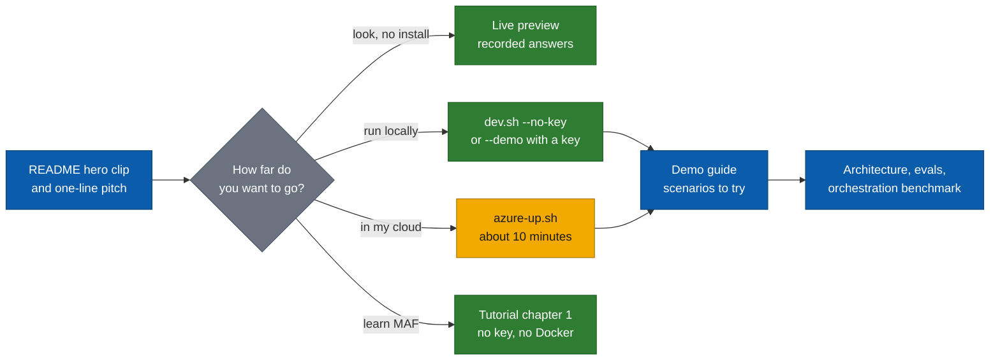

# Documentation and demo audit, November 2026

Scope: the documentation as a first-time visitor meets it, the demo media (GIFs, stills, recordings), the evaluation showcase, UI issues found along the way, and how to show the Azure deployment. Each phase was done in order and committed on `docs/audit-and-demo-assets`.

## 1. Documentation audit

### Inventory

About 29,000 lines of Markdown: the README, 52 pages in `docs/`, 14 concept pages, 38 tutorial chapters, 7 ADRs, and per-package READMEs (evals, MCP servers, .NET agents, web). `scripts/build_docs_site.py --check` passes: 117 pages, no broken links. The content is accurate on the whole. The problems are ordering and a few claims that were overtaken by events.

| Entry point | Lines | Status |
|---|---:|---|
| `README.md` | 366 | Strong opening (hero GIF, one-line pitch, what-is-in-the-box). Azure deploy was buried below the architecture diagram, and one row called it a draft. Fixed |
| `docs/index.md` (site home) | 87 | "Coming next" said Azure had never run on a real subscription. Fixed |
| `docs/README.md` | 109 | Good audience-based reading order. Overlaps the README "Where to start" table and the site home |
| `docs/quick-start.md` | 434 | Accurate, long. Fine as the second click, not the first |
| `docs/demo-guide.md` | 201 | Test users, scenarios and the screens gallery. Best page for "show me", and it already documents the recording pipeline |
| `docs/azure-deployment.md` | 112 | Short and clear, with a resource diagram, step timings and cost. The best-written page for its job |
| `agents/python/evals/README.md` | 790 | Complete but reference-grade. No visual, and no "run this one command and see a scorecard" opening |
| `docs/eval-scorecard.md` | 103 | Generated, and candid about what replay scores mean. A good asset that nothing on the front page links to |

### Stale claims fixed

PR #263 deployed and tested the one-command Azure path from a clean subscription, but seven places still said it never had:

| File | Was | Now |
|---|---|---|
| `README.md` (what is in the box) | "a draft Azure Container Apps deployment" | one-command deployment, tested from a clean subscription |
| `docs/index.md` | "has not run against a real subscription yet" | ran from a clean subscription, with a link to the page |
| `docs/roadmap.md` (item 1, section, shipped list) | "Nothing has run against a real subscription" | done for `small`; `demo`, `reference` and the APIM gateway still unrun |
| `docs/troubleshooting.md` | "None of this has run against a real subscription" | points to the findings from the real runs |
| `docs/troubleshooting.md` row 1 | "default is gpt-5.1" | the profile names the default (`small`: gpt-4.1-mini) |
| `scripts/azure-up.sh`, `scripts/azure/smoke.sh`, `scripts/azure/sanity.sh` | header comments: "not verified against a real subscription" | run as part of `azure-up.sh` |

Also kept from the earlier session: two anchor fixes (`CHANGELOG.md` to `approvals.md`, `troubleshooting.md` to the renamed "findings from the real runs" heading).

Left as written, because they are still true: `docs/releasing.md` (the CI dispatch workflow has never run), `infra/modules/gateway-apim.bicep` (optional gateway, unverified), and the Deploy to Azure button, which `azure-deployment-stages.md` calls unverified.

### The Azure deploy as a selling point

`scripts/azure-up.sh` is the strongest single claim the project can make: one command, no keys, no Docker, about 10 minutes, about 1.4 USD a day, teardown that proves itself. The README now has a section of its own, **Deploy to Azure in one command**, right after **Run it** and before the long tables. It covers the three commands, what gets provisioned, time, cost, access and re-runs, plus a row in the "Where to start" table.

### Recommended start-here path

A visitor decides in about 30 seconds. The README should answer three questions in order: what is it, can I see it now, can I run it.

### Proposed, not applied

These need the owner's call:

1. **Cut v1.5.0.** `./scripts/dev.sh --demo --no-key` pulls the 1.4.0 images, which carry no chat recordings, so every chat prompt says "not recorded". Most first-time visitors will try exactly this pairing, and the README has to explain it in an apologetic sentence. A release fixes it and lets that sentence go.
2. **One "where to start" surface.** The README table (13 rows), `docs/README.md` (reading order by audience) and `docs/index.md` (where to start) cover the same ground three ways. Keep `docs/README.md` as the canonical one, cut the README table to five rows (look, run, deploy, learn, architecture) and link onward.
3. **Shorten the README.** At 366 lines, the Codespaces paragraph (about 10 lines) and the Generative UI paragraph belong in the quick start and demo guide. The 100-line Mermaid block could become the rendered `docs/architecture.png` with a link to the diagram source.
4. **Put evals on the front page.** The eval harness, the red-team set and the keyless replay gate are a real differentiator, but the README gives them one table cell. Add a short "Quality you can check" section: one command (`scripts/replay-evals.sh`), a terminal clip, and a link to the scorecard.
5. **`docs/index.md` "Where the project is"** lists "New in 1.4". Update it at the next release.
