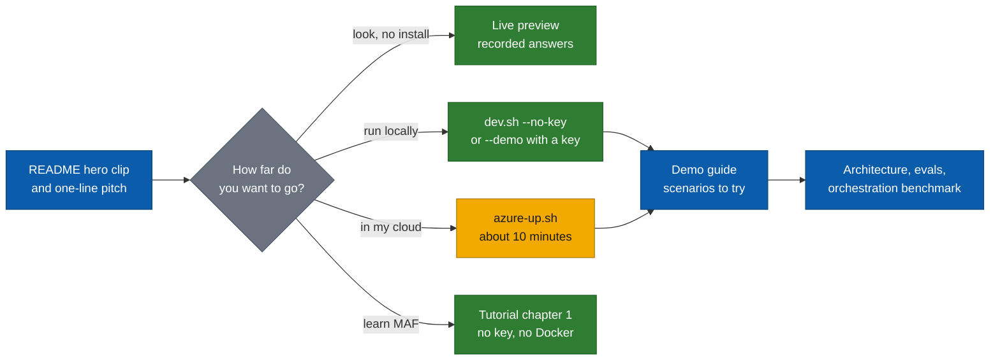

# Documentation and demo audit, November 2026

Scope: the documentation as a first-time visitor meets it, the demo media (GIFs, stills, recordings), the evaluation showcase, UI issues found along the way, and how to show the Azure deployment. Each phase was done in order and committed on `docs/audit-and-demo-assets`.

## 1. Documentation audit

### Inventory

About 29,000 lines of Markdown: the README, 52 pages in `docs/`, 14 concept pages, 38 tutorial chapters, 7 ADRs, and per-package READMEs (evals, MCP servers, .NET agents, web). `scripts/build_docs_site.py --check` passes: 117 pages, no broken links. The content is accurate on the whole. The problems are ordering and a few claims that were overtaken by events.

| Entry point | Lines | Status |
|---|---:|---|
| `README.md` | 366 | Strong opening (hero GIF, one-line pitch, what-is-in-the-box). Azure deploy was buried below the architecture diagram, and one row called it a draft. Fixed |
| `docs/index.md` (site home) | 87 | "Coming next" said Azure had never run on a real subscription. Fixed |
| `docs/README.md` | 109 | Good audience-based reading order. Overlaps the README "Where to start" table and the site home |
| `docs/quick-start.md` | 434 | Accurate, long. Fine as the second click, not the first |
| `docs/demo-guide.md` | 201 | Test users, scenarios and the screens gallery. Best page for "show me", and it already documents the recording pipeline |
| `docs/azure-deployment.md` | 112 | Short and clear, with a resource diagram, step timings and cost. The best-written page for its job |
| `agents/python/evals/README.md` | 790 | Complete but reference-grade. No visual, and no "run this one command and see a scorecard" opening |
| `docs/eval-scorecard.md` | 103 | Generated, and candid about what replay scores mean. A good asset that nothing on the front page links to |

### Stale claims fixed

PR #263 deployed and tested the one-command Azure path from a clean subscription, but seven places still said it never had:

| File | Was | Now |
|---|---|---|
| `README.md` (what is in the box) | "a draft Azure Container Apps deployment" | one-command deployment, tested from a clean subscription |
| `docs/index.md` | "has not run against a real subscription yet" | ran from a clean subscription, with a link to the page |
| `docs/roadmap.md` (item 1, section, shipped list) | "Nothing has run against a real subscription" | done for `small`; `demo`, `reference` and the APIM gateway still unrun |
| `docs/troubleshooting.md` | "None of this has run against a real subscription" | points to the findings from the real runs |
| `docs/troubleshooting.md` row 1 | "default is gpt-5.1" | the profile names the default (`small`: gpt-4.1-mini) |
| `scripts/azure-up.sh`, `scripts/azure/smoke.sh`, `scripts/azure/sanity.sh` | header comments: "not verified against a real subscription" | run as part of `azure-up.sh` |

Also kept from the earlier session: two anchor fixes (`CHANGELOG.md` to `approvals.md`, `troubleshooting.md` to the renamed "findings from the real runs" heading).

Left as written, because they are still true: `docs/releasing.md` (the CI dispatch workflow has never run), `infra/modules/gateway-apim.bicep` (optional gateway, unverified), and the Deploy to Azure button, which `azure-deployment-stages.md` calls unverified.

### The Azure deploy as a selling point

`scripts/azure-up.sh` is the strongest single claim the project can make: one command, no keys, no Docker, about 10 minutes, about 1.4 USD a day, teardown that proves itself. The README now has a section of its own, **Deploy to Azure in one command**, right after **Run it** and before the long tables. It covers the three commands, what gets provisioned, time, cost, access and re-runs, plus a row in the "Where to start" table.

### Recommended start-here path

A visitor decides in about 30 seconds. The README should answer three questions in order: what is it, can I see it now, can I run it.

### Proposed, not applied

These need the owner's call:

1. **Cut v1.5.0.** `./scripts/dev.sh --demo --no-key` pulls the 1.4.0 images, which carry no chat recordings, so every chat prompt says "not recorded". Most first-time visitors will try exactly this pairing, and the README has to explain it in an apologetic sentence. A release fixes it and lets that sentence go.
2. **One "where to start" surface.** The README table (13 rows), `docs/README.md` (reading order by audience) and `docs/index.md` (where to start) cover the same ground three ways. Keep `docs/README.md` as the canonical one, cut the README table to five rows (look, run, deploy, learn, architecture) and link onward.
3. **Shorten the README.** At 366 lines, the Codespaces paragraph (about 10 lines) and the Generative UI paragraph belong in the quick start and demo guide. The 100-line Mermaid block could become the rendered `docs/architecture.png` with a link to the diagram source.
4. **Put evals on the front page.** The eval harness, the red-team set and the keyless replay gate are a real differentiator, but the README gives them one table cell. Add a short "Quality you can check" section: one command (`scripts/replay-evals.sh`), a terminal clip, and a link to the scorecard.
5. **`docs/index.md` "Where the project is"** lists "New in 1.4". Update it at the next release.

## 2. Demo plan (decided 2026-11-27)

### Rule: no internals in the chat, for anyone

The storefront chat shows answers, cards and plain status lines to every role. Graphs, node and tool names, the agent-activity timeline, grounding badges, panelist tags, the mode switcher and Compare all leave the chat. The multi-agent story moves into two places. One is **captions and a small diagram beside each clip**, which name the agents that collaborated. The other is the **developer tools** (Aspire traces, MAF DevUI, and the staff-only /runs page), recorded as separate under-the-hood clips.

### Clips: real journeys, each with its agent story

| # | Clip | User | What the viewer sees | Agents behind it (caption + diagram, not on screen) | Fixtures |
|---|---|---|---|---|---|
| 1 | Hero: shop, ask, buy | customer | search, product cards, "which has the best reviews", add to cart, checkout | orchestrator, product-discovery, review-sentiment, pricing (coupon), inventory | partly recorded; checkout via chat needs new ones |
| 2 | Where is my order | customer | "where is my sweater order", tracking card with ETA | orchestrator, order-management, inventory-fulfillment | recorded |
| 3 | Return with approval | customer, then support | "return my Dyson", a plain "a person will review this" card; support approves in the inbox; the customer sees the refund | return-and-replace workflow, policy gate, approvals, outbox worker | workflow mode: no model needed |
| 4 | Pre-purchase advice | customer | "is it a good time to buy the XM5", one combined answer (reviews, stock, price trend, shipping) | parallel fan-out to four specialists, merged | workflow mode: no model needed |
| 5 | Seller day | seller | seller dashboard, a restock or markdown proposal, approve it | merchant-ops, proposals, approvals | needs checking |
| 6 | Under the hood | developer | the same "best reviews" turn as an Aspire trace: orchestrator, A2A calls, tool spans, tokens and cost | all, as spans | recorded |
| 7 | Evals | developer | keyless quality eval against its baseline, then the red-team suite | eval harness | done (terminal) |
| 8 | Azure in one command | developer | `azure-up.sh` progress and the provisioned resource list, redacted | azd, Bicep, Container Apps | owner records |

Return label download and printing does not exist in the product today, so it cannot be a clip until it is built.

### Handoff to the article session

Every clip ships with an entry in `docs/media/manifest.json`: id, title, one-paragraph caption, the agents involved, a Mermaid snippet of the flow, duration, alt text, and paths to the GIF (1280 px), the MP4 (2560 px) and a still. The article session takes assets and words from that file, without re-deriving them.

### Redaction (Azure and evals)

- **Deploy with fixed names.** Record with `--env eca-demo`, so resource names are generic.
- **Mask terminal output.** A `scripts/demo/redact.sh` filter in the tape pipeline masks GUIDs (subscription, tenant, object ids), email addresses, public IPs, `*.azurecontainerapps.io` hostnames and the subscription name.
- **Check before committing.** A frame OCR pass (tesseract) samples every recorded clip and fails on any GUID, email, IP, or a configured list of account words.
- **Portal screenshots.** These are taken by hand, then blurred with the same check run on them.

## Working order (revised 2026-11-27)

Recording before the UI is settled means recording twice, so the order is:

1. Docs audit: done (commit 75b431ab).
2. Product rules checkpoint: no internals in the chat for any role, staff-only /runs and /agents, customer copy, the fixes found so far.
3. UI and generative-UI review by an independent reviewer (Fable): every screen and card type, the card-selection mechanism, palette, buttons, consistency. Findings only.
4. One consolidated fix pass, verified by tests and a fresh screenshot sweep.
5. Demo content: record any missing journey answers once with the local Azure OpenAI key.
6. Recording: app clips, under-the-hood (Aspire), evals, Azure (redacted), at the locked quality settings.
7. Docs and landing README with the media, `docs/media/manifest.json`, handoff to the article session.
8. Fable proofread, new-developer read-through, final verification, push.

## 3. Evaluation showcase

`scripts/demo/tapes/evals.tape` (vhs) records two keyless runs: a specialist scored against its committed baseline, and the red-team suite. Recording it found two defects, both fixed:

- **Absolute path in reports.** "Compared against" printed the absolute baseline path, which published the reader's home directory in any pasted report or recording. It is now relative to the working directory.
- **Missing space.** The safety report printed "Injection resisted:8".

## 4. Product rules and UI fixes (checkpoint before the review)

| Area | Change |
|---|---|
| Chat, every role | Agent-name badges, the agent-activity timeline, the grounding badge, the workflow graph, the orchestration mode switcher and the Compare dialog are gone from `/chat`. The status line names what is being done for the shopper ("Checking stock and delivery..."), not an agent. All of it moves to a staff-only Lab (`/lab`), the same `ChatView` with `devView`, because the course teaches against it |
| Guest assistant (/shop/assistant) | Same removals |
| /runs, /agents | Staff only (support, admin): moved to the Admin nav group, and the page itself refuses others (`components/staff-only.tsx`) |
| Customer copy | Home, shop, login, chat empty state and the scenario cards no longer talk about specialists, agents or orchestration. Two fake home stat tiles ("6 Specialist Agents", a hard-coded "~1.2s" response time) and an "Agent activity coming soon" card are removed |
| Tour chips | "Handoff mesh - track my order", "Pre-purchase research" and "Round-table debate" are relabelled as shopper questions |
| Pre-purchase answer | Was one pipe-joined line, and "could not check: price_history" leaked a state key. It is now a markdown list with readable names, on both stacks |
| Answer markdown | The `prose` classes never applied (`@tailwindcss/typography` was never installed), so lists had no bullets and headings, tables and code were unstyled. Elements are now styled explicitly |
| /runs | A paused run showed a green check beside "Needs approval"; it now shows a pause icon |
| Sidebar | The footer (user name, sign out) was clipped on short screens: the nav scroll area needed `min-h-0` |
| Chat empty state | The quick prompts appeared twice (list and composer) |
| Parity e2e | Mode, graph and compare checks now run against the API, which both stacks still serve |
| Obsolete | `scripts/record-demo.sh`, `readme-gif.spec.ts` and `demo-recording.spec.ts` are replaced by `scripts/record-media.sh` and `demo-media.spec.ts`. `chat-new-after-compare.spec.ts` now runs against the Lab |
| Duplicate answer | One answer rendered twice: two stream handlers each appended the assistant message, coordinating through a flag set inside a state updater. One upsert now checks inside the updater |

Verified: answer text across all 316 recorded fixtures names no tool and no agent. Role scoping is enforced server side: the route matrix, role-aware prompts, guardrails, ownership checks, and the rule that permissions come only from the authenticated role.

### Open, for the review and later steps

- **Stale sentiment recording.** The review-sentiment chart prompt no longer replays: its tool buckets by month relative to today, so the recording went stale. It needs re-recording (step 5).
- **Hard-coded Aspire link.** The /runs "Aspire" link points at `http://localhost:18888` even on a deployed stack.
- **Landing page wording.** The public landing page (`/`) still says "Meet the agents". It is the project's pitch page, not the store, so this is the owner's call.

## 5. Final passes (2026-11-27)

**Seed and recordings.** Product ratings now come from the seeded reviews (the XM5 showed 4.7 over reviews averaging
3.9). That moved every recorded answer that quotes a rating, so the product-discovery evals (baseline 96.7%) and the
whole demo set were re-recorded: 46 manifest turns into an empty directory on a fresh database, then a
pure replay in reverse order with no miss. Two takes were re-recorded by hand: an Allbirds search where the model sent
an unsupported `brand` argument and found nothing, and one that quoted a product id with a group missing. Every id
quoted in an answer was then checked against the database. The return journey now uses whole-order wording.

**Proofread (Fable) and new-developer read, applied.**

- README leads with the command that works today (`./scripts/dev.sh --no-key`, tour account); `--demo --no-key` gets
  recordings with the next release. "Where to start" sits under the clips. The Azure section is shorter, "clean
  subscription" appears once, the teardown row says where the env name comes from.
- Counts and claims: two modes in the Lab clip, three fan-out branches then shipping, evals run on PRs that touch
  agent or eval code, roadmap marks the Azure run and .NET 11
  done and calls the budget an alert, not a cap. Eval cost is labelled an estimate.
- Demo guide: one accounts table (power user and tour added), the return steps under their own heading, the stale
  demo-clip reference removed, the duplicate `flow-refund` still dropped. Quick start's dead `#test-users` link fixed.
- Tooling: `record-media.sh` refuses a stack without `/api/demo/tour` (only the no-key overlay enables it), the
  superseded `readme-screenshots.spec.ts` is deleted, `azure-*.sh --help` prints clean text, `azure-down.sh` lists the
  local environments when `--env` is missing (it never guesses: it deletes), azd's role-assignment preflight warning
  is documented as harmless, and `scripts/demo/README.md` lists every script.
- UI: the Compare dialog's mode chips were clickable spans; they are toggle buttons with `aria-pressed`. The media spec
  selects modes by that state, so the Compare still no longer films a replay-miss card.

**A leak the specs caught.** Fixing the stale e2e assertions turned up a real one: the admin and seller greetings said
"I'm your customer support orchestrator", because the prompt's first line named the role and told the model to introduce
itself. The prompt now says shopping assistant and forbids the words; the demo set (160 fixtures) and the orchestrator
eval fixtures were re-recorded, unreachable eval fixtures removed with a one-off hit log (not committed), every baseline
reproduced, and an audit of every recorded reply found no internals and no wrong "couldn't find".

**Left for the owner.** The CHANGELOG's Unreleased "Added" list carried duplicate bullets before this branch (the
merchant-ops entry three times, and others twice); worth a cleanup before cutting 1.5.0. Cut v1.5.0 after merge so
`--demo --no-key` ships the recordings.
