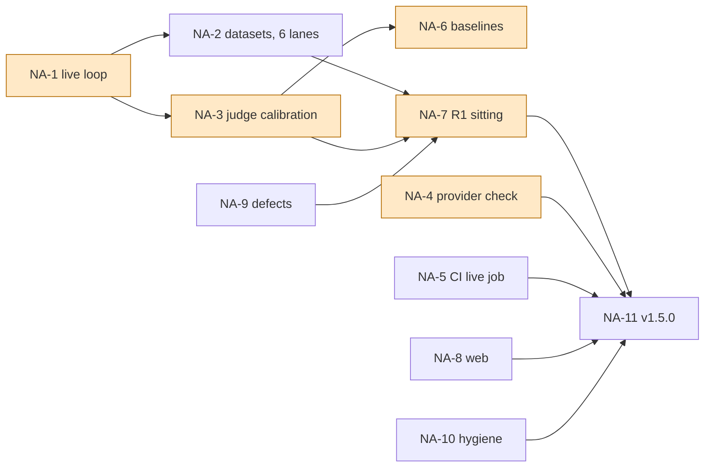

# PLAN — the one plan file

> Repo-committed working artifact, per the "Working Artifacts Location" rule in the project
> `CLAUDE.md`. **This is the only plan file.** It used to be twenty, then nine; the rest are in
> git history, which is where finished plans belong.
>
> The published, reader-facing version of the forward work is
> [`docs/roadmap.md`](../../docs/roadmap.md). This file is the working detail behind it: blockers,
> acceptance criteria, and the constraints that have already cost us time.

**Status: 2026-11-23.** v1.4.0 is published; the next release is v1.5.0 (NA-11). The live blocks are the
[Consolidated plan, 2026-11-20](#consolidated-plan-2026-11-20) (its "Status, 2026-11-23" and "Non-Azure plan, 2026-11-23"
blocks) and the [Execution plan, 2026-11-21](#execution-plan-any-provider-evals-azure-foundry-and-the-ai-gateway-2026-11-21).
Part III is the constraints that still bite. Parts I and IV's build log are now a short [History](#history) note: git holds
them (`git show 4ca4601:.claude/plans/remaining-work.md`). The LangGraph backend (LG1 to LG3) stays parked by maintainer
decision. The Azure deployment is the last item, not the first.

## Consolidated plan, 2026-11-20

Checked against `main` at `f380bba` (#157 DevUI is the newest commit). **This block supersedes the
ordering in Part II and the Phase B text in section B below (Part I is now summarised under History).** Parts III and IV stay as the
constraints and build log. Git holds no half-done work: no open PRs, no stashes, no extra worktrees,
and one stale branch (`docs/readme-accuracy-audit`, July, 398 commits behind, superseded by #82).

### Progress, 2026-11-21

Built and merged since the plan was written (PR numbers are in `git log`): docs sync (#159); `setsid` portability (#160) and its cleanup fix (#189);
SEED-D root cause, which was CPU-dependent pgvector float32 arithmetic and not seed nondeterminism (#161), with the .NET twin (#174);
YAML-1 (#162); B-15 history compaction and SAN-2 (#163, .NET half #175); Azure P1 `db-init` (#164), I1 infra skeleton (#165), I2 to I4
apps, scripts, smoke and the gated deploy workflow (#172), P2 runtime knobs (#176); CI: secret scan, MAF canary, badge check and the
mixed-stack boots (#166); a return-label wildcard leak fixed on both stacks (#167); signing-key rotation and the route/credential matrix (#168);
the pre-demo UI pass (#169) and WEB-T/WEB-S (#177); `--no-key` demo mode and the capstone `run.sh` (#170); a flaky .NET env-var race (#171);
tutorial notebooks 01 to 04 (#173); the Aspire AppHost (#178); the eval scorecard (#184), model providers guide (#185), tutorial fixture rehash (#186)
and the Durable Task spike (#187, recommendation: keep the current design).

Open: Azure P3 managed identity (#191); the .NET approval-timeout worker (NET-36, parity row 36); #180, a prerelease `Azure.AI.OpenAI` bump
that needs a maintainer decision (only the native client path is affected; the adapter the agents use is not).

Corrections to this plan found while building it: a return over $500 routes to `manager`, which `support` cannot decide, so the deploy smoke test
picks the decider from the approval's `assigned_role`; the mixed `net-py` stack crashed the Python specialists on an empty `DB_POOL_*` value until
the settings treated blank as default; dependency review needs Dependabot alerts and the dependency graph enabled in the repo settings (an owner
setting), so that workflow is not added.

Still needing a human: D-1 (Azure spend), a fresh `az login` and a real first deploy; the R0 recording session (demo GIF, tutorial fixtures);
a live-model eval run; #180; enabling Dependabot alerts and the dependency graph.

### Status, 2026-11-23

Written after taking in every session's open work. Main is green; verify with `gh pr list` before trusting the open-PR list below.

**Built and merged since 2026-11-21** (offline-verified unless stated): execution-plan M1 EV-0/1/3/4/10/11/13 run records, repeats, separate judge,
provider check and setup-keyed baselines (#202), pricing file and token budget (#200, #201, #203, #206), M2 run profiles, doctor and startup line
(#207), EV-8 Foundry evaluators adapter and EV-14 community results (#216), AZ-2/AZ-3/AZ-5 Foundry project, APIM gateway and per-app identities
modules (#213), AZ-4 gateway headers (#214), I6/I7 reference profile (VNet, private endpoints, managed Redis, ACR), `stack=dotnet`, build from
source, per-app identity wired (#223, smoke fix #236), ADR 0006 Foundry hosted agents, Proposed (#212), `NET-36` (#194), P3 managed identity (#191),
v1.4.0 cut and announced (#193, #205), the docs passes (#195-#199, #211), web fixes (#217, #219, #221). Orchestrator groundedness scoring (#220) and live-capable
datasets (#222) came out of the first live-model eval. **#215 (EV-2 http target and the B2 parity job) has landed**: parity row 53 and the CI job `stack-parity` exist. Dependabot is on: #224, #225, #227-#230 merged.

**What the first live eval found** (Azure gpt-5.1, judge gpt-4.1-mini, about 1 USD; records in the session scratchpad, not committed):
1. Hard-coded order ids never exist on a seeded DB and the runner's default user is never seeded, so live runs measured the not-found path. Fixed for live runs
   by `evals/live_facts.py` and `evals/datasets/live/*.live.json` (#222); replay datasets and fixtures are untouched and stay valid.
2. Orchestrator groundedness 0 was a scoring limit (its ledger is empty across the A2A hop), not fabrication. Fixed in scoring only (#220). `GroundingLedger` did not record `min_spend`, `max_discount`, `discount_value`, so the pricing specialist also scored 0 on deal amounts: **fixed in #242**. **Still open (PR 266, in review):** the .NET workflow
   mode reports an unverifiable amount where Python workflow modes send no grounding frame (the parity comparison skips grounding-dependent means for that reason).
3. Pricing case 1: `validate_coupon` needs `cart_total` and the pricing agent has no cart tool, so asking is correct. Decision needed: cart tool, optional
   `cart_total`, or a live case that states a total. Any code change invalidates fixtures.
4. A parked `cancel_order` (approval-gated) writes `tool_approval_requests`, which the harness never counts, so the live cancel case cannot pass. **Fixed** (#241, #249, #258: the harness sees the park and the host now makes it durable).
5. "Show me my recent orders" renders cards from context with empty items, address and tracking: a likely agent defect (RecentOrdersProvider shortcut). **Fixed** (#240; the .NET id truncation in #248).
6. Pricing and product-discovery suites still run as `eval@example.com` in live mode; add live variants. Live `cancel_order`/`initiate_return` write for real: reseed between runs. **Fixed** (#241, #249, #253).

**Remaining, by who can do it**

| Owner | Item |
|---|---|
| Code, keyless | See "Status of the Non-Azure plan" below; the findings above are fixed or in review. Dependabot: #226 `@types/node` 26 needs a maintainer call (declined by policy, `docs/contributing-dependencies.md`) |
| Docs | #182 visuals (README GIF, live graph mid-run, Aspire trace, retake `docs/images/mode-compare.jpg`, which shows the pre-#219 dialog) |
| Machine, no spend | M0: `az login`, quota check, OIDC app, public GHCR; the `.NET` image smoke legs have only run on PRs |
| Machine, spend (approved, bounded) | M3 recording sitting R1 (fixtures, demo GIF, C-8/C-10/C-11, tutorial fixtures); M4 first real Azure deploy (I5); then re-run the live eval on the new datasets, 1 to 2 USD |
| Maintainer | D-6 reading in ADR 0006 and spike thresholds, return-label token strength, #180 decision, pricing finding 3, #226. v1.4.0 is published (#205); Dependabot is on |
| After a real deploy | M5 Foundry foundation on a live subscription, M6 gateway attribution check, M7 hosted-agent spike (ADR 0006 S1-S12; D-6 cannot be met literally, orchestrator REST/SSE routes cannot move), M8 injection comparison and publish |

### Non-Azure plan, 2026-11-23

Everything left that does not need an Azure subscription, in the order it should be built. Azure work (M0, M4 to M8, the Bicep
first-run and no-role-assignment mode) is a separate track and is not repeated here. Sizes are engineer-days of agent work; "key"
means a model call is made and "R1" is the one recording sitting everything keyed is batched into.

**Revised order, set by the maintainer on 2026-11-23.** Everything is finished and verified first; the Azure deployment is the last step.

1. **Use what the environment already has.** All evaluation, Foundry-evaluator and live runs use the Azure OpenAI variables in the
   local `.env` (`AZURE_OPENAI_ENDPOINT`, `AZURE_OPENAI_KEY`, the chat, mini and embedding deployments), read by name only and never
   by sourcing the file. No Azure resource is created, and nothing else in `.env` (the AD app, search, document intelligence) is used.
   Foundry features that need an Azure credential rather than a key (`--log-to-project`, the Foundry safety evaluator, hosted agents)
   wait for the deployment phase on the new account.
2. **Azure deployment is last.** It starts only after every NA item below is merged, the docs audit (NA-12) is clean, and v1.5.0 is
   ready. The new account is a personal free trial with a hard limit of 5 USD and free resources only (no APIM, no Managed Redis,
   no ACR, no private networking; the demo profile with the budget module set to 5, public GHCR images, and a model provider the trial
   can afford); a `what-if` and a cost estimate come before any create, and teardown follows the smoke test. The first-deploy
   checklist in `docs/azure-deployment.md` is the runbook.
3. **Documentation stays in step with every merge** (NA-12): work that came from other sessions, the live-eval findings, the new
   harness features and the dependency policy are reflected in the docs as they land, not at the end.

**NA-12 Documentation consistency (runs alongside every item, final audit before the deployment).** The repo is open source, so the
docs keep one standard: plain direct prose, no emojis, Mermaid for diagrams, a "Gotchas" or "Known issues" section where one
applies, tables that render on GitHub, every page in the docs nav, and no stale claims.
- **Per merge:** the PR that changes behaviour updates its page in the same PR; the `docs-sync` check (CLAUDE.md, README.md,
  `docs/`, parity matrix, CHANGELOG) runs against main after each wave and any drift becomes a fix PR, not a note.
- **Pages to bring up to date with what was built:** `evals/README.md` and `docs/agent-quality.md` (live datasets, multi-turn,
  parked approvals, ledger fields, groundedness meaning, judge calibration, baselines), `docs/model-providers.md` (live capability
  results), `docs/contributing-dependencies.md` (merge helper, policy), `docs/azure-deployment.md` (optional note, first-deploy
  checklist, free-tier path), `docs/approvals.md` (parked tool calls, if the cancel investigation changes behaviour),
  `docs/parity-matrix.md` (row numbers and the summary counts), `docs/roadmap.md` and the README "What's next",
  `.claude/HANDOVER.md` progress log, `CHANGELOG.md` read as release notes, and the tutorials that quote changed behaviour.
- **Final audit (acceptance for NA-12):** `python3 scripts/build_docs_site.py --check` and the tutorial checks pass; no broken
  links; every claim about a number (rows, cases, scores, costs) is regenerated or dated; the parity matrix summary equals the
  table; no document names a cloud account, tenant, subscription or resource group; the README quick start works from a clean
  clone with no Azure; a reviewer who knows none of the history can follow the contributor docs.

**Workstreams**

| ID | Work | Size | Key | Depends on |
|---|---|---|---|---|
| NA-1 | Live-eval quality loop: finish round two of the live datasets, rescore with the grounding-ledger fix, one clean full live run, commit nothing but the datasets and the scorecard wording | 1 | live, about 2 USD | live-dataset round-two lane |
| NA-2 | EV-5 datasets: 30 to 50 cases per agent, multi-turn, about 50 adversarial, as live variants first, replay twins after R1 | 4 | authoring none, R1 for twins | NA-1 |
| NA-3 | EV-3 judge calibration (D-7): about 30 hand-labelled responses, two or three candidate judges, agreement reported, one chosen and documented | 1.5 | live, about 2 USD | NA-1, your labelling time |
| NA-4 | EV-10 live capability check on every provider a key or local model exists for, results into `docs/model-providers.md` | 0.5 | live, under 1 USD | none |
| NA-5 | EV-6 rebuilt `full` CI job: dispatch only, provider and model as inputs, records uploaded as an artifact, no schedule and no PR trigger, Azure OIDC left as a documented hook | 1 | none to build | none |
| NA-6 | EV-11 reference baselines: live runs, k=3, through the http target, on the model(s) you choose; baselines keyed by setup | 1 | live, about 2 USD per model | NA-1, NA-3 |
| NA-7 | R1 recording sitting (batched): order-management prompt guard and its 15 fixtures, Alice seed post-pass and her fixtures, the NA-2 replay twins, tutorial fixtures, the items in "Needs a live key" | 3 | record, cap 5 USD | NA-2, NA-3 |
| NA-8 | Web: "New chat" after Compare (Playwright repro, then fix), issue #182 visuals (README GIF, live graph mid-run, Aspire trace, Compare screenshot retake) | 2 | none | none |
| NA-9 | Product defects and parity leftovers (list below) | 2 | none | none |
| NA-10 | Dependency and CI hygiene (list below) | 1 | none | none |
| NA-11 | v1.5.0: scope, changelog, release notes, docs and scorecard sync; cut after R1 | 1 | none | NA-7 |
| NA-12 | Documentation consistency: per-merge updates, `docs-sync` after each wave, final audit before the Azure deployment | ongoing, 1 for the audit | none | every item |
| AZ-LAST | Azure deployment on the new free-trial account (5 USD cap), after NA-1 to NA-12 | 1 to 2 | trial credit | NA-11, NA-12 |

**Status of the Non-Azure plan, 2026-11-23** (verify with `gh pr list`; "in review" means an open PR, not merged):

| Item | State |
|---|---|
| NA-1 | Round two of the live datasets merged (#249); the clean full live run on the grown datasets is still to do |
| NA-2 | Live datasets merged: orchestrator 30 (#254), inventory 28 (#259), product discovery 25 (#253), review sentiment (#255). In review: pricing (#256), order management (#267). Multi-turn cases (`turns`) merged (#252), verifier and harness gaps (#261). Replay twins wait for R1 |
| NA-3 | Judge calibration in review (#268; the default judge unchanged) |
| NA-4 | Provider capability results in review (#269) |
| NA-5 | Done: the rebuilt manual live job (#250) |
| NA-8 | (a) "New chat" after Compare done (#251). (b) The #182 visuals are still to do |
| NA-9 | Items 2 and 3 done (#248). Item 1, the Python grounding frame, and the tie-break and `pending_requests` items are in review (#266). Tool fixes D1 to D4 merged (#260), parked gated calls made durable (#258) |
| NA-10 | Done: dependency policy and the hardened merge helper (#247) |
| NA-12 | Audit fixes in review (#265 and the follow-up groups); the `CHANGELOG.md [Unreleased]` regrouping waits for every PR to merge |
| NA-13 and AZ preparation | In review: public presentation plan (#262), the free-trial Azure profile, sanity script and Deploy to Azure button (#263), Codespaces secrets and provider derivation (#264). The deployment itself stays last (AZ-LAST) |
| NA-6 | Partly done, 2026-11-24: `gpt-4.1` k=1 live baselines (judge `gpt-5.4-mini`) for all six suites under `evals/baselines/python-inproc-gpt-4.1/`. Pricing and inventory re-run after the ledger fix. Still to do: k=3 and the http target, the `gpt-5.x` mini contrast model, the deliberate-regression check |
| NA-7, NA-11 | Not started: they wait on the datasets and the R1 sitting |

**NA-1 Live-eval quality loop.** The round-two lane fixes the cancel case (empty response, pause not detected), the Dyson restock
assertion and the loyalty-tier expectation. After it merges: rescore the stored pricing records with `--rescore --verify` (the
ledger fix should lift groundedness from 0.37), run the six live suites once more, and require every suite at or above its
threshold before NA-3 starts. Acceptance: six live suites pass at the default threshold on one setup, the run records are kept in
the scratchpad (not committed), and `docs/agent-quality.md` states the live numbers with the setup that produced them and the date.

**NA-2 Datasets (EV-5).** Author per agent as `evals/datasets/live/<agent>.live.json` so no fixture is touched. Case types and the
minimum per agent: 10 happy path, 8 edge (empty results, ambiguous names, boundary amounts), 6 multi-turn, 6 adversarial
(injection in product text, role escalation, other customer's order id, over-limit refund, coupon abuse, prompt leak), the rest
free. Every case carries a one-line `why` field. Six lanes, one per agent, file-disjoint so they merge without conflict. Acceptance:
schema tests pass; every placeholder resolves on a freshly seeded database; no case depends on write state left by another case
(reseed rule); the scorecard shows case counts by type; `evals.fixture_drift` stays exit 0 until R1.

**NA-3 Judge calibration.** I draft candidate labels (pass or fail per expected field, with the reason) for 30 stored live
responses across suites; you confirm or flip each one, which is about an hour. Candidates: `gpt-4.1-mini`, `gpt-4.1`, and one
`gpt-5.x` mini from the available deployments. Report agreement per judge against your labels and the cost per 100 judgements.
Acceptance: `evals/judge_calibration/` holds the labelled set, the script, and the result table; the default judge changes only if a
candidate beats the current one by a margin written down in advance (at least 5 points of agreement).

**NA-4 Provider capability check.** Run `evals.provider_check` on each reachable provider: the Azure deployments, an OpenAI-compatible
local endpoint if one is running, OpenAI direct if a key is supplied. Record tool calling, parallel calls, tool-result handling,
structured output and streaming per model. Acceptance: the table in `docs/model-providers.md` is regenerated from stored results
with their dates, and providers that were not run are marked "not run", never guessed.

**NA-5 CI live job.** Rebuild the `full` job in `.github/workflows/evals.yml`: `workflow_dispatch` only, inputs `provider`, `model`,
`repeats`, `suite`; secrets read from repository secrets; records and the scorecard uploaded as artifacts; a spend ceiling via
`COST_BUDGET_TOKENS_PER_RUN`. A test fails the build if the workflow gains a `schedule`, `pull_request` or `push` trigger on a job
that reads a model key. Acceptance: `actionlint` clean, that test exists, and the doc in `evals/README.md` says how to dispatch it.

**NA-6 Reference baselines.** Live runs at k=3 through the http target against a locally booted stack, per model you choose
(proposal: `gpt-4.1` as the stable reference, plus the cheapest current `gpt-5.x` mini for contrast). Baselines live under
`evals/baselines/<setup>/` and the scorecard states which baseline a run was compared with. Acceptance: re-running a suite
reproduces its baseline within the stated spread, and a deliberate regression (a worsened prompt on a branch) turns the gate red.

**NA-7 R1 sitting.** One session, one cap (5 USD, a hard stop in the script), one fixture family at a time with `fixture_drift`
and `scripts/replay-evals.sh --setup` run between families. Order: (1) order-management prompt guard ("never render an order card
from the context summary") and the 15 order-management fixtures; (2) Alice seed post-pass (modelled on `seed_tour_user`, drawing
nothing from the global random stream) and the Alice fixtures; (3) NA-2 replay twins; (4) tutorial fixtures; (5) the remaining
"Needs a live key" items, taking only what is cheap and unblocks something. Acceptance: replay gate green, zero fixture misses,
`fixture_drift` exit 0, each fixture family in its own commit so a bad one reverts alone.

**NA-8 Web.** (a) Reproduce "New chat" after Compare with Playwright first (the backdrop-after-exit hypothesis in
`web/src/components/ui/dialog.tsx`), fix, keep the spec. (b) #182 visuals through browser automation against the running demo
stack: README GIF of one chat turn with the live orchestration graph, an Aspire trace screenshot, a retake of
`docs/images/mode-compare.jpg` (it shows the pre-#219 dialog). Acceptance: the spec fails before the fix and passes after, images
are under 300 KB each, and the README renders them on GitHub.

**NA-9 Product defects and parity leftovers.**
1. Python workflow modes send no `grounding` frame while .NET does (it reported an unverifiable amount in the parity run). Decide:
   emit a grounding report from the Python workflow modes (preferred, so the gate can compare it) or drop it from .NET. Either way
   parity row 53 stops needing the grounding exemption.
2. .NET `RecentOrdersProvider` truncates order ids to 8 characters, so the model cannot pass the id to a tool. Send the full id.
3. Tutorial 22's .NET copy of the group-chat moderator still uses the old one-line wording; align it and its test.
4. `compose` aspire-dashboard image is still the 13.6.5 tag; check for a 17.x image and bump if it exists.
5. #237's remaining `Npgsql` 8.0.9 `VersionOverride`: find where it lands and whether it is still needed.
6. #226 `@types/node` 26: decide (see Decisions).
7. The net-py mixed-stack boot job failed once and passed on re-run: add a bounded retry with a logged reason, or find the race.
8. Cancel with an empty response (round-two lane): if it is a product defect, fix it with a regression test.

**NA-10 Dependency and CI hygiene.** Write the Dependabot policy into `docs/contributing` (patch and minor grouped and merged when
green; a major version gets one human-reviewed PR); stop the merge watcher merging a PR whose head SHA changed after its checks
started (the #223 lesson); keep a short runbook for conflicting CHANGELOG and parity-matrix edits (keep-both rule); remove merged
worktrees and branches that this effort created. Acceptance: policy page linked from `CONTRIBUTING.md`, watcher script committed
under `scripts/` with its SHA check and a test.

**NA-11 v1.5.0.** Scope: run records and profiles, pricing file and token budget, gateway headers, Foundry evaluators and community
results, http target and parity gate, live datasets and the grounding fixes, Aspire 17, the web fixes. Cut after R1 so the replay
fixtures in the release match the prompts in it. Acceptance: changelog entry reads as release notes, docs site and scorecard are
current, the release workflow is run by you (the approval click stays yours).

**NA-13 Public presentation: the GitHub landing page and the documentation site (reviewed in a browser on 2026-11-23).**
The repository is the one the maintainer will promote for the long term, so how it renders to a first-time visitor is part of the
product. A Playwright review of the signed-out GitHub page and of the published docs site found:

| ID | Where | Finding | Fix |
|---|---|---|---|
| PR-1 | README line 12, GitHub landing | The "Open in GitHub Codespaces" badge is 249 by 32 px, a dark pill, while the other nine badges are 20 px flat shields. It wraps onto its own row and looks out of place. | Render it at the same 20 px height as the others (an `` inside the link, or a shields.io badge of the same style linking to the same codespaces URL) and keep it on the first badge row. |
| PR-2 | GitHub repo settings | No social preview image: `open_graph_image_url` is empty, so links shared on social media and in chat show GitHub's generic card. | Add a 1280 by 640 social card (name, one-line pitch, the orchestration diagram) as `docs/images/social-card.png` and set it in Settings, General, Social preview. The upload step is manual; the image and its source are ours. |
| PR-3 | GitHub About box | The description is accurate but long (the sidebar wraps it to nine lines), and the homepage link text is truncated. Twenty topics is GitHub's maximum, so none can be added without dropping one. | Shorten the description to one sentence under about 160 characters; keep the long version in the README. Review the topic list once for search value (for example `maf`, `agent-evaluation`, `llm-evals` against less useful ones). |
| PR-4 | docs site (Just the Docs, published at the maintainer's domain) | No favicon (`/favicon.ico` is 404 under the site path; the domain root has one). The site title wraps onto two lines in the sidebar header and touches the border at desktop width. The accent colour is the theme's default purple, which does not match the project's professional palette (blues and teals). A nav entry in the Architecture group renders as a lone infinity glyph in the screenshot, and two pages share the title "Architecture". | Add a favicon and a logo; set a custom colour scheme (teal and blue links, neutral sidebar); shorten the site title or widen the sidebar title area; find and fix the infinity-glyph nav entry and give the section index and the page distinct titles. |
| PR-5 | docs site, Mermaid | All 61 pages with a Mermaid block render (no raw blocks), but wide diagrams such as the system-overview one are scaled so small the labels are unreadable at 1440 px. | Give wide diagrams a horizontal-scroll or click-to-enlarge wrapper, and split the system overview into two diagrams (tiers, then the data path). |
| PR-6 | docs site, navigation | `azure-deployment.md` and `auth-route-matrix.md` are not in the nav, so they are not published. The site check passes anyway. | Add both to a section and make `scripts/build_docs_site.py --check` fail on any page outside the nav (also finding X-1 of the docs audit). |
| PR-7 | docs site, metadata | Every page's `og:image` is the same old `agent-timeline.png`. | Use the social card from PR-2 as the site default and let a page override it. |

What the review found clean: all 109 nav pages return 200, no page shows raw front matter, no image is broken, every Mermaid block
renders, and the mobile home page reads well. Acceptance for NA-13: a Playwright script (kept under `scripts/` so it can be rerun
before each release) screenshots the GitHub page and the site at desktop and mobile widths, asserts every badge on the first row is
the same height, asserts every nav page returns 200 with a rendered diagram where a diagram exists, and fails on a missing
favicon or social image; the before and after screenshots go in the PR description.

**Azure preparation branch (parallel, no deployment), revised 2026-11-23.** The deployment spins the whole stack, Foundry
included, on the personal free-trial account; only the Foundry model costs real money, so it uses a low-cost deployment
and the budget cap is 7 USD (the first 5 plus up to 2 for Foundry, raised only if a measured need appears). Postgres Flexible
B1ms is spun too (the free account is expected to include about 750 hours of it, still to be verified), with Container Apps,
Key Vault, Log Analytics, monitoring and the budget alerts. The branch delivers, without creating anything:
1. The `free-trial` profile with the Foundry account, project, a cheap chat model and the smallest embedding model, and a cost
   table dated from Azure's public price list.
2. `scripts/azure/sanity.sh`, the last step of a deployment: database connectivity and content, a direct call to the deployed
   Foundry model, one full application turn through the deployed orchestrator that touches a specialist and the database, and a
   small evaluation run through the http target (cost cap about 0.10 USD). PASS or FAIL per check, no keys printed, nothing deleted:
   teardown is a separate, explicit step the maintainer takes after reviewing the results, and a failed step prints what exists and how
   to continue or clean up, so no half-built state is left unexplained.
3. A "Deploy to Azure" button in the README (generated `infra/azuredeploy.json` kept in sync by a test, the portal link, the
   `azd up` path beside it, a cost warning, and an honest statement of what the button cannot do without `azd` hooks).
4. The ordered deployment sequence, read-only `what-if` and `validate`, and a rehearsed teardown.
The real deployment still waits for NA-1 to NA-12.

**NA-14 Local end to end, then Azure (maintainer decision, 2026-11-23).** The next goal is to prove the whole project works
on a laptop before any Azure layer is added. Live evaluator runs inside CI are not a gate for this: the manual CI job
(NA-5) is built and tested for trigger safety, and a user who wants it supplies their own keys as repository secrets; if the
same suites pass locally with the same inputs, that is the evidence. The order is: (1) land the open PRs through the serial
merge queue; (2) a completeness audit lists every half-built or never-exercised feature outside the Azure deployment; (3) each
item is finished or explicitly recorded as out of scope with its reason; (4) one full local verification pass; (5) the docs
audit fixes (NA-12) and the public-presentation fixes (NA-13); (6) Codespaces guidance (NA-15); (7) only then the Azure deployment.
The full local verification pass is: clean `dev.sh` build and seed, the replay gate (`scripts/replay-evals.sh --setup`),
`fixture_drift`, the whole Python and .NET suites, the Playwright e2e specs, the mixed-stack boots, the tutorials keyless
runner, the live quality suites on the keys in the local environment (read by name), and the multi-turn and http-target runs.
It needs ports 8080 to 8085, so it starts when the other session's demo stack is stopped.

**NA-15 Codespaces: one click, and clear guidance on keys.** The badge is fixed to the same height as the others (NA-13 PR-1).
The devcontainer is checked to build and start the stack key-free, and the README, the quick start and a Codespaces section of
`docs/configuration.md` say how a user supplies model keys the safe way: as Codespaces secrets (repository or personal
settings), declared in `devcontainer.json` under `secrets` so the creation screen prompts for them with a description, never
committed and never put in `.env` in the repo; which variables each provider needs (`OPENAI_API_KEY`, or the Azure OpenAI
endpoint, key and deployment names, or an OpenAI-compatible base URL), how to set them after the Codespace exists (add the secret,
then rebuild or reload the environment so it is injected), how to verify with `python -m scripts.doctor`, and that without
a key the stack runs in replay mode. Acceptance: the devcontainer builds in Docker locally; the doctor command reports the
provider from the injected variables; a user who has never seen the repo can follow the section from the badge to a working chat.

**Order and parallelism**



Wave A (now, all parallel, no key unless noted): NA-1, NA-5, NA-8, NA-9, NA-10, and the NA-2 authoring lanes once NA-1's mechanism
is confirmed. Wave B: NA-3 (needs your labels), NA-4, NA-6. Wave C: NA-7 then NA-11. NA-9 item 1 must land before R1 because it can
change what the workflow modes send and therefore what is recorded.

**Tests.** Every item adds tests with the change: dataset schema and placeholder-resolution tests (testcontainers) for NA-2; a
trigger-safety test for the live workflow (NA-5); a Playwright spec that fails before the fix (NA-8); regression tests for each
NA-9 defect; a watcher SHA-check test (NA-10). The merge gate stays: ruff, `fixture_drift` exit 0, replay gate, `pytest`, the docs
check, and the .NET suite when .NET changes.

**UI impact.** NA-8 only: the Compare dialog exit behaviour and new screenshots. NA-9 item 1 may add a grounding indicator to
workflow-mode answers; if it does, the web client's `onOrchestrationEvent` path already ignores unknown frames, so no UI change is
required, but the chat page needs a visual check.

**Seed data.** NA-7 adds one post-pass after the existing seeding steps (Alice's latest order set to delivered with a matching
history row, drawing nothing from the global random stream) so the 15 Alice fixtures are re-recorded once, not many times. NA-2
cases use only seeded users and products by name through placeholders; no new seed rows. No migration is planned.

**Config and env.** No new settings except the NA-5 workflow inputs. `.env.example` and `docs/configuration.md` change only if
NA-9 item 1 adds a flag. Live runs read only `AZURE_OPENAI_*` and `JUDGE_*`; the repo `.env` is never sourced whole.

**Spend (all approved earlier, bounded):** NA-1 about 2 USD, NA-3 about 2, NA-4 under 1, NA-6 about 2 per model, NA-7 capped at 5.
Total about 12 to 15 USD, one-off.

**Risks.** The R1 sitting is the only step that can invalidate the replay gate for everyone, so it goes last and family by family.
Judge calibration depends on your hour of labelling; if that slips, NA-6 baselines use the current judge and say so. NA-2 can
inflate CI time: live variants never run in the PR gate.

**Decisions I need from you** (none block Wave A): (1) models for the reference baselines (proposal above); (2) 5 USD cap for R1;
(3) the hour for judge labels, or say "use my labels as drafted" to skip it and mark the calibration as unreviewed;
(4) NA-9 item 1 direction (emit grounding from Python workflow modes, preferred); (5) #226 merge or close; (6) v1.5.0 scope.

### Decisions needed first

1. **R0 recording session ($1-3).** Cheapest unblock: C-8, C-9b, C-10, C-11, C-18 and the tutorial fixtures wait on it.
2. **D-3, .NET parity line.** Decides NET-36, B-18 and the .NET halves of B-15, B-16 and D-5b.
3. **D-1, Azure spend ceiling: approved 2026-11-21, spend as needed.** See the execution plan.
4. **Chat model on Azure: gpt-5.1 (approved 2026-11-20).** gpt-4.1 is closed to new customers; it stays an override.
5. **LangGraph (LG1-LG3) stays parked.** #103 recommends one LangGraph specialist behind A2A instead of a third backend.

### Pending items

**Key-free, no Azure (start now)**

| ID | Issue | Work | Size |
|---|---|---|---|
| DOC-R | #103 | Fix stale claims: roadmap (MCP 2.x "blocked", PyPI, Claude), parity rows 3, 8, 12, 23, plan section 15 (RFC 7591 is built), README "What's next" | 3h |
| DOCS-SYNC | #82 | Apply the 2026-11-20 drift audit (below) | 8h |
| YAML-1 | #86/#97 | Group-chat panelist and judge prompts into YAML, byte-identical (`group_chat_mode.py:34,39`, `llm_judge.py:29`) | 4h |
| B-15 | #98 | History compaction, off by default, both stacks; Python rehydration is capped at 50 rows today | 10h |
| SAN-2 | #97 | Sanitize `recall_memories` and `get_user_profile` (`guardrails/config.py:49,52`) | 3h |
| NET-36 | #92 | .NET handler for `approval.timeout_apply` (parity row 36) | 8h |
| CI-H | #85/#84 | Secret-scan job, `maf-canary.yml`, MAF badge check, pricing-promotions baseline (0.727 measured vs 0.680 committed) | 5h |
| SMOKE-MX | #88 | Boot `py-net` and `net-py` mixed stacks in compose-smoke | 4h |
| B-18 | #90 | Aspire AppHost and ServiceDefaults | 14h |
| C-7, C-18, C-9b, DIST-X | #86/#104 | `docker-compose.nokey.yml`, `dev.sh --no-key`, capstone `run.sh`, devcontainer start, remove `NEXT_DIST_DIR` | 11h |
| C-20 | #100 | Notebooks for chapters 01-04 under replay | 8h |
| AUTH-KR, AUTH-AM | section 15 | Signing-key rotation (migration 0014), route/token matrix doc and test | 14h |
| WEB-T, WEB-S, WEB-C | section 17 | Type `api.ts`, `useSyncExternalStore` for auth and cart, report dropped cards; both lint rules back to `error` | 16h |
| UI-AUDIT | #99 | Read-only UI audit, ranked fixes signed off before the demo GIF is recorded | 4h |
| SEED-D, TUT-RH, E-9a, P-8, DTS, RL-LIVE, PS1 | various | Re-seed fixture miss, commit the rehash script, scorecard generator, `docs/model-providers.md`, Durable Task write-up, live-stack return run, run `dev.ps1` | 24h |

**Azure preparation that needs no subscription** (Phase B rewritten, see below): P1, P2, P3, I1-I4.

**Needs a live key** (R0 first, then one R1 sitting so nothing is recorded twice): C-6/A-6b/tutorial fixtures (R0), C-8, C-10, C-11, D-5b, B-16, M-2, V-1a, E-3b, E-4, E-6, E-7, E-8, E-10, typed product filters, B2 (dual-stack parity in CI), P-7 (R2).

**Needs Azure:** I5 (first real deploy), I6 (reference profile), I7 (build from source), then C, D, E.

### Parallel lanes (one worktree each)

| Lane | Work | Owns | Collides with |
|---|---|---|---|
| L1 Docs | DOC-R, DOCS-SYNC, P-8 | docs, README, parity rows 3/8/12/23, this file | any lane adding a parity row |
| L2 Prompts | YAML-1 | `config/prompts/group-chat-*.yaml`, `_eval/`, `group_chat_mode.py`, `llm_judge.py`, .NET `GroupChatMode.cs` | replay fixtures must not change |
| L3 Python runtime | B-15, SAN-2, P2 | `shared/agent_host.py`, `shared/config.py`, `guardrails/config.py` | L7 and L12 on `shared/config.py` |
| L4 .NET runtime | B-15, SAN-2, NET-36 | rehydrator, sanitizer config, approvals hosted service | L5 on `Directory.Packages.props` |
| L5 Aspire | B-18 | AppHost, ServiceDefaults, `.sln` | L4 (serialize merges) |
| L6 CI | CI-H, SMOKE-MX, TUT-RH, SEED-D | `.github/workflows/`, `compose-smoke.sh`, baselines, `seed.py` checkpoints | L8 and L11 on `seed.py` |
| L7 Auth | AUTH-KR | `auth_server/`, migration 0014, .NET JWKS refresh | L3 on `shared/config.py` |
| L8 Demo | C-7, C-18, C-9b, DIST-X | compose overlay, `dev.sh`/`dev.ps1`, devcontainer | L11 (Dockerfile) |
| L9 Web | WEB-T/S/C, UI-AUDIT fixes | `web/src/lib`, components, `eslint.config.mjs` | `web/pnpm-lock.yaml`: hold Dependabot web merges |
| L10 Tutorials | C-20 | notebooks | none |
| L11 Azure runtime | P1 (`db-init` image, `seed --if-empty`, staff password) | `Dockerfile.dbinit`, `scripts/db_init.py`, `seed.py`, build-images matrix | L6, L8 |
| L12 Azure code | P2, P3 (temperature, DB pool, `sslmode`, managed identity) | `shared/factory.py`, `agent_host._run_options`, .NET factories | L3 |
| L13 Azure infra | I1-I4 | `infra/`, `azure.yaml`, `scripts/azure/`, `azure-up.sh`/`azure-down.sh` | none (new files) |

Pre-assigned: migration 0014 to AUTH-KR, 0015 reserved for D-5b. Parity rows 43 B-15, 44 B-18, 45 AUTH-KR, 46 YAML-1; Azure deployment takes the next free row. Every lane running `replay-evals.sh` shares one `flock` file; never `pkill`. Every key-free PR passes `fixture_drift` (exit 0) and replay with zero misses before and after. Stage explicit paths, never `git add -A`. Agree file ownership with the other session before L3, L7, L8, L10 start (Part III).

### Order of work

- **Wave 1 (about 2 days, parallel, key-free, no fixture changes):** L1, L2, L3 (B-15 Python, SAN-2), L6 (CI-H, SMOKE-MX), L11 (P1), L13 (I1), UI-AUDIT.
- **Wave 2 (about 3 days):** L4 if D-3 is "parity", L7, L8, L9, L12 (P2, P3), L13 (I2-I4), L6 (SEED-D, TUT-RH, E-9a). Once SMOKE-MX is green, flip `A2A_IDENTITY=token` in a release.
- **Wave 3:** UI fixes from the audit, then R0 (C-6, A-6b, tutorial fixtures, then C-8, C-9b, C-18, C-10, C-11). In parallel and keyless: L5 B-18, WEB-S, WEB-C, L10, P-8. Then one R1 sitting with every keyed item ready on a branch, then regenerate the eval scorecard and land B2.
- **Azure:** now milestones M0 and M4 to M8 of the 2026-11-21 execution plan (D-1 approved).

### Phase B rewritten: one-command Azure deploy (#89)

**Goal.** `./scripts/azure-up.sh` (wraps `azd up`) yields a public URL where a signed-in user completes a keyed chat turn with product cards and one approval. `./scripts/azure-down.sh` leaves zero resources and nothing soft-deleted. Nothing exists yet: no `infra/`, no `azure.yaml`, no `azd` or `bicep` installed.

**Findings that change the earlier design**

1. gpt-4.1 and gpt-4.1-mini are Deprecated and closed to new customers. Default chat model is **gpt-5.1 (2025-11-13)**; gpt-4.1 remains an override. gpt-5.x rejects `temperature`, so P2 makes an empty `LLM_TEMPERATURE` omit it on both stacks.
2. gpt-4.1-mini is not deployed by default: nothing reads it. `deployMiniModel` is opt-in.
3. Azure Cache for Redis is closed to new customers. Demo: `redis:8-alpine` as an internal-TCP container app. Reference: Azure Managed Redis. Rate limiting fails open either way.
4. A public URL with anonymous chat and a published admin password is an open spend tap. Defaults: frontend ingress restricted to the deployer IP, generated staff passwords, `COST_BUDGET_MODE=enforce`, a TPM cap, a resource-group budget alert.
5. The seeder cannot run in Azure as it is: `scripts/` and `docker/postgres/` are bind-mounted, not in an image; `seed.py` truncates when users exist; the precomputed embeddings file is not committed. P1 fixes all three.

**Topology.** One resource group per azd environment. Container Apps environment with: frontend (the only external ingress, IP-restricted), orchestrator, five specialists, outbox worker (min 1), Redis container, manual `job-db-init`; auth-server and MCP servers opt-in. PostgreSQL Flexible 16 with `azure.extensions=VECTOR,PGCRYPTO`. One AIServices account with chat and `text-embedding-3-small` deployments, created by the Bicep. Key Vault (RBAC), user-assigned managed identity, Log Analytics and App Insights, budget alert. Images from GHCR by pinned release tag. Python stack only; .NET images are not published, recorded as a parity row.

**Cost (estimates; Phase E publishes measured numbers).** Demo about $120-380 per month ($4-12 a day), about $0.02-0.03 per chat turn. Reference about $500-800 per month (zone-redundant Postgres in a VNet, Managed Redis, ACR).

**Bicep layout.** `azure.yaml`; `infra/main.bicep` (subscription scope), `main.parameters.json`, `bicepconfig.json` (linter rules as errors), `profiles/demo.json`, `profiles/reference.json`, `modules/` (monitoring, identity, keyvault, postgres, openai, redis-container, redis-managed, cae, container-app, apps, db-init-job, budget, acr); `scripts/azure/` (`prereqs`, `preprovision`, `postprovision`, `smoke`, each as `.sh` and `.ps1`). Naming: `resourceToken = toLower(uniqueString(subscription().id, environmentName, location))` on globally unique resources; container apps named `ca-<service>` without the token (32-character limit). Separate `location` and `openAiLocation`. Pin API versions with `az provider show` while writing I1.

**Secrets and config wiring**

- `preprovision` generates once per azd environment, only if unset: `POSTGRES_ADMIN_PASSWORD` (alphanumeric, three character classes, so `DATABASE_URL` needs no encoding), `JWT_SECRET`, `AGENT_SHARED_SECRET`, `A2A_IDENTITY_KEY` (distinct), `OAUTH_SEED_KEY`, `AUTH_SIGNING_KEY_ENCRYPTION_KEY` (64 hex each), `SEED_STAFF_PASSWORD` (20 alphanumeric). Never `newGuid()` (rotates every deploy) or `uniqueString()` (not secret).
- Secrets go to Key Vault and are injected as Container Apps secrets with `keyVaultUrl` plus the managed identity, consumed through `secretRef`. No secret is a Bicep output; the admin password is printed from the azd env by `postprovision`.
- Bicep computes: `DATABASE_URL` (`?sslmode=require`), `AZURE_OPENAI_ENDPOINT` and key, `AGENT_REGISTRY` (`https://ca-<svc>.internal.<domain>`), `ORCHESTRATOR_URL`, `CORS_ALLOWED_ORIGINS`, per-specialist `A2A_PUBLIC_BASE_URL`, `REDIS_URL`.
- Static: `ENVIRONMENT=production` (turns on the secret validator, so the worker and job need the full secret set), `LLM_PROVIDER=azure`, `HOSTNAME=0.0.0.0`, `WEB_TRUSTED_PROXY_HOPS=1`, `RATE_LIMIT_TRUSTED_PROXY_HOPS=2` (verify in I5), `HITL_RESUME_TIMEOUT_SECONDS=200` and `MAF_STREAM_TIMEOUT_SECONDS=120` (both under the 240 s ingress limit).
- Do not set `OTEL_EXPORTER_OTLP_ENDPOINT`; the managed OTel agent injects a gRPC endpoint. Metrics do not reach App Insights (documented).
- End-of-deploy outputs: `FRONTEND_URL`, `ORCHESTRATOR_INTERNAL_URL`, `AZURE_KEY_VAULT_NAME`, `AZURE_RESOURCE_GROUP`, `ADMIN_LOGIN_EMAIL`, `AZURE_OPENAI_ENDPOINT`, `AZURE_CHAT_DEPLOYMENT`, `AZURE_POSTGRES_FQDN`, `APPLICATIONINSIGHTS_NAME`.
- Auth: first go uses the OpenAI key in Key Vault. P3 adds `AZURE_OPENAI_AUTH=identity` with `AZURE_CLIENT_ID` and the `Cognitive Services OpenAI User` role; flip the default only after a verified Azure run (release blocker for Phase E). `azure-identity` is the one dependency risk: gate it with `uv lock --check`, a lock diff showing no MAF or FastAPI change, replay-evals and an image smoke import.

**Mechanics**

- Database order: server, then `azure.extensions` configuration (serialized), then database, then `AllowAllAzureServices` firewall rule (demo), then apps and job. `scripts.db_init` runs `migrate`, `seed --if-empty` (never TRUNCATE in Azure), embeddings with `REINDEX` when the table is empty, then `ANALYZE`.
- Container Apps has no `depends_on`: apps start and serve 503 on `/ready` until the job lands the schema. Verify in I5 that the ARM PUT does not block on readiness; if it does, move migrate into an orchestrator init container.
- Every app `minReplicas: 1` (a Python cold start can exceed the 60 s A2A timeout); the worker is always min 1; orchestrator scales to 3 on HTTP concurrency 20. `POST /api/orchestration/compare` can exceed the 240 s limit and is documented best-effort.
- `azure-down.sh` runs `azd down --purge --force`, re-checks `az keyvault list-deleted` and `az cognitiveservices account list-deleted`, purges leftovers, and exits non-zero if anything remains.
- `prereqs.sh`: `az`, `azd`, `bicep` floor versions, `containerapp` extension, `jq`, `curl`; provider registrations (App, OperationalInsights, Insights, CognitiveServices, DBforPostgreSQL, KeyVault, ManagedIdentity, Consumption, Cache for reference); role-assignment write rights (Owner, or Contributor plus User Access Administrator); Postgres SKU availability, model name, version, `GlobalStandard` SKU, lifecycle and quota in the region.

**First-run failure catalogue (29 items, each with a guard)**

| Failure | Guard |
|---|---|
| gpt-4.1 deployment refused | gpt-5.1 default; lifecycle preflight |
| gpt-5.x 400 on `temperature` | P2 omission; Bicep derives it from the model name |
| No TPM quota | usage preflight, `openAiLocation`, capacity param |
| Parallel model deployments conflict | `dependsOn` chain |
| Postgres offer-restricted in region | `list-skus` preflight with alternates |
| `CREATE EXTENSION vector` not allowed | allowlist before the job |
| Postgres password rejected or breaks the URL | generator guarantees classes, alphanumeric only |
| Postgres unreachable or no TLS | firewall rule, `sslmode=require`, .NET honours it (P2) |
| `max_connections` exhausted | `DB_POOL_*` (P2), demo 1/4 |
| Key Vault RBAC propagation | role assignment in an earlier module; one retry of `azd provision` |
| Deployer lacks role-assignment rights | prereq RBAC check |
| Soft-deleted name collision | `list-deleted` check, purge, no purge protection in demo |
| Worker or job crash-loops on placeholder secrets | full secret set on both |
| Re-run wipes data | `seed --if-empty` |
| Semantic search silently full-text | embeddings step in `db_init`, smoke asserts count |
| IVFFlat built before data | `REINDEX` after seed |
| A2A call redirected http to https | registry uses `https://...internal.<domain>` |
| Wrong `ORCHESTRATOR_URL` | built by Bicep, smoke logs in through the proxy |
| Shared rate-limit bucket | proxy-hop settings, verified with two client IPs |
| SSE buffered or cut at 240 s | stream cap 120 s, frame-timing check in I5 |
| Specialist cold start over 60 s | min replicas 1 |
| Public URL abused | IP restriction, generated passwords, enforce budget, TPM cap, budget alert |
| Azure Policy denies public PG or local auth | `azd provision --preview`; reference profile as fallback |

The full 29-row catalogue (job log lag, telemetry, card origin under `a2a`, Next bind address, and so on) goes into `docs/troubleshooting.md` with I3.

**Validation chain.** (1) Offline on every PR, no Azure credentials: `az bicep build` and lint on every profile and flag combination, `shellcheck` and PSScriptAnalyzer, and a pytest on the compiled ARM JSON asserting the env-var table per app, probe limits and that every secret is a Key Vault reference. (2) What-if via `azd provision --preview`, `workflow_dispatch` only, OIDC, never on `pull_request`. (3) `smoke.sh`: revisions healthy and job succeeded, frontend 200, admin and alice login, one keyed chat turn with a product card, one approval with no model (a return over $500 in `workflow:return-replace`, decided by support, timeline shows finalize), SSE timing (first frame under 15 s, more than 10 frames). (4) Playwright with `E2E_BASE_URL=$FRONTEND_URL`. (5) `.github/workflows/azure.yml`: offline on PR; dispatch what-if; dispatch deploy-and-test behind a required reviewer, `azure-down` in an `always()` step, leftover-resource assertion. No schedule, ever.

**Work breakdown (about 73h, 9 working days)**

| PR | Scope | Size | Verified |
|---|---|---|---|
| P1 | `db-init` image, `scripts/db_init.py`, `seed --if-empty`, `SEED_STAFF_PASSWORD`, build-images matrix and smoke import | 7h | offline |
| P2 | Optional `LLM_TEMPERATURE`, `DB_POOL_MIN/MAX_SIZE`, .NET `sslmode`, gpt-5.1 cost rows | 6h | offline |
| P3 | `AZURE_OPENAI_AUTH=key\|identity`, `AZURE_CLIENT_ID`, `azure-identity` | 7h | offline code, Azure for the flip |
| I1 | `infra/` skeleton and offline CI job | 9h | offline |
| I2 | Container Apps environment, apps, job, opt-in auth and MCP | 9h | offline build |
| I3 | `azure.yaml`, hooks, up and down scripts | 8h | offline, then Azure |
| I4 | `smoke.sh`, Playwright env, `azure.yml` | 7h | offline, then Azure |
| I5 | First real deploy from a clean subscription, fix-forward, measured SSE and proxy hops, one keyed eval run on gpt-5.1 (re-recorded, never copied) | 6h plus wall clock | Azure |
| I6 | Reference profile: VNet, private Postgres, Managed Redis, ACR, `A2A_IDENTITY=token`, identity default | 10h | Azure |
| I7 | Build-from-source mode with `remoteBuild` | 4h | Azure |

Each PR carries its own Tests, UI, Seed, Env and Docs lines: P1 `configuration.md` and `deployment.md`; P2 `configuration.md` and the parity matrix; P3 `security-guide.md`; I1-I3 `docs/azure-deployment.md` (draft), README "Deploy to Azure", `troubleshooting.md`; I5 `deployment.md` App Insights section (B6), a parity row "Azure deployment: Python stack only", CHANGELOG. `.gitignore` gains `.azure/`. P1, P2 and P3 touch files other lanes own; confirm ownership first. The job image needs the next `:main` publish before I2 can reference it.

**Open risks.** Prompts and evals were tuned on gpt-4.1; gpt-5.1 behaviour is unmeasured until I5. Five behaviours need a live subscription: ARM readiness blocking, proxy-hop counts, the OpenAI API version for gpt-5.1 tool calling, MCP host headers on internal FQDNs, and the managed OTel agent on a preview API version. Consumption egress IPs are not static, which matters only for Phase D allow-listing. D-1 is unanswered; the demo costs about $4-12 a day while it is up.

### Documentation and README sync (audit of 2026-11-20, nothing fixed yet)

28 drift findings, 8 README gaps. High: README, `CITATION.cff` and others say "A2A-style ... #88" though A2A 1.0 shipped (D-6); `docs/adding-an-agent.md` teaches a nonexistent `A2AAgentHost` instead of `shared.agent_host.create_agent_app` (D-7); `architecture.md` and `telemetry.md` repeat it and omit `/a2a/v1`, the agent card and the identity token (D-8). Medium: migration range and table count (D-1 to D-3), Redis 7 versus 8 (D-5), metrics and deployment doc claims (D-9, D-10), env-var catalogue (D-11), API route counts (D-14), docs missing from the site nav and README table (D-16), stale `docs/index.md` and `roadmap.md` and `CHANGELOG` (D-18 to D-20), `generate_embeddings` run from the wrong directory (D-25). README gaps: no table of contents, features, project layout, testing or configuration section; no hero GIF (#87); diagram and MAF badge use indigo; no release badge; `CODE_OF_CONDUCT` and `SECURITY` not linked. Missing community files: `SUPPORT.md`, a dependency-review workflow (CONTRIBUTING claims one), a secret-scan job. Fix order: the three high items, then the medium group as one docs-sync PR, then the README restructure after the hero GIF exists. The README follows an open-source layout (pitch, badges, hero GIF, table of contents, features, architecture diagram in the house palette, quick start with prerequisites and the keyless path, configuration, project layout, testing, docs index, roadmap, contributing, security, license, support).

## Execution plan: any-provider evals, Azure, Foundry and the AI gateway (2026-11-21)

Checked against the code on branch `claude/new-session-ytrmq5` (after `29a45dc`). **This block supersedes Part I
phases C, D and E, the red-team bullet in §12, and the CI half of B2.** Phase B's I5 to I7 are folded in below as
M4 and M8. Work it top to bottom: each milestone says what it needs, the steps in order, how to know it is done,
and what it costs. Steps marked **[machine]** need a human at a workstation with Docker, `az`/`azd` and keys;
everything else can be done in a cloud session.

### Goal

**Any developer runs the repo with any LLM provider and gets an eval result they can trust for that provider;
Azure developers can also use Container Apps, Foundry (evals, tracing, hosted agents) and an AI gateway.**

| Tier | Needs | Gets |
|---|---|---|
| 0 Keyless | Docker | the app on replay, replay regression, detector recall |
| 1 Any provider, local | a profile + key or a local model | the app on that model and a live eval of it: capability check, cost, comparison to the reference and to the developer's own last run |
| 2 Azure | a subscription | tier 1 plus Container Apps, Foundry project (evals, tracing), AI gateway, Foundry-hosted agents |

Rule: every eval feature lands provider-neutral first and gets its Azure variant second. A tier-2 change that alters
a tier-1 code path is a design error.

### Decisions (settled 2026-11-21 unless marked open)

| ID | Decision |
|---|---|
| D-1 | **Azure spend is approved as needed.** Nothing in this plan is parked for cost. Guard rails stay: the budget alert in `infra/modules/budget.bicep`, `azure-down.sh` after every test deploy, and no scheduled job that spends (rule in `evals.yml`). Record actual spend per milestone in the progress log. |
| D-3 | .NET stays at parity (unchanged). Python goes to Azure first because it is what Bicep deploys today; .NET follows in M8. |
| D-6 | **All six agents move to Foundry hosted agents.** The route is staged (M7): design note, one agent, the rest. If M5's reachability spike fails, the decision returns to the maintainer with the reason. |
| D-7 | **One fixed judge for every reference run**, any provider, pinned and recorded; the model is chosen in M3 by calibration. Overrides are allowed and make a run "not comparable". |
| D-8 | **A dated reference pricing file ships**; no price lives in code (done, see state table). |
| Providers | **Supported:** OpenAI, Azure OpenAI, Gemini (OpenAI-compatible), Anthropic, Ollama, any OpenAI-compatible server (OpenRouter, llama.cpp `llama-server`, vLLM, LM Studio, LiteLLM). **Reference baselines:** Azure gpt-5.1 and OpenAI direct; a third family when community results show demand. |
| D-9 *(open)* | MCP ingress for Foundry-hosted agents: external ingress defended by the existing OAuth 2.1 tokens, or a VNet-integrated Foundry setup. Decided at the end of M5's spike, with evidence. |

### Current state (verified in the code)

| Area | State | Evidence |
|---|---|---|
| Model providers | **Built:** openai, azure (key or managed identity), anthropic (stub-tested only), replay; any OpenAI-compatible endpoint through `LLM_BASE_URL` + `LLM_API`; per-agent `model:` override | `shared/factory.py::get_chat_client`, `docs/model-providers.md` |
| Pricing | **Built (this branch):** one shared file, no price in code, unknown model costs null, enforce fails closed | `config/pricing/models.yaml`, `shared/cost.py`, `CostEstimator.cs` |
| Pricing, rest | **Built (#200, #201):** token budget, `price_source`/`priced_at` columns, shared file, eval `--estimate` | EV-12 below |
| Eval runner | **Built, in-process only:** `evals/harness.py` calls agent objects directly; .NET has a separate in-process runner (`ECommerceAgents.Evals`) | no eval reaches a deployed system |
| Datasets | **Small:** 5 to 8 cases each, 40 total; red team 8, all direct injection | `evals/datasets/` |
| Indirect injection corpus | **Built, unscored by evals:** canary corpus, seeded only with `--adversarial`; scored by `guardrail_confusion.py` | `evals/seed_adversarial.py` |
| Judge | **Self-judging:** `scorers/llm_judge.py` uses `get_chat_client()` | |
| CI evals | `smoke` (replay, every PR) **correct**; `full` (dispatch) **wrong shape**: `openai` + `gpt-4.1` + stored `OPENAI_API_KEY`, in-process | `.github/workflows/evals.yml` |
| Run profiles, doctor | **Built (#207)** | no `config/profiles/`, no `scripts/doctor.py` |
| Azure infra | **Written, never deployed:** Bicep (CAE, apps, Postgres Flexible + pgvector, AIServices with gpt-5.1 + embeddings, Key Vault, identity, Log Analytics/App Insights via managed OTel, budget, Redis container, db-init job), `demo`/`reference` profiles, `azure-up.sh`/`azure-down.sh`, hooks, `smoke.sh`, `azure.yml` (offline on PR, what-if and deploy-and-test on dispatch with OIDC) | `infra/`, `scripts/azure/`, `.github/workflows/azure.yml` |
| Azure gaps | **Not built:** VNet/private endpoints, ACR, Azure Managed Redis (the `reference` profile has sizing but no networking modules); Foundry project (`accounts/projects`); App Insights connected to a Foundry project; APIM | `infra/modules/` |
| Images | **Python only** published to GHCR (orchestrator, five specialists, plus web/auth/MCP); **no .NET images** | `build-images.yml` |
| MCP on Azure | Opt-in (`deployMcp`), **internal ingress** | `apps.bicep` |
| A2A on Azure | `A2A_TRANSPORT=legacy`, `A2A_IDENTITY=both` | `apps.bicep` |
| Gateway headers | **Built (#214, AZ-4)** | `shared/factory.py` |
| Dual-stack parity gate in CI | **Built in #215 (EV-2 + B2), see the 2026-11-23 status block; the Playwright spec with a live key stays the full gate** | no workflow references it |
| Foundry anything | **Not built** | |

Known open risks carried from Phase B: prompts and evals were tuned on gpt-4.1 and gpt-5.1 is unmeasured; ARM
readiness blocking, proxy-hop counts, the API version for gpt-5.1 tool calling, MCP host headers on internal FQDNs,
and the managed OTel agent's preview API are unverified until a real deploy.

---

### M0. Prerequisites **[machine]** (half a day, once)

Nothing here is code. Do it before M3 and M4.

1. Azure: subscription with Owner (or Contributor + User Access Administrator) on it; `az login`, `azd auth login`.
2. Quota: gpt-5.1 (Global Standard) and `text-embedding-3-small` in the chosen `openAiLocation`; check with
   `az cognitiveservices usage list -l <region>`. Pick the region from where gpt-5.1 is offered.
3. GitHub: an Entra app registration with a federated credential for `repo:nitin27may/e-commerce-agents:environment:azure-deploy`;
   the `azure-deploy` environment with a required reviewer; repo variables `AZURE_CLIENT_ID`, `AZURE_TENANT_ID`,
   `AZURE_SUBSCRIPTION_ID` (names from `azure.yml`).
4. Images: approve the pending v1.4.0 `release` run so the images publish; make the GHCR packages public
   (`azure-deployment.md` says why).
5. Keys for M3: Azure OpenAI (existing), OpenAI, and any of Gemini/Anthropic/OpenRouter to be tried; Ollama
   installed with one tool-capable model.
6. Tools: Docker, `uv`, `pnpm`, .NET 10 SDK, `azd`, Bicep CLI.

*Done when* `scripts/azure/prereqs.sh` passes and `scripts/azure-up.sh --env t1 --location <r> --dry-run` prints a plan.

### M1. Eval foundations, keyless (about 4 days; cloud session is fine)

Order matters: records first, then the targets that write them.

1. **EV-0, rename and narrow the PR gate.** `smoke` becomes "Replay regression"; it gates on fixture misses and
   deterministic assertions; its score is never shown as quality (agree the scorecard wording with the docs session).
2. **EV-13 + EV-1, setup key and run records.** One `Setup` value (stack, target, chat provider+model, embedding
   provider+model, judge, gateway, pricing source) printed at the top of every report. Every case writes a JSONL
   record in Foundry's field names (`query`, `response`, `context`, `tool_calls`, `ground_truth`) plus `setup`,
   `tokens`, `latency_ms`, `cost_usd`. `--records-out <file>`; `--rescore <file>` scores stored records with no
   model call. Tests: records round-trip; rescore reproduces scores.
3. **EV-2, the `http` target.** `--target http --base-url <orchestrator>`: logs in as a seeded eval user, drives
   `POST /api/chat/stream`, assembles text and `step` frames into the same run record. Works for Python, .NET,
   mixed and any deployed URL. Validate keyless against `docker compose` under `LLM_PROVIDER=replay`: the http
   target must reproduce the in-process replay scores (any difference is a bug in one of them).
4. **B2 on EV-2.** A CI job boots both stacks under replay and runs one dataset through the http target against
   each; fails when the stacks diverge. Acceptance from B2 stands (remove a capability, watch it go red).
5. **EV-4, repeats and gating.** `--repeats k` (live default 3), mean and spread per suite; regression threshold
   scaled to case count and spread, not a flat 0.05.
6. **EV-3 (config half), the judge.** `JUDGE_PROVIDER` / `JUDGE_MODEL` / endpoint settings on any provider; refuse
   to default to the model under test; a run judged by the model under test is labelled "self-judged".
7. **EV-10 (stubbed), capability check.** `python -m evals.provider_check`: tool calling, parallel calls, tool
   choice, streaming with tools, JSON output, context length against the largest composed prompt, embeddings.
   Suites needing a missing capability are "not applicable". Stubbed-transport tests per provider shape.
8. **EV-12 (rest), cost.** `COST_BUDGET_TOKENS_PER_RUN` on both stacks; migration adding `price_source` and
   `priced_at` to `usage_logs` (next free number); eval `--estimate` (token counts from replay fixtures x repeats x
   price), `--concurrency`, 429 backoff.
9. **EV-11 (local part).** Personal baselines in git-ignored `evals/.local/`; reports state which baseline they
   compared against (reference, floor, personal). Baseline directories keyed by setup; current files move to
   `evals/baselines/python-inproc-replay/`.

*Done when* `scripts/replay-evals.sh` and the new http-target CI job are green with zero fixture misses and
`fixture_drift` exit 0, before and after.

### M2. Run profiles and the doctor (about 2 days; cloud session is fine)

1. **RP-1 + RP-7, profiles.** `config/profiles/<name>.env` overlays, each setting chat, embeddings and a suggested
   judge together: `keyless`, `openai`, `azure-key`, `azure-identity`, `anthropic`, `gemini`, `ollama`,
   `openrouter`, `llama-cpp`, `openai-compatible`, `azure-gateway`, `foundry`. `dev.sh --profile` / `dev.ps1 -Profile`,
   and the same flag on `replay-evals.sh` and the eval CLI. `.env` still holds secrets.
2. **Compose wiring.** Mount `agents/python/config/pricing` read-only into every agent service (both stacks) and pass
   `PRICING_OVERRIDES_FILE`, so a price edit or override works without a rebuild. Pass the new eval/gateway
   variables the same way.
3. **RP-2 + RP-3, doctor and startup line.** `python -m scripts.doctor`: effective configuration (secrets redacted),
   validation errors, reachability of the model endpoint, database, Redis and each registry entry, the capability
   check, and the provider's "verified how" status. One startup log line per service on both stacks.
4. **RP-6, stack coverage.** Each profile states whether .NET supports it (`LLM_API` is Python-only).
5. **RP-4 + RP-5, docs and drift test.** `docs/run-profiles.md` (profile x tier x stack x key x cost x verified x
   which evals apply, and the two commands per profile); a test that every profile key exists in `Settings` and
   `.env.example`. Index and README links agreed with the docs session.

*Done when* a fresh clone runs `dev.sh --profile ollama` and the doctor reports every check, on a machine with no
OpenAI key.

### M3. Recording sitting R1 **[machine]** (1 to 2 days; token spend only)

Folded into the existing R1 so nothing is recorded twice. Prepare every keyed item on a branch first.

1. **EV-5, datasets.** 30 to 50 cases per agent, multi-turn cases (absorbs E-3b), about 50 adversarial: direct,
   indirect through `seed_adversarial` (recorded cases score its canaries), and benign-but-suspicious cases for
   false positives; the red-team judge (absorbs E-4). Re-record replay fixtures once, at the end.
2. **EV-3, calibrate the judge (D-7).** Label about 30 responses by hand; run two candidate judges; pick the one with
   higher agreement; pin it. Record the agreement figure in `docs/eval-scorecard.md`.
3. **EV-10 live.** Run the capability check on every provider a key or local model exists for; record results in
   `docs/model-providers.md`.
4. **EV-11, reference baselines.** Live runs through the http target, k=3, on Azure gpt-5.1 and OpenAI direct, both
   stacks: `evals/baselines/<stack>-http-<model>/` with their records.
5. **EV-6, the CI live job.** `full` rebuilt: dispatch only, provider and model as inputs, Azure through OIDC (no
   stored key), others from their own secrets, http target against the CI compose stack, `COST_BUDGET_MODE=enforce`,
   `--estimate` first. Run it once per reference provider.
6. **EV-14, community results.** `evals/community/` format, validation script, scorecard reads it labelled.
7. Everything else on the R1 list (C-8, C-10, C-11, D-5b, B-16, M-2, V-1a, E-6, E-7, E-8, typed filters, P-7).

*Done when* the scorecard shows both reference providers on both stacks with spread, judge agreement and cost.

### M4. First real Azure deployment (I5) **[machine]** (2 days plus wall clock)

1. `scripts/azure-up.sh --env <e> --location <r> --dry-run`, then `azure.yml` mode `what-if`.
2. Real deploy: `scripts/azure-up.sh --env <e> --location <r>` (demo profile, `openAiAuth=key` first).
3. `scripts/azure/smoke.sh` (full run), then Playwright with `E2E_BASE_URL=$FRONTEND_URL`.
4. Measure and fix forward the five open behaviours listed above (readiness, proxy hops, gpt-5.1 API version, MCP
   host headers, managed OTel). Each fix is its own PR with the measured value in the description.
5. Flip `openAiAuth=identity`, redeploy, re-run smoke. Then make identity the default (release blocker for publishing).
6. **EV-7, deployed evals.** Run the http target against the deployed orchestrator, k=3, gpt-5.1; compare with the
   local gpt-5.1 reference. Differences are deployment effects (timeouts, ingress, proxy) and each gets explained.
7. `azure.yml` mode `deploy-and-test` end to end from GitHub, including the always-run teardown and the
   leftover-resource assertion.
8. Record a day's cost for the demo profile from Cost Management; replace the estimate in `azure-deployment.md`.
9. `scripts/azure-down.sh`; confirm nothing is left (Key Vault and AIServices purged).

*Done when* deploy, smoke, deployed eval and teardown all run from `azure.yml` with no manual step.

### M5. Foundry foundation (3 days)

1. **AZ-2, Foundry project in Bicep** behind `deployFoundryProject`: `Microsoft.CognitiveServices/accounts/projects`
   under the existing AIServices account, the App Insights connection, role assignments for the app identity.
   Offline tests in `tests/test_infra_bicep.py` first.
2. **AZ-3, Foundry as model provider.** Document that the `azure` provider pointed at the AIServices account *is*
   Foundry for OpenAI models; verify with a deployed turn. Add `LLM_PROVIDER=foundry` only if a non-OpenAI catalogue
   model or the project-scoped client is actually needed, and note which in the PR.
3. **Tracing in Foundry.** Confirm Container Apps traces appear in the project's tracing view through the connected
   App Insights; note any GenAI semantic-convention fields missing on either stack.
4. **EV-8, Foundry evaluators.** Optional extra `foundry-evals` (`azure-ai-evaluation`): map run records onto the
   Foundry evaluators (groundedness, intent resolution, tool-call accuracy, task adherence, indirect attack); run
   locally; optional sink logs the run to the project. The core eval path imports no Azure package (a test enforces it).
5. **AZ-1, reachability spike [machine], half a day, decides D-6's route and D-9.** From a minimal Foundry-hosted
   agent: call a Container Apps specialist over A2A, call an MCP server with an OAuth token, reach Postgres. Today
   the MCP servers have internal ingress, so expect that call to fail; test both D-9 options. Also record which
   hosted-agent packages exist for Python and .NET at the pinned MAF versions, and whether a hosted agent can serve
   A2A itself or needs an adapter. Write the findings into this plan.

*Done when* a deployed run's traces and a Foundry evaluation of the same records are visible in one project, and the
spike's findings are written down.

### M6. AI gateway (3 days)

1. **AZ-4, gateway headers (keyless; can land any time after M1).** `get_chat_client` and the .NET factory send
   `x-agent-name`, `x-run-id`, `x-eval-run-id` on every model call; replay keys unaffected (`fixture_drift` 0, zero
   misses).
2. **Verify before writing [machine]:** which API Management tiers support the token-limit and token-metric policies
   for Azure OpenAI, provisioning time and price. Record in this plan.
3. **AZ-5, APIM module** behind `deployGateway`: API in front of the AIServices account, managed-identity auth to the
   backend, per-agent token limits, token metrics to App Insights. Apps point `AZURE_OPENAI_ENDPOINT` at the gateway
   when the flag is on: no provider change.
4. **Per-app identities** in the reference profile, so per-agent attribution is trusted rather than header-asserted.
5. **Reconcile:** gateway token metrics vs `usage_logs` tokens vs Cost Management for one day; explain any gap.
6. **EV-7 gateway variant:** deployed eval with the gateway on; record latency overhead and 429 behaviour.

*Done when* one deployed day shows per-agent tokens from the gateway matching `usage_logs` within an explained margin.

### M7. Foundry hosted agents, all six (D-6) (1.5 to 2 weeks)

1. **Design note first** (`docs/adr/` new ADR), from M5's findings: how the orchestrator's checkpoints and HITL
   resume (`PostgresCheckpointStorage`, `hitl_requests`), the outbox worker, identity propagation
   (`X-User-Context`, ContextVars) and the agent registry work when Foundry runs the agents; what stays on Container
   Apps (frontend, worker, MCP, auth server, database); D-9's choice.
2. **Packaging:** one specialist (`review-sentiment`: fewest tools, no money moves, no HITL) packaged for Foundry,
   registered through `AGENT_REGISTRY`, same prompt YAML and database.
3. **Prove it:** a live turn routed from the Container Apps orchestrator to the Foundry-hosted specialist; the
   frontend unchanged; deployed eval for that agent within its reference spread.
4. **The other four specialists**, one PR each, each with its deployed eval.
5. **The orchestrator last** (it owns modes, checkpoints, HITL): behind the design note; the frontend talks to it
   unchanged; approvals and resume pass the smoke test.
6. **EV-7 Foundry variant:** full deployed eval against the all-Foundry topology.

*Done when* all six run on Foundry, the smoke test and deployed eval pass, and paused returns resume.

### M8. Reference profile, .NET on Azure, injection comparison, publish (2 weeks)

1. **I6, reference profile:** VNet with private endpoints for Postgres, Key Vault and AIServices; Azure Managed
   Redis; ACR; `A2A_IDENTITY=token` with a distinct key; identity auth default.
2. **I7, build from source** with `remoteBuild` into ACR.
3. **.NET on Azure:** publish .NET images in `build-images.yml`; a `stack=dotnet` Bicep parameter; smoke and
   deployed eval on the .NET stack; parity-matrix row updated.
4. **EV-9, Prompt Shields:** a second detector behind the guardrail seam; `guardrail_confusion.py` over the M3
   adversarial set for both detectors; precision and recall published.
5. **AZ-7, publish:** `docs/azure-deployment.md` with measured costs for each topology (compose, Container Apps,
   + gateway, + Foundry project, Foundry-hosted), the "which host, when" guide, and one article per milestone that ran.

### Order and parallelism

```
M1 ──► M2 ──────────────► (profiles used by M3)
 │
 ├──► M3 [machine, keys]
 │
M0 ──► M4 [machine] ──► M5 ──► M7
                    └──► M6 (AZ-4 may land with M1)
M4 + M7 ──► M8
```

M1 and M2 need no key and no Azure, so they start now. M0 can run in parallel at any time. M3 needs M1's runner and
M2's profiles. M4 needs M0 only; it does not wait for M3. M5 needs M4's deployment; M6 needs M4; M7 needs M5's spike;
M8 needs M4, and its .NET and publish steps need M7.

### Unknowns to settle at the machine (write the answer here when found)

- Hosted-agent packages for MAF Python and .NET at the pinned versions, and whether a hosted agent can serve A2A (M5.5).
- Foundry-hosted agent egress: public endpoints only, or VNet integration (M5.5, decides D-9).
- APIM tiers that support the Azure OpenAI token policies; provisioning time; price (M6.2).
- gpt-5.1 regional availability and quota for the chosen region (M0.2).
- The five Phase B behaviours (M4.4).

### Rejected, so it is not proposed again

- A second plan file under `docs/` (CLAUDE.md: one plan).
- "Define four seams" as new work: the model client, guard and telemetry seams exist; the eval seam is M1.
- Nightly or scheduled live or Foundry evals (no automatic trigger may spend a key).
- A monthly cost estimate in the README: measured numbers in `azure-deployment.md` instead (M4.8, M8.5).
- `LLM_PROVIDER=foundry` as a duplicate of `azure` for OpenAI models.
- A Prompt Shields comparison on the current 8 red-team cases: noise, so it waits for M3's adversarial set.
- A fallback price for unknown models.

---

# Part II — Unsequenced backlog

Real work with no position claimed in the Execution plan.

## 11. Open items from plan 20

- [ ] **The .NET eval suite.** 6 of 7 datasets ported; record-on-miss and the `IEmbeddingProvider`
      seam are merged. Needs a live key: record fixtures for all six, generate .NET baselines —
      **re-recorded, never copied from Python**, since .NET has a different mode set and its
      absolute scores legitimately differ — and add a CI job gating on *baseline regression* rather
      than an absolute floor, because the score is a property of the recording session (measured
      spread: 8 points across four identical recordings). `red_team` needs its own schema and
      evaluator and stays separate. **Deferred for budget (~$1.50), not difficulty** — which is why
      it is also the evidence behind decision D-1.
- [ ] **The demo clip.** Eight attempts found five defects that each let the run exit 0 while
      silently dropping the approval and resume beats: wrong mode for the gate, a regex that cannot
      span `" & "`, locators keyed off button text that changes after the first switch, four
      simultaneous data constraints, and a return that can only be initiated once per order. All
      five are fixed and the spec now **throws** instead of logging. *Still open:* the return turn
      does not reach the HITL gate and the run hits its 600 s cap with no `hitl_requests` row.
      The prompts are fine — FTS ranks `Allbirds Wool Runners` at 0.67.

## 12. Eval and gate completeness

The dual-backend gate moved out of this section into **B2**. What is left:

- [ ] **An eval gate for the MCP path** — run each dataset twice, native tools versus MCP, and fail
      CI if the MCP run scores below the native baseline. MCP is offered as an alternative
      data-access layer with nothing measuring whether it is as good.
- [ ] **A red-team evaluator** (now M3 step 1 in the 2026-11-21 execution plan). `red_team.json` is scored by keyword matching, which means very
      little; it needs its own schema and judge.

## 13. Retrieval and the tool surface

- [ ] **Typed filter DSL** — replace `search_products`' flat parameter list with a structured
      `ProductFilters` model. Text-to-SQL was considered and rejected
      ([ADR 0002](../../docs/adr/0002-no-text-to-sql.md)): `user_email`/`user_role` scoping lives in
      ContextVars and dynamic SQL would bypass that contract. A typed DSL gives the model
      flexibility at the boundary while keeping SQL generation server-side and auditable.
      *Cheaper before LG2 than after* — every tool signature ported is one more copy to change.
- [ ] **Publish the two MCP servers to PyPI**, so any MCP client can run them against any
      PostgreSQL database without this codebase. That is the honest test of whether they are a real
      integration surface or internal plumbing with a protocol on top.
- [ ] **Prompt caching** — cache system prompts and tool schemas per agent. Worth doing *now*
      rather than earlier because the cost counter that shipped in v1.3 can measure it.

## 14. Cross-framework comparison — the options not taken

The rung ladder in Part I is the middle option below. The other two remain open and separable.

- [ ] **Claude and other providers as a third model backend.** One chat client per stack behind the
      existing `LLM_PROVIDER` switch. Both backends keep their orchestration; only the model
      changes. Mostly answers "is this locked to OpenAI?". **Worth doing before LG2 finishes**: a
      three-framework comparison run on a single model family is confounded by nothing, and this is
      the switch that proves it.
- [ ] **Agentic workflows on the repository itself** — coding agents for eval recording,
      documentation-drift checks, review. Ships nothing in the product; improves the rate at which
      everything else gets done.

## 15. OAuth — later phases

Phases A–D shipped and are live-verified: the authorization server, user login brokered by the
orchestrator, client-credentials inter-agent auth, and the MCP servers as OAuth 2.1 resource
servers — all on both stacks. The design and per-phase notes for what shipped are documented in
[`docs/security-guide.md`](../../docs/security-guide.md).

- [ ] **Key rotation.** A single active signing key per `kid`, with no automatic rotation, is the
      known gap. `AUTH_SIGNING_KEY_ENCRYPTION_KEY` and per-service `OAUTH_CLIENT_SECRET` must come
      from a secret store in any real deployment; the `OAUTH_SEED_KEY` dev default must never ship.
      **Phase B forces this** — Key Vault is in the Bicep either way, so rotation stops being
      theoretical the moment there is a secret store to rotate into.
- [x] **RFC 7591 dynamic client registration** — done: `auth_server/register.py`, opt-in with
      `AUTH_ALLOW_DYNAMIC_REGISTRATION`, scope-limited to `client_credentials` and the two MCP read
      scopes, behind a `client:register` bearer. Not open registration.
- [ ] **Audit matrix** covering which routes accept which token type.

## 16. Blocked, waiting on upstream

- [ ] **MCP 2.x migration** — blocked on `agent-framework-core`. Listed rather than deleted, because
      an item that vanishes looks like a decision nobody made.
      **Update 2026-11-15: no longer blocked.** Core 1.23+ requires `mcp>=2.2`, so the MAF upgrade
      forces this migration; it is PR B-6 in Part IV.

## 17. Known debt

- [ ] **Frontend lint debt.** `no-explicit-any` and `react-hooks/set-state-in-effect` are errors again
      (API layer typed in `web/src/lib/api.ts`; auth and cart are `useSyncExternalStore` stores in
      `auth-store.ts` / `cart-store.ts`, page loaders go through `useLoadEffect`). What is left is the
      `@next/next/no-img-element` warnings (use `next/image` where practical) and a handful of unused
      imports.
- [ ] **The chat page hard-crashes on an unexpected API shape.** Found during plan 20's UI
      verification; unowned. **Blocks nothing until LG1**, at which point a second framework starts
      producing payloads and an unexpected shape stops being hypothetical.
- [ ] **`embeddings=0` in the default local stack**, so `semantic_search` is lexical-only until
      `scripts/generate_embeddings` has run. Correct behaviour, surprising default.

## 18. Recorded decisions — not pending work

Listed so they are not rediscovered as gaps.

- **Superseded 2026-11-15: the LangGraph backend is parked** (Part IV §5, IV-4). The three lines
  below record the earlier decision and no longer describe planned work.
- **The third backend is LangGraph, Python only.** Not the Claude Agent SDK, and not a .NET
  equivalent. Python only keeps the comparison to one variable.
- **The third backend ships as rungs, not as a release.** LG1 is a spike that must produce a number
  and a cost note; LG2 does not start on momentum.
- **Azure precedes the third backend, but only through Phase B.** The previous plan gated the
  comparison on all of A–E. Phase D carries the most unknowns and the LangGraph work does not depend
  on it.
- **No .NET container images are published.** The demo path stays Python-only; a visitor is there
  for the features, not the backend language. `--dotnet` remains build-from-source.
- **No Langfuse sink on .NET.** OTel already carries GenAI spans to Aspire; a second exporter would
  be additive only.
- **Anonymous storefront conversations are not persisted** on either stack, so follow-ups there have
  no context at any tier. A product decision, not a bug.
- **The .NET stack seeds and authenticates with Python images.** `seeder` and `auth-server` are
  shared rather than duplicated: the seeder is the single source of demo data, and a second
  implementation would have to produce byte-identical rows or the dual-backend parity gate becomes
  meaningless. Neither service is an agent, so neither demonstrates anything about MAF.
- **Superseded 2026-11-15:** .NET MAF 1.28.0 ships `MagenticWorkflowBuilder` (Part IV §7), so the
  "unavailable on .NET" half of the next line is no longer true. The app still has no Magentic mode.
- **Magentic orchestration exists in neither stack**, and on .NET it is unavailable rather than
  unbuilt: Magentic is Python-only in MAF v1. Chapter 16's .NET tests reflect over
  `Microsoft.Agents.AI.Workflows` and assert the gap still exists, with a control test so a failed
  assembly load cannot masquerade as the same result. Not a parity gap, because neither side has it.
  An earlier version of this line said .NET ships `MagenticWorkflowBuilder`; it does not, and that
  error had propagated into `docs/parity-matrix.md` and `docs/roadmap.md`.
- **Text-to-SQL was considered and rejected.** See ADR 0002.

## 19. The pattern worth carrying forward

**The reported problem has been smaller than the actual one every single time**, and every time the
difference was found by running something rather than reading it. That table is now a published
page — [`docs/reported-vs-actual.md`](../../docs/reported-vs-actual.md) — with eight rows. It is the
most useful thing in this repo for anyone deciding how much to trust an issue title.

---

# Part III — Constraints and verification

## Constraints that still bite

Carried forward because each was learned the hard way and still governs future work.

**Live runs catch what tests cannot.** The .NET orchestrator could never route — `EcommerceContextProvider`
returned a fresh `AIContext`, discarding the caller's messages and clearing every tool — and 418
tests passed while it was broken. It was found by pointing `AZURE_OPENAI_ENDPOINT` at a logging proxy
and reading what actually reached the model. Every item above must be exercised against a running
stack, not just unit-tested. **This is also the load-bearing argument for the Part I order:** a third
backend with no deployment target can only ever be exercised on a laptop.

**Two ways a dual-backend run can lie; one is now closed.** The Playwright base URL override is
`E2E_BASE_URL`; a run setting anything else silently drives whichever frontend is on `:3000`. That
one still bites. The second — `NEXT_PUBLIC_*` inlined at build time, so a second `next dev` booting
off a warm build directory served the first one's API URL — was closed by Phase A: a build encodes
nothing about the backend now. The *shape* of that failure survives as a wrong `ORCHESTRATOR_URL`,
so `assertFrontendTalksToOrchUrl` stays and still fails at login when the frontend's token is
rejected by `ORCH_URL`. `NEXT_DIST_DIR` is kept but is no longer load-bearing — and it has a cost worth knowing before
anyone follows the dual-stack dev instructions: a `next build` with a custom dist dir **rewrites the
committed `web/tsconfig.json`**, adding that directory to `include` and reformatting the file. Found
by using it during Phase A verification. Deleting the option is now a defensible cleanup. **Both failure modes
get worse at three stacks** — LG3 must extend these assertions, not just add a third URL.

**A shared failure is not a parity gap.** Diffing the two backends' failure sets is what makes a
dual-stack run interpretable. Three assertions were "fixed" in the wrong direction before this was
applied — the inventory test's badge assertion depends on which of two equally-valid tools the model
picked, and its heading assertion (`product_name || "Stock & Fulfillment"`) failed on a *different*
backend each time. At three stacks the diff is three-way and the rule holds harder, not less.

**MAF .NET has no `ctx.request_info` equivalent.** Pausing from inside an arbitrary executor is not
possible; it requires a dedicated `RequestPort` node. Python's two-call `execute()`/resume-via-
`responses={...}` maps to one long-lived `StreamingRun` cached across the pause — verified
empirically: break out of the event stream on `RequestInfoEvent` *without disposing the run*, then
`SendResponseAsync` and open a fresh `WatchStreamAsync()`. LangGraph's `interrupt()` plus a
checkpointer is a third shape again, and the three-way difference is publishable content at LG2.

**In-workflow HITL resume needs the first stream drained.** Breaking out at the first `request_info`
— the obvious move for an HTTP handler — leaves the workflow with `_is_running=True`, and the
resuming `run()` raises `RuntimeError: Workflow is already running`.

**More than one agent can share this working tree.** Another Claude session works in this repo
concurrently. A `git add -A` while its uncommitted work was present swept 35 of its files into a
.NET commit; the branch it thought it had was empty, so from its side the work had simply vanished.
Stage explicit paths, never `-A`, and commit or stash before switching branches — `git checkout`
drags uncommitted work across and that is the actual failure mode, not file overlap. The two
branches shared zero files.

Ownership as agreed: `agents/dotnet/**` and `docker/postgres/init.sql` here; `tutorials/**`,
`.env.example`, `CLAUDE.md`, `agents/python/shared/*` there. `docs/quick-start.md` and `README.md`
are shared and split by section — model selection and the free-tier path there, Windows/WSL2,
PowerShell and `dev.ps1` here. The `ChatClientFactory` → `IChatClient` refactor spans
`agents/dotnet/src/` and six `Program.cs` files, so it wants one uninterrupted window; announce it.
**Phase A and LG1 both touch `agents/python/shared/*`, which is the other session's path** — agree
ownership before starting either.

**The repository is the source of truth; the site is a rendering.** `scripts/build_docs_site.py` is
strictly one-directional. Nothing may live only on the site, and no Jekyll front matter may be
committed into the repo's markdown — it renders as a metadata table on GitHub and would duplicate
every page's H1. `--check` enforces link resolution, nav parentage, and title uniqueness under a
parent (just-the-docs matches nav by title, so a collision silently collapses the tree).

## Verification

Per the execution discipline established for the .NET work: **verify locally, treat CI as
confirmation.** CI's unique value is the independently-seeded database — the two bugs it caught that
local runs could not were both environment-specific by nature.

```bash
# .NET
cd agents/dotnet && dotnet test ECommerceAgents.sln          # 598 passing

# Python
cd agents/python && uv run pytest                            # 838 passing

# Web
cd web && npx vitest run && npx tsc --noEmit && npx eslint .  # 176 passing

# Docs site
uv run python scripts/build_docs_site.py --check             # 97 pages, 0 broken links
uv run python scripts/check_tutorial_readmes.py --check      # 34/34 chapters

# Dual-backend gate — the definition of done for parity
scripts/e2e-both-stacks.sh -- e2e/orchestration-parity.spec.ts
```

**The exit criterion for parity is `PARITY_GAPS.<stack>` being empty *while every test in the spec
asserts presence*.** It is empty for .NET today, and the demo-clip item is the proof that "empty" is
only as strong as the tests in the file — closing resume means adding a test first, watching it
fail, then fixing it. The same criterion applies to LangGraph at LG3.

---

# Part IV — The November 2026 audit: everything that needs no Azure

Added 2026-11-15. A full audit (Python, .NET, web, tutorials, docs, CI, plus a landscape review)
produced issues #80–#104; [#103](https://github.com/nitin27may/e-commerce-agents/issues/103) is the
tracking issue. This part plans **every one of them that needs no Azure resource** — 22 of the 24 work items. The
two that do, #89 (`azd up` to Container Apps) and #91 (Foundry), stay where they were: Part I
phases B–E.

Parts I–III are unchanged by this except where noted:

- **§16 is out of date.** MCP 2.x is no longer blocked upstream — and upgrading MAF past core 1.22
  *forces* it. It is now PR B-6.
- **§11 "The demo clip" has a new lead.** The return flow makes no model call, so the stall is
  reproducible with no key. See C-1.
- **§17 `embeddings=0`** is PR A-6a.
- **Part I is not resequenced here.** Where this part recommends doing something before Phase B
  (the zero-key demo, the trust fixes), that is a recommendation for the maintainer, recorded in §5.

## 1. How this was planned, and who builds it

| Activity | Model | How |
|---|---|---|
| Planning | **Opus** | Five `planner` subagents, one per workstream, each required to verify the issue's claims in code before planning around them. Re-plan the same way when a PR's premise turns out wrong. |
| Building | **Sonnet** | The main loop under `opusplan` (see `.claude/agents/README.md`), or one Sonnet agent per PR in its own worktree when PRs are independent. One PR per branch; no PR spans workstreams. |
| Testing | **Sonnet** | The `test-runner` subagent after every PR: the commands named in that PR's row, then the gates in §6. |
| Review | Opus, repo default | `code-auditor` on anything sized L, anything touching auth, approvals or money, and every PR that changes a wire format. Not requested for this plan; it is what `.claude/agents/` already configures, and can be dropped. |

**The planning pass earned its cost by contradicting the issues.** Every workstream found the filed
problem was not the real one — the pattern §19 already records. The five that change the work most:

1. **The return workflow creates the return, issues the label and marks the order returned *before*
   the approval gate.** Rejecting only skips a discount (D.0). #92 was filed as "the customer can
   approve their own request"; that is true and is the smaller problem.
2. **On the .NET stack, anyone who can reach `:3000` can act as any user, including admin**, with the
   compose default secret: the orchestrator accepts `X-Agent-Secret` + `X-User-Email` from any caller
   and the frontend proxy forwards those headers from the browser (A.0). Not in #81 as filed.
3. **Python's tool-output sanitizer lists two tools that do not exist and omits seven that do**,
   including `search_reviews`, which returns raw review text (E.0).
4. **Cost is overstated about 3×** (cached input billed at full price) while specialist spend is
   not counted at all (E.0).
5. **There is no single jump to current MAF.** Core 1.23 forces MCP 2.x, so the upgrade is two
   stages with the fixture corpus checked between them (B.0).

Three issue claims were wrong and are corrected in the workstreams: the streaming bug is Python-only
(.NET is already correct); Durable Task cannot demonstrate durability without Azure, so #95 is built
on Postgres checkpoints and timers; structured output is the wrong tool for chat cards (B-19 instead).

## 2. Rules every PR in this part follows

- **No Azure.** Nothing here provisions or calls an Azure resource.
- **No live key behind an automatic trigger.** New CI jobs run on `LLM_PROVIDER=replay` and assert
  that no `*_API_KEY` is set. Recording is always a human running a script locally.
- **Fixtures are the constraint that orders everything.** A replay fixture is keyed by a hash of the
  messages, tool schemas and instructions. So: never edit `config/prompts/_shared/` in passing; never
  reword a `@tool` description in passing; keep anything new (usage, approval ids, model config) out
  of the text the model sees. After B-1, run `uv run python -m evals.fixture_drift` before and after
  any change near prompts or tools — exit 0 or 1 is fine, 2 means the change belongs in a recording
  session.
- **Schema changes are migrations** once A-10 lands. Until then a schema PR says so and needs
  `./scripts/dev.sh --clean`.
- **Both stacks, or a row in `docs/parity-matrix.md`.** Each workstream lists what is recorded rather
  than ported.
- **The path-ownership split in Part III still applies.** Several PRs touch
  `agents/python/shared/*`, `tutorials/**`, `.env.example` and `README.md`; agree ownership before
  starting, stage explicit paths, never `git add -A`.
- **Next.js 16:** read `web/node_modules/next/dist/docs/` before any frontend PR that uses a
  framework convention (C-12, A-4, B-8).

## 3. Key-free work versus recording sessions

**Most of this plan needs no key at all.** The PRs that do are batched into three sessions so nothing
is recorded twice. Every session is a person running a script on a local stack.

| Session | When | Key | Records | Unblocks | Estimate |
|---|---|---|---|---|---|
| **R0 — the tour** | After wave 1 and B-3 | OpenAI or Azure OpenAI (the existing one) | The ~10-prompt demo tour (C-6), the catalog embeddings export (A-6b), and the default-prompt fixtures for tutorial chapters 04, 05, 07, 12, 13, 14, 16 (found by C-16) | C-7 → C-11, C-18 | $1–3 |
| **R1 — everything else, one sitting** | When B-6 has merged and B-16, D-5b, M-2 are *ready on their branches* — those three change what the model sees, so the replay gate fails until their fixtures are refreshed. Record against the ready branches and merge code and fixtures together | Same | New eval cases: multi-turn, role, approval, argument (E-3b); red-team v2 + judge verdicts (E-4); guardrail FP/FN (E-6); MCP-path suites (E-7); all six .NET datasets and baselines (E-8, closes §11); five-mode benchmark (E-10); re-record of cases touching gated tools (D-5b); `merchant_ops` dataset (M-2); group-chat fixtures (B-16); a tour re-check | E-9 and every row marked R1 | $5–9 |
| **R2 — other vendors** | After P-3, P-4, P-5 | Anthropic, Google; optionally local Ollama at $0 | Wiring smoke for each provider; the model scorecard, one fixture directory per model (P-7) | P-3–P-5 sign-off, P-7 | $1–3 per provider |

Estimates are the planners' and assume OpenAI's automatic prompt caching; treat them as order of
magnitude. Take the modal result of a recording, not the best roll (`evals/fixtures/README.md`).

**R0 is deliberately early and R1 deliberately late.** The tour is insulated from most later churn —
three of its eleven beats use no fixtures at all, and its prompts avoid the approval-gated tools — so
recording it early buys the zero-key demo months sooner at the risk of one cheap re-record. Everything
else waits until the upgrades and new tools have stopped invalidating fixtures.

## 4. Sequence

Waves are ordered; PRs inside a wave are independent unless the workstream's own "Order" line says
otherwise.

| Wave | What | PRs | Key |
|---|---|---|---|
| **0 — stop the bleeding** — **built 2026-11-15**, see §7 | Small, independent, each fixes something that is wrong today | A-1 (streaming), A-2 (secrets, impersonation, loopback ports), D-1 (no self-approval), E-1 (sanitizer), B-9 (stream fallback re-runs tools), C-1 (keyless approval repro), A-5a, A-5b (stale claims), A-3 | none |
| **1 — gates and foundations** | What later waves stand on | A-7a → A-7b (ruff), A-8a/b/c, A-10 (migrations) → A-11 (`/ready`) → A-9, A-12, A-4, A-6a (embeddings), B-1 (fixture drift) → B-2, B-4 → B-5 (.NET MAF), C-2 → C-3 (tour determinism), C-12, C-14, C-16 → C-17 (tutorials), C-19, E-2a → E-2b, E-3a, E-3c, P-1, B-10, A-13 | none |
| **2 — first upgrade, demo surface, approvals core** | | B-3 (core 1.22), C-4 → C-5, D-2 → D-3 → D-4 → D-5a, D-7, D-8, E-2c → E-2d, E-5, P-2, P-4, P-6, M-1, X-1 | none |
| **R0** | Record the tour | C-6, A-6b | **yes** |
| **3 — the demo ships** | | C-7 → C-8 → C-9, C-10 → C-11, C-13, C-18, B-11 (build only; its run needs a key) | none |
| **4 — second upgrade, real A2A, flows** | | B-6 (core 1.26 + MCP 2) → B-7, B-8, B-12 → B-13 → B-14, B-15, B-18, B-19, D-5n, D-6, D-9a → D-9b, M-3 → M-4, V-1 → V-2, B-17, P-3, P-5, P-8, C-20. **Not built (an earlier revision said "held on their branches"; no such branches exist, see the Reconciliation section). Each needs R1 recordings:** D-5b, B-16, M-2's dataset, E-3b, E-4, E-6, E-7, E-8 — each invalidates or needs fixtures, so it merges with its recording, not before | none for what merges |
| **R1** | Record everything else | see §3 | **yes** |
| **5 — publish the numbers** | | E-9, E-10, P-7 (after R2), new tutorial chapters from #100 | R2 for P-7 |

**If only the key-free work is wanted**, waves 0–2 are complete without a key, and most of wave 4
merges without one. What waits for R1 is anything that changes what the model sees (D-5b, B-16) and
the datasets and baselines R1 produces.

**Cross-workstream edges that are easy to miss**

- A-10 (migrations) precedes every schema PR: D-3, M-1, V-1, E-2d, A-12.
- A-1 precedes E-2c (same lines in `chat.py`) and B-11.
- D-1 changes who can approve, so the tour spec (C-6) approves as admin.
- A-6a keeps the replay embedding path, which the tour depends on (C.0 item 4).
- B-3 precedes D-8, so resume is validated once against the 1.22 checkpoint format.
- B-12/B-13 precede any cross-agent approval; it should use A2A `input-required`.
- New tools from D, M and V must pass E-1's coverage test.
- B-6 precedes P-3 (Anthropic on Python), E-7 (MCP gate) and any revisit of X-2.

## 5. Decisions for the maintainer

Each workstream ends with its own table; defaults are assumed unless changed. Four cut across them:

- [ ] **IV-1 — Does the zero-key demo go ahead of Part I Phase B?** This part assumes yes: waves 0–3
      before Bicep. The case: a visitor cannot evaluate the repo today without a key and twelve
      containers, and official `azd` multi-agent samples sit in the low hundreds of stars, so a
      deployment is required for credibility but is unlikely to be what makes the repo found.
      *Default assumed: yes.*
- [ ] **IV-2 — Recording budget.** R0 + R1 come to roughly $6–12, R2 to $1–3 per extra vendor. D-1 in
      §0 already flags spend as possibly the binding constraint; this is the number to decide it on.
      *Default assumed: R0 and R1 approved, R2 optional.*
- [ ] **IV-3 — How far does .NET follow?** This part ports the approvals API (D-5n), real A2A (B-13)
      and the trust fixes, and *records rather than ports* the SLA worker, the return lifecycle beyond
      approval, merchant ops and event autonomy. That is a partial answer to D-3 in §0 and should be
      made on purpose. *Default assumed: as listed.*
- [x] **IV-4 — LangGraph is parked.** Decided by the maintainer 2026-11-15: no LangGraph backend.
      LG1, LG2 and LG3 in Part I are parked, not scheduled, and nothing in this part depends on them.
      This supersedes the LangGraph lines in §18 and the LG rows in Part I's table. The reader-facing
      copies — `docs/roadmap.md` and README "What's next" — still describe it and are corrected in
      A-5b.

## 6. Verification for this part

In addition to Part III's commands:

```bash
# After B-1 — the fixture corpus is still valid
scripts/replay-evals.sh
cd agents/python && uv run python -m evals.fixture_drift       # 0 clean, 1 offline-fixable, 2 re-record

# After A-7b
cd agents/python && uv run ruff check . && uv run ruff format --check .

# After A-10
uv run python scripts/migrate.py                                # idempotent on an existing volume

# After C-7 — the whole point
./scripts/dev.sh --demo --no-key                                # no OPENAI_API_KEY in the environment
cd web && pnpm exec playwright test e2e/demo-tour.spec.ts --trace off

# After B-12 / B-13
cd agents/python && uv run pytest tests/test_a2a_conformance.py
scripts/e2e-both-stacks.sh --mixed py-net -- e2e/orchestration-parity.spec.ts
```

**Done, for this part, means:** from a fresh Codespace with no secrets, the tour completes including
one approval that a customer cannot grant themselves; the official A2A client completes a streamed
task against a Python and a .NET specialist; `fixture_drift` exits 0 on current MAF; and every number
on the eval scorecard was produced by a command in this file.

# History

Parts of this file that were plans or build logs and are finished or superseded. They were deleted from the working copy so that
"what is left?" is not a research question; the full text is in git (`git show 4ca4601:.claude/plans/remaining-work.md`, or
`git log -p -- .claude/plans/remaining-work.md`). What each one decided, so nothing is lost that still governs work:

- **Part I, the 2026-09 sequence (phases A to E, B2, LG1 to LG3).** A (Azure unblock: frontend proxy, agent registry) is done. B
  (Container Apps, Bicep, teardown, managed identity), C (Foundry as model provider), D (Foundry Hosted Agents) and E (publish the
  Azure reference) were replaced by milestones M0 to M8 of the Execution plan; B2 (the parity gate) is built (`stack-parity.yml`,
  parity row 53). LG1 to LG3 are parked. The three standing decisions it asked for: **D-1** Azure spend is approved but bounded and
  the deployment is last; **D-2** the objective is a worked reference; **D-3** .NET stays at full parity (recorded in
  `.claude/HANDOVER.md`, section 4).
- **Part IV, the November 2026 audit build log and workstreams A to E (#80 to #104).** Built wave by wave and recorded in git;
  its rules (section 2), the key-free versus recording split (section 3), the sequence and the decisions for the maintainer
  (sections 4 and 5) remain above this note. The corrections the build log found are in `CLAUDE.md` (Architecture, A2A 1.0,
  Approvals, Model pricing, Testing & Evals) and in the docs they describe.

