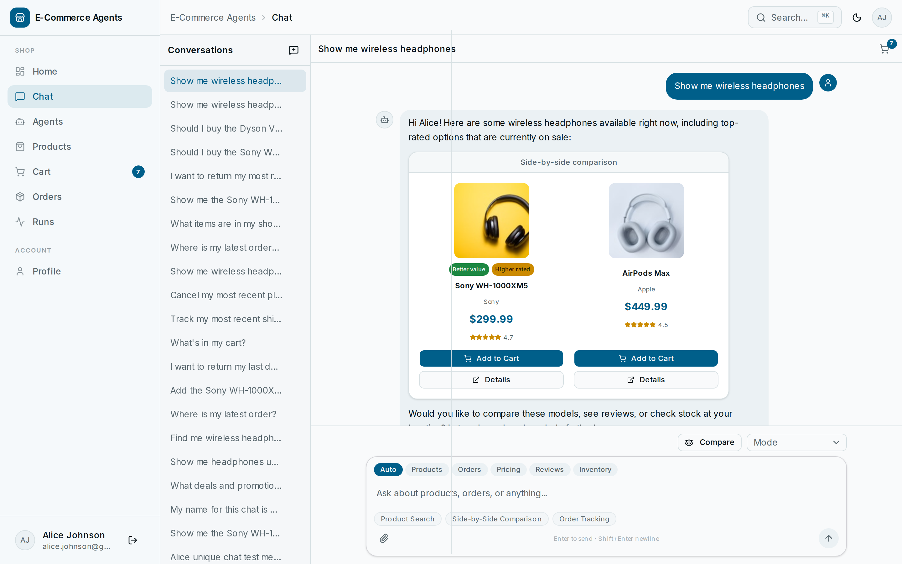
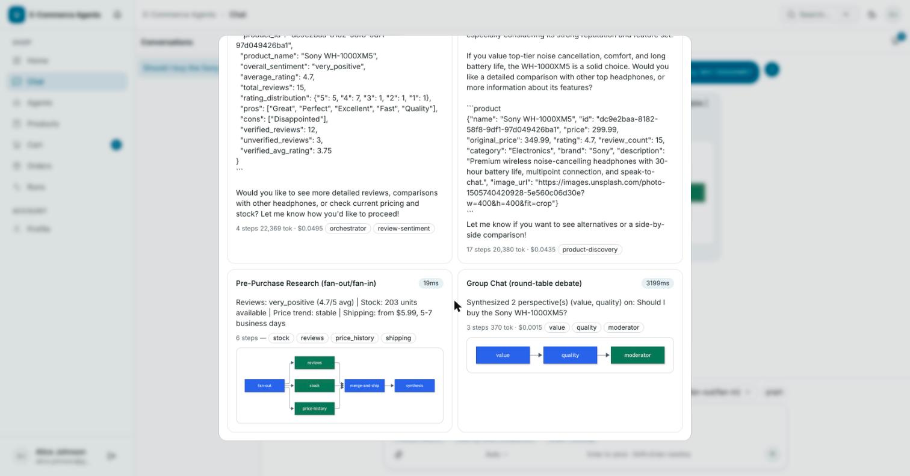
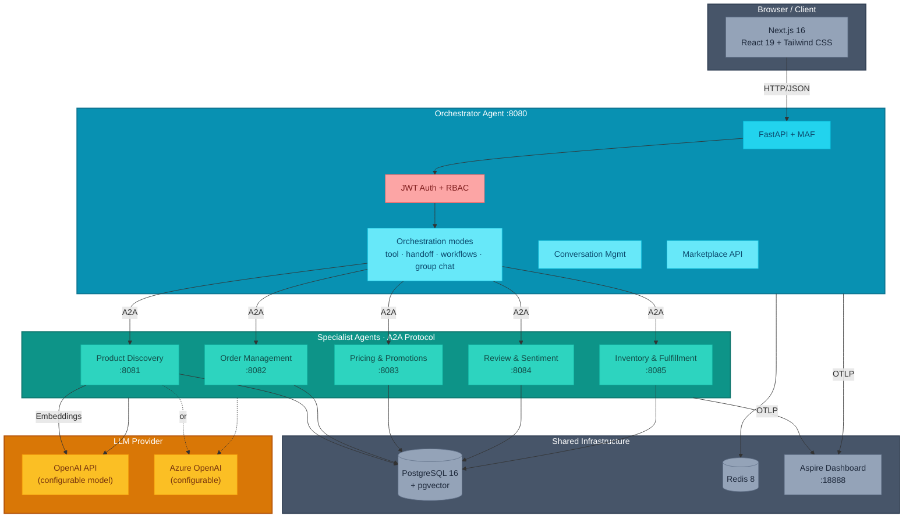

# E-Commerce Agents

[](https://github.com/nitin27may/e-commerce-agents/actions/workflows/tests.yml)
[](https://github.com/nitin27may/e-commerce-agents/actions/workflows/build-images.yml)
[](LICENSE)
[](https://python.org)
[](https://dotnet.microsoft.com)
[](https://nextjs.org)
[](https://github.com/microsoft/agent-framework)
[](https://github.com/pgvector/pgvector)
[](https://docs.docker.com/compose/)
[](https://codespaces.new/nitin27may/e-commerce-agents)

**A complete multi-agent e-commerce application built on [Microsoft Agent Framework](https://github.com/microsoft/agent-framework) (MAF), in Python and .NET, and a 34-chapter course that teaches every piece of it.**

This is a working application, end to end, not a sample that stops at "the agent replied". A
storefront with sign-in and roles sits in front of an orchestrator and five specialist agents that
handle product search, orders, pricing, reviews and inventory, backed by PostgreSQL, with human
approvals, guardrails, evals, tracing and deployment around them. The course starts from a first
agent and builds up to it one mechanism at a time; chapter 1 runs with no API key and no Docker.



## What is in the box

| Layer | What runs |
|---|---|
| **Web app** | Next.js storefront, cart, checkout and orders; streaming chat that renders product cards, tables and charts; seller and admin dashboards; an approvals inbox |
| **Orchestration** | One orchestrator, five selectable modes (below), a live graph of the run and a side-by-side compare view |
| **Agents** | Five specialists as separate services, talking A2A 1.0, with optional MCP servers for product and inventory data |
| **Data** | PostgreSQL with pgvector for semantic search, numbered migrations, a deterministic seeder, Redis for rate limiting |
| **Identity** | JWT sign-in, five roles (customer, power user, seller, support, admin), identity carried to every agent and tool |
| **Safety** | Policy-routed human approval, checkpoints and resume, guardrails, grounding checks, idempotency on money-moving actions |
| **Quality** | An eval suite that replays without a key in CI, a red-team set, dozens of CI checks per pull request |
| **Operations** | OpenTelemetry into the Aspire dashboard, per-request token and cost tracking, Docker Compose with prebuilt images, a draft Azure Container Apps deployment |
| **Two backends** | All of the above in Python, and in .NET / C# behind the same frontend and database, with the differences listed in the [parity matrix](docs/parity-matrix.md) |

## One orchestrator, five orchestration modes

Most agent samples show one orchestration pattern in isolation. Here the orchestrator runs the same
request through any of five, selected per request in the chat box, so "which one should I use?" has a measured answer:

| Mode | How the agents are coordinated | p50 latency | Model calls |
|---|---|---|---|
| `tool` (default) | The orchestrator's model picks a specialist and calls it as a tool | 10.6 s | orchestrator + specialist |
| `handoff` | A triage agent hands the conversation to a specialist, which can hand it on | 5.1 s | triage + specialist |
| `group-chat` | Two specialists debate, then a moderator answers | 3.2 s | 2 panelists + moderator |
| `workflow:pre-purchase` | A fixed graph fans out to several specialists at once and merges the results | 0.26 s | none |
| `workflow:return-replace` | A fixed sequential graph that pauses for human approval before anything is created | 0.10 s | none |



The two workflow modes call no model, so they are doing less work, not the same work faster.
Method, token and cost figures: [orchestration benchmark](docs/orchestration-benchmark.md)
(gpt-4.1, 40 requests). How each pattern works: [orchestration patterns](docs/concepts/06-orchestration-patterns.md).

## Learn

New to MAF? Run chapter 1 now — no API key, no Docker:

```bash
uv sync --project tutorials
uv run --project tutorials python tutorials/01-first-agent/python/main.py
```

It replays a recorded model response, so it works offline. From there, follow a
[learning path](./tutorials/README.md#learning-paths) — first agent, inside an agent, workflows,
multi-agent orchestration, production concerns — or the short route in the
[course README](./tutorials/README.md).

## Run it

```bash
git clone https://github.com/nitin27may/e-commerce-agents.git
cd e-commerce-agents
cp .env.minimal .env          # set OPENAI_API_KEY — the only variable a first run needs
./scripts/dev.sh --demo       # pulls prebuilt images, seeds, and starts everything
```

Then open **http://localhost:3000** and sign in as `alice.johnson@gmail.com` / `customer123`.
Docker is the only requirement — no Python, .NET or Node needed.

`--demo` pulls the eleven released images from GitHub Container Registry instead of building them,
which is the difference between a first run of about a minute and one of about twelve (a rough figure; it depends on your network and machine). Images are published for
`linux/amd64` and `linux/arm64`, so Apple Silicon runs natively.

**No API key?** `./scripts/dev.sh --demo --no-key` (PowerShell: `./scripts/dev.ps1 -Demo -NoKey`) starts the whole stack with no model behind it: browsing, search, cart and checkout work, and chat replays recorded answers for the suggested prompts. The recordings ship in images built after this change; the released 1.4.0 images have none and report chat prompts as "not recorded". A local model through Ollama also needs no paid key: see [docs/quick-start.md](docs/quick-start.md#run-without-a-paid-api-key).

**Building from source instead** — drop the flag. This is the contributor path, and the one to use
if you have changed any code:

```bash
./scripts/dev.sh              # builds all eleven images locally, then seeds and starts
```

**On Windows**, use `scripts/dev.ps1` — the PowerShell twin of the bash script, same flags:

```powershell
Copy-Item .env.minimal .env    # then set OPENAI_API_KEY in .env
./scripts/dev.ps1 -Demo
```

[WSL2](https://learn.microsoft.com/windows/wsl/install) still gives the best experience, and
everything above works unchanged inside it.

**In the browser, no install.** The Codespaces badge above opens a ready environment (Python 3.12 + `uv`, Node 26 +
`pnpm`, the .NET 10 SDK, Docker-in-Docker) and installs the dependencies ([`.devcontainer/`](./.devcontainer/)).
The creation screen asks for optional model-key secrets (`OPENAI_API_KEY`, or the Azure OpenAI endpoint, key and
deployment, or an OpenAI-compatible `LLM_BASE_URL`); the provider is chosen from whichever you supply. With none,
it runs key-free on recorded responses: the tutorials, Python tests and keyless evals work, and chat says a prompt
was not recorded. Add secrets under Settings, Secrets and variables, Codespaces (or your personal ones at
github.com/settings/codespaces, scoped to this repo); after the Codespace exists, add the secret and run
**Codespaces: Rebuild Container**. The stack is not started for you: run `./scripts/dev.sh` in the terminal, and
check the setup with `uv run --project agents/python python -m scripts.doctor`. Details and gotchas:
[Quick Start](docs/quick-start.md#codespaces), [Configuration](docs/configuration.md#codespaces).

Full detail — the .NET stack, WSL2 notes, running with no API key, and what to do when something
breaks: the **[Quick Start page](https://nitinksingh.com/e-commerce-agents/getting-started/quick-start.html)**.

**Generative UI, not raw JSON.** The chat surface never dumps a tool result as text or a code block. Every agent response is inspected by shape and rendered as the right interactive component: a single detailed result becomes a card, a list becomes a table, a distribution or trend becomes a chart, a status becomes a tone-coded badge — see it live in the [screens gallery](https://nitinksingh.com/e-commerce-agents/getting-started/demo-guide.html) (review sentiment: rating distribution + 6-month trend, rendered from the same data an LLM would otherwise only describe in prose).

**Full documentation:** **[nitinksingh.com/e-commerce-agents](https://nitinksingh.com/e-commerce-agents/)** — the concepts library, all 34 tutorial chapters, and the architecture reference, with every diagram rendered.

Companion demo repo for the AI article series on [nitinksingh.com](https://nitinksingh.com):
**[MAF v1: Putting It All Together](https://nitinksingh.com/posts/maf-v1-21-putting-it-all-together/)**
(the current Python + .NET series) and
**[Building a Multi-Agent E-Commerce Platform — The Complete Guide](https://nitinksingh.com/posts/building-a-multi-agent-e-commerce-platform-the-complete-guide/)**
(the original Python-only walkthrough). The articles are optional background — this repo and its
[documentation site](https://nitinksingh.com/e-commerce-agents/) are the canonical, always-current source.

---

## Where to start

| I want to... | Go here |
|---|---|
| **Learn MAF step by step** — start with no key | [tutorials/README.md](./tutorials/README.md) — 34 chapters; [run chapter 1](#learn) now |
| **Just run it** | [Run it](#run-it) above — Docker, one command |
| **Choose an orchestration pattern** | [The five modes](#one-orchestrator-five-orchestration-modes) · [benchmark](docs/orchestration-benchmark.md) · [orchestration patterns](docs/concepts/06-orchestration-patterns.md) |
| Run the .NET backend, or Windows, or with no API key | [Quick Start](https://nitinksingh.com/e-commerce-agents/getting-started/quick-start.html) |
| Configure it | [Configuration](docs/configuration.md) — one `.env`, and how it reaches each service |
| Read the documentation | **[nitinksingh.com/e-commerce-agents](https://nitinksingh.com/e-commerce-agents/)** — rendered and searchable |
| **Brand new to AI — never run a model or written an agent** | [AI Knowledge Hub](https://nitinksingh.com/ai-resources/) — eleven modules, ten labs, free and local |
| Learn what an agent even is — new to AI/agents | [Concepts](https://nitinksingh.com/e-commerce-agents/concepts/) — start at page 01 |
| Understand how the agents work / add a new one | [Architecture](docs/architecture.md) · [Adding an Agent](docs/adding-an-agent.md) |
| Use the MCP server | [MCP Integration](docs/mcp-integration.md) |
| See what shipped and what is next | [Roadmap](https://nitinksingh.com/e-commerce-agents/getting-started/roadmap.html) · [CHANGELOG](CHANGELOG.md) |
| See the generative UI, test users and scenarios to try | [Demo guide](https://nitinksingh.com/e-commerce-agents/getting-started/demo-guide.html) |

---

## Architecture



Six agents — five specialists behind one orchestrator, which coordinates them in any of the [five modes](#one-orchestrator-five-orchestration-modes) — over A2A (1.0 JSON-RPC and the legacy HTTP wire, [docs/a2a.md](docs/a2a.md)), with the same schema and the
same frontend for either backend. Full detail — request flow, agent internals, the database schema
and the API surface — is in **[Architecture](https://nitinksingh.com/e-commerce-agents/architecture/)**.

**Pick your stack:** [`agents/python/`](./agents/python/) or [`agents/dotnet/`](./agents/dotnet/) —
switch with `./scripts/dev.sh --dotnet`. Parity is checked in CI by a keyless gate that boots both stacks under replay (`.github/workflows/stack-parity.yml`); the live dual-backend Playwright suite (`scripts/e2e-both-stacks.sh`) still runs locally. And
[`docs/parity-matrix.md`](./docs/parity-matrix.md) lists the remaining differences row by row.

---

## Deploy to Azure

Draft, Python stack only, **not yet deployed to a real subscription**. The Bicep, the azd hooks and the scripts are written and checked offline; the first real deploy is still to come, so expect fix-forward changes.

```bash
az login && azd auth login
scripts/azure-up.sh --env demo1 --location eastus2 --image-tag v1.4.0   # PowerShell: scripts/azure-up.ps1
scripts/azure-down.sh --env demo1                                        # removes everything, checks nothing is soft-deleted
```

It creates a Container Apps environment (frontend, orchestrator, five specialists, outbox worker, Redis), PostgreSQL with pgvector, an Azure OpenAI account (gpt-5.1) and Key Vault, and runs a database job. The frontend is reachable only from your public IP by default, and a demo costs roughly $4 to $12 a day while it is up. Prerequisites, the wiring, costs, assumptions and the failure catalogue are in [docs/azure-deployment.md](docs/azure-deployment.md) and [docs/troubleshooting.md](docs/troubleshooting.md#azure-deployment-first-run-failure-catalogue).

---

## Documentation

Everything below is published, searchable and cross-linked at
**[nitinksingh.com/e-commerce-agents](https://nitinksingh.com/e-commerce-agents/)** — with every
Mermaid diagram rendered as a diagram. The site is generated from this repository by
`scripts/build_docs_site.py`, so the files here are always the source of truth; nothing lives
only on the site.

| Section | What's in it |
|---------|--------------|
| **[Concepts](https://nitinksingh.com/e-commerce-agents/concepts/)** | 14 pages for readers new to agents — what an agent is, the agentic loop, tools, harnesses, why multi-agent, orchestration patterns, graphs, state and memory, grounding, guardrails, HITL, evaluation, observability and cost, production concerns |
| **[Tutorials](https://nitinksingh.com/e-commerce-agents/tutorials/)** | 34 chapters. Every chapter that ships code ships both Python and .NET, and every one is gated in CI — the tests replay fixtures (Python) or drive a scripted client (.NET), so the whole suite runs with no key and no network |
| **[Architecture](https://nitinksingh.com/e-commerce-agents/architecture/)** | [System design](docs/architecture.md) · [agent flows](docs/agent-flows.md) · [database schema](docs/database-schema.md) · [API reference](docs/api-reference.md) · [frontend](docs/frontend.md) · [workflows](docs/workflows/README.md) |
| **[Guides](https://nitinksingh.com/e-commerce-agents/guides/)** | [Adding an agent](docs/adding-an-agent.md) · [A2A 1.0](docs/a2a.md) · [approvals](docs/approvals.md) · [merchant proposals](docs/merchant-proposals.md) · [event autonomy](docs/event-autonomy.md) · [return lifecycle](docs/return-lifecycle.md) · [DevUI](docs/devui.md) · [MCP integration](docs/mcp-integration.md) · [telemetry](docs/telemetry.md) · [security](docs/security-guide.md) · [agent quality and evals](docs/agent-quality.md) · [MAF best practices](docs/maf-best-practices.md) · [releasing](docs/releasing.md) |
| **[Getting Started](https://nitinksingh.com/e-commerce-agents/getting-started/)** | [Quick start](docs/quick-start.md) · [configuration](docs/configuration.md) · [deployment](docs/deployment.md) · [troubleshooting](docs/troubleshooting.md) |
| **[Reference](https://nitinksingh.com/e-commerce-agents/reference/)** | [Python vs .NET parity matrix](docs/parity-matrix.md) · [agent audit matrix](docs/agent-audit-matrix.md) · [orchestration benchmark](docs/orchestration-benchmark.md) · [reported vs actual](docs/reported-vs-actual.md) · [glossary](tutorials/_shared/jargon-glossary.md) · [Mermaid style guide](tutorials/_shared/mermaid-style-guide.md) |
| **[Demo guide](https://nitinksingh.com/e-commerce-agents/getting-started/demo-guide.html)** | Test users, the agent catalog, scenarios to try, and the screens gallery ([source](docs/demo-guide.md)) |
| **[Roadmap](https://nitinksingh.com/e-commerce-agents/getting-started/roadmap.html)** | What shipped, what is in progress, and what is deliberately not done ([source](docs/roadmap.md)) |

Contributor-facing docs stay in the repo rather than on the site:
[CONTRIBUTING.md](CONTRIBUTING.md) (setup, conventions, testing policy, PR checklist),
[CHANGELOG.md](CHANGELOG.md) (what changed in each release) and [CLAUDE.md](CLAUDE.md).

---

## Tech stack

| Layer | Technology |
|-------|-----------|
| Agent framework | [Microsoft Agent Framework](https://github.com/microsoft/agent-framework) v1 — Python (`agent-framework-core`) **and** .NET (`Microsoft.Agents.AI`) |
| Agent communication | A2A 1.0 JSON-RPC (`/a2a/v1`, agent card at `/.well-known/agent-card.json`) and the legacy `/message:send` wire, on both stacks ([a2a.md](docs/a2a.md)), plus optional MCP for product and inventory data (flag-gated, `MCP_ENABLED`) |
| LLM | OpenAI / Azure OpenAI, or any OpenAI-compatible endpoint (Ollama, vLLM, OpenRouter) |
| Backend | Python 3.12 + FastAPI · .NET 10 + ASP.NET Core |
| Data | PostgreSQL 16 + pgvector · Redis 8 |
| Frontend | Next.js 16, React 19, Tailwind 4, shadcn/ui |
| Telemetry | OpenTelemetry → .NET Aspire Dashboard |

Versions, ports and every environment variable: **[Deployment](./docs/deployment.md)** and
**[Configuration](./docs/configuration.md)**.

---

## What's next

This is an active project. The short version of where it goes from here — the full list, with
checkboxes and the reasoning for the order, is on the
**[Roadmap](https://nitinksingh.com/e-commerce-agents/getting-started/roadmap.html)**.

| Next | What it is |
|---|---|
| **Azure and Microsoft Foundry** | A Container Apps deployment is written and checked offline ([Deploy to Azure](#deploy-to-azure)) but has not yet run against a real subscription. It comes last, after the evaluation and documentation work is merged. After it: the same six agents in two more topologies (Foundry as model provider, Foundry Hosted Agents), with what each one costs you |
| **Finish the gates** | The keyless parity gate runs in CI, but it covers only turns that call no model. A model-calling comparison across the two stacks needs a key, and the .NET eval suite still needs its baselines |
| **Retrieval and tooling** | A typed filter DSL for `search_products`, the two MCP servers published to PyPI, and prompt caching — now measurable, because the cost counter ships |

No third backend is planned. The roadmap also records what is **deliberately not** planned, and why, so those are not mistaken
for oversights.

> **Watch this repository** to be notified when these land — use *Watch → Custom → Releases* for
> release-only notifications, or *Watch → All Activity* to follow the work as it happens. Each
> release is written up in the [CHANGELOG](CHANGELOG.md), which says plainly when something never
> worked and for how long.

---

## Contributing

1. Fork the repository
2. Create a feature branch: `git checkout -b feature/your-feature`
3. Make your changes and ensure tests pass
4. Submit a pull request

See [CONTRIBUTING.md](CONTRIBUTING.md) for detailed setup, conventions, testing policy, and PR checklist.

---

## License

This project is licensed under the [MIT License](LICENSE).

---

Built with [Microsoft Agent Framework](https://github.com/microsoft/agent-framework) and the [A2A protocol](https://a2a-protocol.org/) as its wire format (A2A 1.0 on both stacks, [docs/a2a.md](docs/a2a.md)).

**Built by [Nitin Singh](https://github.com/nitin27may)** &middot; [Documentation](https://nitinksingh.com/e-commerce-agents/) &middot; [More projects](https://nitinksingh.com/projects/)
