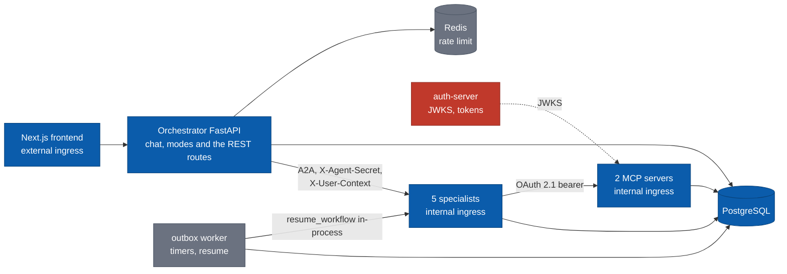
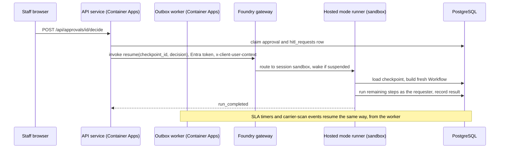

# ADR 0006 — Run the agents as Foundry hosted agents, one at a time, behind a reachability spike

**Status:** Proposed, conditional on the M5 reachability spike · **Date:** 2026-11-23

Nothing in this record has been built or run. The Foundry facts come from Microsoft documentation
read on 2026-11-23; each one carries a source id (`[H1]` and so on, listed under
[Sources](#sources)). A claim this record could not confirm is marked **not verified** and
collected under [Not verified](#not-verified). The repo facts come from the code at the commit this
record was written against.

## Context

Decision D-6 in the execution plan (`.claude/plans/remaining-work.md`, 2026-11-21) says all six
agents move to Foundry hosted agents, staged: a design note (this record), one specialist, the rest,
the orchestrator last. D-9 (open) asks how a Foundry-hosted agent reaches the MCP servers: external
ingress defended by the existing OAuth 2.1 tokens, or a VNet-integrated Foundry. M5 step 5 is a
half-day spike that answers both. If the spike fails, the plan says the decision returns to the
maintainer.

Today every agent is a container on Azure Container Apps (Bicep written, never deployed), each
reached by the orchestrator over A2A at an internal FQDN. The plan table says "Foundry anything:
not built".

This record does three jobs: say what hosted agents are, walk each mechanism of this system through
them, and fix the spike's questions so its answer is a measurement.

## What hosted agents are today

| Topic | What the documentation says | Source |
|---|---|---|
| Model | You package an agent as a container image in Azure Container Registry (or upload source). Agent Service pulls it, creates a dedicated Entra agent identity and a dedicated endpoint, and runs each session in its own VM-isolated sandbox | [H1] [H2] |
| Status | Microsoft Agent Framework docs call the hosting service generally available. The Python `agent-framework-foundry-hosting` package is prerelease; the .NET `Microsoft.Agents.AI.Foundry.Hosting` package is a preview build. Sub-features (session compute APIs, A2A v0.3) are preview. Earlier container protocol 1.0.0 is no longer supported | [H3] [H4] [H1] [H6] |
| Languages | Python and C# | [H1] |
| Protocols | Responses, Invocations, Invocations over WebSocket, Activity, and A2A | [H1] [H12] |
| Container contract | Port 8088 (`PORT` is reserved), plain HTTP, `GET /readiness`, at least one of `/responses`, `/invocations`, `/activity/messages`, graceful `SIGTERM`, linux/amd64 | [H5] [H2] |
| Endpoints | `{project_endpoint}/agents/{name}/endpoint/protocols/openai/responses`, `.../protocols/invocations`, `.../protocols/a2a`; Entra token for `https://ai.azure.com/.default` | [H1] [H2] [H6] |
| Sessions | State persists per session (`$HOME`, `/files`). Idle timeout 2 to 240 minutes, default 15; compute is deprovisioned at the timeout and restored on the next request with the same session id. A session is deleted after 30 days idle. No replica count, no warm pool | [H1] [H17] |
| Sandbox sizes | 0.25 vCPU / 0.5 GiB up to 16 vCPU / 32 GiB; converted image limit 2 GiB at 0.25 vCPU, 5 GiB at 1 vCPU | [H1] [H9] |
| Quotas | 1,000 concurrent sessions per subscription and region by default (2,000 in seven named regions); 1,000 versions per agent; one version serves 100% of traffic, no traffic splitting | [H9] [H1] |
| Identity | Per-agent Entra identity plus a project-wide managed identity for platform tasks. The gateway forwards **only** `x-client-*` plus content, tracing and `user-agent` headers; it never forwards the caller's `Authorization`, `Host`, `Cookie` or `x-forwarded-*`. The platform injects `x-agent-user-id` and `x-agent-foundry-call-id`. Without `x-ms-user-identity` (which needs a custom data action) the platform sees the backend workload, not the end user, as the caller | [H5] [H13] |
| Secrets | Don't put secrets in images or env vars; env values may be `${{connections.<name>.credentials.<field>}}` placeholders resolved at sandbox start | [H1] [H2] |
| State | A Foundry state store (key-value, item cap 1 MB, 30-day idle expiry by default, ETag concurrency, optional per-user isolation derived from the call id). In a standard setup it lives in your Cosmos DB | [H7] |
| Resilience | Resilient execution re-enters a handler from the start after process loss (not deterministic replay). Applies to stored background responses; foreground requests are not re-invoked | [H8] [H5] |
| Inbound A2A | A2A 1.0 is GA, JSON-RPC only; default is 0.3 unless `A2A-Version: 1.0` is sent. Requires the container to speak the Responses protocol. For hosted agents: single-turn `SendMessage` only, no `contextId` or `taskId`, no `GetTask`, no `returnImmediately`. Text only, no streaming | [H1] [H6] |
| Networking | Standard setup with private networking: a delegated subnet (`Microsoft.App/environments`, /27 or larger, RFC 1918, same region as the account), BYO Storage, Cosmos DB and AI Search, public access disabled. Network injection must be chosen when the Foundry account is created. Without your own subnet, Microsoft-managed egress with `isolationMode` `AllowInternetOutbound` or `AllowOnlyApprovedOutbound` | [H10] [H11] [H12] |
| Observability | The platform injects `APPLICATIONINSIGHTS_CONNECTION_STRING`; the protocol libraries emit OpenTelemetry. The gateway forwards `traceparent`, `tracestate` and `baggage` | [H1] [H5] |
| Pricing | Compute billed on allocated CPU and memory while a session's sandbox runs, including idle time until suspension; model and tool use billed separately. The primary pricing page showed no numbers | [H1] [H16] |
| Regions | 31 listed, including East US 2, Sweden Central, West Europe | [H1] [H9] |

Packages at this repo's pins:

| Stack | Package | What its metadata says | Repo pin |
|---|---|---|---|
| Python | `agent-framework-foundry-hosting` 1.0.0b261112 (2026-11-12) | `agent-framework-core>=1.25.0,<2`, `mcp>=2.2.0,<3`, `httpx2>=2.0.0,<3`, `azure-ai-agentserver-core>=2.1.0,<3`, `-responses>=2.2.0b1,<3`, `-invocations>=1.1.0,<2`, Python 3.11 or later [H14] | core 1.26.0, `mcp>=2.2,<3`, Python 3.12 |
| .NET | `Microsoft.Agents.AI.Foundry.Hosting` 1.28.0-preview.261106.1 | `Microsoft.Agents.AI >= 1.28.0`, `Azure.AI.AgentServer.Responses >= 1.0.0-beta.9`, `Azure.AI.Projects >= 3.0.0-beta.5` [H15] | `Microsoft.Agents.AI` 1.28.0 |

On paper both fit without moving a pin. That is a read of metadata, not an install (spike S5).
Hosting a native `Workflow` is documented for Python only [H3].

## What this system does today

Facts from the code that the rest of this record relies on:

- A specialist is `shared/agent_host.py::create_agent_app`: a FastAPI app with `/message:send`,
  `/message:stream` and the A2A 1.0 mount (`shared/a2a_server.py`). It runs MAF's `agent.run()`, emits
  `step`, `usage` and `replay_miss` data, and rehydrates history from Postgres by session id.
- The registry is `AGENT_REGISTRY`, a name-to-base-URL map validated by
  `shared/factory.py::parse_agent_registry`. `call_specialist_agent` looks the name up, so one agent can
  change host with one registry entry.
- Identity is ContextVars (`shared/context.py`) set by `AgentAuthMiddleware`, from `X-User-*` headers or a
  verified `X-User-Context` token (`shared/identity_token.py`). The token is HS256, audience-bound to the
  specialist's registry name, with a five-minute default lifetime.
- Workflow modes run in the orchestrator process. Their executors call specialists through the registry.
  Pause and resume use `PostgresCheckpointStorage` plus a `hitl_requests` row; `ReturnReplaceMode.resume()`
  builds a fresh `Workflow` from `checkpoint_id` and a decision, which is why it already works from a
  different process ([checkpoints-and-resume.md](../checkpoints-and-resume.md)).
- `worker/return_handlers.py` imports `orchestrator.approvals_service.resume_workflow` and runs the
  resumed workflow **inside the worker**. So the worker is a second orchestrator host.
- The approvals inbox, SLA timers and escalation are outbox rows polled with `FOR UPDATE SKIP LOCKED`
  ([approvals.md](../approvals.md)).
- MCP servers are OAuth 2.1 resource servers when `MCP_AUTH_ENABLED=true` (audience `mcp-product` or
  `mcp-inventory`, one scope each, JWKS from the auth server). With the flag off they have no auth at
  all. `apps.bicep` gives them internal ingress and the Container Apps environment has no VNet
  (`cae.bicep`). Only the frontend is external.
- Postgres has public network access enabled, with an allow-Azure-services firewall rule
  ([azure-deployment.md](../azure-deployment.md)). Redis is an in-environment container used by rate
  limiting and readiness (`shared/rate_limit.py`, `shared/readiness.py`).

## Decision

Proceed with D-6 as a staged route with hard gates, and treat it as **proposed until M5's spike
passes its gate set** ([The spike](#the-m5-spike)):

1. The five specialists move to Foundry hosted agents one at a time, `review-sentiment` first.
2. The sixth agent is the orchestrator's **mode runner only** (the chat and workflow-mode engine). The
   REST surface (auth, cart, checkout, orders, seller, admin, approvals, notifications, demo, runs) stays on
   Container Apps as the API service, because a hosted agent exposes only the protocol endpoints above.
   If D-6 meant the whole FastAPI service, it cannot be done as written. This is a question for the
   maintainer before stage 4, whatever the spike says.
3. The orchestrator-to-specialist wire for hosted specialists is the **Invocations** protocol, unless
   spike question S7 shows the A2A bridge carries what Invocations does.
4. Pause, resume, timers and approvals keep their Postgres implementation. Foundry-native workflow
   checkpoints and state store are not used for them.
5. Container Apps keeps the frontend, API service, outbox worker, MCP servers, auth server, database and
   Redis.
6. The registry flip is the migration mechanism and the rollback.

## How each mechanism behaves when Foundry runs the agents

### Specialist packaging and the wire

The container needs port 8088, `/readiness` and a protocol endpoint [H5]; the current specialists bind
8081 to 8085 and expose `/health` and `/ready`. Two ways to serve the protocol:

| Option | What it keeps | What it loses |
|---|---|---|
| `ResponsesHostServer(agent)` from the hosting package [H3] | Platform-managed conversation history, OpenAI-compatible clients, inbound A2A bridge | `agent_host.py` as the owner of steps, usage, replay-miss frames and history rehydration; our SSE frame vocabulary |
| `InvocationsHostServer` or a custom invocation handler that calls `_run_agent_native_stream` [H3] [H5] | The existing frame vocabulary (`step`, `usage`), history rehydration by session id, one code path with Container Apps | Platform conversation history (unused today: we rehydrate from Postgres), inbound A2A (needs the Responses protocol [H6]) |

Recommendation: Invocations, because it is the smallest change to what the orchestrator and the web
timeline already consume. This amends the wire named in [ADR 0001](0001-a2a-over-direct-calls.md) for hosted
specialists: still a network boundary, no longer A2A. If S7 passes, A2A 1.0 through the Responses bridge
is preferred, since it keeps ADR 0001 true.

The A2A bridge cannot carry what `docs/a2a.md` relies on: no `contextId` (the session id), no streaming,
no status-update metadata for `steps/v1` and `usage/v1`, no `GetTask` [H1] [H6]. Whether `x-client-*`
headers reach a handler through the A2A endpoint is not documented (not verified).

The caller needs a new transport: acquire an Entra token for `https://ai.azure.com/.default` with the
orchestrator's managed identity, which must hold **Foundry Agent Consumer** on the project or agent
[H6], and POST to the invocations URL with `agent_session_id` [H4]. `shared/a2a_client.py` has no Entra
path today; this is a new client, not a registry value.

### Orchestrator modes and the registry

`tool`, `handoff` and the three workflow modes dispatch through the registry, so a mixed fleet (some
specialists hosted, some on Container Apps, .NET ones included) works with no mode change. The
registry's "only send to the registry origin" rule holds: a hosted entry's origin is the Foundry account
host. `AGENT_REGISTRY` is validated for scheme and host only, so a project-endpoint URL passes.

Cost of a conversation changes shape. A session is a sandbox, so a turn touching five specialists wakes
up to five sandboxes, each billed from start until its idle timeout. At 0.25 vCPU and 0.5 GiB, with the
secondary, unverified East US rates of 0.0994 USD per vCPU-hour and 0.0118 USD per GiB-hour [H18], one
sandbox-hour costs about 0.031 USD, so a conversation that wakes five sandboxes for the default 15
minutes is about 0.04 USD of compute before any model tokens. This is arithmetic on unconfirmed rates,
not a measurement (spike S12).

### Checkpoints and HITL resume across requests and sandboxes

The plan calls this the largest unknown. Two kinds of pause exist, and they differ.

**Tool approvals inside a specialist** (`cancel_order`, `process_refund`, `place_backorder` through
`shared/hitl.py`): the tool call writes a `hitl_requests` row and the request ends; an admin approval
later executes the database operation from the API service. Nothing waits in the sandbox. This works on
Foundry unchanged, provided a retry after a forced sandbox stop stays idempotent (`run_once`), which S11
tests.

**Workflow pauses** (`workflow:return-replace`, and the lifecycle waits in `return-lifecycle.md`):
the graph pauses at `ctx.request_info`, a checkpoint goes to Postgres, a `hitl_requests` row carries MAF's
resume token, and a later request, possibly in another process, builds a fresh `Workflow` and resumes
from `checkpoint_id`. This is already the stateless shape that a suspended or replaced sandbox needs.
A sandbox's `$HOME` survives idle suspension [H1], but nothing here depends on it.

Hosting the workflow with Foundry's native mechanism would put the pause inside a Responses conversation
(`function_call_output` replies, `FoundryCheckpointStore`, state store items capped at 1 MB [H3] [H7]).
That is the wrong owner: the approvals inbox, the reviewer-is-not-requester rule, SLA escalation,
claim and fence, and the outbox timers all key on `approvals` and `hitl_requests`
([approvals.md](../approvals.md)). Two sources of truth for "is this return waiting" would drift.
Decision: the hosted mode runner is a stateless handler with two entry points, start and
`resume(checkpoint_id, decision)`. Native workflow hosting stays unused.

Who calls resume matters more than where checkpoints live:

Today `resume_workflow` runs in whichever process calls it (API route or worker). With a hosted mode
runner there are two options: keep calling it in-process from both (the worker and API then still hold the
workflow code and call hosted specialists with an Entra token), or have both invoke the hosted runner.
The second leaves one implementation host; the first is the smaller first change. This record picks the
first for stage 4 and treats the second as a later cleanup, because the worker must keep working during
the transition and a rollback must not need a data migration.

### Outbox worker and approvals SLA timers

Stay on Container Apps. The worker polls rows under a lease, runs reminders and SLA timers, and serves
both stacks ([approvals.md](../approvals.md)). A sandbox is suspended after at most 4 hours idle and has no
scheduler [H1]; replacing the worker with sandboxes would need a new timer system, and
[durable-task-spike.md](../durable-task-spike.md) already argues against running two. Foundry routines
(schedule or event triggers [H12]) are not evaluated here. The worker's own model calls and specialist calls
need the same managed identity and registry changes as the API service.

### Identity propagation

| Today | On Foundry |
|---|---|
| `X-Agent-Secret` proves which agent is calling | Replaced by the gateway's Entra check and the Foundry Agent Consumer role; the header is not forwarded anyway [H5] |
| `X-User-Context` signed token | Must travel as `x-client-user-context` (only `x-client-*` survives) [H5]; the verifier reads the new name. Accept both names while the fleet is mixed |
| `X-User-Email`, `X-User-Role`, `X-Session-Id` headers | Not forwarded. Hosted specialists must run `A2A_IDENTITY=token` with a distinct `A2A_IDENTITY_KEY`; under the default `both` a hosted agent with no token would have no identity at all |
| ContextVars from the middleware | Unchanged: a small adapter verifies the token and sets them before `agent.run()` |
| End user | Stays in our token. Foundry's per-user isolation keys on an Entra object id and the delegation needs a custom data action [H13]; our users are rows in our database |

Two consequences. First, `x-agent-user-id`, the state store's `user_isolation` and the hosting package's
default session namespacing key on the platform's idea of the caller, which for our orchestrator is one
workload identity [H13] [H3]. Nothing user-scoped may rely on them. All user-scoped data stays in Postgres
keyed by email, as `docs/security-guide.md` requires today. Second, a sandbox must never serve two
conversations by accident: choose the session id per conversation unless S10 justifies a pool.

The hosted agent's own identity is a real gain: per-agent Entra principals give the per-app attribution
M6 step 4 builds with extra work. The symmetric-key limit in `shared/identity_token.py` is unchanged by
this move: a compromised specialist can mint tokens. The key reaches a hosted container as an env
placeholder resolved from a project connection [H2], so it is also visible in the sandbox environment.

### MCP servers and OAuth 2.1 tokens (D-9)

Hosted agents expose fixed protocol endpoints, so the MCP servers (long-lived HTTP servers with their own
auth) stay on Container Apps. Only `product-discovery` and `inventory-fulfillment` use them, and only with
`MCP_ENABLED=true`; `review-sentiment` does not, so D-9 does not block stage 2.

| Option | What it needs | Risk |
|---|---|---|
| E. External ingress on the MCP servers, defended by tokens | `MCP_AUTH_ENABLED=true` (a hard precondition: with it off an external server is open); the auth server's token endpoint reachable from the sandbox, which means it is external too; protected-resource URLs rewritten to the public FQDN; IP restriction only if the sandbox egress IPs are stable (not verified) | Two more public surfaces; token endpoint abuse; one ingress setting for a whole app, no per-path control |
| V. VNet-injected Foundry | Foundry account created with network injection (cannot be added later [H10]); a delegated agent subnet in the same region; a VNet-integrated Container Apps environment with private DNS; BYO Cosmos DB, Storage and AI Search for the standard setup [H10]; deploys from inside the network | Large infrastructure change; the reference profile in M8 builds the VNet pieces anyway; Foundry endpoint also becomes private, so the Container Apps orchestrator must reach it privately |
| T. Foundry toolbox or remote tool connection | A project connection per MCP server, tool traffic through the project's data proxy [H11] [H12] | Whether it supports our client-credentials flow against a self-hosted authorization server is not verified |

Recommendation: **V for the reference profile, E accepted only for the demo profile and only with every
condition above**, and prefer not to need MCP at all from hosted agents: if the sandbox can reach Postgres
(S3), `MCP_ENABLED=false` gives the same data access the specialists have by default. If it cannot reach
Postgres but can reach an external MCP, MCP is the data gateway and E is justified. The spike decides
which world this is. D-9 should be recorded as made only with S2, S3 and S4 results in hand.

### Database and Redis

Postgres Flexible Server is public with an allow-Azure-services rule today. Whether a hosted sandbox's
egress counts as "Azure services" for that rule is not verified (S3). The reference profile closes the
server behind a private endpoint, which then requires VNet injection (V). Sandboxes that suspend and
resume may hold dead pooled connections; the asyncpg pool must survive a resume (S3). Redis is an in-
environment TCP container, unreachable from Foundry in any option without V. Only the orchestrator's rate
limiter and readiness probe use it, so hosted specialists need none.

### Telemetry and cost attribution

On Container Apps the managed OpenTelemetry agent injects `OTEL_EXPORTER_OTLP_ENDPOINT`
([azure-deployment.md](../azure-deployment.md)); on Foundry the platform injects an Application Insights
connection string instead [H2], and the protocol libraries emit spans [H5]. `shared/telemetry.py` needs an
exporter path for the connection string. `traceparent` is forwarded [H5], so one trace can span both
hosts (S9). Token usage still returns in the `usage` frame and lands in `usage_logs`, so cost attribution
in the product does not change. The model calls themselves are made by the agent identity, which gives the
AI gateway (M6) a real per-agent principal to key on.

### Eval targets

The HTTP eval target drives `POST /api/chat/stream` on the orchestrator, so it measures the fleet
whatever hosts it; EV-7's Foundry variant is the same run against the all-Foundry topology. The in-process
runner calls agent objects directly and cannot reach a hosted agent. Replay mode runs inside a sandbox
only if the fixtures are baked into the image; the spike uses that to test the wire without model spend
(S6). A replay miss is acted on only by a replaying orchestrator ([a2a.md](../a2a.md)), unchanged.

### What stays on Container Apps, and why

| Component | Why it stays |
|---|---|
| Frontend (Next.js) | A web app, not an agent endpoint; browsers cannot present an Entra token for Foundry |
| API service (all REST routes, chat entry, conversation and usage persistence) | A hosted agent serves only protocol endpoints [H5]; the chat route also owns auth, rate limiting, `_link_run_artifacts` and the SSE frames the UI reads |
| Outbox worker | Timers and event polling; sandboxes suspend and have no scheduler [H1] |
| MCP servers | Long-lived HTTP servers with their own OAuth; not agents |
| Auth server | The token issuer and JWKS for service and user tokens |
| PostgreSQL, Redis, db-init job | Shared state for both stacks and the worker; not agent compute |

## Options considered

| Option | Description | Verdict |
|---|---|---|
| A | All six on Foundry, the orchestrator as one hosted agent | Not possible as stated: the REST surface and SSE entry cannot be served by a hosted agent |
| A' | Five specialists plus the mode runner hosted; API service split out and kept on Container Apps | Recommended target, staged, gated |
| B | Five specialists hosted; orchestrator entirely on Container Apps | The expected landing point if gate G6 fails, and a good place to stop |
| C | Everything stays on Container Apps; Foundry only as model, tracing and evaluation provider | Default and rollback; M5 steps 1 to 4 deliver it regardless |

## Recommendation

Take A' as D-6 directs, in the stage order below, and expect B to be where it settles. Plainly: nothing
in the current design is broken by Container Apps. The case for hosted agents is product coherence
(a managed agent platform, per-agent Entra identity, Foundry tracing and evaluation in one project) and the
demo and article value, paid for with a second host, cold starts, preview packages, a new transport, and an
identity header rename. Option C keeps most of the Foundry value for a fraction of the risk, so the
migration earns its place only if the spike's numbers are good.

**Return the decision to the maintainer** if any of these happens:

1. Gate-set spike questions S1, S3, S5, S6 or S8 fail with no workable variant (no stable route to
   Postgres or to MCP, a pin that must move, a wire that loses steps or usage, or identity that cannot
   reach the handler).
2. S9 shows cold-start p95 above its threshold and a pooled-session design (S10) does not fix it.
3. S6 and S7 both fail: neither Invocations nor the A2A bridge preserves steps, usage and session id.
4. Measured compute cost for the demo workload is more than twice the Container Apps equivalent (D-1
   allows spend; this is a prompt to look, not a ceiling).
5. Before stage 4 regardless of results: whether D-6's sixth agent means the mode runner only (this
   record's reading) or the whole orchestrator service (not feasible).
6. A required pin moves (`agent-framework-core`, `-openai`, `-orchestrations`, `mcp`), because that
   invalidates replay fixtures and the `maf` Dependabot group.

## Staged migration

| Stage | Work | Exit criterion |
|---|---|---|
| 0. M5 spike | S1 to S12 below, findings written into the plan | Gate set passes, D-9 recorded with evidence |
| 1. Plumbing, no agent moves | ACR plus `az acr import` of the GHCR images (ACR is not built today); Bicep flag for the Foundry project and agent identities; an optional extra, not the lock, for `agent-framework-foundry-hosting` (the DevUI precedent in `CLAUDE.md`); a container entry that serves 8088 and `/readiness` and wraps `_run_agent_native_stream`; identity header adapter; Entra client in the orchestrator; registry value per agent | Existing replay gate and `fixture_drift` unchanged (exit 0); offline Bicep tests green |
| 2. `review-sentiment` | One hosted agent registered in `AGENT_REGISTRY`; same prompt YAML and database | A live turn routed from the Container Apps orchestrator, frontend unchanged, deployed eval for the agent within its reference spread |
| 3. The other four, one PR each | `pricing-promotions`, `product-discovery`, `inventory-fulfillment`, `order-management` (HITL and money last) | Each: its deployed eval within spread, its tool approvals still create exactly one row and execute once |
| Gate G6 | Maintainer confirms the sixth agent's meaning (decision rule 5) | Written answer |
| 4. Mode runner | Split the API service from the chat and mode engine; hosted runner with start and `resume`; worker and approvals routes call it | Full smoke test; a paused return resumes from the staff route and from the worker, in a different sandbox than it paused in |
| 5. .NET | M8 and D-3, parity-matrix row, mixed-stack run | Out of this record's scope |

Each stage is its own PR set. Python only until M8, in line with D-3 and [ADR 0005](0005-dual-stack-parity.md):
the .NET stack keeps calling Container Apps specialists, and the registry lets the two coexist.

## The M5 spike

A minimal hosted agent plus the foundry-samples diagnostic agent (it runs DNS, TCP, TLS and HTTP probes
from the hosted runtime [H10]). Half a day. **Gate set** questions decide whether the route is viable;
**design set** questions size it. Thresholds are proposals for the maintainer to change before the run.
"Measure" always means write the number into the plan.

| # | Question | How to measure | Pass | Fail means |
|---|---|---|---|---|
| S1 *(gate)* | Can a sandbox, on a default (non-network-secured) account, reach an external-ingress Container Apps FQDN? | Diagnostic agent probes (DNS, TCP, TLS, HTTP) at a test app, 50 calls; also fetch an echo endpoint from 5 sessions and record the egress IPs | 50 of 50 return 200, p95 under 2 s; note whether the IPs repeat | Option E impossible; only V remains |
| S2 | What happens on the **internal** FQDN, and does the VNet-injected variant fix it? | Same probes against `https://ca-<svc>.internal.<domain>`; repeat with a BYO-subnet account if the budget allows | Failure mode recorded (expect DNS failure); V variant: 50 of 50 | Informational; decides how big V is |
| S3 *(gate)* | Can a sandbox reach Postgres, and does the pool survive suspend and resume? | `asyncpg.connect` plus `SELECT 1` over TLS, 20 trials; then idle past the minimum timeout (120 s), resume, run a query through a pre-built pool | Connects under 1 s p95; the post-resume query succeeds, or the pool recovers within one retry | No data path except MCP; V needed for the reference profile |
| S4 | Can a sandbox call an MCP server with an OAuth token (D-9)? | Client-credentials token from the auth server, then `tools/list` on MCP with external ingress: valid token, no token, wrong-audience token, wrong-scope token; repeat for V if built | 200 with the right token; 401 for each of the other three; p95 under 1 s | E is unsafe or unusable; record why |
| S5 *(gate)* | Do the hosting packages install at this repo's pins? | `uv` resolve with the extra at 1.0.0b261112 against core 1.26.0, openai 1.18.2, orchestrations 1.4.2, anthropic 1.0.0b261112, `mcp` 2.x; `dotnet restore` with 1.28.0-preview.261106.1 against `Directory.Packages.props` | Resolver adds packages and changes no pin; `pytest` and `fixture_drift` still exit 0; .NET restores | A pin must move: return to the maintainer (rule 6) |
| S6 *(gate)* | Does our specialist run as a hosted agent over Invocations, with the same frames? | Existing image plus a 8088 shim, version reaches `active`; run 5 prompts under `LLM_PROVIDER=replay` (fixtures baked in) through Invocations and through `/message:stream` locally | Version `active` in under 20 minutes; frame sequence (`step`, `usage`, text) identical after dropping timestamps | Wire loses steps or usage |
| S7 | Does the A2A 1.0 bridge carry what we need? | Enable `a2a` plus `responses`; call with the official `a2a-sdk` and `A2A-Version: 1.0`; record streaming, `contextId`, metadata extensions, `x-client-*` forwarding, `GetTask` | Session id and user context both reach the handler, steps and usage survive | Use Invocations (S6); ADR 0001's wire is amended |
| S8 *(gate)* | Does identity arrive and verify? | Orchestrator managed identity with Foundry Agent Consumer calls the endpoint; handler logs which headers it saw; run `identity_token.verify` on `x-client-user-context`: valid, tampered, expired, wrong audience; send forged `X-User-*` headers with no token under `A2A_IDENTITY=token` | Token arrives and verifies; `Authorization` and `X-Agent-Secret` absent; all three bad tokens and the forged headers refused | Hosted agents cannot know the user |
| S9 | Do traces join? | One turn through orchestrator and hosted specialist; look at Application Insights; check the model call's caller principal | One trace id with parent-child spans across hosts; caller principal is the agent identity | Observability gap to close before stage 2 |
| S10 | How do cold start and concurrency behave? | 30 first-requests after suspension at 0.25/0.5 and 1/2; warm-turn overhead against Container Apps (same prompt, replay); 20 concurrent requests on one session | Cold p95 under 20 s (inside the 60 s A2A timeout with room for the model); warm overhead p50 under 150 ms; 20 of 20 complete, p95 under twice a single call | Pooled sessions, a keep-warm ping, or return to the maintainer (rule 2) |
| S11 | Is it right-sized, and are tool approvals idempotent across a forced stop? | Peak RSS and converted image size at 0.25 vCPU; run an approval-gated tool, stop the session mid-call, retry | RSS under 70% of allocation and image under 2 GiB (else next tier); exactly one `hitl_requests` row and one side effect | Larger tier (cost) or a fix to `run_once` use |
| S12 | What does it cost? | Cost Management, one day, 5 sandboxes active and idle, against the arithmetic above | Within a factor of two of the estimate | Rule 4 |

Also record, while there: the exact A2A and Invocations URLs and API versions that worked, which regions
the project and gpt-5.1 share, whether Python 3.12 is accepted by source-code deploy (the docs show
`python_3_13` only), and whether a GHCR image can be used or ACR is mandatory.

## Risks and rollback

| Risk | Mitigation |
|---|---|
| Preview-grade packages on both stacks, new beta every week | Optional extra outside the lock; exact pin; `maf` Dependabot group; S5 at each bump |
| Cold start breaks the 60 s specialist timeout | S10 gate; pooled session ids; keep Container Apps copy during soak |
| A user's data leaking through a shared sandbox or Foundry's per-user partition | No user data in `$HOME` or the state store; session id per conversation; Postgres keyed by email |
| Identity token key visible in the sandbox environment | Distinct `A2A_IDENTITY_KEY`, project-connection placeholder, rotation in the security runbook |
| Two hosts to run and debug, with different logs and failure modes | One stage at a time; Container Apps copies stay deployed until the soak ends |
| The A2A and Responses surfaces diverge from `docs/a2a.md` | Document the hosted wire in `a2a.md` in the stage 1 PR |
| Cost of idle sandboxes | Short idle timeout on agents that do not need warmth; stop sessions at conversation end |
| Quota (1,000 sessions) or subnet exhaustion (HTTP 429 `session_quota_exceeded`, `subnet_exhausted`) [H9] [H11] | Backoff in the new client; alert on 429 |

**Rollback is per agent and needs no data migration.** Set that agent's `AGENT_REGISTRY` entry back to the
Container Apps URL and redeploy the orchestrator; the Container Apps app is kept deployed (minimum replicas
may drop to zero during soak to save cost, accepting the cold start) until two clean eval runs and a
smoke test have passed on the hosted version. All state is in Postgres, so nothing moves. Then delete the
hosted agent (`agents.delete(force=True)` [H2]). Because the verifier accepts both header names during
the transition, a mixed fleet keeps working in either direction. The stage 4 rollback is the same flip for
the mode runner; the API service never left.

## Gotchas

- A hosted container must listen on 8088; the platform owns `PORT` [H5]. Our specialists use 8081 to 8085.
- The gateway drops every caller header that is not `x-client-*` or on the short allowlist [H5]. A
  header that works against Container Apps silently disappears here.
- A2A on Foundry defaults to v0.3 unless the caller sends `A2A-Version: 1.0` [H6].
- Network injection cannot be added to an existing Foundry account for hosted agents [H10]. Decide V
  before creating the account, not after.
- Private ACR works only for projects created after 2026-06-25 [H1].
- Idle time is billed until suspension; allocation, not use, is billed [H1].
- A hosting package host owns the agent object you give it and warns against reuse [H3]; create it from a
  factory per request when it carries identity.

## What would make this wrong

If the spike shows a sandbox cannot reach the database or the MCP servers without a VNet, and the VNet
work (M8) is not scheduled, the five specialists gain nothing over Container Apps and cost more. If
Foundry's Invocations or A2A wire cannot carry the step and usage frames the timeline and cost tracking
read, the migration regresses the product to gain a platform. If the maintainer's intent for D-6 was
"the whole orchestrator service", this record's reading is wrong and the plan needs a different design.

## Not verified

- Hosted-agent compute prices from a primary source: the pricing page rendered no numbers [H16]. The rates
  in this record are from secondary pages [H18].
- Whether a default (not network-secured) account gives sandboxes open internet egress, and whether egress
  IPs are stable.
- Whether a sandbox's egress passes an "allow Azure services" Postgres firewall rule.
- Maximum request or stream duration through the gateway; cold-start latency; how many concurrent requests
  one session serves.
- Whether `x-client-*` headers are forwarded on the A2A endpoint, and whether the hosted A2A bridge carries
  any metadata beyond text.
- The doc conflict on A2A retention: the enable page says tasks and contexts are kept 60 days, the hosted
  concepts page says `contextId`, `taskId` and `GetTask` are unsupported for hosted agents. This record follows
  the narrower statement [H1] [H6].
- Whether Python 3.12 works for source-code deploy, and whether GHCR images are accepted.
- Whether a Foundry connection supports OAuth client credentials against a self-hosted authorization server.
- Whether the BYO Cosmos DB, Storage and AI Search requirement of the standard setup applies to a hosted-only
  deployment.
- .NET workflow hosting (only Python is documented), and any install-time behaviour of either hosting
  package: only metadata was read, nothing was installed.
- The GA date and the claim that long-running resilience went GA on 2026-10-28 (secondary source only).

## Sources

Read on 2026-11-23.

| Id | URL |
|---|---|
| H1 | <https://learn.microsoft.com/en-us/azure/foundry/agents/concepts/hosted-agents> |
| H2 | <https://learn.microsoft.com/en-us/azure/foundry/agents/how-to/deploy-hosted-agent> |
| H3 | <https://learn.microsoft.com/en-us/agent-framework/hosting/foundry-hosted-agent> |
| H4 | <https://learn.microsoft.com/en-us/azure/foundry/how-to/develop/framework-hosted-agents> |
| H5 | <https://learn.microsoft.com/en-us/azure/foundry/agents/concepts/hosted-agent-contract> |
| H6 | <https://learn.microsoft.com/en-us/azure/foundry/agents/how-to/enable-agent-to-agent-endpoint> |
| H7 | <https://learn.microsoft.com/en-us/azure/foundry/agents/concepts/agent-state-store> |
| H8 | <https://learn.microsoft.com/en-us/azure/foundry/agents/concepts/long-running-agent-resilience> |
| H9 | <https://learn.microsoft.com/en-us/azure/foundry/agents/concepts/limits-quotas-regions> |
| H10 | <https://learn.microsoft.com/en-us/azure/foundry/agents/how-to/virtual-networks> |
| H11 | <https://learn.microsoft.com/en-us/azure/foundry/agents/concepts/agents-networking-deep-dive> |
| H12 | <https://learn.microsoft.com/en-us/azure/foundry/agents/concepts/azure-yaml-reference> |
| H13 | <https://learn.microsoft.com/en-us/azure/foundry/agents/how-to/use-on-behalf-of-flow> |
| H14 | <https://pypi.org/pypi/agent-framework-foundry-hosting/json> |
| H15 | <https://www.nuget.org/packages/Microsoft.Agents.AI.Foundry.Hosting> |
| H16 | <https://azure.microsoft.com/en-us/pricing/details/foundry-agent-service/> |
| H17 | <https://learn.microsoft.com/en-us/azure/foundry/agents/how-to/manage-hosted-sessions> |
| H18 (secondary: a search result whose page was not opened, so unverified) | <https://github.com/ChrisFulstow/bureau-221b/blob/main/wiki/foundry/pricing.md> |

Related in this repository: [a2a.md](../a2a.md), [approvals.md](../approvals.md),
[checkpoints-and-resume.md](../checkpoints-and-resume.md), [azure-deployment.md](../azure-deployment.md),
[durable-task-spike.md](../durable-task-spike.md), [mcp-integration.md](../mcp-integration.md),
[security-guide.md](../security-guide.md).
