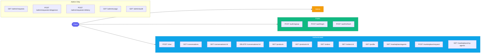

# API Reference

This is the HTTP API the web frontend calls: about 70 routes for sign-in, chat, the catalog, orders, the marketplace, approvals and administration. The orchestrator (FastAPI) serves it on port 8080, all under `/api/` except `/health`. The Python and .NET orchestrators serve the same routes, except where [parity-matrix.md](parity-matrix.md) says otherwise. To authenticate, send the access token from `POST /api/auth/login` as `Authorization: Bearer <token>`.

The sections from auth to admin give request and response examples; the rest list their routes in tables. The source of truth is `agents/python/orchestrator/routes/*.py`.

| Area | Sections |
|---|---|
| Sign-in | [Authentication](#authentication), [Auth (Public)](#auth-public) |
| Chat and orchestration | [Chat](#chat), [Conversations](#conversations), [Orchestration](#orchestration) |
| Shopping | [Products](#products), [Orders](#orders), [Profile](#profile) |
| Marketplace and admin | [Marketplace](#marketplace), [Admin](#admin) |
| Approvals and operations | [Approvals](#approvals), [Notifications](#notifications), [Merchant proposals](#merchant-proposals), [Event autonomy](#event-autonomy), [Return lifecycle](#return-lifecycle) |
| Everything else | [Other routes](#other-routes), [Error Response Format](#error-response-format) |

## Route Overview



## Authentication

All authenticated endpoints require a `Bearer` token in the `Authorization` header:

```
Authorization: Bearer <access_token>
```

Tokens are JWTs signed with `JWT_SECRET` (PyJWT + bcrypt). Access tokens contain `sub` (email), `role`, `user_id`, and `type: "access"`. Refresh tokens contain `sub` and `type: "refresh"`.

Admin endpoints additionally verify `role == "admin"` and return `403` if the check fails.

---

## Auth (Public)

### POST /api/auth/signup

Create a new user account and receive tokens.

| Field | Value |
|-------|-------|
| Auth  | Public |

**Request Body**

```json
{
  "email": "alice.johnson@gmail.com",
  "password": "securepassword",
  "name": "Alice Johnson"
}
```

**Response** `200`

```json
{
  "access_token": "eyJhbGciOi...",
  "refresh_token": "eyJhbGciOi...",
  "user": {
    "id": "550e8400-e29b-41d4-a716-446655440000",
    "email": "alice.johnson@gmail.com",
    "name": "Alice Johnson",
    "role": "customer",
    "loyalty_tier": "bronze",
    "total_spend": 0.0
  }
}
```

**Errors**
- `409` Email already registered

---

### POST /api/auth/login

Authenticate an existing user and receive tokens.

| Field | Value |
|-------|-------|
| Auth  | Public |

**Request Body**

```json
{
  "email": "alice.johnson@gmail.com",
  "password": "securepassword"
}
```

**Response** `200`

```json
{
  "access_token": "eyJhbGciOi...",
  "refresh_token": "eyJhbGciOi...",
  "user": {
    "id": "550e8400-e29b-41d4-a716-446655440000",
    "email": "alice.johnson@gmail.com",
    "name": "Alice Johnson",
    "role": "customer",
    "loyalty_tier": "gold",
    "total_spend": 4200.0
  }
}
```

**Errors**
- `401` Invalid email or password
- `403` Account is deactivated

---

### POST /api/auth/refresh

Exchange a refresh token for a new access token.

| Field | Value |
|-------|-------|
| Auth  | Public (requires valid refresh token in body) |

**Request Body**

```json
{
  "refresh_token": "eyJhbGciOi..."
}
```

**Response** `200`

```json
{
  "access_token": "eyJhbGciOi..."
}
```

**Errors**
- `401` Refresh token expired / invalid / wrong type
- `403` Account is deactivated

---

## Chat

### POST /api/chat

Send a message to the orchestrator agent. The orchestrator routes to specialist agents as needed and returns the consolidated response.

| Field | Value |
|-------|-------|
| Auth  | JWT optional. An anonymous caller reaches product discovery only, and no conversation is stored. Rate limited |

**Request Body**

```json
{
  "message": "What are the best noise-cancelling headphones under $350?",
  "conversation_id": null,
  "mode": null
}
```

`mode` is optional and names one of the [orchestration modes](#orchestration) (`tool`, `handoff`, `workflow:pre-purchase`, `workflow:return-replace`, `group-chat`). Omitted, the server uses `ORCHESTRATION_MODE`, which defaults to `tool`.

`conversation_id` is optional. Omit or pass `null` to start a new conversation. Pass an existing ID to continue a conversation (loads the last 50 messages as context).

**Response** `200`

```json
{
  "response": "I found several great options for noise-cancelling headphones under $350...",
  "conversation_id": "a1b2c3d4-e5f6-7890-abcd-ef1234567890",
  "agents_involved": ["orchestrator", "product-discovery", "pricing-promotions"]
}
```

**Errors**
- `400` Unknown `mode`
- `401` Invalid token
- `404` Conversation not found (if `conversation_id` is provided but doesn't belong to the user)
- `429` Rate limit exceeded

---

## Conversations

### GET /api/conversations

List the authenticated user's conversations, ordered by most recent activity.

| Field | Value |
|-------|-------|
| Auth  | JWT Required |

**Response** `200`

```json
[
  {
    "id": "a1b2c3d4-e5f6-7890-abcd-ef1234567890",
    "title": "What are the best noise-cancelling headphones under $350?",
    "message_count": 4,
    "created_at": "2026-04-01T10:30:00+00:00",
    "last_message_at": "2026-04-01T10:35:22+00:00"
  }
]
```

Returns up to 50 active conversations. Soft-deleted conversations are excluded.

---

### GET /api/conversations/{conversation_id}

Get a single conversation with its full message history.

| Field | Value |
|-------|-------|
| Auth  | JWT Required |

**Response** `200`

```json
{
  "id": "a1b2c3d4-e5f6-7890-abcd-ef1234567890",
  "title": "What are the best noise-cancelling headphones under $350?",
  "created_at": "2026-04-01T10:30:00+00:00",
  "last_message_at": "2026-04-01T10:35:22+00:00",
  "messages": [
    {
      "id": "msg-uuid-1",
      "role": "user",
      "content": "What are the best noise-cancelling headphones under $350?",
      "agent_name": null,
      "agents_involved": [],
      "metadata": {},
      "tokens_in": 0,
      "tokens_out": 0,
      "created_at": "2026-04-01T10:30:00+00:00"
    },
    {
      "id": "msg-uuid-2",
      "role": "assistant",
      "content": "I found several great options...",
      "agent_name": "orchestrator",
      "agents_involved": ["orchestrator", "product-discovery"],
      "metadata": {},
      "tokens_in": 150,
      "tokens_out": 320,
      "created_at": "2026-04-01T10:30:05+00:00"
    }
  ]
}
```

**Errors**
- `404` Conversation not found or doesn't belong to the user

---

### DELETE /api/conversations/{conversation_id}

Soft-delete a conversation (sets `is_active = FALSE`). Messages are preserved in the database.

| Field | Value |
|-------|-------|
| Auth  | JWT Required |

**Response** `200`

```json
{
  "status": "deleted"
}
```

**Errors**
- `404` Conversation not found or doesn't belong to the user

---

## Products

### GET /api/products

Browse and search the product catalog with filtering and sorting.

| Field | Value |
|-------|-------|
| Auth  | JWT Required |

**Query Parameters**

| Parameter   | Type    | Default   | Description |
|-------------|---------|-----------|-------------|
| `category`  | string  | -         | Filter by category (Electronics, Clothing, Home, Sports, Books) |
| `min_price` | float   | -         | Minimum price filter |
| `max_price` | float   | -         | Maximum price filter |
| `search`    | string  | -         | ILIKE search against product name and description |
| `sort`      | string  | `rating`  | Sort order: `rating`, `price_asc`, `price_desc`, `newest`, `name` |
| `limit`     | int     | `50`      | Page size |
| `offset`    | int     | `0`       | Pagination offset |

**Response** `200`

```json
{
  "products": [
    {
      "id": "prod-uuid-1",
      "name": "Sony WH-1000XM5",
      "description": "Premium wireless noise-cancelling headphones with 30-hour battery...",
      "category": "Electronics",
      "brand": "Sony",
      "price": 299.99,
      "original_price": 349.99,
      "image_url": "/images/products/sony-wh1000xm5.jpg",
      "rating": 4.7,
      "review_count": 12
    }
  ],
  "total": 50,
  "categories": ["Books", "Clothing", "Electronics", "Home", "Sports"]
}
```

Product descriptions are truncated to 200 characters in the list view.

---

### GET /api/products/{product_id}

Get full product details including specs, stock levels, reviews, and rating distribution.

| Field | Value |
|-------|-------|
| Auth  | JWT Required |

**Response** `200`

```json
{
  "id": "prod-uuid-1",
  "name": "Sony WH-1000XM5",
  "description": "Premium wireless noise-cancelling headphones with 30-hour battery life...",
  "category": "Electronics",
  "brand": "Sony",
  "price": 299.99,
  "original_price": 349.99,
  "image_url": "/images/products/sony-wh1000xm5.jpg",
  "rating": 4.7,
  "review_count": 12,
  "specs": {
    "type": "Over-ear",
    "battery": "30 hours",
    "noise_cancelling": true,
    "weight": "250g",
    "connectivity": "Bluetooth 5.2"
  },
  "in_stock": true,
  "total_stock": 145,
  "warehouses": [
    { "name": "East", "region": "east", "quantity": 50 },
    { "name": "Central", "region": "central", "quantity": 65 },
    { "name": "West", "region": "west", "quantity": 30 }
  ],
  "reviews": [
    {
      "id": "review-uuid-1",
      "rating": 5,
      "title": "Best headphones I've owned",
      "body": "The noise cancellation is incredible...",
      "verified": true,
      "reviewer": "Alice Johnson",
      "date": "2026-03-15T14:20:00+00:00"
    }
  ],
  "rating_distribution": {
    "1": 1,
    "2": 0,
    "3": 2,
    "4": 3,
    "5": 6
  }
}
```

**Errors**
- `404` Product not found

---

## Orders

### GET /api/orders

List the authenticated user's orders. Filterable by status.

| Field | Value |
|-------|-------|
| Auth  | JWT Required |

**Query Parameters**

| Parameter | Type   | Default | Description |
|-----------|--------|---------|-------------|
| `status`  | string | -       | Filter by status: placed, confirmed, shipped, out_for_delivery, delivered, cancelled, returned |
| `limit`   | int    | `20`    | Page size |
| `offset`  | int    | `0`     | Pagination offset |

**Response** `200`

```json
{
  "orders": [
    {
      "id": "order-uuid-1",
      "status": "delivered",
      "total": 349.98,
      "carrier": "Express",
      "tracking": "EXP-12345-US",
      "item_count": 2,
      "date": "2026-03-20T09:15:00+00:00"
    }
  ],
  "total": 8
}
```

---

### GET /api/orders/{order_id}

Get full order details including line items, status history, shipping address, and return info.

| Field | Value |
|-------|-------|
| Auth  | JWT Required |

**Response** `200`

```json
{
  "id": "order-uuid-1",
  "status": "delivered",
  "total": 349.98,
  "shipping_address": {
    "street": "123 Main St",
    "city": "New York",
    "state": "NY",
    "zip": "10001",
    "country": "US"
  },
  "carrier": "Express",
  "tracking": "EXP-12345-US",
  "coupon": "SAVE10",
  "discount": 35.0,
  "date": "2026-03-20T09:15:00+00:00",
  "items": [
    {
      "product_id": "prod-uuid-1",
      "name": "Sony WH-1000XM5",
      "category": "Electronics",
      "image_url": "/images/products/sony-wh1000xm5.jpg",
      "quantity": 1,
      "unit_price": 299.99,
      "subtotal": 299.99
    }
  ],
  "status_history": [
    {
      "status": "placed",
      "notes": "Order received",
      "location": null,
      "timestamp": "2026-03-20T09:15:00+00:00"
    },
    {
      "status": "delivered",
      "notes": "Delivered to front door",
      "location": "New York, NY",
      "timestamp": "2026-03-23T14:30:00+00:00"
    }
  ],
  "return": null
}
```

When a return exists, the `return` field contains:

```json
{
  "id": "return-uuid-1",
  "reason": "Defective product",
  "status": "refunded",
  "refund_method": "original_payment",
  "refund_amount": 299.99,
  "created_at": "2026-03-25T10:00:00+00:00",
  "resolved_at": "2026-03-28T16:00:00+00:00"
}
```

**Errors**
- `404` Order not found or doesn't belong to the user

---

## Profile

### GET /api/profile

Get the authenticated user's profile, including loyalty tier benefits and activity counts.

| Field | Value |
|-------|-------|
| Auth  | JWT Required |

**Response** `200`

```json
{
  "id": "user-uuid-1",
  "email": "alice.johnson@gmail.com",
  "name": "Alice Johnson",
  "role": "customer",
  "loyalty_tier": "gold",
  "total_spend": 4200.0,
  "member_since": "2025-12-01T00:00:00+00:00",
  "order_count": 15,
  "review_count": 8,
  "tier_benefits": {
    "discount_pct": 10.0,
    "free_shipping_threshold": 25.0,
    "priority_support": true
  }
}
```

**Errors**
- `404` User not found

---

## Marketplace

### GET /api/marketplace/agents

List all active agents in the marketplace catalog.

| Field | Value |
|-------|-------|
| Auth  | JWT Required |

**Response** `200`

```json
[
  {
    "id": "agent-uuid-1",
    "name": "product-discovery",
    "display_name": "Product Discovery",
    "description": "Searches products by keyword, category, price range, and semantic similarity.",
    "category": "Shopping",
    "icon": "search",
    "status": "active",
    "version": "1.0",
    "capabilities": ["search", "recommend", "compare"],
    "requires_approval": true,
    "allowed_roles": ["power_user", "admin"]
  }
]
```

---

### POST /api/marketplace/request

Submit an access request for a specific agent.

| Field | Value |
|-------|-------|
| Auth  | JWT Required |

**Request Body**

```json
{
  "agent_name": "product-discovery",
  "role_requested": "power_user",
  "use_case": "I need advanced product search capabilities for comparison shopping."
}
```

**Response** `200` (pending approval)

```json
{
  "id": "req-uuid-1",
  "agent_name": "product-discovery",
  "status": "pending",
  "message": "Your request has been submitted and is pending admin approval."
}
```

**Response** `200` (auto-approved, when `requires_approval = false`)

```json
{
  "id": "req-uuid-1",
  "agent_name": "product-discovery",
  "status": "approved",
  "message": "Access granted automatically — no approval required."
}
```

**Errors**
- `404` Agent not found
- `409` Pending request already exists for this agent
- `409` User already has access to this agent

---

### GET /api/marketplace/my-agents

List agents the authenticated user has been granted access to.

| Field | Value |
|-------|-------|
| Auth  | JWT Required |

**Response** `200`

```json
[
  {
    "agent_name": "product-discovery",
    "display_name": "Product Discovery",
    "description": "Searches products by keyword, category, price range, and semantic similarity.",
    "category": "Shopping",
    "icon": "search",
    "role": "power_user",
    "granted_at": "2026-03-01T12:00:00+00:00"
  }
]
```

---

## Admin

All admin endpoints require `role: "admin"` in the JWT. Non-admin users receive `403 Admin access required`.

### GET /api/admin/requests

List all pending access requests across all users.

| Field | Value |
|-------|-------|
| Auth  | Admin Only |

**Response** `200`

```json
[
  {
    "id": "req-uuid-1",
    "agent_name": "product-discovery",
    "role_requested": "power_user",
    "use_case": "I need advanced product search capabilities.",
    "status": "pending",
    "created_at": "2026-04-01T08:00:00+00:00",
    "user_email": "bob.smith@gmail.com",
    "user_name": "Bob Smith",
    "user_role": "customer"
  }
]
```

---

### POST /api/admin/requests/{request_id}/approve

Approve a pending access request. Creates the corresponding `agent_permissions` record in a transaction.

| Field | Value |
|-------|-------|
| Auth  | Admin Only |

**Request Body**

```json
{
  "admin_notes": "Approved for trial period."
}
```

`admin_notes` is optional (defaults to empty string).

**Response** `200`

```json
{
  "status": "approved",
  "request_id": "req-uuid-1"
}
```

**Errors**
- `404` Request not found
- `409` Request already approved/denied

---

### POST /api/admin/requests/{request_id}/deny

Deny a pending access request.

| Field | Value |
|-------|-------|
| Auth  | Admin Only |

**Request Body**

```json
{
  "admin_notes": "Insufficient justification."
}
```

**Response** `200`

```json
{
  "status": "denied",
  "request_id": "req-uuid-1"
}
```

**Errors**
- `404` Request not found
- `409` Request already approved/denied

---

### GET /api/admin/usage

Get aggregate usage statistics for the last 30 days, with per-agent breakdowns and a 7-day daily trend. `overall.pending_requests` is the count of access requests still awaiting an admin (not limited to the 30 days).

| Field | Value |
|-------|-------|
| Auth  | Admin Only |

**Response** `200`

```json
{
  "period": "last_30_days",
  "overall": {
    "total_requests": 1250,
    "unique_users": 18,
    "total_tokens_in": 450000,
    "total_tokens_out": 680000,
    "avg_duration_ms": 2300,
    "total_tool_calls": 3400,
    "pending_requests": 2
  },
  "by_agent": [
    {
      "agent_name": "orchestrator",
      "request_count": 500,
      "unique_users": 18,
      "tokens_in": 180000,
      "tokens_out": 250000,
      "avg_duration_ms": 2100,
      "error_count": 5
    },
    {
      "agent_name": "product-discovery",
      "request_count": 320,
      "unique_users": 15,
      "tokens_in": 95000,
      "tokens_out": 150000,
      "avg_duration_ms": 1800,
      "error_count": 2
    }
  ],
  "daily_trend": [
    {
      "day": "2026-04-04",
      "request_count": 85,
      "unique_users": 12
    },
    {
      "day": "2026-04-03",
      "request_count": 92,
      "unique_users": 14
    }
  ]
}
```

---

### GET /api/admin/audit

Get a detailed audit log from `usage_logs` with associated `agent_execution_steps` for each entry.

| Field | Value |
|-------|-------|
| Auth  | Admin Only |

**Query Parameters**

| Parameter | Type | Default | Description |
|-----------|------|---------|-------------|
| `limit`   | int  | `50`    | Page size (max 200) |
| `offset`  | int  | `0`     | Pagination offset |

**Response** `200`

```json
{
  "entries": [
    {
      "id": "log-uuid-1",
      "agent_name": "orchestrator",
      "user_email": "alice.johnson@gmail.com",
      "user_name": "Alice Johnson",
      "input_summary": "What are the best headphones?",
      "tokens_in": 150,
      "tokens_out": 420,
      "tool_calls_count": 2,
      "duration_ms": 2450,
      "status": "success",
      "error_message": null,
      "trace_id": "4bf92f3577b34da6a3ce929d0e0e4736",
      "created_at": "2026-04-04T10:15:00+00:00",
      "steps": [
        {
          "step_index": 0,
          "tool_name": "call_specialist_agent",
          "tool_input": { "agent_name": "product-discovery" },
          "tool_output": { "result": "Found 3 matching products..." },
          "status": "success",
          "duration_ms": 1200
        }
      ]
    }
  ],
  "total": 1250,
  "limit": 50,
  "offset": 0
}
```

The `trace_id` field correlates with OpenTelemetry traces in the Aspire Dashboard, allowing drill-down from audit log to distributed traces.

---

## Orchestration

`agents/python/orchestrator/routes/orchestration.py`. The five modes are described in
[architecture.md](architecture.md#orchestration-modes). A chat turn picks its mode with the `mode` field of
`POST /api/chat` and `POST /api/chat/stream`.

| Endpoint | Who | Notes |
|---|---|---|
| `GET /api/orchestration/modes` | public | A list of `{name, label, description, capabilities, default}`. `capabilities` is `{streams, supports_hitl, supports_checkpoints, is_graph}` |
| `GET /api/orchestration/modes/{name}/graph` | public | `{"name": "...", "mermaid": "..."}`. `mermaid` is `null` for a mode with no diagram (`tool`, `handoff`). `404` unknown mode |
| `POST /api/orchestration/compare` | signed in | `{"message": "...", "modes": ["tool", "handoff"]}`, one to five modes (`400` otherwise). Runs the prompt through each mode in turn, outside any conversation and with no history. Returns `{message, results}`; each result has `mode`, `label`, `text`, `latency_ms`, `agents_involved`, `step_count`, `graph_mermaid`, `tokens_in`, `tokens_out`, `est_cost_usd` and `error`. A `null` token or cost field means not captured. A mode that fails, or an unknown name, is reported in its own `error`. Rate limited |
| `POST /api/orchestration/{run_id}/resume` | staff | `{"approved": true\|false}`. Approves or rejects the paused approval of that run, as a thin caller of the approvals decide function. Returns `{run_id, approved, text, agents_involved}`. `404` no pending approval for the run; `403` and `409` as for `decide` below. Rate limited |

## Approvals

The unified approvals inbox (both stacks). Rules, the authorisation matrix and the edits allowlist are in
[Approvals and the Routing Policy](approvals.md#the-approvals-api).

| Endpoint | Who | Notes |
|---|---|---|
| `GET /api/approvals` | staff | `?status=<status>\|all`, `?limit=`; `support` sees support-routed items, `admin` sees all |
| `GET /api/approvals/{id}` | staff | Approval + audit `events` + policy `recommendation` + `editable_fields` + `source_detail` |
| `POST /api/approvals/{id}/decide` | staff | `{"decision": "approve"\|"reject"\|"request_info", "edits": {...}, "note": "..."}`. `403` own request or below the assigned role, `409` already decided or being decided, `422` bad edits |
| `POST /api/approvals/{id}/info` | requester | `{"message": "..."}`; `409` if nothing is being asked |
| `GET /api/me/approvals` | signed in | Own approvals: `id`, `kind`, `status`, `amount`, timestamps |

`POST /api/orchestration/{run_id}/resume` and `POST /api/admin/hitl/requests/{id}/approve|deny` remain, as thin
callers of the same decide function.

## Notifications

`agents/python/orchestrator/routes/notifications.py`. The bell in the web sidebar reads these.

| Endpoint | Who | Notes |
|---|---|---|
| `GET /api/me/notifications` | signed in | `?limit=` (1-100, default 30). The caller's own notifications, newest first, plus the unread count. Notifications addressed to a role (for example all `support` staff) appear for anyone holding the role |
| `POST /api/me/notifications/{id}/read` | signed in | Marks one read for the caller only. `404` for an id that is not theirs, the same as for one that does not exist |
| `GET /api/admin/outbox/parked` | admin | `?limit=` (1-200, default 50). Outbox rows the worker gave up on: id, topic, subject, attempts and the error class. Never the payload |

## Merchant proposals

Python only; see [merchant-proposals.md](merchant-proposals.md). Seller or admin. A proposal that is not the caller's is a `404`, the same as one that does not exist. These are never in the staff approvals inbox.

| Endpoint | Notes |
|---|---|
| `GET /api/seller/proposals` | `?status=`, `?limit=`. The caller's proposals with their lines (an admin sees all) |
| `POST /api/seller/proposals/run` | `{"seller_email": "..."}` optional. Generates a proposal now; a seller can only generate for themselves |
| `GET /api/seller/proposals/{id}` | One proposal with its lines |
| `POST /api/seller/proposals/{id}/decide` | `{"lines": [{...}], "note": "..."}`. Accept, edit or reject each line; accepted lines execute once. An edit can never raise a line |

## Event autonomy

Python only, admin only; see [event-autonomy.md](event-autonomy.md). The feature is off unless `AUTONOMY_ENABLED`.

| Endpoint | Notes |
|---|---|
| `POST /api/admin/events/simulate` | `{"scenario", "order_id", "delay_days", "event_id"}`, all optional. Injects a seeded demo event (`order.shipment_delayed`). `404` for everyone unless `AUTONOMY_SIMULATOR_ENABLED`, answered before the admin check so a `401`/`403` cannot reveal the route |
| `GET /api/admin/decisions` | `?state=`, `?limit=` (default 100), `?offset=`. What the system decided, with its budget use and state |
| `GET /api/admin/decisions/{id}` | One decision |
| `POST /api/admin/decisions/{id}/reverse` | `{"note": "..."}` optional. Undoes an executed action with a new log row and a negating ledger entry; it does not return the day's budget |

An over-budget action opens an approval of kind `autonomous_action`, decided through `POST /api/approvals/{id}/decide`. The .NET stack answers `422` ("not supported on this stack") to every decision on an `event` approval.

## Return lifecycle

Python only; see [return-lifecycle.md](return-lifecycle.md). All four answer `404` unless `RETURN_LIFECYCLE_ENABLED`, except the timeline.

| Endpoint | Who | Notes |
|---|---|---|
| `POST /api/admin/returns/{return_id}/simulate-scan` | admin | `{"carrier": "SIM", "tracking": ""}`. Announces the carrier's first scan of a waiting return; the outbox worker resumes the paused run. `409` if the return is not waiting for a scan. There is no carrier integration, so this is the only producer of `return.carrier_scanned` |
| `GET /api/staff/returns/inspections` | staff | Returns the carrier has delivered, waiting for inspection |
| `POST /api/staff/returns/{return_id}/inspect` | staff | `{"outcome": "accept"\|"reject", "resolution": "refund"\|"store_credit"\|"replacement", "amount", "condition", "note"}`. The amount can only be lowered. Pays out once. Never decided by the customer the return is for |
| `GET /api/runs/{run_id}/timeline` | signed in | What happened to a return run, oldest first: waits, approval events and checkpoints. Admins see any run, everyone else their own (`404` otherwise). Staff see who acted; a customer sees only the role |

## Other routes

Routes without a detailed section above. Auth is signed in unless stated.

| Endpoint | Notes |
|---|---|
| `POST /api/chat/stream` | The SSE form of `POST /api/chat`. Event names are listed in [frontend.md](frontend.md) and `orchestrator/routes/chat.py` |
| `GET /api/runs`, `GET /api/runs/{run_id}/checkpoints` | The caller's runs and a run's checkpoints, including a pending `hitl_request` |
| `GET /api/agents/stats` | Per-agent statistics |
| `GET /api/admin/hitl/requests`, `POST /api/admin/hitl/requests/{id}/approve`, `POST /api/admin/hitl/requests/{id}/deny` | Legacy tool-approval routes (admin); callers of the approvals decide function |
| `POST /api/orders/{order_id}/cancel`, `POST /api/orders/{order_id}/return`, `GET /api/returns/{label_token}/label` | Order cancellation, return request and return label |
| `GET /api/cart`, `POST /api/cart/items`, `PUT` / `DELETE /api/cart/items/{item_id}`, `POST` / `DELETE /api/cart/coupon`, `PUT /api/cart/address`, `POST /api/checkout` | Cart and checkout |
| `GET /api/user/memories`, `DELETE /api/user/memories/{memory_id}` | The caller's stored agent memories |
| `GET /api/seller/products`, `GET /api/seller/orders`, `GET /api/seller/stats` | Seller views (seller or admin) |
| `GET /api/demo/tour`, `POST /api/demo/reset` | Demo tour; `404` unless `DEMO_TOUR_ENABLED` |
| `GET /health` | Static liveness, no auth |

## Error Response Format

All error responses follow FastAPI's standard format:

```json
{
  "detail": "Description of the error"
}
```

| Status Code | Meaning |
|-------------|---------|
| `401`       | Missing, expired, or invalid JWT |
| `403`       | Insufficient permissions (e.g., non-admin accessing admin routes) |
| `404`       | Resource not found or doesn't belong to the authenticated user |
| `409`       | Conflict (duplicate email, duplicate access request, already resolved request) |

---

## Related

- [`docs/architecture.md`](architecture.md) — how requests flow from browser through orchestrator to specialist agents
- [`docs/database-schema.md`](database-schema.md) — the tables these endpoints read and write
- [`docs/deployment.md`](deployment.md) — running the stack so endpoints are reachable
- [`docs/frontend.md`](frontend.md) — how the Next.js client calls these endpoints
- [Project README](../README.md)
