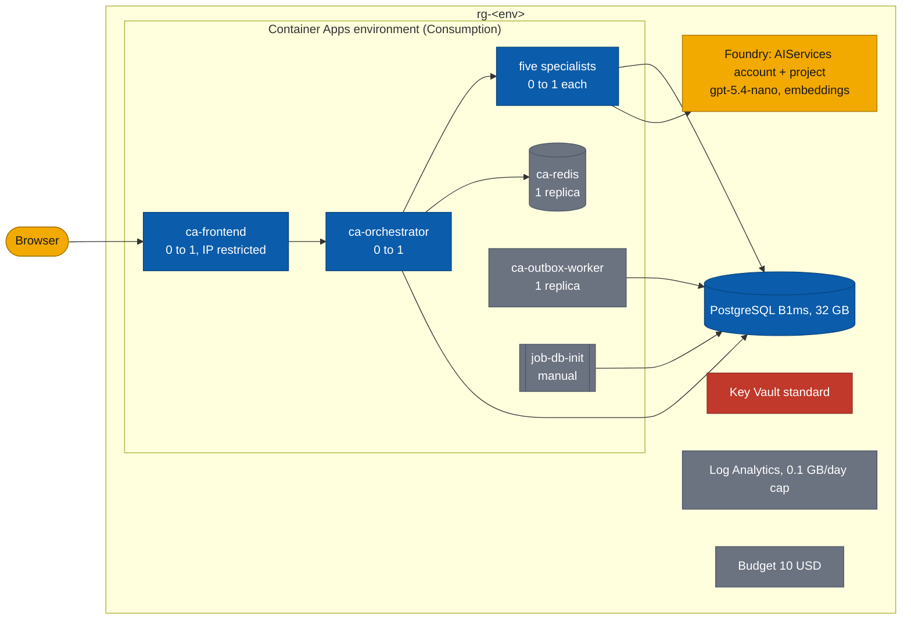
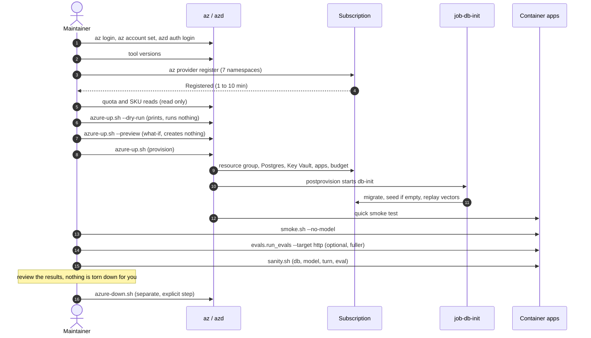

# Azure deployment sequence (free trial)

The ordered steps for a first real deployment on a new personal free-trial subscription, with a budget of about 10 USD, a low-cost model and no standing charge beyond Postgres, the worker and Redis. Every stage lists what it creates, what it costs, how long it takes, how to check it worked, how to stop spending, and what is known to go wrong. For the template itself see [azure-deployment.md](azure-deployment.md).

**Status: rehearsed read-only, never deployed.** The Bicep builds and lints, `az deployment sub validate` and `what-if` succeeded for every free-trial variant (and for the compiled `azuredeploy.json` the portal button uses) against a real, empty subscription, and the region and SKU listings were read. Nothing has been created. What a real deployment is still needed to confirm is in [What this page could not verify](#what-this-page-could-not-verify).

`<subscription-id>`, `<env>` and `<region>` below are placeholders. Do not paste your own account name, tenant, subscription id or resource group into the repo, an issue or a commit.

## What the free-trial profile deploys

`DEPLOY_PROFILE=free-trial` (`infra/profiles/free-trial.json`) is the demo topology shrunk to the cheapest shape the template can express:

| Piece | Free-trial setting | Why |
|---|---|---|
| Container apps | frontend, orchestrator, five specialists: **0 to 1 replica**, scale to zero; orchestrator 0.5 vCPU, 1 GiB | A replica that does not exist costs nothing. The worker (outbox) and Redis stay at 1 replica because nothing HTTP can wake them |
| Redis | `redis:8-alpine` container app, 0.25 vCPU | No Managed Redis. Rate limiting fails open, so Redis is optional, but a configured `REDIS_URL` with nothing behind it adds a connect failure to every request, so the container stays |
| Images | public GHCR at an immutable tag: `sha-<7>` of the main commit you mean to run (a release tag works; `latest` and `main` are refused) | No registry (ACR), no Docker on your machine |
| PostgreSQL | Flexible Server 16, Burstable `Standard_B1ms`, 32 GB (the minimum), no HA, 7 day backups | The cheapest SKU that runs pgvector |
| Key Vault | Standard, no purge protection, 7 day soft delete | A purge-protected vault keeps its name for 90 days |
| Log Analytics | 30 days, **0.1 GB per day cap** (the API minimum is 0.023) | Caps ingestion, so a noisy day cannot cost more than about 0.28 USD |
| Foundry | AIServices account `ai-<token>` (**local auth disabled, identity only**), a Foundry project with the Application Insights connection, `chat` = **`gpt-5.4-nano`** `2026-03-17` (GlobalStandard, 10K TPM) and `embedding` = `text-embedding-3-small` (GlobalStandard, 10K TPM) | The cheapest chat model that is generally available in `eastus2` and has a global standard SKU; the account, the project and idle deployments cost nothing, tokens are billed per use |
| Budget | **10 USD**, alerts at 50, 80 and 100 percent actual and 100 percent forecast, sent to subscription Owners and Contributors | Notifies; it does not stop spending. Raised from 5 for Foundry; the maintainer cap is 10 |
| Not created | API Management, Managed Redis, ACR, VNet, private endpoints, per-app identities, auth server, MCP servers | Each costs by the hour or needs a feature a trial may lack |



## The model provider on a free trial

The profile deploys the Foundry resources by default: the AIServices account, a Foundry project and two model deployments. The chat model was picked read-only from `az cognitiveservices model list --location eastus2`: of the generally available chat models with a GlobalStandard SKU, the nano tier is the cheapest. `gpt-4.1-mini`, `gpt-4.1-nano` and `gpt-4o-mini` are `Legacy` or `Deprecating` in that region, `gpt-5-nano` and `gpt-5.4-nano` are `GenerallyAvailable`. **`gpt-5.4-nano` `2026-03-17`** was chosen because its price could be read from the public Retail Prices API (USD per 1M tokens, `eastus2`, global standard, 2026-11-23): **0.20 input, 1.25 output, 0.02 cached input**. (`gpt-5-nano` is probably cheaper, but its meters did not show up in the API under any name this page could find, so its price is unverified.) Embeddings: `text-embedding-3-small` at 0.02 per 1M tokens (the API lists 0.00002 per 1K, global). The price file `agents/python/config/pricing/models.yaml` has a row for `gpt-5.4-nano` (`verified: false`: read from the API, not a pricing page), so the per-run cost ceiling works instead of failing closed.

Azure OpenAI quota is the part of this that may not exist yet: a new subscription often has zero TPM for a model, and `az cognitiveservices usage list` cannot be read until `Microsoft.CognitiveServices` is registered (stage 3). Whether `gpt-5.4-nano` accepts the API version the apps send (`2025-04-01-preview`) is also unverified; the sanity check's direct call (stage 12) is what finds out.

If the subscription has no quota, or you want zero model spend, `deployOpenAi=false` (`--llm replay|openai`) is still an option: no account, no deployments, no Foundry project, and the apps use `externalLlmProvider`:

| `--llm` | What runs | Cost | What works |
|---|---|---|---|
| (omitted, the default) | Foundry account and project, `gpt-5.4-nano`, `text-embedding-3-small` | per token on the Azure budget | Chat turns, if the trial has quota |
| `replay` | `LLM_PROVIDER=replay`, `EMBEDDING_PROVIDER=replay`, `COST_BUDGET_MODE=observe`. No model is called | 0 USD in model tokens | Everything that calls no model: login, catalogue, search (keyless vectors), cart, orders, approvals, the quick smoke and the http eval on `stack_parity.json`. Chat answers "not recorded" (the released images carry no recordings, [replay-mode.md](replay-mode.md)). Sanity checks `model` and `turn` do not apply |
| `openai` | `LLM_PROVIDER=openai`, `LLM_BASE_URL`, key from Key Vault secret `llm-api-key`, embeddings `replay` unless you change `EXTERNAL_EMBEDDING_PROVIDER` | the provider's charges, outside the Azure budget | Chat turns |

A model on your laptop (Ollama, LM Studio) is **not reachable** from Container Apps. The `openai` path needs a public HTTPS OpenAI-compatible endpoint. The key is the only secret and lives in Key Vault; a key you export is stored in the azd environment in clear text (git-ignored, `.azure/`). The switch is Python stack only and cannot be combined with `deployGateway` or the reference profile.

## First deployment runbook (the exact order)

This is the short form of the stages below, with the points where money or state changes made explicit. Run it top to bottom; a STOP means do not continue until the condition holds. Nothing here puts an account, tenant or subscription identifier in the repo: you supply them in your own shell.

### What the maintainer provides

| Input | Where it comes from | Rule |
|---|---|---|
| Subscription | `az account set --subscription <id-or-name>` in your shell | Confirm it is the free-trial subscription before anything else (stage 1 prints it; compare by eye, do not paste it into the repo or an issue) |
| Tenant | the same sign-in | `az login --tenant <tenant>` if you belong to several; confirm `az account show` names the tenant you expect |
| Region | `eastus2` | The only region the profile was read against (Postgres unrestricted, `gpt-5.4-nano` GlobalStandard listed). Another region needs stage 4 repeated for it |
| Image tag | `sha-<7>` of the main commit to run | Immutable. `scripts/azure-up.sh` and the `preprovision` hook accept only `vX.Y.Z`, `sha-<7 hex>` or `src-*`, and the free-trial profile refuses to guess one |
| Environment name | you choose; lowercase letters, digits, dashes | Names `rg-<env>`; `verify-clean.sh` shows whether a torn-down name is free again |
| Staff password | `SEED_STAFF_PASSWORD`, generated by `azd` into `.azure/<env>/.env` | Never printed by the scripts; the portal path asks you to type one (12 characters or more) |
| Your public IP | detected by `preprovision`, or `azd env set DEPLOYER_IP <ip>` | The frontend answers only this address |

Pick the image tag from main, then confirm the images exist (a registry read, no Azure involved):

```bash
git fetch origin main
TAG="sha-$(git rev-parse --short=7 origin/main)"; echo "$TAG"
docker buildx imagetools inspect "ghcr.io/nitin27may/e-commerce-agents/orchestrator:$TAG" >/dev/null && echo "image exists"
```

STOP if the image does not exist: `publish-main` in `tests.yml` pushes `sha-<7>` only after every test job is green on that push, so a commit whose run has not finished or failed has none. Use the newest main commit whose run published (the Packages page lists the tags), or a release tag. `latest` is the newest release, not main, and a release lags the template (it predates migrations 0015 to 0020 and the approvals changes), so the profile no longer defaults to it.

### Commands, in order

| # | Command | Changes anything? | Expected output | STOP if |
|---|---|---|---|---|
| 1 | `az login`, `az account set --subscription <id>`, `az account show --query "{name:name, state:state}" -o table`, `azd auth login` | Signs in only | the free-trial name, state `Enabled` | wrong subscription or tenant |
| 2 | `az provider register --namespace ...` (seven, stage 3), then `az provider list ...` | Free, subscription-level | every row `Registered` | any row not `Registered` after 10 minutes |
| 3 | The stage 4 reads (`list-skus`, `containerapp list-usages`, `cognitiveservices usage list`) | No | `no restriction`, `Standard_B1ms` listed; `OpenAI.GlobalStandard.gpt-5.4-nano` and `text-embedding-3-small` with a limit above zero | a restriction, or zero or no model quota: plan `--llm replay` instead |
| 4 | `scripts/azure-up.sh --env <env> --location eastus2 --profile free-trial --image-tag "$TAG" --dry-run` | No; it prints every command and runs none | the list ends with `azd provision --environment <env> --no-prompt` | any error text |
| 5 | the same command with `--preview` instead of `--dry-run` | Local `.azure/<env>` only; Azure what-if | about 34 creates, no `Delete` or `Modify` | any delete or modify, or a count far from 34 |
| **spend checkpoint 1** | Read the what-if once more. Nothing has been created or billed. | | | you are not ready to spend: stop here and `azd env delete <env>` |
| 6 | the same command with neither flag (provision) | **Yes: billing starts**, about 0.046 USD per hour (Postgres first) | `provisioningState` `Succeeded`, `FRONTEND_URL` printed, db-init job `Succeeded` | a failed deployment: run the teardown before debugging for long, partial resources bill |
| **spend checkpoint 2** | Note the clock. Idle burn is about 1.39 USD per day with the log cap reached, so the 10 USD budget is about 7 days idle. Finish the sanity run and decide within the hour. | | | |
| 7 | `scripts/azure/smoke.sh --quick`, then `--no-model` (stages 9 and 10) | Writes demo rows | `PASS: quick smoke`, `PASS: full smoke` | a failure other than a cold start (run it once more) |
| 8 | `scripts/azure/sanity.sh --env <env>` | Writes chat rows; about 0.03 USD of tokens | `sanity: 4 passed, 0 failed, 0 skipped`, exit 0 | `model` 400 or 404: the API version or model name does not fit the account; keep the output and report it |
| **spend checkpoint 3** | Cost read-back (below). Review the sanity output with the maintainer before tearing down. | | | the figure is far above the estimate: tear down now |
| 9 | `scripts/azure-down.sh --env <env> --dry-run`, then without the flag | **Yes: deletes everything** | ends with `clean: <env> is gone, nothing is billing and no name is held` | `teardown incomplete`: re-run with `--purge-only` |
| 10 | `scripts/azure/verify-clean.sh --env <env>` (again the next day) | No, read only | nine `CLEAN` lines and `verify-clean: every class is CLEAN` | any `LEFT` line |

Cost read-back. It lags by many hours and is not a billing record. This command has not been run against a subscription; treat a null or missing value as "not reported yet", not as zero:

```bash
az rest --method get \
  --url "https://management.azure.com/subscriptions/$(az account show --query id -o tsv)/resourceGroups/rg-<env>/providers/Microsoft.Consumption/budgets/budget-<env>?api-version=2023-05-01" \
  --query "properties.currentSpend"
```

The budget notifies at 50, 80 and 100 percent actual spend (5, 8 and 10 USD) and at 100 percent forecast; it does not stop spending. The only stops are the teardown and, on a free trial, its credit.

### Known unknowns for the first run

These cannot be settled offline; the first run settles them, and each has a stop condition above.

- TPM quota for `gpt-5.4-nano` and `text-embedding-3-small` on this subscription, and whether `gpt-5.4-nano` accepts API version `2025-04-01-preview` (the `model` sanity check is the test).
- Embeddings. The precomputed vectors file `scripts/data/product_embeddings.v1.jsonl.gz` is not in the repository, so the seeder skips it and the db-init job embeds every product through the Foundry deployment with the managed identity (a small token count at 0.02 USD per 1M; db-init takes the long end of its time estimate). For no model spend at all, deploy with `--llm replay`: the seeder then writes keyless hashing vectors.
- Trial caps on Container Apps environments and cores (shown only as a quota error from `Microsoft.App`).
- Whether the budget API answers the resource-group scope read above.

## The sequence



Costs below are for `eastus2`, USD, from the public Azure Retail Prices API on **2026-11-23** (`https://prices.azure.com/api/retail/prices`, no sign-in), list prices, no discounts:

| Meter | Price |
|---|---|
| Container Apps vCPU active / idle | 0.000024 / 0.000003 per second |
| Container Apps memory, active or idle | 0.000003 per GiB-second |
| Container Apps HTTP requests | 0.40 per million |
| PostgreSQL Flexible Server Burstable B1ms | 0.017 per hour |
| PostgreSQL storage | 0.115 per GB-month |
| PostgreSQL backup storage (LRS) | 0.095 per GB-month |
| Log Analytics, Analytics Logs ingestion | 2.76 per GB (the API also lists a 0.00 row; whether it is a free grant is not verified) |
| Key Vault operations | 0.03 per 10,000 |
| **`gpt-5.4-nano`, global standard: input / output / cached input** | **0.20 / 1.25 / 0.02 per 1M tokens** |
| `text-embedding-3-small`, global | 0.02 per 1M tokens (0.00002 per 1K) |
| Foundry account, project, idle deployments | no standing meter found; tokens only (not verified beyond the API listing) |

**Free grants.** Verified in Microsoft's documentation ([Billing in Azure Container Apps](https://learn.microsoft.com/en-us/azure/container-apps/billing), updated 2026-03-25): each calendar month, per subscription, the first 180,000 vCPU-seconds, 360,000 GiB-seconds and 2 million HTTP requests of the Consumption plan are free; a revision scaled to zero replicas incurs no resource charge; idle rates apply only to a revision held at its minimum replica count. **Not verified** (the Microsoft pages did not expose the figures when fetched; verify in the portal): the free-account credit amount and period, the Log Analytics free ingestion, the Key Vault free operations, and the PostgreSQL B1ms allowance. The maintainer reports about 750 free hours of B1ms on a free account; this page has not confirmed it, and the estimates below subtract none of it, so they are upper bounds. If the allowance applies, take 12.41 USD a month (0.017 an hour) off.

### Estimate for the profile

| Item | Basis | USD |
|---|---|---|
| PostgreSQL compute | 0.017 x 730 h | 12.41 / month |
| PostgreSQL storage | 32 GB x 0.115 | 3.68 / month |
| Outbox worker, 1 replica idle | (0.5 vCPU x 0.000003 + 1 GiB x 0.000003) x 2,628,000 s | 11.83 / month |
| Redis, 1 replica idle | (0.25 x 0.000003 + 0.5 x 0.000003) x 2,628,000 s | 5.91 / month |
| Specialists, orchestrator, frontend | scaled to zero | 0 while idle |
| Foundry account, project, deployments | no tokens, no standing charge | 0 while idle |
| Log Analytics | at most 0.1 GB x 2.76 x 30 (the cap) | up to 8.28 / month |
| **Left up, idle** | | **about 33.8 fixed, up to 42.1 with the log cap reached** |
| **Per hour, idle** | 33.83 / 730 | **0.046** |
| **Per day, idle, with the log cap** | 24 x 0.046 + 0.276 | **1.39** |

At that rate the 10 USD budget lasts about **7 days** (10 / 1.39), and a month costs about 4 times the budget. Foundry did not change the idle figure; it only adds tokens when something calls the model. This profile is for a test and a teardown, not for leaving up. The idle worker and Redis are the largest compute lines; the free monthly vCPU and GiB grants absorb part of them, by an amount this page does not claim.

### Tokens and cost of the sanity run (estimate)

| Check | Model calls | Tokens (estimate) |
|---|---|---|
| `model`: one direct completion | 1 | about 20 in, up to 200 out |
| `turn`: "show me my recent orders" | orchestrator plus one specialist, with tool results fed back | about 10,000 in, 1,500 out |
| `eval`: 3 cases of `orchestrator_routing.json` | the same shape, three times | about 30,000 in, 4,500 out |
| **Total** | | **about 40,000 in, 6,200 out visible; with reasoning tokens (billed as output) allow about 19,000 out** |

40,000 x 0.20 / 1M + 19,000 x 1.25 / 1M = 0.008 + 0.024, **about 0.03 USD**, a third of the 0.10 USD cap the eval was sized for. The prompt sizes are guesses (system prompt, role blocks and tool schemas dominate); the eval run prints the real token counts and estimated cost, so the first run replaces the guess. Embedding queries add well under 0.001.

### Cost of a 2 hour test

| Item | Basis | USD |
|---|---|---|
| Fixed resources, 2 h | 0.0463 x 2 | 0.093 |
| Eight HTTP apps active for 30 minutes | 8 x (0.5 x 1800 x 0.000024 + 1 x 1800 x 0.000003) | 0.216 |
| `job-db-init`, 10 minutes (estimate) | 0.5 x 600 x 0.000024 + 1 x 600 x 0.000003 | 0.009 |
| Log Analytics, cap for 2 h | 0.1 GB x 2.76 x 2 / 24 | up to 0.023 |
| Sanity run (stage 12) | tokens above | about 0.03 |
| Manual chat during the test | 20 turns x about 0.003 | about 0.06 |
| **Total, upper bound before any free grant** | | **about 0.43** |

The Container Apps lines fall inside the free monthly grants (50 vCPU-hours), so the realistic bill for the test is the Postgres lines plus tokens, roughly 0.2 USD (less if the B1ms allowance applies). Costs can lag in the portal by several hours; check Cost Management the next day.

---

### Stage 1. Sign in

```bash
az login
az account show --query name -o tsv          # confirm it is the NEW subscription before going on
az account set --subscription <subscription-id>
azd auth login                               # separate sign-in; az login does not cover azd
```

- **Creates:** nothing. **Cost:** none. **Time:** a minute (estimate).
- **Verify:** `az account show --query "{name:name,state:state}" -o json` prints state `Enabled`. `az role assignment list --assignee "$(az ad signed-in-user show --query id -o tsv)" --query "[].roleDefinitionName" -o tsv` lists `Owner` (the template creates role assignments).
- **Roll back:** `az logout`; `azd auth logout`.
- **Failure modes:** [#34](troubleshooting.md#azure-deployment-first-run-failure-catalogue) (azd signed out, no subscription chosen), [#11](troubleshooting.md#azure-deployment-first-run-failure-catalogue) (no role-assignment rights).

### Stage 2. Tool versions

```bash
az version --query '"azure-cli"' -o tsv      # 2.67 or newer
azd version                                  # 1.18 or newer
az bicep version                             # 0.34 or newer; az bicep install if missing
jq --version && curl --version | head -n 1
```

- **Creates:** nothing. **Cost:** none. **Time:** under a minute.
- **Verify:** the versions above. `scripts/azure/prereqs.sh` repeats the check and refuses an old tool.
- **Roll back:** not needed.
- **Failure modes:** an old `az` lacks `az containerapp job` flags; `azd` below 1.18 does not read `main.parameters.json` defaults the same way.

### Stage 3. Provider registration (you run it)

A new subscription has the providers unregistered. The free-trial path needs these seven (drop `Microsoft.CognitiveServices` only with `--llm`, which skips the Foundry account):

```bash
az provider register --namespace Microsoft.App
az provider register --namespace Microsoft.OperationalInsights
az provider register --namespace Microsoft.Insights
az provider register --namespace Microsoft.DBforPostgreSQL
az provider register --namespace Microsoft.KeyVault
az provider register --namespace Microsoft.ManagedIdentity
az provider register --namespace Microsoft.CognitiveServices      # the Foundry account and its model deployments

az extension add --name containerapp --upgrade --only-show-errors
```

`Microsoft.Authorization` and `Microsoft.Consumption` (the budget) were already registered on the subscription this page was rehearsed against; check yours. `Microsoft.ContainerRegistry` and `Microsoft.Network` are **not** needed by this profile (`scripts/azure-up.sh --profile free-trial` skips them).

- **Creates:** provider registrations on the subscription. Free.
- **Time:** 1 to 10 minutes each (estimate; they run in parallel).
- **Verify:**
  ```bash
  az provider list --query "[?namespace=='Microsoft.App' || namespace=='Microsoft.DBforPostgreSQL' || namespace=='Microsoft.KeyVault' || namespace=='Microsoft.OperationalInsights' || namespace=='Microsoft.Insights' || namespace=='Microsoft.ManagedIdentity'].{ns:namespace,state:registrationState}" -o table
  ```
  Every row says `Registered` (add `Microsoft.CognitiveServices` to the filter).
- **Roll back:** `az provider unregister --namespace <ns>` once the namespace holds no resources. Leaving them registered costs nothing.
- **Failure modes:** [#33](troubleshooting.md#azure-deployment-first-run-failure-catalogue) (`MissingSubscriptionRegistration`). Until `Microsoft.App` is registered, `az containerapp list-usages` and `az cognitiveservices usage list` answer with an error or an empty list, so the quota check in stage 4 means nothing before this stage is done.

### Stage 4. Quota and region check (read only)

```bash
az postgres flexible-server list-skus --location eastus2 -o json \
  | jq -r '.[0] | (.reason // "no restriction"), ([.supportedServerEditions[] | select(.name=="Burstable") | .supportedServerSkus[].name] | join(" "))'
az containerapp list-usages --location eastus2 -o table          # after stage 3
az cognitiveservices usage list --location eastus2 -o table      # after stage 3; look for OpenAI.GlobalStandard.gpt-5.4-nano and text-embedding-3-small, empty or zero means no quota
```

- **Creates:** nothing. **Cost:** none. **Time:** a minute.
- **Verify:** the first command prints `no restriction` and a list that includes `Standard_B1ms`. In the rehearsal `eastus2` was unrestricted and `eastus` answered "Provisioning is restricted in this region" (see [Findings](#findings-from-the-read-only-rehearsal)).
- **Roll back:** not needed.
- **Failure modes:** [#5](troubleshooting.md#azure-deployment-first-run-failure-catalogue) (Postgres restricted in the region: pick another `--location`), [#3](troubleshooting.md#azure-deployment-first-run-failure-catalogue) (no TPM quota: use `--llm`). `scripts/azure/prereqs.sh` runs the Postgres check and, without `--llm`, the model and quota check.

### Stage 5. Dry run (prints, runs nothing)

```bash
scripts/azure-up.sh --env <env> --location eastus2 --profile free-trial --image-tag sha-<7> --dry-run
```

- **Creates:** nothing; every `az` and `azd` command is printed. **Cost:** none. **Time:** seconds.
- **Verify:** the output ends with `azd provision --environment <env> --no-prompt`, has `az cognitiveservices model list --location eastus2`, and (with `--llm replay`) `azd env set DEPLOY_OPENAI false` with no model listing.
- **Roll back:** not needed.
- **Failure modes:** `--llm openai` without `--llm-base-url` or without `LLM_API_KEY` in the environment is refused with a message; a floating `--image-tag latest` is refused ([#22](troubleshooting.md#azure-deployment-first-run-failure-catalogue) family).

### Stage 6. What-if

```bash
scripts/azure-up.sh --env <env> --location eastus2 --profile free-trial --image-tag sha-<7> --preview
```

This runs the prerequisite checks (registering any provider you skipped), creates the **local** azd environment and generates the secrets into `.azure/<env>/.env`, then `azd provision --preview`, which is a what-if. It creates nothing in Azure. Expect about 34 creates: the resource group, Log Analytics, Application Insights, the identity, Key Vault with four secrets, Postgres with its configuration, database and firewall rule, the environment, nine container apps, the job and the budget. Role assignments show as "Unsupported" (their names are computed at deployment time); that is normal.

If you would rather read it without azd, `az deployment sub what-if --location eastus2 --parameters infra/ci/free-trial-replay.bicepparam` shows the same shape with CI placeholders, and `az deployment sub validate` with the same arguments checks the template against ARM. Both were run in the rehearsal and succeeded.

- **Creates:** local files only. **Cost:** none. **Time:** 1 to 3 minutes (estimate).
- **Verify:** the command exits 0 and the summary has no `Delete` or `Modify` lines for a fresh environment.
- **Roll back:** `azd env delete <env>` removes the local environment.
- **Failure modes:** a purged-name collision ([#12](troubleshooting.md#azure-deployment-first-run-failure-catalogue)); an Azure Policy that denies public Postgres or local auth ([#23](troubleshooting.md#azure-deployment-first-run-failure-catalogue)). Whether `azd provision --preview` also runs the `preprovision` hook is unverified, which is why `--preview` runs `preprovision.sh` itself.

### Stage 7. Provision

```bash
# Default: Foundry with gpt-5.4-nano. No Azure OpenAI quota? add --llm replay (no model) or, for your own endpoint:
#   export LLM_API_KEY=...           (the key is never an argument)
#   --llm openai --llm-base-url https://<host>/v1 --llm-model <model>
scripts/azure-up.sh --env <env> --location eastus2 --profile free-trial --image-tag sha-<7>
```

- **Creates:** everything in [What the profile deploys](#what-the-free-trial-profile-deploys), then runs the `postprovision` hook (stages 8 to 10). The frontend answers only your public IP.
- **Cost:** about 0.046 USD per hour from the moment Postgres exists (see the estimate). **Time:** 15 to 30 minutes (estimate; Postgres dominates).
- **Verify:**
  ```bash
  az group show --name rg-<env> --query properties.provisioningState -o tsv      # Succeeded
  az containerapp list --resource-group rg-<env> --query "[].{n:name,min:properties.template.scale.minReplicas,max:properties.template.scale.maxReplicas}" -o table
  az consumption budget list --query "[].{n:name,amount:amount}" -o table        # 10
  ```
  `azd env get-value FRONTEND_URL` prints the URL.
- **Roll back / stop spending:** `scripts/azure-down.sh --env <env>` (stage 13, after the sanity check and your review). If provisioning stops half way, the resources that exist still bill: run the teardown before debugging for long.
- **Failure modes:** [#10](troubleshooting.md#azure-deployment-first-run-failure-catalogue) (Key Vault role propagation, retried once after 60 s), [#12](troubleshooting.md#azure-deployment-first-run-failure-catalogue), [#6](troubleshooting.md#azure-deployment-first-run-failure-catalogue), [#7](troubleshooting.md#azure-deployment-first-run-failure-catalogue), [#8](troubleshooting.md#azure-deployment-first-run-failure-catalogue), and the free-trial rows 39 to 44 there. A trial's cap on Container Apps environments or cores shows as a quota error from `Microsoft.App`; it cannot be read in advance (see below).

### Stage 8. Database bootstrap (`job-db-init`)

Run by `postprovision`; to run it again:

```bash
az containerapp job start --name job-db-init --resource-group rg-<env> --query name -o tsv
```

- **Creates:** schema, 45 tables, pgvector extension, indexes. **Cost:** a few cents of Container Apps compute. **Time:** 5 to 15 minutes (estimate; with `replay` embeddings it is the short end).
- **Verify:** `az containerapp job execution list --name job-db-init --resource-group rg-<env> --query "sort_by(@, &properties.startTime)[-1].properties.status" -o tsv` prints `Succeeded`.
- **Roll back:** the job is idempotent (`seed --if-empty`); deleting the resource group removes the data.
- **Failure modes:** [#6](troubleshooting.md#azure-deployment-first-run-failure-catalogue) (`vector` not allow-listed), [#13](troubleshooting.md#azure-deployment-first-run-failure-catalogue), [#14](troubleshooting.md#azure-deployment-first-run-failure-catalogue), [#24](troubleshooting.md#azure-deployment-first-run-failure-catalogue) (job log lag), [#37](troubleshooting.md#azure-deployment-first-run-failure-catalogue).

### Stage 9. Seed check

The seeder is part of stage 8. Prove the data is there through the same path a browser uses:

```bash
FRONTEND_URL="$(azd env get-value FRONTEND_URL)" E2E_STAFF_PASSWORD="$(azd env get-value SEED_STAFF_PASSWORD)" scripts/azure/smoke.sh --quick
```

- **Creates:** nothing (it logs in as admin and alice and lists products). **Cost:** none beyond requests. **Time:** about a minute, plus up to 5 minutes for a cold start.
- **Verify:** it prints `PASS: quick smoke`, with `products listed (N total)` where N is above zero.
- **Roll back:** not needed.
- **Failure modes:** [#36](troubleshooting.md#azure-deployment-first-run-failure-catalogue) (revisions still starting), [#18](troubleshooting.md#azure-deployment-first-run-failure-catalogue), and a 403 from the frontend when your IP changed (`azd env set DEPLOYER_IP <ip>`, then run stage 7 again).

### Stage 10. Smoke test

```bash
FRONTEND_URL="$(azd env get-value FRONTEND_URL)" E2E_STAFF_PASSWORD="$(azd env get-value SEED_STAFF_PASSWORD)" \
  AZURE_RESOURCE_GROUP=rg-<env> DB_INIT_JOB_NAME=job-db-init scripts/azure/smoke.sh --no-model
```

`--no-model` runs the quick checks plus the approval flow (a return paused in `workflow:return-replace`, decided by a reviewer, shown on the run timeline) and skips the one keyed chat turn that needs a model. Drop `--no-model` once the stack has a real model.

- **Creates:** a return and an approval row in the demo data. **Cost:** none. **Time:** 1 to 5 minutes.
- **Verify:** `PASS: full smoke`. If the approval step fails under replay, the quick smoke in stage 9 is the replay-compatible gate; the approval step is meant to need no model but has not run under replay.
- **Roll back:** the demo data goes with the resource group.
- **Failure modes:** [#20](troubleshooting.md#azure-deployment-first-run-failure-catalogue) and [#28](troubleshooting.md#azure-deployment-first-run-failure-catalogue); with scale to zero a specialist's first request is a cold start (row 40).

### Stage 11. Evaluation against the deployed stack (optional, fuller than the sanity eval)

The http eval target needs only the URL. Use the frontend URL (it proxies `/api/*` to the orchestrator, which has no public address):

```bash
cd agents/python
export EVAL_STAFF_PASSWORD="$(azd env get-value SEED_STAFF_PASSWORD)"
LLM_PROVIDER=replay uv run python -m evals.run_evals --target http \
  --base-url "$(azd env get-value FRONTEND_URL)" --stack python --chat-provider azure --chat-model gpt-5.4-nano \
  --agent orchestrator --dataset evals/datasets/stack_parity.json --pass-threshold 0 --records-out /tmp/freetrial-eval.jsonl
```

`stack_parity.json` holds cases that call no model, so it also runs on a `--llm replay` deployment. `orchestrator_routing.json` calls the model; the sanity check runs three of its cases. A full model dataset spends tokens on the 10 USD budget: estimate it with `--estimate` first.

- **Creates:** conversations and run records in the demo database. **Cost:** requests only for `stack_parity`; tokens for a model dataset. **Time:** 1 to 3 minutes (estimate; cold starts first).
- **Verify:** a per-suite report and exit 0 with `--pass-threshold 0`; `/tmp/freetrial-eval.jsonl` has one record per case.
- **Roll back:** the data goes with the resource group.
- **Failure modes:** a 429 backs off and retries; a replay miss is reported, never silently scored; the frontend IP allow-list must include the machine running the eval.

### Stage 12. Sanity check (last, before you decide anything)

```bash
scripts/azure/sanity.sh --env <env>                 # all four checks
scripts/azure/sanity.sh --env <env> --only model    # one check; db | model | turn | eval
scripts/azure/sanity.sh --resource-group rg-<env>   # after a portal deployment: set E2E_STAFF_PASSWORD to the password you chose
```

It proves the chain from the database to a model answer, prints PASS, FAIL or SKIP per check, handles no key, and exits non-zero if any check failed:

| Check | What it does | How it reaches the database without exposing it |
|---|---|---|
| `db` | Admin and the seeded customer log in through the frontend; counts products, lists orders, reads the approvals inbox (a late migration) | Read-only GETs through the deployed path, frontend to orchestrator to its connection pool. No firewall rule, no `az containerapp exec`, no SQL client. A count over the API is what is possible with the database private to the apps |
| `model` | One chat completion on the deployed Foundry endpoint, `max_completion_tokens` 200, with **your own Entra token** (`az account get-access-token --resource https://cognitiveservices.azure.com`); no key is read, because the account has local authentication disabled | Not the database. Needs the deployer's Cognitive Services OpenAI User role (the template grants it from `AZURE_PRINCIPAL_ID`; in the portal tick `grantDeployerAccess`). SKIP when the environment has no model account |
| `turn` | "Show me my 3 most recent orders" as the seeded customer through `/api/chat/stream`; needs a route to a specialist, a specialist tool step (which read the database) and an answer | The specialist's own tools read Postgres |
| `eval` | The first 3 cases of `orchestrator_routing.json` over the http target, `--repeats 1`; needs no case errored and every case routed to a specialist; prints groundedness and token counts (not graded) | The orchestrator's tools |

- **Creates:** nothing in Azure. It writes rows to the deployed database (a chat conversation and run records for the seeded users), listed in its summary; they go with the environment. **Deletes nothing and tears nothing down.**
- **Cost:** about 0.03 USD of tokens (estimate above). **Time:** 3 to 8 minutes (estimate; the first calls wake scaled-to-zero apps, each call waits up to `SANITY_WAIT_SECONDS`, 300).
- **Verify:** the last lines read `sanity: 4 passed, 0 failed, 0 skipped` and exit code 0 (`echo $?`).
- **If a check fails:** the script prints what it created (nothing in Azure, which rows) and the command to run that check again (`--only <check>`). The environment stays up and keeps billing; nothing is rolled back automatically. Decide after reading the output: fix and re-run, or tear down.
- **Failure modes:** `db` empty means stage 8 did not finish (`az containerapp job start ...`); `model` HTTP 401 or 403 means the deployer's role is missing or still propagating (a few minutes), HTTP 400 or 404 the model name or API version; `turn` can exceed the 60 second A2A timeout on a cold chain (troubleshooting row 40: run it again once); `eval` on a `--llm replay` deployment reports replay misses.

**Do not tear down until the maintainer has reviewed the results.** The sanity check ends by saying so; the teardown is stage 13 and is only ever run by hand.

### Stage 13. Teardown (explicit, separate, last)

Run it only after you have read the sanity output. Nothing else ever calls it, and the goal of the whole exercise is that when everything works, **everything is deleted and nothing keeps billing or holds a name**.

```bash
scripts/azure-down.sh --env <env> --dry-run   # prints exactly what it will delete, deletes nothing
scripts/azure-down.sh --env <env>             # deletes, then proves it
scripts/azure/verify-clean.sh --env <env>     # read only; run it again any time, for example the next day
```

`azure-down.sh` does, in order: force-deletes the Log Analytics workspace (a plain delete leaves it recoverable, holding its name, for 14 days); `azd down --purge --force` (the resource group and everything in it); purges the soft-deleted Key Vault, AIServices account and API Management service; deletes the subscription-scope deployment records of the environment; deletes a subscription-scope budget with the environment's name if one exists; runs `verify-clean.sh`; and only if that is clean removes the local azd state `.azure/<env>`, which holds the generated secrets in clear text (`--keep-local` keeps it). If anything is left it stops, says which class, and keeps the local state so you can run `scripts/azure-down.sh --env <env> --purge-only`.

#### What survives a resource group delete

| Class | Why it survives | What removes it | How `verify-clean.sh` shows it |
|---|---|---|---|
| Log Analytics workspace | soft-deleted for 14 days, keeps its name, so redeploying the same environment name fails | `az monitor log-analytics workspace delete --force true` before the group goes | `workspace` |
| Key Vault | soft-deleted; the name is held until purged. The demo and free-trial profiles have no purge protection, so it can be purged at once; the reference profile turns purge protection on, which cannot be purged early (90 days, not billed, use a new `--env`) | `az keyvault purge` | `vault` (a purge-protected one is reported with its date) |
| Foundry / AIServices account, its project and connection | the account is soft-deleted and holds its name; the project and the App Insights connection live inside it and go with it | `az cognitiveservices account purge` | `account` |
| API Management | soft-deleted, only when `deployGateway` was on | `az apim deletedservice purge` | `apim` |
| Subscription deployment records | `Microsoft.Resources/deployments` at subscription scope are not in the group (no cost) | `az deployment sub delete`, for names `<env>`, `<env>-...` or outputs naming `rg-<env>` | `deployments` |
| Budget | `Microsoft.Consumption/budgets`. The template deploys it **in the resource group**, so it goes with the group; a copy at subscription scope would not | the group delete; a subscription-scope `budget-<env>` is deleted explicitly | `budget` (both scopes) |
| Role assignments | the template creates none outside the group; those on the vault, account and identities go with them. Orphans of deleted principals would show as `Unknown` | the group delete | `roles` (anything still scoped under `rg-<env>`) |
| Local azd state | `.azure/<env>` on your machine, secrets in clear text | `azure-down.sh` removes it last | `local` |
| Resource provider registrations | not environment state, free | left alone (`az provider unregister` if you want) | not checked |

No Entra app registration, service principal or federated credential is created by anything in this repo's deployment, so there is none to delete ([why](azure-deployment.md#do-you-need-an-entra-app-registration)).

- **Cost:** stops every charge. **Time:** 5 to 20 minutes (estimate; the group delete dominates).
- **Closing proof:** `verify-clean.sh` prints one line per class and ends with `verify-clean: every class is CLEAN for '<env>'` and exit code 0:
  ```text
  CLEAN  group        rg-<env> does not exist
  CLEAN  budget       budget-<env> does not exist (group and subscription scope)
  CLEAN  vault        no soft-deleted Key Vault
  CLEAN  account      no soft-deleted AIServices account
  CLEAN  apim         no soft-deleted API Management service
  CLEAN  workspace    no soft-deleted Log Analytics workspace
  CLEAN  deployments  no subscription deployment record
  CLEAN  roles        no role assignment under rg-<env>
  CLEAN  local        no local azd state for <env>
  ```
  A query that fails is `LEFT ... could not query`, never `CLEAN`, except where the provider is not registered (then nothing can exist). The format above is what the script printed against an environment that never existed; a real teardown has not been run.
- **Roll back:** none; redeploy from stage 7.
- **Failure modes:** [#38](troubleshooting.md#azure-deployment-first-run-failure-catalogue) (`azd down` fails or the environment is not on this machine: `az group delete --name rg-<env> --yes`, then `scripts/azure-down.sh --env <env> --purge-only`), and a soft-deleted workspace from a group deleted by hand (it keeps its name 14 days: recover it with `az monitor log-analytics workspace recover` and delete it with `--force true`, or use another `--env`).

## Keyless: which credentials remain

The free-trial profile uses managed identity wherever the codebase supports it. The apps and the db-init job run as one user-assigned identity:

| Call | How it authenticates |
|---|---|
| Apps to the model (Foundry / Azure OpenAI), chat and embeddings | `AZURE_OPENAI_AUTH=identity`: Entra token, the identity holds Cognitive Services OpenAI User on the account; **local authentication is disabled on the account** (`disableLocalAuth`) |
| Apps to the Foundry project | the identity holds Azure AI User on the project |
| Container Apps secrets | Key Vault references, resolved by the identity (Key Vault Secrets User, RBAC, no access policies) |
| Image pulls | anonymous, public GHCR: no registry credential, no ACR |
| You to the model (sanity check) | your own Entra token; the template grants the deployer Cognitive Services OpenAI User |
| You to the vault | Key Vault Secrets Officer for the deployer, by role |
| App registrations | none |

**Override.** `openAiLocalAuth` (azd `AZURE_OPENAI_LOCAL_AUTH`) is `auto` by default: disabled when the apps use identity (free-trial, reference), enabled for the key-based demo profile. `enabled` keeps keys on the account for a tool that cannot use Entra ID.

**Postgres stays on a password.** Entra authentication exists on Flexible Server and `asyncpg` accepts a callable password, but this codebase builds its connections from one static `DATABASE_URL` in at least eight Python entry points (`shared/db.py`, `shared/readiness.py`, `shared/checkpoint_storage.py`, the outbox worker, both MCP servers, `auth_server`, the migrate, seed and db-init scripts) and the .NET `DatabasePool`, and the migrations would have to run as an Entra role. That is a code change across both stacks and a new image release, and the pinned `v1.4.0` images cannot do it. So the admin password remains, as a generated secret that is never shown: the template generates it (azd: the preprovision hook; portal: a parameter default), it is stored only inside the Key Vault secret `database-url` (the free-trial profile drops the separate `postgres-admin-password` copy, which nothing read), and the apps read it by Key Vault reference. azd also keeps it in `.azure/<env>/.env`, in clear text, until teardown removes that directory.

Every secret the free-trial deployment still contains, and whether it can go:

| Secret (Key Vault name) | What it protects | Remove or derive? |
|---|---|---|
| Postgres admin password (inside `database-url`) | the database | Not removable now: needs Entra database auth in both stacks and a new image (above). Generated, never printed |
| `jwt-secret` | signs user access tokens (the app's own HS256 auth server; there is no Entra login) | Not removable. It could be derived from another root secret, but that only moves the secret |
| `agent-shared-secret` | `X-Agent-Secret` between the orchestrator and the specialists; also the root of the signed user-context token key | Not removable without replacing the service-to-service scheme (an app change); the identity-token mode already derives its key from it |
| `seed-staff-password` | the seeded admin, support and seller logins; read only by `job-db-init` | You choose it. Removable after the first successful bootstrap, but a re-run of the job needs it. The seeded customers' passwords are public by design |
| *Dropped in this profile:* `azure-openai-key` | the model account key | Gone: identity auth, local auth disabled |
| *Dropped:* `postgres-admin-password` | a duplicate of the password in `database-url` | Gone |
| *Dropped:* `a2a-identity-key` | A2A user-context token key | Gone: `A2A_IDENTITY=both` falls back to the agent secret. Needed distinct only for `token` mode |
| *Dropped:* `oauth-seed-key`, `auth-signing-key-encryption-key` | the optional OAuth auth server | Gone unless `deployAuthServer` is on (they are read only with `AUTH_MODE=oauth`) |
| *Only with `--llm openai`:* `llm-api-key` | your external model endpoint | Not removable: that provider has no Azure identity |

Platform-held keys outside the repo and the vault: the Container Apps environment holds the Log Analytics shared key to ship console logs (the `log-analytics` destination needs it; sending through diagnostic settings would avoid it, unverified here), and the Application Insights connection string (an instrumentation key, an identifier rather than an access secret) is used by the managed OpenTelemetry agent and by the Foundry project's tracing connection. Whether App Insights can be switched to Entra-only ingestion with the managed agent is unverified, so it is left on.

## The portal button instead of azure-up.sh

`infra/azuredeploy.json` is the compiled template behind the README's Deploy to Azure button ([how it handles the azd hooks](azure-deployment.md#deploy-to-azure-button)). For this profile: open the button, choose the region `eastus2`, set `profile` to `free-trial`, `environmentName`, `imageTag` `sha-<7>` (the main commit, see the runbook), `seedStaffPassword` (12 characters or more) and your public address in `deployerIp`; after the deployment run the `DB_INIT_START_COMMAND` output, then stages 9, 10 and 12 (`sanity.sh --resource-group rg-<env>` with `E2E_STAFF_PASSWORD` set). It checks nothing in advance (stages 3 to 6 do not happen), so a quota or region problem shows as a failed deployment with partial resources: delete the resource group. The button is unverified.

## Findings from the read-only rehearsal

Run against an empty new subscription, nothing created. Classified as the task asked.

| Finding | Class | What it means |
|---|---|---|
| The template, its modules and every fixture build and lint clean (Bicep 0.49.2) | none | |
| `az deployment sub validate` and `what-if` succeeded for `free-trial` (34 changes: Foundry account with local auth disabled, project, `chat` `gpt-5.4-nano`, `embedding`, budget 10, four Key Vault secrets), `free-trial-replay` (27) and `free-trial-openai` (28), and for the compiled `infra/azuredeploy.json` with the required portal parameters plus `grantDeployerAccess` (36; the deployer's two role assignments resolve through `deployer().objectId`), while 9 of 11 providers were unregistered | none | Neither command checks registration, quota or policy, so a clean result does not predict a clean deployment |
| `Microsoft.App`, `OperationalInsights`, `Insights`, `DBforPostgreSQL`, `KeyVault`, `ManagedIdentity`, `CognitiveServices`, `ContainerRegistry`, `Network` were not registered | permission (the maintainer registers them, stage 3) | `az containerapp list-usages` failed with a registration error until `Microsoft.App` is registered |
| `az cognitiveservices usage list` returned an empty list | quota (unknown) | Empty because the provider is unregistered; the TPM quota for `gpt-5.4-nano` and `text-embedding-3-small` can only be read after stage 3. A new subscription often has none |
| `az cognitiveservices model list --location eastus2`: `gpt-5.4-nano` `2026-03-17`, `gpt-5-nano`, `gpt-5.1` are GenerallyAvailable with GlobalStandard; `gpt-4.1-mini`, `gpt-4.1-nano` are `Legacy`, `gpt-4o-mini` is `Deprecating` | quota | The model exists; whether this subscription may deploy it is the unread quota |
| `az postgres flexible-server list-skus`: `eastus2`, `centralus`, `westus3`, `westeurope`, `northeurope`, `swedencentral`, `uksouth` offer `Standard_B1ms` with no restriction; **`eastus` answers "Provisioning is restricted in this region"** | policy (offer restriction on a new subscription) | Use `eastus2`. Not a template defect |
| No Azure Policy assignments were visible to the signed-in user | policy | A policy that denies a resource would show only at deployment |
| The signed-in user holds `Owner` | permission ok | Role assignments in the template can be created |
| `Microsoft.App` free-trial caps (environments, cores) | quota (unreadable) | Read `az containerapp list-usages --location eastus2` after stage 3 |
| The Log Analytics daily cap could not be passed as a decimal | template defect, **fixed** | The monitoring module takes it as a decimal string through `json()`; the what-if shows `0.1` |
| A conditional secret gated on a `@secure()` value was predicted even when empty | template defect, **fixed** | Gated on a plain boolean; the demo's resource list is unchanged (pinned by test) |
| The portal path had no way to supply seven secrets and a region | template defect, **fixed** | Six secrets and `location` now have defaults (`newGuid()`, `deployment().location`); only `environmentName`, `imageTag` and `seedStaffPassword` are required |

## What this page could not verify

Without a real deployment:

- That a free-trial subscription can create a Container Apps environment and nine apps, and what core and environment quotas it enforces.
- That the subscription has TPM quota for `gpt-5.4-nano` and the embedding model, and that the account accepts `gpt-5.4-nano` on API version `2025-04-01-preview` (the apps call it on the Responses API by default). The `model` sanity check is the first thing that would find out.
- That a Foundry project can be created under the account in `eastus2` with the API version the module uses (`2026-09-01`), and that App Insights traces appear in it.
- That Postgres Flexible Server creation succeeds on the trial (the SKU listing is not an offer check) and that `azure.extensions` accepts `VECTOR,PGCRYPTO`. The maintainer's 750 free B1ms hours are not confirmed from Microsoft's documentation.
- That the Container Apps environment has no hourly management charge. The Retail Prices API lists an `Environment Management Hour` meter at 0.10 USD an hour; the billing page says plan management charges apply to Dedicated profiles, private endpoints and planned maintenance, none of which this profile uses. If that meter appeared on a bill it would cost 2.40 USD a day: check Cost Management a few hours after stage 7.
- Cold-start behaviour with every HTTP app at zero. Troubleshooting row 21 says a Python cold start can exceed the 60 second A2A timeout; this profile accepts that risk, so the first chat turn after idle (including the sanity `turn` check) may fail and the second succeed. Set `minReplicas` to 1 in the profile for the orchestrator and specialists to avoid it (idle cost about 11.8 USD a month each at 0.5 vCPU and 1 GiB).
- Whether the free grants (account credit, 12 month Postgres, Log Analytics) apply and by how much, and whether budget notifications are accepted on a trial and when they arrive.
- Whether `azd provision --preview` runs the preprovision hook; `--preview` runs it explicitly.
- Whether the portal accepts the subscription-scope `azuredeploy.json`, and whether ARM registers providers on demand for it.
- That the sanity script's parsing matches the live responses. Its `db` and `turn` checks run offline against a mock frontend in the test suite; the `model` and `eval` checks have never run, and the token figures above are estimates.
- The PowerShell mirrors (`azure-up.ps1`, `prereqs.ps1`, `preprovision.ps1`) do not have the free-trial, `--llm`, `--preview` or sanity options; use the bash scripts (macOS, Linux, WSL).
