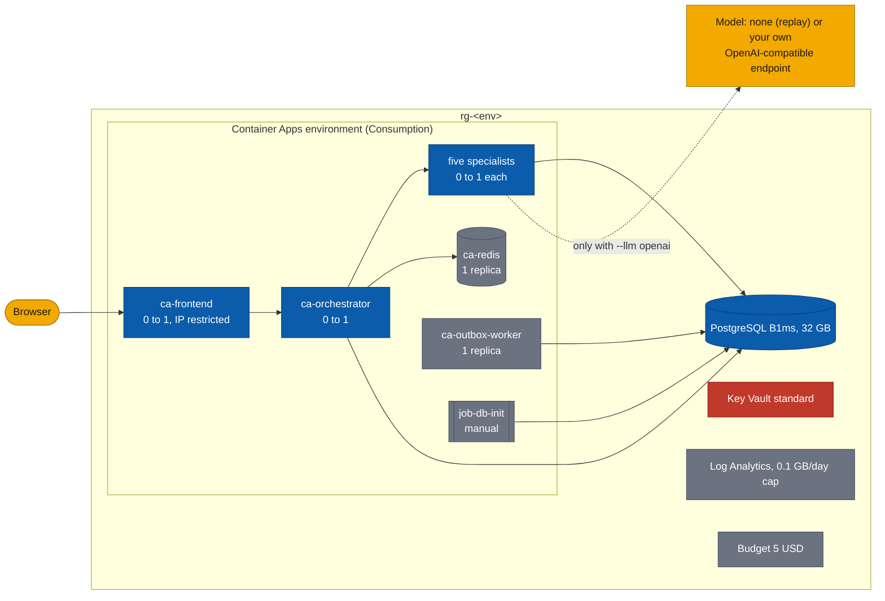
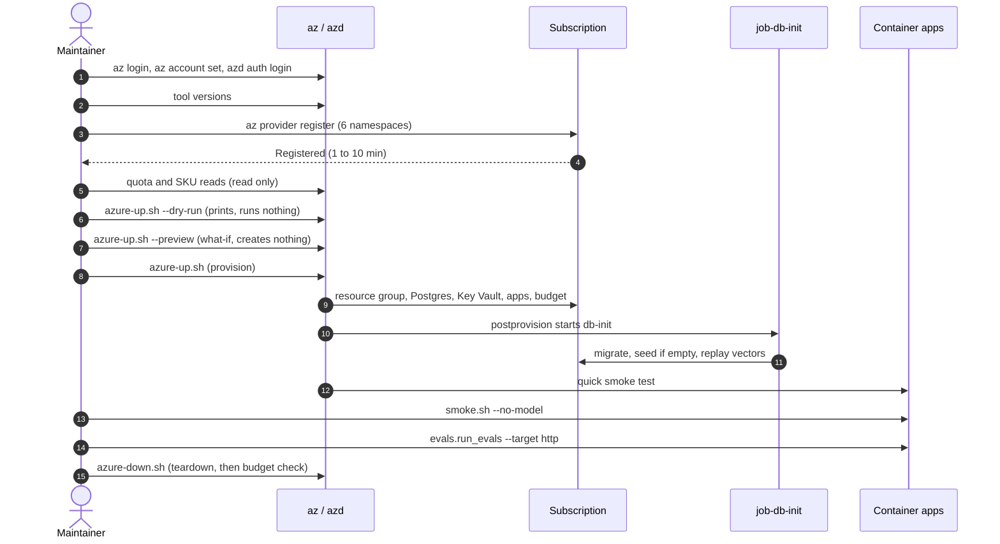

# Azure deployment sequence (free trial)

The ordered steps for a first real deployment on a new personal free-trial subscription, with a hard budget of 5 USD and free resources only. Every stage lists what it creates, what it costs, how long it takes, how to check it worked, how to stop spending, and what is known to go wrong. For the template itself see [azure-deployment.md](azure-deployment.md).

**Status: rehearsed read-only, never deployed.** The Bicep builds and lints, `az deployment sub validate` and `what-if` succeeded for all three free-trial variants against a real, empty subscription, and the region and SKU listings were read. Nothing has been created. What a real deployment is still needed to confirm is in [What this page could not verify](#what-this-page-could-not-verify).

`<subscription-id>`, `<env>` and `<region>` below are placeholders. Do not paste your own account name, tenant, subscription id or resource group into the repo, an issue or a commit.

## What the free-trial profile deploys

`DEPLOY_PROFILE=free-trial` (`infra/profiles/free-trial.json`) is the demo topology shrunk to the cheapest shape the template can express:

| Piece | Free-trial setting | Why |
|---|---|---|
| Container apps | frontend, orchestrator, five specialists: **0 to 1 replica**, scale to zero; orchestrator 0.5 vCPU, 1 GiB | A replica that does not exist costs nothing. The worker (outbox) and Redis stay at 1 replica because nothing HTTP can wake them |
| Redis | `redis:8-alpine` container app, 0.25 vCPU | No Managed Redis. Rate limiting fails open, so Redis is optional, but a configured `REDIS_URL` with nothing behind it adds a connect failure to every request, so the container stays |
| Images | public GHCR at a pinned release tag (`v1.4.0`) | No registry (ACR), no Docker on your machine |
| PostgreSQL | Flexible Server 16, Burstable `Standard_B1ms`, 32 GB (the minimum), no HA, 7 day backups | The cheapest SKU that runs pgvector |
| Key Vault | Standard, no purge protection, 7 day soft delete | A purge-protected vault keeps its name for 90 days |
| Log Analytics | 30 days, **0.1 GB per day cap** (the API minimum is 0.023) | Caps ingestion, so a noisy day cannot cost more than about 0.28 USD |
| Budget | **5 USD**, alerts at 50, 80 and 100 percent actual and 100 percent forecast, sent to subscription Owners and Contributors | Notifies; it does not stop spending |
| Not created | API Management, Managed Redis, ACR, VNet, private endpoints, Foundry project, per-app identities, auth server, MCP servers | Each costs by the hour or needs a feature a trial may lack |



## The model provider on a free trial

Azure OpenAI is pay per token, needs a quota that a new subscription often has at zero, and may need an access request. The template therefore has a switch, `deployOpenAi` (azd `DEPLOY_OPENAI`, default `true`). With `false` it creates no AIServices account, no model deployments, no `Cognitive Services OpenAI User` role and no `azure-openai-key` secret, and the apps run with `externalLlmProvider`:

| `--llm` | What runs | Cost | What works |
|---|---|---|---|
| `replay` (recommended first) | `LLM_PROVIDER=replay`, `EMBEDDING_PROVIDER=replay`, `COST_BUDGET_MODE=observe`. No model is called, and nothing is needed from outside Azure | 0 USD in model tokens | Everything that calls no model: login, catalogue, search (keyless hashing vectors), cart, checkout, orders, approvals inbox, `/runs`, the quick smoke test, and the http eval target on `stack_parity.json`. A chat prompt answers "this prompt was not recorded": the released images carry no recordings ([replay-mode.md](replay-mode.md)) |
| `openai` | `LLM_PROVIDER=openai`, `LLM_BASE_URL`, `LLM_API`, key from Key Vault secret `llm-api-key`, embeddings still `replay` unless you change `EXTERNAL_EMBEDDING_PROVIDER` | whatever the provider charges, outside the Azure budget | Chat turns |
| (omitted) | Azure OpenAI account in the template, `gpt-5.1` and `text-embedding-3-small` at 10K TPM | pay per token on the Azure budget | Chat turns, if the trial has quota |

What is realistic. A model on your laptop (Ollama, LM Studio) is **not reachable** from Container Apps: the apps run in Azure and cannot call `localhost` on your machine. The `openai` path needs a public HTTPS OpenAI-compatible endpoint: a paid key with a hard spending limit, or a provider's free tier if it has an OpenAI-compatible route (rate limits and terms apply; check the provider). The endpoint is a plain environment variable, not a secret; the key is the only secret and lives in Key Vault. A key you export is stored in the azd environment in clear text (git-ignored, `.azure/`) like every other generated secret. Start with `--llm replay`: it proves the whole deployment for no token cost, and you can switch to `openai` later by re-running with the key.

Two limits of the switch. It is Python stack only, and it cannot be combined with `deployGateway`, `deployFoundryProject` or the reference profile, which all need the account.

## The sequence



Costs below are for `eastus2`, USD, from the public Azure Retail Prices API on **2026-11-23** (`https://prices.azure.com/api/retail/prices`, no sign-in), list prices, no discounts:

| Meter | Price |
|---|---|
| Container Apps vCPU active / idle | 0.000024 / 0.000003 per second |
| Container Apps memory, active or idle | 0.000003 per GiB-second |
| Container Apps HTTP requests | 0.40 per million |
| PostgreSQL Flexible Server Burstable B1ms | 0.017 per hour |
| PostgreSQL storage | 0.115 per GB-month |
| PostgreSQL backup storage (LRS) | 0.095 per GB-month |
| Log Analytics, Analytics Logs ingestion | 2.76 per GB (the API also lists a 0.00 row; whether it is a free grant is not verified) |
| Key Vault operations | 0.03 per 10,000 |

**Free grants.** Verified in Microsoft's documentation ([Billing in Azure Container Apps](https://learn.microsoft.com/en-us/azure/container-apps/billing), updated 2026-03-25): each calendar month, per subscription, the first 180,000 vCPU-seconds, 360,000 GiB-seconds and 2 million HTTP requests of the Consumption plan are free; a revision scaled to zero replicas incurs no resource charge; idle rates apply only to a revision held at its minimum replica count. **Not verified** (the pages did not expose the figures when fetched; verify in the portal's free services list before relying on them): the free-account credit amount and period, the 12 month PostgreSQL B1ms allowance, the Log Analytics free ingestion, the Key Vault free operations. The estimates below subtract none of them, so they are upper bounds.

### Estimate for the profile

| Item | Basis | USD |
|---|---|---|
| PostgreSQL compute | 0.017 x 730 h | 12.41 / month |
| PostgreSQL storage | 32 GB x 0.115 | 3.68 / month |
| Outbox worker, 1 replica idle | (0.5 vCPU x 0.000003 + 1 GiB x 0.000003) x 2,628,000 s | 11.83 / month |
| Redis, 1 replica idle | (0.25 x 0.000003 + 0.5 x 0.000003) x 2,628,000 s | 5.91 / month |
| Specialists, orchestrator, frontend | scaled to zero | 0 while idle |
| Log Analytics | at most 0.1 GB x 2.76 x 30 (the cap) | up to 8.28 / month |
| **Left up, idle** | | **about 33.8 fixed, up to 42.1 with the log cap reached** |
| **Per hour, idle** | 33.83 / 730 | **0.046** |
| **Per day, idle, with the log cap** | 24 x 0.046 + 0.276 | **1.39** |

At that rate the 5 USD budget lasts about **3.6 days** (5 / 1.39) before it is spent, and a month costs about 8 times the budget. This profile is for a test and a teardown, not for leaving up. The idle worker and Redis are the largest compute lines; the free monthly vCPU and GiB grants would absorb part of them, by an amount this page does not claim.

### Cost of a 2 hour test

| Item | Basis | USD |
|---|---|---|
| Fixed resources, 2 h | 0.0463 x 2 | 0.093 |
| Eight HTTP apps active for 30 minutes | 8 x (0.5 x 1800 x 0.000024 + 1 x 1800 x 0.000003) | 0.216 |
| `job-db-init`, 10 minutes (estimate) | 0.5 x 600 x 0.000024 + 1 x 600 x 0.000003 | 0.009 |
| Log Analytics, cap for 2 h | 0.1 GB x 2.76 x 2 / 24 | up to 0.023 |
| Model tokens with `--llm replay` | no model is called | 0 |
| **Total, upper bound before any free grant** | | **about 0.34** |

The Container Apps lines fall inside the free monthly grants (50 vCPU-hours), so the realistic bill for the test is the Postgres lines, roughly 0.10 USD. Add the provider's own charges if you use `--llm openai`. Costs can lag in the portal by several hours; check Cost Management the next day.

---

### Stage 1. Sign in

```bash
az login
az account show --query name -o tsv          # confirm it is the NEW subscription before going on
az account set --subscription <subscription-id>
azd auth login                               # separate sign-in; az login does not cover azd
```

- **Creates:** nothing. **Cost:** none. **Time:** a minute (estimate).
- **Verify:** `az account show --query "{name:name,state:state}" -o json` prints state `Enabled`. `az role assignment list --assignee "$(az ad signed-in-user show --query id -o tsv)" --query "[].roleDefinitionName" -o tsv` lists `Owner` (the template creates role assignments).
- **Roll back:** `az logout`; `azd auth logout`.
- **Failure modes:** [#34](troubleshooting.md#azure-deployment-first-run-failure-catalogue) (azd signed out, no subscription chosen), [#11](troubleshooting.md#azure-deployment-first-run-failure-catalogue) (no role-assignment rights).

### Stage 2. Tool versions

```bash
az version --query '"azure-cli"' -o tsv      # 2.67 or newer
azd version                                  # 1.18 or newer
az bicep version                             # 0.34 or newer; az bicep install if missing
jq --version && curl --version | head -n 1
```

- **Creates:** nothing. **Cost:** none. **Time:** under a minute.
- **Verify:** the versions above. `scripts/azure/prereqs.sh` repeats the check and refuses an old tool.
- **Roll back:** not needed.
- **Failure modes:** an old `az` lacks `az containerapp job` flags; `azd` below 1.18 does not read `main.parameters.json` defaults the same way.

### Stage 3. Provider registration (you run it)

A new subscription has the providers unregistered. The free-trial path needs these six (add `Microsoft.CognitiveServices` only if you deploy the Azure OpenAI account):

```bash
az provider register --namespace Microsoft.App
az provider register --namespace Microsoft.OperationalInsights
az provider register --namespace Microsoft.Insights
az provider register --namespace Microsoft.DBforPostgreSQL
az provider register --namespace Microsoft.KeyVault
az provider register --namespace Microsoft.ManagedIdentity
# Only without --llm: the Azure OpenAI account.
az provider register --namespace Microsoft.CognitiveServices

az extension add --name containerapp --upgrade --only-show-errors
```

`Microsoft.Authorization` and `Microsoft.Consumption` (the budget) were already registered on the subscription this page was rehearsed against; check yours. `Microsoft.ContainerRegistry` and `Microsoft.Network` are **not** needed by this profile (`scripts/azure-up.sh --profile free-trial` skips them).

- **Creates:** provider registrations on the subscription. Free.
- **Time:** 1 to 10 minutes each (estimate; they run in parallel).
- **Verify:**
  ```bash
  az provider list --query "[?namespace=='Microsoft.App' || namespace=='Microsoft.DBforPostgreSQL' || namespace=='Microsoft.KeyVault' || namespace=='Microsoft.OperationalInsights' || namespace=='Microsoft.Insights' || namespace=='Microsoft.ManagedIdentity'].{ns:namespace,state:registrationState}" -o table
  ```
  Every row says `Registered`.
- **Roll back:** `az provider unregister --namespace <ns>` once the namespace holds no resources. Leaving them registered costs nothing.
- **Failure modes:** [#33](troubleshooting.md#azure-deployment-first-run-failure-catalogue) (`MissingSubscriptionRegistration`). Until `Microsoft.App` is registered, `az containerapp list-usages` and `az cognitiveservices usage list` answer with an error or an empty list, so the quota check in stage 4 means nothing before this stage is done.

### Stage 4. Quota and region check (read only)

```bash
az postgres flexible-server list-skus --location eastus2 -o json \
  | jq -r '.[0] | (.reason // "no restriction"), ([.supportedServerEditions[] | select(.name=="Burstable") | .supportedServerSkus[].name] | join(" "))'
az containerapp list-usages --location eastus2 -o table          # after stage 3
az cognitiveservices usage list --location eastus2 -o table      # only for the Azure OpenAI path; empty or zero means no quota
```

- **Creates:** nothing. **Cost:** none. **Time:** a minute.
- **Verify:** the first command prints `no restriction` and a list that includes `Standard_B1ms`. In the rehearsal `eastus2` was unrestricted and `eastus` answered "Provisioning is restricted in this region" (see [Findings](#findings-from-the-read-only-rehearsal)).
- **Roll back:** not needed.
- **Failure modes:** [#5](troubleshooting.md#azure-deployment-first-run-failure-catalogue) (Postgres restricted in the region: pick another `--location`), [#3](troubleshooting.md#azure-deployment-first-run-failure-catalogue) (no TPM quota: use `--llm`). `scripts/azure/prereqs.sh` runs the Postgres check and, without `--llm`, the model and quota check.

### Stage 5. Dry run (prints, runs nothing)

```bash
scripts/azure-up.sh --env <env> --location eastus2 --profile free-trial --llm replay --image-tag v1.4.0 --dry-run
```

- **Creates:** nothing; every `az` and `azd` command is printed. **Cost:** none. **Time:** seconds.
- **Verify:** the output ends with `azd provision --environment <env> --no-prompt`, has `azd env set DEPLOY_OPENAI false`, and contains no `az cognitiveservices model list`.
- **Roll back:** not needed.
- **Failure modes:** `--llm openai` without `--llm-base-url` or without `LLM_API_KEY` in the environment is refused with a message; a floating `--image-tag latest` is refused ([#22](troubleshooting.md#azure-deployment-first-run-failure-catalogue) family).

### Stage 6. What-if

```bash
scripts/azure-up.sh --env <env> --location eastus2 --profile free-trial --llm replay --image-tag v1.4.0 --preview
```

This runs the prerequisite checks (registering any provider you skipped), creates the **local** azd environment and generates the secrets into `.azure/<env>/.env`, then `azd provision --preview`, which is a what-if. It creates nothing in Azure. Expect about 31 creates: the resource group, Log Analytics, Application Insights, the identity, Key Vault with eight secrets, Postgres with its configuration, database and firewall rule, the environment, nine container apps, the job and the budget. Role assignments show as "Unsupported" (their names are computed at deployment time); that is normal.

If you would rather read it without azd, `az deployment sub what-if --location eastus2 --parameters infra/ci/free-trial-replay.bicepparam` shows the same shape with CI placeholders, and `az deployment sub validate` with the same arguments checks the template against ARM. Both were run in the rehearsal and succeeded.

- **Creates:** local files only. **Cost:** none. **Time:** 1 to 3 minutes (estimate).
- **Verify:** the command exits 0 and the summary has no `Delete` or `Modify` lines for a fresh environment.
- **Roll back:** `azd env delete <env>` removes the local environment.
- **Failure modes:** a purged-name collision ([#12](troubleshooting.md#azure-deployment-first-run-failure-catalogue)); an Azure Policy that denies public Postgres or local auth ([#23](troubleshooting.md#azure-deployment-first-run-failure-catalogue)). Whether `azd provision --preview` also runs the `preprovision` hook is unverified, which is why `--preview` runs `preprovision.sh` itself.

### Stage 7. Provision

```bash
# Replay path: no key, no model. For your own endpoint add:
#   export LLM_API_KEY=...           (the key is never an argument)
#   --llm openai --llm-base-url https://<host>/v1 --llm-model <model>
scripts/azure-up.sh --env <env> --location eastus2 --profile free-trial --llm replay --image-tag v1.4.0
```

- **Creates:** everything in [What the profile deploys](#what-the-free-trial-profile-deploys), then runs the `postprovision` hook (stages 8 to 10). The frontend answers only your public IP.
- **Cost:** about 0.046 USD per hour from the moment Postgres exists (see the estimate). **Time:** 15 to 30 minutes (estimate; Postgres dominates).
- **Verify:**
  ```bash
  az group show --name rg-<env> --query properties.provisioningState -o tsv      # Succeeded
  az containerapp list --resource-group rg-<env> --query "[].{n:name,min:properties.template.scale.minReplicas,max:properties.template.scale.maxReplicas}" -o table
  az consumption budget list --query "[].{n:name,amount:amount}" -o table        # 5
  ```
  `azd env get-value FRONTEND_URL` prints the URL.
- **Roll back / stop spending:** `scripts/azure-down.sh --env <env>` (stage 12). If provisioning stops half way, the resources that exist still bill: run the teardown before debugging for long.
- **Failure modes:** [#10](troubleshooting.md#azure-deployment-first-run-failure-catalogue) (Key Vault role propagation, retried once after 60 s), [#12](troubleshooting.md#azure-deployment-first-run-failure-catalogue), [#6](troubleshooting.md#azure-deployment-first-run-failure-catalogue), [#7](troubleshooting.md#azure-deployment-first-run-failure-catalogue), [#8](troubleshooting.md#azure-deployment-first-run-failure-catalogue), and the free-trial rows 39 to 44 there. A trial's cap on Container Apps environments or cores shows as a quota error from `Microsoft.App`; it cannot be read in advance (see below).

### Stage 8. Database bootstrap (`job-db-init`)

Run by `postprovision`; to run it again:

```bash
az containerapp job start --name job-db-init --resource-group rg-<env> --query name -o tsv
```

- **Creates:** schema, 45 tables, pgvector extension, indexes. **Cost:** a few cents of Container Apps compute. **Time:** 5 to 15 minutes (estimate; with `replay` embeddings it is the short end).
- **Verify:** `az containerapp job execution list --name job-db-init --resource-group rg-<env> --query "sort_by(@, &properties.startTime)[-1].properties.status" -o tsv` prints `Succeeded`.
- **Roll back:** the job is idempotent (`seed --if-empty`); deleting the resource group removes the data.
- **Failure modes:** [#6](troubleshooting.md#azure-deployment-first-run-failure-catalogue) (`vector` not allow-listed), [#13](troubleshooting.md#azure-deployment-first-run-failure-catalogue), [#14](troubleshooting.md#azure-deployment-first-run-failure-catalogue), [#24](troubleshooting.md#azure-deployment-first-run-failure-catalogue) (job log lag), [#37](troubleshooting.md#azure-deployment-first-run-failure-catalogue).

### Stage 9. Seed check

The seeder is part of stage 8. Prove the data is there through the same path a browser uses:

```bash
FRONTEND_URL="$(azd env get-value FRONTEND_URL)" E2E_STAFF_PASSWORD="$(azd env get-value SEED_STAFF_PASSWORD)" scripts/azure/smoke.sh --quick
```

- **Creates:** nothing (it logs in as admin and alice and lists products). **Cost:** none beyond requests. **Time:** about a minute, plus up to 5 minutes for a cold start.
- **Verify:** it prints `PASS: quick smoke`, with `products listed (N total)` where N is above zero.
- **Roll back:** not needed.
- **Failure modes:** [#36](troubleshooting.md#azure-deployment-first-run-failure-catalogue) (revisions still starting), [#18](troubleshooting.md#azure-deployment-first-run-failure-catalogue), and a 403 from the frontend when your IP changed (`azd env set DEPLOYER_IP <ip>`, then run stage 7 again).

### Stage 10. Smoke test

```bash
FRONTEND_URL="$(azd env get-value FRONTEND_URL)" E2E_STAFF_PASSWORD="$(azd env get-value SEED_STAFF_PASSWORD)" \
  AZURE_RESOURCE_GROUP=rg-<env> DB_INIT_JOB_NAME=job-db-init scripts/azure/smoke.sh --no-model
```

`--no-model` runs the quick checks plus the approval flow (a return paused in `workflow:return-replace`, decided by a reviewer, shown on the run timeline) and skips the one keyed chat turn that needs a model. Drop `--no-model` once the stack has a real model.

- **Creates:** a return and an approval row in the demo data. **Cost:** none. **Time:** 1 to 5 minutes.
- **Verify:** `PASS: full smoke`. If the approval step fails under replay, the quick smoke in stage 9 is the replay-compatible gate; the approval step is meant to need no model but has not run under replay.
- **Roll back:** the demo data goes with the resource group.
- **Failure modes:** [#20](troubleshooting.md#azure-deployment-first-run-failure-catalogue) and [#28](troubleshooting.md#azure-deployment-first-run-failure-catalogue); with scale to zero a specialist's first request is a cold start (row 40).

### Stage 11. Evaluation against the deployed stack

The http eval target needs only the URL. Use the frontend URL (it proxies `/api/*` to the orchestrator, which has no public address):

```bash
cd agents/python
export EVAL_STAFF_PASSWORD="$(azd env get-value SEED_STAFF_PASSWORD)"
LLM_PROVIDER=replay uv run python -m evals.run_evals --target http \
  --base-url "$(azd env get-value FRONTEND_URL)" --stack python --chat-provider replay \
  --agent orchestrator --dataset evals/datasets/stack_parity.json --pass-threshold 0 --records-out /tmp/freetrial-eval.jsonl
```

`stack_parity.json` holds cases that call no model, so it runs on a `replay` deployment. A model-calling dataset against a replay stack reports replay misses, not scores; run those only after `--llm openai` or the Azure OpenAI path, and only on purpose (they spend provider money outside this budget).

- **Creates:** conversations and run records in the demo database. **Cost:** requests only. **Time:** 1 to 3 minutes (estimate; cold starts first).
- **Verify:** the run prints a per-suite report and exits 0 with `--pass-threshold 0`; `/tmp/freetrial-eval.jsonl` has one record per case.
- **Roll back:** the data goes with the resource group.
- **Failure modes:** a 429 backs off and retries; a replay miss is reported, never silently scored; the frontend IP allow-list must include the machine running the eval.

### Stage 12. Teardown

```bash
scripts/azure-down.sh --env <env>            # azd down --purge --force, purges Key Vault, proves rg-<env> is gone
az group exists --name rg-<env>              # false
az keyvault list-deleted --query "[].name" -o tsv    # empty
```

- **Deletes:** the resource group and every resource in it, then purges the soft-deleted vault. **Cost:** stops the hourly charges. **Time:** 5 to 15 minutes (estimate).
- **Verify:** `az group exists` prints `false`. Check Cost Management the next day; costs lag.
- **Roll back:** none; redeploy from stage 7.
- **Failure modes:** [#38](troubleshooting.md#azure-deployment-first-run-failure-catalogue) (`azd down` fails or the environment is not on this machine: `az group delete --name rg-<env> --yes`, then `scripts/azure-down.sh --env <env> --purge-only`). The budget resource is inside the group and is deleted with it.

## Findings from the read-only rehearsal

Run against an empty new subscription, nothing created. Classified as the task asked.

| Finding | Class | What it means |
|---|---|---|
| The template, its modules and all fixtures build and lint clean (Bicep 0.49.2) | none | |
| `az deployment sub validate` and `what-if` succeeded for `free-trial`, `free-trial-replay` and `free-trial-openai` while 9 of 11 providers were unregistered | none | Neither command checks registration, quota or policy, so a clean result does not predict a clean deployment |
| `Microsoft.App`, `OperationalInsights`, `Insights`, `DBforPostgreSQL`, `KeyVault`, `ManagedIdentity`, `CognitiveServices`, `ContainerRegistry`, `Network` were not registered | permission (the maintainer registers them, stage 3) | `az containerapp list-usages` failed with a registration error until `Microsoft.App` is registered |
| `az cognitiveservices usage list` returned an empty list | quota (unknown) | Empty because the provider is unregistered; the TPM quota for `gpt-5.1` can only be read after stage 3 |
| `az cognitiveservices model list` for `eastus2`: `gpt-5.1` `2025-11-13` and `text-embedding-3-small` `1` are GenerallyAvailable with a GlobalStandard SKU; `gpt-4.1-mini` is `Legacy` | quota | The models exist; whether this subscription may deploy them is the unread quota |
| `az postgres flexible-server list-skus`: `eastus2`, `centralus`, `westus3`, `westeurope`, `northeurope`, `swedencentral`, `uksouth` offer `Standard_B1ms` with no restriction; **`eastus` answers "Provisioning is restricted in this region"** | policy (offer restriction on a new subscription) | Use `eastus2` (the region every example here uses). Not a template defect |
| No Azure Policy assignments were visible to the signed-in user | policy | A policy that denies a resource would show only at deployment |
| The signed-in user holds `Owner` | permission ok | Role assignments in the template can be created |
| `Microsoft.App` free-trial caps (environments, cores) | quota (unreadable) | Needs the provider registered; read `az containerapp list-usages --location eastus2` after stage 3 |
| Log Analytics `workspaceCapping.dailyQuotaGb` must be a number the Bicep type system could not express as `int` | template defect, **fixed** | The monitoring module now takes the cap as a decimal string and passes it through `json()`; the what-if shows `0.1` |
| A conditional secret gated on a `@secure()` value was predicted even when empty (`bicep snapshot`) | template defect, **fixed** | Gated on a plain boolean instead, so the demo's resource list is unchanged (pinned by test) |

## What this page could not verify

Without a real deployment:

- That a free-trial subscription can create a Container Apps environment and nine apps, and what core and environment quotas it enforces.
- That Postgres Flexible Server creation succeeds on the trial (the SKU listing is not an offer check) and that `azure.extensions` accepts `VECTOR,PGCRYPTO`.
- That the Container Apps environment has no hourly management charge. The Retail Prices API lists an `Environment Management Hour` meter at 0.10 USD an hour; the billing page says plan management charges apply to Dedicated profiles, private endpoints and planned maintenance, none of which this profile uses. If that meter appeared on a bill it would cost 2.40 USD a day: check Cost Management a few hours after stage 7.
- Cold-start behaviour with every HTTP app at zero. Troubleshooting row 21 says a Python cold start can exceed the 60 second A2A timeout; this profile accepts that risk, so the first chat turn after idle may fail and the second succeed. Warm the chain with a login and a product list first, or set `minReplicas` to 1 in the profile for the orchestrator and specialists (idle cost about 11.8 USD a month for each at 0.5 vCPU and 1 GiB).
- Whether the free grants (account credit, 12 month Postgres, Log Analytics) apply to this subscription and by how much.
- Whether budget notifications are accepted on a trial subscription, and when they arrive.
- Whether `azd provision --preview` runs the preprovision hook.
- The PowerShell mirrors (`azure-up.ps1`, `prereqs.ps1`, `preprovision.ps1`) do not have the free-trial or `--llm` options; use the bash scripts (macOS, Linux, WSL).
