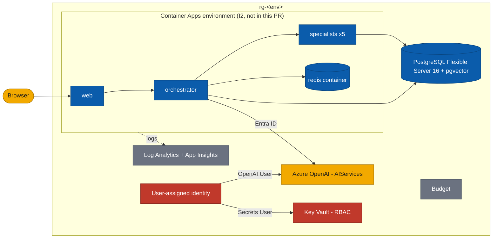

# Azure deployment (draft)

**Status: draft.** Only the infrastructure skeleton exists (`infra/`). The Container Apps environment and apps, `azure.yaml`, the azd hooks and the helper scripts arrive in later PRs (I2 to I4). Nothing here has been deployed: the Bicep compiles and lints offline, and every behaviour below that needs a subscription is marked as an assumption. For the local and Compose paths see [deployment.md](deployment.md).

## Topology



## What the skeleton creates

| Resource | Name | Notes |
|---|---|---|
| Resource group | `rg-<environmentName>` | tagged `azd-env-name` |
| Log Analytics + App Insights | `log-<token>`, `appi-<token>` | daily ingestion cap from the profile |
| User-assigned identity | `id-<token>` | runtime identity for later apps |
| Key Vault | `kv-<token>` | RBAC; holds `postgres-admin-password`, `jwt-secret`, `agent-shared-secret` |
| PostgreSQL Flexible Server 16 | `psql-<token>` | database `ecommerce_agents`, admin `ecomadmin`, `azure.extensions = VECTOR,PGCRYPTO`, TLS required |
| Azure OpenAI (AIServices) | `ai-<token>` | `chat` (default gpt-5.1) and `embedding` (text-embedding-3-small); optional `chat-mini` |
| Budget | `budget-<environmentName>` | notifies subscription Owners and Contributors, no email in the repo |

`<token>` is `toLower(uniqueString(subscription().id, environmentName, location))`, 13 characters, so every name stays inside its length limit.

## Profiles

`infra/profiles/demo.json` and `reference.json` carry the SKUs and counts; pick one with the `DEPLOY_PROFILE` azd variable (default `demo`).

| | demo | reference |
|---|---|---|
| PostgreSQL | Burstable B1ms, 32 GB, no HA | General Purpose D2ds_v5, 128 GB, zone-redundant HA, geo-redundant backup |
| Postgres network | public, AllowAllAzureServices | public for now; private endpoint is a later PR |
| Key Vault | no purge protection, 7 day soft delete | purge protection, 90 day soft delete |
| Log Analytics cap | 1 GB/day, 30 days | 5 GB/day, 90 days |
| OpenAI capacity (K TPM) | chat 50, embedding 20 | chat 100, embedding 50 |
| Budget | 150 / month | 800 / month |

Cost estimate (not measured, list prices, a single region, light traffic): demo roughly 60 to 120 USD/month before model usage, dominated by PostgreSQL and Container Apps once I2 lands; reference several times that. Treat both as order-of-magnitude figures and check the Azure pricing calculator.

## Parameters and secrets

`infra/main.parameters.json` uses azd `${VAR}` substitution: `AZURE_ENV_NAME`, `AZURE_LOCATION`, `AZURE_OPENAI_LOCATION` (defaults to the location), `AZURE_PRINCIPAL_ID`, `DEPLOY_PROFILE`, `AZURE_CHAT_MODEL`, `AZURE_CHAT_MODEL_VERSION`, `DEPLOY_MINI_MODEL`. The three secrets (`POSTGRES_ADMIN_PASSWORD`, `JWT_SECRET`, `AGENT_SHARED_SECRET`) are `@secure()` parameters read from the azd environment; they are never outputs and never committed. `.azure/` (azd's environment store) is git-ignored.

## Offline checks

```bash
cd infra
bicep build main.bicep
bicep lint main.bicep
for f in ci/*.bicepparam; do bicep build-params "$f" --stdout > /dev/null; done
cd ../agents/python && uv run pytest tests/test_infra_bicep.py
```

`.github/workflows/infra-offline.yml` runs the same on pull requests touching `infra/`, with no Azure credentials. The linter treats `secure-secrets-in-params`, `outputs-should-not-contain-secrets` and `use-recent-api-versions` as errors (`infra/bicepconfig.json`).

## Gotchas and known issues

- **Serialisation.** Model deployments on one account, and server parameters plus the database on one Flexible Server, are chained with `dependsOn`. Parallel writes fail with busy or conflict errors.
- **Purge protection is one way.** Once enabled it cannot be turned off, which is why the demo profile omits it. A soft-deleted vault keeps its name until purged.
- **Redis** is a placeholder module (`modules/redis-container.bicep`) until I2.
- **Model availability** (gpt-5.1 2025-11-13, GlobalStandard, quota) varies by region and subscription. Set `AZURE_OPENAI_LOCATION` if the primary region lacks it.
- **Budget start date** defaults to the first of the current month via `utcNow`, so redeploying in a later month moves it.

## Assumptions to confirm on a real subscription

- gpt-5.1 `2025-11-13` and a `gpt-5.1-mini` name exist and accept the requested capacities in the chosen region.
- text-embedding-3-small version `1` accepts `GlobalStandard`; otherwise set `embeddingSkuName` to `Standard`.
- `azure.extensions` accepts `VECTOR,PGCRYPTO` and the `source` value `user-override` is accepted by API 2025-08-01.
- The AllowAllAzureServices rule name and a 0.0.0.0 range are accepted.
- Budget notifications with `contactRoles` and an empty `contactEmails` are accepted by the Consumption API.
- ARM writes Key Vault secrets without a data-plane role for the deploying identity.
- Newer API versions than the ones in the task brief compiled and linted cleanly; their runtime behaviour is unverified.
