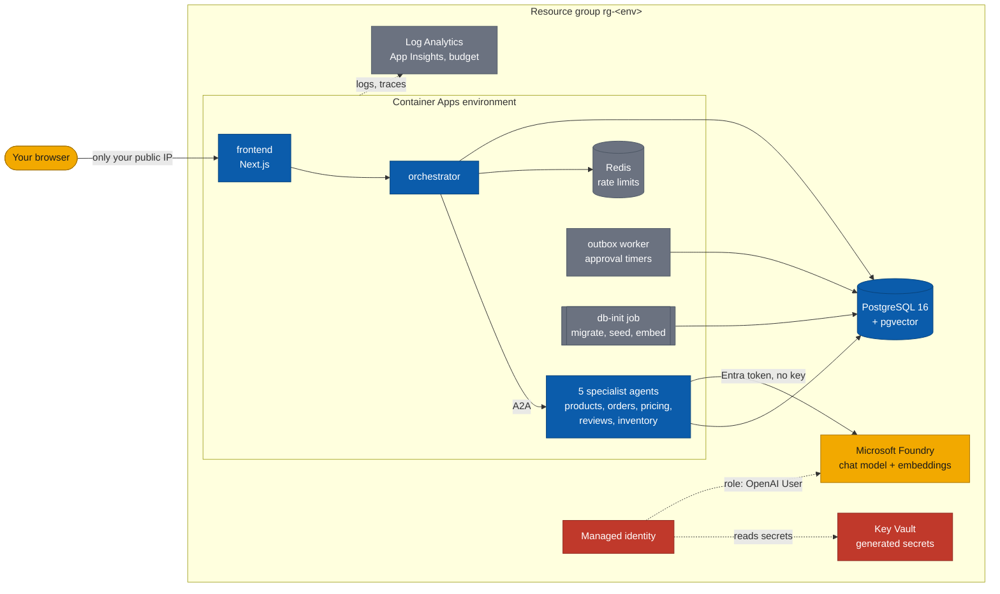

# Deploy to Azure

One command deploys the whole demo to your own Azure subscription and prints the URL when it is ready. It was deployed and tested from a clean subscription: provisioned in about 8 minutes, URL and accounts printed at about 10 minutes, then a smoke test with a real model, a return approval and a database check.

```bash
az login && azd auth login
scripts/azure-up.sh                  # shows progress, then prints the URL, the accounts and what to try
scripts/azure-down.sh --env <env>    # removes everything and proves it (the name is printed in the banner)
```

Nothing else is needed: no Docker, no model key, no app registration, no secret to invent. Every value has a default and can be overridden ([options](#options)).

## What gets created



| Resource | What it is used for |
|---|---|
| Container Apps (frontend, orchestrator, five specialists, outbox worker, Redis) | The application. Everything scales to zero except the worker and Redis. Only the frontend is reachable from outside, and only from your IP |
| `db-init` job | Runs once after provisioning: schema migrations, the seed data (the [documented accounts](demo-guide.md)) and product embeddings |
| PostgreSQL Flexible Server | All application data, with pgvector for semantic search |
| Microsoft Foundry account and project | The chat model (`gpt-4.1-mini`) and the embedding model. The apps call them with the managed identity: there is no model key anywhere |
| Key Vault | The four generated secrets (database URL, JWT secret, agent shared secret, seed password). Apps read them by reference through the identity |
| Log Analytics, Application Insights, budget | Logs and traces (capped at 0.1 GB a day) and a 10 USD budget that emails you at 50, 80 and 100 percent |

## Before you start

- An Azure subscription where you are **Owner** (the template creates role assignments).
- `az` 2.67+, `azd` 1.18+, `jq`, `curl` and `bash` (macOS, Linux or WSL).

## What the command does

| Step | What happens | Measured |
|---|---|---|
| 1. Checks | Tools and sign-ins, resource providers, Postgres and model availability in the region, name collisions | under a minute |
| 2. Secrets | Generates every secret once and reuses it on later runs | seconds |
| 3. Provision | Creates everything above with `infra/main.bicep` | about 8 minutes |
| 4. Smoke test | Starts the db-init job, then logs in, chats with the real model, and runs a return through approval | about 2 minutes |
| 5. Done | Prints the URL, the accounts, two prompts to try, and the verify and teardown commands | |

If a step fails, read the message, fix the cause and run the same command again: it is safe to repeat. Common first-run failures (region restrictions, model quota, role propagation) are in [troubleshooting](troubleshooting.md#azure-deployment-first-run-failure-catalogue).

## Options

The defaults are printed on a `using:` line before anything is created. A flag wins over an environment variable, which wins over the default.

| Setting | Flag | Variable | Default |
|---|---|---|---|
| Environment name | `--env` | `ECA_ENV` | `eca-` plus a hash of your subscription, so a re-run updates the same environment |
| Region | `--location` | `ECA_LOCATION` | the first region where PostgreSQL `Standard_B1ms` is available to you |
| Size | `--profile` | `ECA_PROFILE` | `small` (`demo` and `reference` are larger) |
| Image version | `--image-tag` | `ECA_IMAGE_TAG` | the newest published build of `main` |
| Chat model | `--chat-model`, `--chat-model-version` | none | `gpt-4.1-mini` `2025-04-14` |
| No model quota | `--llm replay` | none | off: replay answers recorded prompts only; `--llm openai` uses your own endpoint |
| Passwords | `--generated-passwords` | `ECA_DEMO_PASSWORDS` | the documented demo accounts |
| Access | `--public-open`, `--allowed-ips` | none | only your public IP |

`--dry-run` prints every command and changes nothing. All the other options are in the [reference](azure-deployment-reference.md#azd-environment-variables).

## Signing in

The default run seeds the same accounts as a local install: `admin.demo@gmail.com` / `admin123`, `support.demo@gmail.com` / `support123`, `seller.demo@gmail.com` / `seller123`, `power.demo@gmail.com` / `power123`, and the customers (for example `alice.johnson@gmail.com`) with `customer123`. These passwords are public, so they are used only while the frontend is restricted to your IP. With `--public-open` or `--generated-passwords` the staff accounts get a generated password instead: `azd env get-value SEED_STAFF_PASSWORD`. If your IP changes, `azd env set DEPLOYER_IP <ip>` and run the command again.

## Cost

The `small` size is about 1.4 USD a day while it is up, and about 0.4 USD for a two hour test. `demo` is 4 to 12 USD a day. The budget only sends alerts; it does not stop spending, so tear down when you are done. The breakdown is in [stages and costs](azure-deployment-stages.md#estimate-for-the-profile).

## Tear down

```bash
scripts/azure-down.sh --env <env>            # deletes everything, including soft-deleted vaults and model accounts
scripts/azure/verify-clean.sh --env <env>    # read only: nine CLEAN lines
```

## Known limits

- The PostgreSQL admin password stays a generated password; the rest is keyless.
- A new subscription allows one Container Apps environment.
- After idle, the first request can be slow while the apps start.
- Evaluations and the generated-UI cards are not covered by the deployed checks; run them locally.

More: [stages, costs and teardown in detail](azure-deployment-stages.md), [reference](azure-deployment-reference.md) (profiles, wiring, optional gateway and per-app identities, the Deploy to Azure button), [troubleshooting](troubleshooting.md#azure-deployment-first-run-failure-catalogue).
