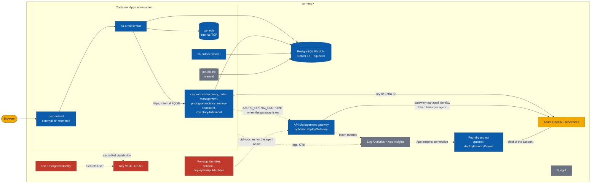

# Azure deployment

Bicep templates and scripts that deploy the Python stack to Azure Container Apps, for anyone who wants to run the demo in their own subscription.

**Status: deployed and tested from a clean subscription, with one command.** `scripts/azure-up.sh` with no arguments provisioned the free-trial profile in 7 minutes 32 seconds, printed the URL and accounts at 10 minutes 30 seconds, and passed the smoke test (real model answers with product cards, a return paused, approved and executed), the database, chat-turn and direct model checks; the teardown was verified clean. The numbers, the findings and the known limits are on [the free-trial page](azure-deployment-sequence.md). The `demo` and `reference` profiles, the gateway, the per-app identities and the .NET stack (`--stack dotnet`) were checked offline only; the assumptions that need a subscription for them are at the [end of this page](#assumptions-still-to-confirm). For local and Compose paths see [deployment.md](deployment.md).

The Bicep in `infra/` is hand-written; it is not generated from the .NET Aspire AppHost, which is a local development tool and not a deployment path.

**Azure is optional.** Nothing outside `infra/`, `azure.yaml`, `scripts/azure*` and `.github/workflows/azure.yml` needs it. The default dev, demo and eval paths run with `LLM_PROVIDER=openai`, `replay` or any OpenAI-compatible endpoint and never touch Azure.

## One command

```bash
az login && azd auth login
scripts/azure-up.sh                  # prints progress, then the URL, the accounts and what to test
scripts/azure-down.sh --env <env>    # removes everything and proves it (the env name is in the banner)
```

You need an Azure subscription where you are **Owner** (or Contributor plus User Access Administrator, because the template creates role assignments), `az` 2.67+, `azd` 1.18+, Bicep 0.34+ (`az bicep install`), `jq`, `curl` and `bash`. No Docker, no model key, no app registration, nothing to invent: every secret is generated, and the images are public on GHCR.

The defaults, and the flag or `ECA_*` variable that overrides each, are in [the table on the free-trial page](azure-deployment-sequence.md#the-command). In short: environment `eca-<hash of your subscription>`, the first region where PostgreSQL `Standard_B1ms` is offered, the `free-trial` profile (`gpt-4.1-mini` through Foundry), the newest `main` image that is published, the documented demo accounts, and a frontend reachable only from your public IP. `--dry-run` prints every command and changes nothing.

**Cost.** The free-trial profile is about 1.4 USD a day idle and roughly 0.4 USD for a two hour test (list prices, [the breakdown](azure-deployment-sequence.md#estimate-for-the-profile)); the `demo` profile is 4 to 12 USD a day and `reference` several times that. The budget alert only notifies, it does not stop spending: run the teardown when you are done.

**What each step does**

| Step | What happens | Typical time |
|---|---|---|
| `[1/5]` checks (`prereqs.sh`) | tools and both sign-ins, resource provider registration (waits), role-assignment permission, the Postgres SKU, model availability and quota, soft-deleted names | under a minute; up to 10 on a subscription that never registered the providers |
| `[2/5]` secrets | the azd environment is created and every secret is generated once, **before** the first provision, because azd reads template parameters before it runs hooks | seconds |
| `[3/5]` `azd provision` | `infra/main.bicep` at subscription scope: resource group, Log Analytics, App Insights, identities, Key Vault, Postgres with pgvector, the Foundry account, project and model deployments, the Container Apps environment, the apps, the db-init job, the budget | about 8 minutes measured for the free-trial profile |
| `[4/5]` smoke test (`postprovision`) | starts `job-db-init` (migrations, seed, embeddings) and waits, then the smoke test: login, catalogue, a streamed chat turn with product cards, a return that parks, is approved and runs | about 2 minutes measured |
| `[5/5]` done | the banner, then `sanity.sh` (database, chat turn, direct model call with a bearer token) unless `--no-verify` | about 1 minute |

**If a step fails:** read the message, fix the cause and re-run the same command; it is idempotent (secrets, environment and resources are reused). The failures a new subscription meets are [listed with their fixes](azure-deployment-sequence.md#limits-a-new-subscription-meets) and in [troubleshooting.md](troubleshooting.md#azure-deployment-first-run-failure-catalogue). The frontend answers only your public IP; if it changes, `azd env set DEPLOYER_IP <ip>` and run the script again.

**Tear down** (everything, including the soft-deleted Key Vault and model account that would block a re-deploy):

```bash
scripts/azure-down.sh --env <env>            # azd down --purge --force, purges leftovers, then proves rg-<env> is gone
scripts/azure/verify-clean.sh --env <env>    # read only; nine CLEAN lines
```

The reference profile turns on Key Vault purge protection, which cannot be undone: after teardown its vault stays soft-deleted for the retention period (90 days) and **that `--env` name cannot be deployed again until then**. Use a new name. The teardown reports this and exits 0, because nothing is billed for it.

## Accounts

The default run seeds the documented accounts, the same ones a local `./scripts/dev.sh` run has: `admin.demo@gmail.com` / `admin123`, `support.demo@gmail.com` / `support123`, `seller.demo@gmail.com` / `seller123`, `power.demo@gmail.com` / `power123` and the customers (for example `alice.johnson@gmail.com`) with `customer123`. These passwords are public, so they are seeded only while the frontend is IP-restricted: the template passes `seedDemoPasswords` through only when `publicAccess` is `restricted`, and `--public-open` falls back to a generated staff password. `--generated-passwords` does the same on a restricted frontend; the password is then `azd env get-value SEED_STAFF_PASSWORD`.

## Do you need an Entra app registration?

No. Not for the application: it signs users in with its own JWT auth server (no Entra login), service-to-service calls use the managed identity, and the images are public on GHCR. Not for a local deployment (`azd` and `scripts/azure-up.sh` run as the signed-in user) and not for the portal button (it runs as you). The only thing that would use an app registration is the optional GitHub Actions deploy workflow `.github/workflows/azure.yml`; if you want that, the comment block at the top of that file describes the federated credential (`repo:<owner>/<repo>:environment:azure-deploy`, no client secret) you would create by hand. Nothing in `scripts/` creates or deletes one, so teardown has none to remove.

## Deploy to Azure button

`infra/azuredeploy.json` is `infra/main.bicep` compiled (`bicep build main.bicep --outfile azuredeploy.json`, run from `infra/`). It is generated and committed so the portal can read it; `test_azuredeploy_json_is_a_fresh_build_of_main_bicep` fails when it is stale (it ignores Bicep's own version stamp). The README button is:

```markdown
[](https://portal.azure.com/#create/Microsoft.Template/uri/https%3A%2F%2Fraw.githubusercontent.com%2Fnitin27may%2Fe-commerce-agents%2Fmain%2Finfra%2Fazuredeploy.json)
```

The URL is the url-encoded raw address of the file on `main`, so it resolves only after the branch that adds the file is merged. For a fork or a tag, encode that raw URL instead. The template deploys at subscription scope, so the portal asks for a region for the deployment record and `location` defaults to it. No `createUiDefinition` is needed: the portal builds a form from the parameters, and only three have no default.

**What the button does not do, because there is no azd.** The hooks (`scripts/azure/preprovision.sh`, `postprovision.sh`) do not run. Each of their jobs, and what the template alone does about it:

| azd hook job | Portal deployment |
|---|---|
| Generate secrets (JWT, agent secret, A2A key, OAuth seed, signing key, Postgres password) | Generated by parameter defaults (`newGuid()`, which is only legal there). A re-deployment of the same environment **generates new values** and rotates them: use azd for upgrades |
| The staff login password | **Required parameter** `seedStaffPassword` (12 characters or more). Nothing generates it, because nobody could read it afterwards |
| Pin the image tag | **Required parameter** `imageTag` (`v1.4.0`); no default, so a deployment never floats |
| Record your public IP for the restricted frontend | **Not done.** `deployerIp` is empty, so the frontend allows nobody (`192.0.2.1/32`) until you type your address or set `publicAccess` to `open` |
| Region, SKU, quota and soft-deleted-name checks | **Not done.** The same problems appear as deployment errors, after some resources exist |
| Register resource providers | **Not done.** ARM registers the providers a template uses when you may; on a fresh subscription register them first ([sequence, stage 3](azure-deployment-sequence.md#stage-3-provider-registration-you-run-it)) |
| Registry fill for `IMAGE_SOURCE=acr` (two-pass) | **Not supported.** Use `profile` `demo` or `free-trial` (public GHCR). `reference` needs azd |
| Start `job-db-init` (migrate, seed, embeddings) | **Not done, and the template cannot do it**: a manual Container Apps job has no run-on-create, and a deployment script would add a storage account and a container instance for one command. The deployment prints it as output `DB_INIT_START_COMMAND`: `az containerapp job start --name job-db-init --resource-group rg-<env>`. Until it has run, the apps answer 503 on `/ready` and logins fail |
| Smoke test | **Not done.** Run `scripts/azure/smoke.sh` and `scripts/azure/sanity.sh` |

So the button reaches a working app with one extra command and three typed values; it is not one click. The other path is `azd up` or `scripts/azure-up.sh`, which does all of the above (`azure.yaml` declares no services, so `azd provision` is the whole job). The portal path itself has not been run; the one-command path is the tested one.

## Topology



## Foundry project (optional)

`DEPLOY_FOUNDRY_PROJECT=true` (Bicep `deployFoundryProject`, default false) adds `modules/foundry-project.bicep`: a Foundry project (`Microsoft.CognitiveServices/accounts/projects`) under the same AIServices account, the shared Application Insights component connected to it (so the traces the apps already export show in the project's tracing view), and one role for the app identity, **Azure AI User** on the project. That role carries the data actions a caller needs (run agents, create evaluation runs, read project resources) and none of the management ones: not Azure AI Project Manager, not Contributor. Model calls stay covered by Cognitive Services OpenAI User on the account. Turning the flag on also sets `allowProjectManagement` and a system-assigned identity on the account (the API refuses a project otherwise); with the flag off the account is exactly what it was. Outputs: `AZURE_AI_PROJECT_NAME` and `AZURE_AI_PROJECT_ENDPOINT` (`https://<account>.services.ai.azure.com/api/projects/<project>`); no secret.

**The `azure` provider is Foundry for OpenAI models.** The account this template creates is a Foundry resource (kind `AIServices`), so the `azure` provider pointed at its endpoint already is Foundry for OpenAI models: the same deployments, the same managed-identity or key auth. We do not add `LLM_PROVIDER=foundry`; one is only warranted for a non-OpenAI catalogue model or a project-scoped client, and neither is needed yet.

## AI gateway (optional)

`DEPLOY_GATEWAY` (Bicep `deployGateway`, default false) adds `modules/gateway-apim.bicep`: an API Management instance with one API (`/openai`) in front of the AIServices account. The apps keep `LLM_PROVIDER=azure`; only `AZURE_OPENAI_ENDPOINT` changes, to the `gatewayEndpoint` output (also `AZURE_GATEWAY_ENDPOINT`). No app code or `apps.bicep` change: `main.bicep` hands `apps` the gateway URL through its existing `openAiEndpoint` parameter.

What the policy (`modules/gateway-policy.xml`) does on every call:

- **Per-agent token limits** with `azure-openai-token-limit`, counted per agent name. Set limits with `gatewayAgentTokenLimits` (`{ orchestrator: 120000 }`); the rest get `gatewayDefaultTokensPerMinute` (60000). A name that is not one of the six apps and the worker shares one bucket called `unlisted`, so a made-up header cannot mint a fresh budget.
- **Per-agent token metrics** with `azure-openai-emit-token-metric` to Application Insights (namespace `ecommerce_agents`, dimensions `Agent`, `AgentTrusted`). Request and response bodies are not logged.
- **Managed identity to the account.** The gateway's system-assigned identity holds Cognitive Services OpenAI User on the account; the caller's `api-key` is deleted before the call.
- **Who the caller is.** With `AZURE_OPENAI_AUTH=identity` the gateway validates the caller's Entra token (`validate-azure-ad-token`, audience `https://cognitiveservices.azure.com`, only the app identities' client ids). With `key` (the default) the apps send an APIM subscription key as `api-key`; the gateway module stores it as the `azure-openai-key` secret, replacing the account key the Bicep otherwise copies there.
- **Which agent.** The apps' model client sends `x-agent-name` (added in a separate change). A header is a claim. When the caller's token belongs to one of the per-app identities the gateway uses that identity's agent name instead and ignores the header (`AgentTrusted=true`). Until the apps use their own identities every call is header-asserted (`AgentTrusted=false`).

Parameters: `GATEWAY_SKU` / `gatewaySku` (default `BasicV2`), `gatewayPublisherEmail` (APIM insists on one; the default is a placeholder, set a real address for anything lasting).

Cost and time: **UNVERIFIED offline.** v2 tiers provision in minutes and are the cheap end of the tiers that might support the token policies; classic tiers (`Developer`, `Basic`, `Standard`, `Premium`) take 30 to 45 minutes or more to create and to delete. Check the price on the Azure pricing page before a deploy and run `azure-down` afterwards. The first deployed run must also record which tier accepts the policy (plan item M6.2).

## Per-app identities (optional)

`DEPLOY_PER_APP_IDENTITIES` (Bicep `deployPerAppIdentities`, default false; intended for the reference profile) adds `modules/app-identities.bicep`: seven user-assigned identities (`id-<token>-<app>`: orchestrator, the five specialists, outbox-worker), each with Key Vault Secrets User, and Cognitive Services OpenAI User on the account only when there is no gateway. Output `AZURE_APP_IDENTITIES` lists `{ app, id, clientId, principalId }`.

**They are attached to the apps.** With the flag on, the orchestrator, the five specialists and the outbox worker run as their own identity: it is the app's `identityId`, resolves its Key Vault references, and its client id is the app's `AZURE_CLIENT_ID`. The db-init job, the frontend, Redis, the auth server and the MCP servers keep the shared identity. When the image source is ACR, every per-app identity also gets `AcrPull` (the registry pull uses the app's own identity). The gateway can then treat each app's calls as trusted rather than header-asserted. `test_apps_run_as_their_own_identity_when_per_app_identities_are_on` pins it.

## What it creates

| Resource | Name | Notes |
|---|---|---|
| Resource group | `rg-<environmentName>` | tagged `azd-env-name` |
| Log Analytics + App Insights | `log-<token>`, `appi-<token>` | daily ingestion cap from the profile |
| User-assigned identity | `id-<token>` | resolves Key Vault references; Entra caller for the model when `AZURE_OPENAI_AUTH=identity` |
| Key Vault | `kv-<token>` | RBAC; holds every secret listed below |
| PostgreSQL Flexible Server 16 | `psql-<token>` | database `ecommerce_agents`, admin `ecomadmin`, `azure.extensions = VECTOR,PGCRYPTO`, TLS required |
| Azure OpenAI (AIServices) | `foundry-<token>` | the chat model (profile default: gpt-5.1 for demo and reference, gpt-4.1-mini for free-trial) and `text-embedding-3-small`, each deployment named after its model; optional `chat-mini` |
| Container Apps environment | `cae-<token>` | Consumption profile, Log Analytics, managed OpenTelemetry to App Insights |
| Container apps | `ca-frontend`, `ca-orchestrator`, `ca-product-discovery`, `ca-order-management`, `ca-pricing-promotions`, `ca-review-sentiment`, `ca-inventory-fulfillment`, `ca-outbox-worker`, `ca-redis` | no token in the name (32 character limit); opt-in: `ca-auth-server`, `ca-mcp-product`, `ca-mcp-inventory` |
| Container Apps job | `job-db-init` | manual trigger, 15 minute timeout |
| Budget | `budget-<environmentName>` | notifies subscription Owners and Contributors, no email in the repo |

`<token>` is `toLower(uniqueString(subscription().id, environmentName, location))`, 13 characters.

## Wiring

Images come from `ghcr.io/nitin27may/e-commerce-agents/<service>:<imageTag>`. The tag is pinned (`IMAGE_TAG`, no default; `latest` and `main` are refused) so a re-deploy never changes what runs. The GHCR packages must be public.

| Concern | Value |
|---|---|
| Secrets | `database-url`, `jwt-secret`, `agent-shared-secret`, `a2a-identity-key`, `oauth-seed-key`, `auth-signing-key-encryption-key`, `azure-openai-key` (key auth only), `seed-staff-password` (job only). Each is a Key Vault reference (`keyVaultUrl` plus the identity), consumed through `secretRef`. No secret is a Bicep output |
| `ENVIRONMENT=production` | turns the secret validator on, so the worker and the job carry the whole set; a placeholder crash-loops them |
| Registry | `AGENT_REGISTRY` is `https://ca-<svc>.internal.<defaultDomain>` per specialist; plain http is redirected by the environment and an A2A POST does not survive that |
| Frontend | `ORCHESTRATOR_URL=https://ca-orchestrator.internal.<domain>`, `HOSTNAME=0.0.0.0`, `WEB_TRUSTED_PROXY_HOPS=1` |
| Orchestrator | `CORS_ALLOWED_ORIGINS` is the frontend URL, `RATE_LIMIT_TRUSTED_PROXY_HOPS=2` |
| Specialists | `A2A_PUBLIC_BASE_URL` is each one's own internal URL |
| Timeouts | `MAF_STREAM_TIMEOUT_SECONDS=120`, `HITL_RESUME_TIMEOUT_SECONDS=200`, both under the 240 s ingress limit |
| Spend | `COST_BUDGET_MODE=enforce`, `COST_BUDGET_USD_PER_RUN=0.50`, a TPM cap in the profile, a budget alert |
| Model | `LLM_PROVIDER=azure`; `LLM_TEMPERATURE` is empty for gpt-5.x (they reject it) |
| Telemetry | `OTEL_ENABLED=true`; `OTEL_EXPORTER_OTLP_ENDPOINT` is never set, the managed OpenTelemetry agent injects it. Traces and logs reach App Insights, metrics do not |
| Scale | every app `minReplicas >= 1` (a Python cold start can exceed the 60 s A2A timeout), orchestrator scales to 3 on 20 concurrent requests, worker is one replica |
| Probes | startup and liveness on `/health`, readiness on `/ready` (503 until `job-db-init` has migrated), all inside the Container Apps limits |

## Profiles

`infra/profiles/demo.json` and `reference.json` carry the SKUs and counts; pick one with `DEPLOY_PROFILE` (default `demo`). The reference profile adds a VNet, private endpoints, Azure Managed Redis and a Container Registry (details below). Both profiles are written and compiled offline; neither has been deployed.

| | demo | reference |
|---|---|---|
| PostgreSQL | Burstable B1ms, 32 GB, no HA | General Purpose D2ds_v5, 128 GB, zone-redundant HA, geo-redundant backup |
| Key Vault | no purge protection, 7 day soft delete | purge protection, 90 day soft delete |
| Log Analytics cap | 1 GB/day, 30 days | 5 GB/day, 90 days |
| OpenAI capacity (K TPM) | chat 50, embedding 20 | chat 100, embedding 50 |
| Replicas | 1 to 2 (orchestrator 1 to 3) | 2 to 6 (orchestrator 2 to 10) |
| Budget | 150 / month | 800 / month |
| Network | public endpoints, Postgres firewall rule for Azure services | VNet (`vnet-<token>`): Container Apps subnet (delegated, `/24`; `/27` is the minimum) and a private endpoint subnet (`/24`); private endpoints and private DNS zones for Postgres, Key Vault, the AIServices account (three zones) and Redis; public network access off on all four. The frontend ingress stays external behind its IP allow-list |
| Redis | `redis:8` container app (`ca-redis`) | Azure Managed Redis (`Microsoft.Cache/redisEnterprise`, `Balanced_B0`, TLS on port 10000), connection string in Key Vault |
| Images | GHCR at the pinned tag | ACR (Basic) filled by `az acr import` from GHCR, pulled with the identity (`AcrPull`) |
| Model auth | account key from Key Vault | Entra ID through the identity; local auth disabled on the account |
| A2A identity | `both` | `token`, with the distinct `A2A_IDENTITY_KEY` that preprovision generates |

**`free-trial`** (`infra/profiles/free-trial.json`, [sequence and costs](azure-deployment-sequence.md)) is the demo topology at its smallest, **with Foundry**: the AIServices account, a Foundry project, a `gpt-4.1-mini` chat deployment (GlobalStandard, 100K TPM) and a `text-embedding-3-small` deployment (30K TPM), each named after its model so the cost guard can price a turn. Every HTTP app scales 0 to 1 (the worker and Redis hold one replica), orchestrator 0.5 vCPU, Postgres B1ms 32 GB, Log Analytics capped at 0.1 GB/day, budget 10 with alerts at 50, 80 and 100 percent actual. It has no Managed Redis, ACR, APIM or private networking. `deployOpenAi=false` stays an option for a subscription with no model quota:

| `deployOpenAi` | Meaning |
|---|---|
| `true` (default, every profile) | the Azure OpenAI account, `chat` and `embedding` deployments and the key secret, as before; the free-trial profile also creates the Foundry project |
| `false` | none of those, and no Foundry project. `externalLlmProvider` is `replay` (no model is called) or `openai` (`externalLlmBaseUrl`, `externalLlmModel`, `externalLlmApi`, key in Key Vault secret `llm-api-key`); `externalEmbeddingProvider` defaults to `replay`. Cost budget mode is `observe`. azd: `DEPLOY_OPENAI`, `EXTERNAL_LLM_PROVIDER`, `EXTERNAL_LLM_BASE_URL`, `EXTERNAL_LLM_MODEL`, `EXTERNAL_LLM_API`, `EXTERNAL_EMBEDDING_PROVIDER`, `EXTERNAL_LLM_API_KEY`. Not combinable with the gateway or the reference profile |

The chat model is the profile's choice unless `AZURE_CHAT_MODEL` and `AZURE_CHAT_MODEL_VERSION` are set (set both): `chatModelName` and `chatModelVersion` are empty by default and the profile fills them (demo and reference `gpt-5.1`, free-trial `gpt-4.1-mini`). The Foundry project is on when the profile says so or `deployFoundryProject` is true.

The free-trial profile is keyless where the code allows (identity to the model, `disableLocalAuth` on the account, Key Vault references, public images); `openAiLocalAuth` overrides it. Postgres keeps a generated password. Every remaining secret and the reason is in [the keyless section](azure-deployment-sequence.md#keyless-which-credentials-remain). The portal button gets the same roles for the deployer only if you tick `grantDeployerAccess` (azd passes your principal id itself).

`scripts/azure-up.sh --profile free-trial [--llm replay|openai --llm-base-url ...] [--preview]`; the key comes from `LLM_API_KEY`, never an argument. After a deployment, `scripts/azure/sanity.sh` proves the chain end to end and leaves everything up for you to review ([sequence, stage 12](azure-deployment-sequence.md)). The PowerShell mirrors do not have these options.

Cost (estimates, not measured): demo roughly 120 to 380 USD a month, about 0.02 to 0.03 USD per chat turn; reference 500 to 800.

## Reference profile, image source and stack

**Reference profile** (`DEPLOY_PROFILE=reference`). Modules: `network.bicep` (VNet, subnets, the six private DNS zones with VNet links), `private-endpoints.bicep`, `redis-managed.bicep`, `acr.bicep`. Postgres, Key Vault and the AIServices account switch to `publicNetworkAccess: Disabled` only in this profile; the demo compiles to the same resources as before (a stored list in `agents/python/tests/data/infra_demo_resources.json` pins it). Redis reaches Python as `REDIS_URL=rediss://:<key>@<host>:10000/0` (secret `redis-url`) and .NET as `ConnectionStrings__Redis` (secret `redis-connection-string`, StackExchange.Redis syntax).

**Image source** (`IMAGE_SOURCE`, `auto` | `ghcr` | `acr`; `auto` is ghcr for demo, acr for reference). With `acr` the apps start only after the registry holds `IMAGE_TAG`, so a deployment is two provisions: `preprovision` sets `DEPLOY_APPS=false` until `ACR_IMAGES_TAG` matches, `postprovision` runs `scripts/azure/acr-images.sh` (import, or build) and stops; the second `azd provision` starts the apps, runs `job-db-init` and the smoke test. `scripts/azure-up.sh` does both for you.

**Build from source.** `scripts/azure-up.sh --build-from-source` implies `acr` and builds every image of the stack with `az acr build` (ACR Tasks, linux/amd64, no local Docker) from the working tree, tagged `src-<sha>` (`-dirty<epoch>` on a dirty tree). `--dry-run` prints every command. `scripts/azure/images.tsv` lists the images and their build inputs; a test keeps it equal to the `build-images.yml` matrix. This is not azd `services:` with `remoteBuild`: the apps need their image at provision time and `azd deploy` needs the apps to exist, and declaring services would make a plain `azd up` rebuild them. Inner loop after the first deploy: `scripts/azure/acr-images.sh build --registry <acr> --tag <new tag> --only orchestrator`, then `azd env set IMAGE_TAG <new tag>` and `azd provision`.

**.NET stack** (`--stack dotnet`, `DEPLOY_STACK`). Runs `orchestrator-dotnet`, the five `<specialist>-dotnet` images and, with `--mcp`, `mcp-inventory-dotnet` (there is no .NET product MCP server, and the .NET specialists do not call MCP). The outbox worker, `db-init`, the auth server and the frontend are the Python images on both stacks. Env differences: `ConnectionStrings__Redis` instead of `REDIS_URL`; no `MAF_STREAM_TIMEOUT_SECONDS`; `OTEL_SERVICE_NAME` ends in `.dotnet`; the orchestrator gets `DOTNET_TIMEOUT_WORKER_ENABLED=true` (parity row 36). Health paths are the same (`/health`, `/ready`; the MCP host has `/health` only). The images are published by `build-images.yml` as `<service>-dotnet` (amd64 only); the first `.NET` smoke run happens in that workflow's first CI run. Parity row 54.

## azd environment variables

Set by `azure-up` or by hand with `azd env set`.

| Variable | Default | Meaning |
|---|---|---|
| `AZURE_LOCATION`, `AZURE_OPENAI_LOCATION` | required, location | region for everything; region for the model account |
| `DEPLOY_PROFILE` | `demo` | `demo`, `reference` or `free-trial` |
| `AZURE_OPENAI_LOCAL_AUTH`, `GRANT_DEPLOYER_ACCESS` | `auto`, `false` | `auto` disables key auth on the account when the apps use identity (`enabled`/`disabled` override); the second grants the deploying person the vault and model roles when no `AZURE_PRINCIPAL_ID` is passed (portal) |
| `DEPLOY_OPENAI` and `EXTERNAL_LLM_*` | `true`, replay | skip the Azure OpenAI account and name another provider; see Profiles |
| `IMAGE_TAG` | none | pinned GHCR tag, `vX.Y.Z` or `sha-<7>` |
| `PUBLIC_ACCESS` | `restricted` | `open` lets anyone reach the frontend |
| `DEPLOYER_IP`, `ALLOWED_IPS` | detected, empty | `/32` allowed through the frontend ingress; extra CIDRs, comma separated. Restricted with neither allows nobody |
| `AZURE_CHAT_MODEL`, `AZURE_CHAT_MODEL_VERSION` | the profile's (`gpt-5.1` `2025-11-13`; free-trial `gpt-4.1-mini` `2025-04-14`) | set both; `azure-up.sh --chat-model` exports them |
| `SEED_DEMO_PASSWORDS` | `false` (`azure-up.sh` sets `true`) | seeds the documented demo passwords; honoured only while `PUBLIC_ACCESS` is `restricted` |
| `AZURE_OPENAI_API_VERSION` | `2025-04-01-preview` | API version the apps call |
| `AZURE_OPENAI_AUTH` | `auto` | `auto` (demo key, reference identity), `key` or `identity` (needs an image built with `AZURE_OPENAI_AUTH` support; disables local auth on the account) |
| `DEPLOY_STACK` | `python` | `python` or `dotnet` |
| `IMAGE_SOURCE`, `BUILD_FROM_SOURCE` | `auto`, `false` | `auto`/`ghcr`/`acr`; source builds go into ACR |
| `DEPLOY_APPS`, `ACR_IMAGES_TAG` | set by the hooks | false until the registry holds `IMAGE_TAG`; the tag the registry was last filled with |
| `DEPLOY_MINI_MODEL`, `DEPLOY_AUTH_SERVER`, `DEPLOY_MCP` | `false` | opt-in model deployment and apps |
| `DEPLOY_FOUNDRY_PROJECT` | `false` | Foundry project under the AIServices account, App Insights connection, Azure AI User for the app identity |
| `DEPLOY_GATEWAY`, `GATEWAY_SKU`, `GATEWAY_PUBLISHER_EMAIL` | `false`, `BasicV2`, placeholder | API Management in front of the account; see [AI gateway](#ai-gateway-optional) |
| `DEPLOY_PER_APP_IDENTITIES` | `false` | one identity per app, attached to the orchestrator, specialists and worker |
| `POSTGRES_ADMIN_PASSWORD`, `JWT_SECRET`, `AGENT_SHARED_SECRET`, `A2A_IDENTITY_KEY`, `OAUTH_SEED_KEY`, `AUTH_SIGNING_KEY_ENCRYPTION_KEY`, `SEED_STAFF_PASSWORD` | generated | `preprovision` creates each only if unset and never overwrites. Postgres password: 32 alphanumerics with three character classes (no URL encoding in `DATABASE_URL`). Staff password: 20 alphanumerics. The rest: 64 hex characters, `A2A_IDENTITY_KEY` distinct from `AGENT_SHARED_SECRET` |

`.azure/` (azd's environment store, which holds these secrets in clear text) is git-ignored. Do not copy it into a repo.

## Offline checks

```bash
cd infra
bicep build main.bicep && bicep lint main.bicep
for f in modules/*.bicep; do bicep lint "$f"; done
for f in ci/*.bicepparam; do bicep build-params "$f" --stdout > /dev/null; done
cd ../agents/python && uv run pytest tests/test_infra_bicep.py      # compiles, snapshots every fixture, asserts the env-var table
cd ../.. && scripts/test-azure-secrets.sh                            # secret formats, idempotence, never overwrite
scripts/azure-up.sh --env demo1 --location eastus2 --image-tag v1.4.0 --dry-run   # prints every az/azd command, runs none
```

`bicep snapshot` evaluates a `.bicepparam` against `main.bicep` locally, which is how the tests see real values without a subscription. `.github/workflows/infra-offline.yml` and `azure.yml` run the same on pull requests, with no Azure credentials. PowerShell scripts (`*.ps1`) mirror the bash ones; they have not been parse-checked where `pwsh` is not installed.

## Gotchas and known issues

- **The apps start before the schema exists.** Container Apps has no `depends_on`; services answer 503 on `/ready` until `job-db-init` finishes. `postprovision` starts the job and waits for it. Whether the ARM PUT blocks on readiness is unverified; if it does, move `migrate` into an orchestrator init container.
- **Serialisation.** Model deployments on one account, and server parameters plus the database on one Flexible Server, are chained with `dependsOn`. Parallel writes fail with busy or conflict errors.
- **Purge protection is one way.** The demo profile omits it. A soft-deleted vault or model account keeps its name until purged: `azure-down` purges and then verifies.
- **Redis** is `redis:8-alpine` with no persistence and no password, reachable only inside the environment. Rate limiting fails open without it. Azure Cache for Redis is closed to new customers.
- **Consumption egress IPs are not static.** Matters only for allow-listing from outside.
- **`POST /api/orchestration/compare`** can run past the 240 s ingress limit and is best-effort.
- **Gateway adds a hop and a second limiter.** Token limits answer 429 with `Retry-After`; the apps retry per the provider settings. Quota on the account (TPM) still applies behind it. The gateway is a public endpoint: in key mode anyone holding the subscription key can spend, exactly like the account key today; entra mode with per-app identities is the stricter setup.
- **Key auth first.** With `AZURE_OPENAI_AUTH=key` the account key is copied into Key Vault by the Bicep (`listKeys`), so it appears in the deployment history of the resource group. Identity auth removes it; flip the default only after a verified Azure run.
- **Budget start date** defaults to the first of the current month via `utcNow`, so redeploying in a later month moves it.
- **Troubleshooting:** the first-run failure catalogue and its guards are in [troubleshooting.md](troubleshooting.md#azure-deployment-first-run-failure-catalogue).

## Assumptions still to confirm

**Confirmed by the clean free-trial run** (so no longer assumptions): Key Vault references with the identity resolve; internal ingress FQDNs and `ca-redis:6379` work; `RATE_LIMIT_TRUSTED_PROXY_HOPS=2` and `WEB_TRUSTED_PROXY_HOPS=1` fit the ingress; the AIServices account accepts `allowProjectManagement` and a project, deployments named after their models, GlobalStandard for both models and identity-only access (`disableLocalAuth`) with the managed-identity token path (embeddings and chat answered, no key in any app); `azure.extensions` accepts `VECTOR,PGCRYPTO`; the AllowAllAzureServices firewall rule and budget notifications with `contactRoles` are accepted; the apps start under `ENVIRONMENT=production` with the generated secret set; an empty `LLM_TEMPERATURE` is accepted; azd evaluates `main.parameters.json` **before** the hooks (the opposite of what was assumed, which is why `azure-up.sh` generates the secrets itself); the list-deleted shapes `checks.sh` parses; and the teardown plus `verify-clean.sh`.

**Still unverified** (checked offline only; none has been deployed):

- The `demo` and `reference` profiles, including private endpoints and their DNS zones, Azure Managed Redis `Balanced_B0` availability and price, `az acr import` and `az acr build`, and the two-pass ACR flow.
- The API Management gateway: tier support for `azure-openai-token-limit` and `azure-openai-emit-token-metric` (`BasicV2` is a guess, as are its price and provisioning time), custom metric dimensions in Application Insights, streaming through `buffer-response="false"`, and `validate-azure-ad-token` accepting the identity token with that audience.
- Per-app identities: the `oid` claim vouching for the agent name at the gateway.
- Microsoft.CognitiveServices `2026-09-01` for project connections in other regions, and the `AppInsights` connection feeding the project tracing view; Azure AI User `53ca6127-db72-4b80-b1b0-d745d6d5456d` being sufficient for every data action the apps use on a project.
- The .NET stack (`--stack dotnet`) in Azure, and the MCP servers' probes.
- The PowerShell mirrors, and the Deploy to Azure button itself (the portal accepting the subscription-scope template).
- The free monthly grants and the real bill: portal cost data lags by hours.
