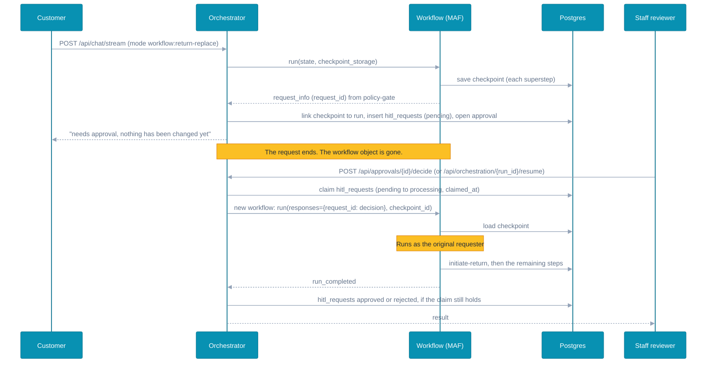

# Checkpoints and resume

How a workflow run in this application stops in one HTTP request and continues in a later one.
This page is for a developer who wants to follow a paused return from the moment it stops to the
moment it finishes, and to know which table holds what in between.

The one workflow that pauses is `workflow:return-replace`. It stops at an approval gate, a reviewer
decides hours later, and a different request (possibly a different process) carries it on from a
checkpoint in Postgres. [Approvals](approvals.md) covers who may decide and how the decision is
routed. [Return lifecycle](return-lifecycle.md) covers the optional waits after approval. Tutorial
[18, state and checkpoints](../tutorials/18-state-and-checkpoints/README.md) teaches the framework
feature on its own.

## What a checkpoint is, and when one is saved

A checkpoint is Microsoft Agent Framework's snapshot of a workflow graph's execution state: where
the graph was when it stopped, not what was said in the conversation
([concepts: state, memory and sessions](concepts/08-state-memory-and-sessions.md)).

The framework saves one checkpoint per superstep whenever a run is given a checkpoint storage.
`PrePurchaseMode` and `ReturnReplaceMode` (`agents/python/orchestrator/modes/workflow_mode.py`)
attach one to every run, taken from `shared.factory.get_checkpoint_storage()`. The backend is
`MAF_CHECKPOINT_BACKEND`: `postgres` (the default), `file` or `memory`.

The framework's event stream does not report a save. So both modes wrap the storage in
`RecordingCheckpointStorage` (`agents/python/shared/checkpoint_storage.py`), which records each
saved id. The mode drains that list between events and emits its own `checkpoint` event, which the
chat stream forwards to the browser as an `event: checkpoint` frame.

## What is stored, and where

Two tables, both in the baseline schema (`docker/postgres/init.sql`).

**`workflow_checkpoints`** holds the snapshots. `PostgresCheckpointStorage` writes them.

| Column | What it holds |
|---|---|
| `checkpoint_id` | UUID primary key |
| `workflow_name` | The graph's name, `return-and-replace` for a return |
| `payload` | The checkpoint as JSONB, encoded with the framework's own `encode_checkpoint_value` |
| `usage_log_id` | The run (`usage_logs` row) this checkpoint belongs to |
| `session_id`, `parent_checkpoint_id`, `seq` | Used by the .NET store only; see [What differs on .NET](#what-differs-on-net) |

**`hitl_requests`** holds one row per pause. It is the index that says which checkpoint and which
framework request belong to which paused run.

| Column | What it holds |
|---|---|
| `workflow_run_id` | The run that paused |
| `request_id` | The framework's own resume token for the pending request |
| `checkpoint_id` | The checkpoint to reload |
| `user_email` | The requester. The resumed steps run as this user |
| `kind` | `return_approval` for the gate; `carrier_scan` and `return_inspection` for the lifecycle waits |
| `status` | `pending`, `processing` while a resume holds the claim, then `approved` or `rejected` |
| `claimed_at` | The claim's fencing token |
| `approval_id` | The linked row in the staff inbox (`approvals`) |
| `response` | The recorded outcome, including who decided |

After a run ends, `_link_run_artifacts` (`agents/python/orchestrator/routes/chat.py`) sets
`usage_log_id` on the run's latest checkpoint. If the run paused for approval it also inserts the
`hitl_requests` row and then opens the inbox `approvals` row. The inbox row is best effort: if it
is missing, `approvals_service.ensure_for_hitl_request` creates it when someone first decides.

## The pause

The graph is `check-eligibility → policy-gate → initiate-return → search-replacements →
apply-discount → finalize` (`agents/python/workflows/return_replace.py`).

`_PolicyGateExecutor.run` asks the approval policy. A route of `auto` goes straight on. Any other
route pauses: the executor yields a snapshot of the state, then calls `ctx.request_info` with a
`ReturnApprovalRequest` and expects a `ReturnDecision` back.

Two properties of the pause matter later:

- **Nothing has been created.** The `returns` row comes from `initiate-return`, the step after the
  gate. A rejected or expired request leaves no return and the order untouched.
- **The request carries the whole `WorkflowState`.** The resumed run restores its state from the
  request itself, so nothing depends on process memory.

`ReturnReplaceMode.run` ends the request with a `run_completed` event that carries
`pending_approval: true`, the framework's `request_id`, the policy's route and reasons, and
`latest_checkpoint_id`. The customer sees "Return for order … needs approval … Nothing has been
changed yet."

## The resume

Staff decide through `POST /api/approvals/{id}/decide` or the older
`POST /api/orchestration/{run_id}/resume` (`agents/python/orchestrator/routes/orchestration.py`,
`resume_run`). The second finds the run's latest `hitl_requests` row and calls the same
`approvals_service.decide`. The requester can never be the one who decides.

`approvals_service.resume_workflow` does the work, in this order:

1. **Claim.** One `UPDATE` moves the `hitl_requests` row from `pending` to `processing` and stamps
   `claimed_at`. A second click finds nothing to claim and gets a `409`. A `processing` row older
   than `HITL_CLAIM_TTL_SECONDS` (default 600) is treated as a crashed resume and can be taken over.
2. **Become the requester.** It sets `current_user_email` to the row's `user_email` and
   `current_user_role` to that user's role. Tools read identity from these ContextVars, so the
   return is created as the customer. The reviewer is recorded separately.
3. **Resume.** `ReturnReplaceMode.resume` builds a fresh workflow object; the one that paused lived
   in an earlier request. It calls
   `run(responses={request_id: decision}, checkpoint_id=..., checkpoint_storage=...)`. The gate's
   `on_decision` handler restores the state from the original request. On approval it sends the
   state on to `initiate-return`; on rejection it ends the run with an error and creates nothing.
4. **Record.** The row becomes `approved` or `rejected`, but only if `claimed_at` still matches. A
   resume whose claim was taken over records nothing and answers `409`. The new latest checkpoint
   is linked to the same run.

The resume has a hard limit of `HITL_RESUME_TIMEOUT_SECONDS` (default 300, validated to be shorter
than the claim TTL). Past it the caller gets a `504` and the approval is still pending. Any exit
without a completed resume, cancellation included, hands the claim back. A row of another `kind`
is refused with a `400`, and a row with no `request_id` or `checkpoint_id` with a `409`.

## What happens on timeout

A pending approval has a deadline from the policy file: 24 hours for `return_approval`, with
`on_timeout: expire`. The outbox worker reminds, escalates a `support` review to a manager once,
and at the top level calls `approvals_service.expire`
([approvals: the outbox worker](approvals.md#the-outbox-worker-sla-and-notifications)).

`expire` uses the same resume path. It calls `resume_workflow` with
`ReturnDecision(decision="reject", decided_by="system")`, so the paused run finishes as a rejection
and nothing is created. The approval then becomes `expired`.

With `RETURN_LIFECYCLE_ENABLED`, an approved return pauses again for the carrier's scan and for
inspection. Those waits use the same checkpoint and `hitl_requests` mechanism with their own
timers; see [Return lifecycle](return-lifecycle.md).

## Seeing it in the UI

Open `/runs`. The page calls `GET /api/runs/{id}/checkpoints` for every visible run. The response
lists the checkpoints linked to the run and its latest `hitl_requests` row. Admins can read any
run; everyone else only their own.

- A run with a pending request shows a **Needs approval** badge without expanding the row.
- Staff (`support` or `admin`) see **Approve** and **Reject**, which call
  `POST /api/orchestration/{run_id}/resume`. Everyone else sees "Awaiting staff review".
- A return in a lifecycle wait shows its timeline from `GET /api/runs/{id}/timeline`.

## What differs on .NET

The .NET orchestrator pauses and resumes the same workflow over the same two tables, and serves the
same routes. The differences:

- **The store.** `PostgresJsonCheckpointStore`
  (`agents/dotnet/src/ECommerceAgents.Shared/Checkpoints/`) implements the framework's
  `ICheckpointStore<JsonElement>`. It keys on `(session_id, checkpoint_id)`, reads the index ordered
  by `seq`, and mints the UUID itself so the `hitl_requests.checkpoint_id` foreign key holds.
  `CheckpointStorageFactory` takes the same `memory | file | postgres` values.
- **The payload format.** A .NET checkpoint is MAF .NET's own JSON, which Python's storage does
  not decode. A return paused by the .NET orchestrator is resumed by the .NET orchestrator.
- **The pause.** The gate pauses on a `RequestPort` node; MAF .NET has no `ctx.request_info` call
  from inside an arbitrary executor (parity matrix, row 8).
- **The resume.** `ReturnReplaceMode.ResumeAsync` also builds a fresh workflow.
  `ReturnAndReplaceWorkflow.ResumeFromCheckpointAsync` restores the run, waits for the framework to
  raise the pending request again, and answers that. The stored `request_id` is a correlation
  check, not the source of the response.
- **Timeout.** Only a stack can resume its own checkpoint, so the .NET orchestrator applies the
  timeout for a paused return it opened: its `ApprovalTimeoutWorker` hosted service drains those
  `approval.timeout_apply` rows and the Python worker skips them (parity matrix, row 36; added
  after release 1.4.0). The lifecycle waits are not ported (row 41).

## Gotchas

- **A checkpoint belongs to the graph that wrote it.** Flipping `RETURN_LIFECYCLE_ENABLED` changes the graph, so change it only while no return is paused; a paused run cannot resume against a different graph.
- **Custom types must round-trip.** `PostgresCheckpointStorage` carries `ReturnDecision` and the workflow state; MAF's own `FileCheckpointStorage` refuses custom types, so do not swap it in.
- **Resume builds a new workflow.** The process that paused the run may not be the one that resumes it, so nothing may depend on in-memory state from before the pause.
- **A stack resumes only its own checkpoints.** A Python checkpoint is not readable by .NET and the reverse.
- **No decision means rejection.** When the SLA expires with nobody deciding, the run resumes as a rejection and nothing is created.
- **Returns paused before the policy gate existed** were expired by migration `0010`; their checkpoints cannot be resumed with the current response type.
