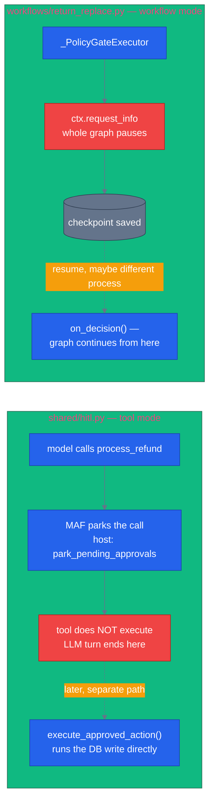

# Human-in-the-loop

## What it is

Human-in-the-loop (HITL) means a specific action requires an explicit human approval before it's
allowed to execute, no matter how confident the model is. It's the acknowledgment that
"confidence" and "correctness" are different things, and that some actions are expensive enough to
get wrong — financially, or in terms of trust — that the cost of asking a human first is worth
paying every time, not just when the model seems unsure.

## Why it matters

A model can be well-grounded (see [grounding and RAG](09-grounding-and-rag.md)), well-guarded (see
[guardrails](10-guardrails.md)), and still make a judgment call a human wouldn't have made — an
$800 refund approved for a return that's technically eligible but unusual enough that a person
would have asked a follow-up question first. Grounding and guardrails answer "is this response
factually correct and safe from attack"; HITL answers a different question entirely: "even if this
is exactly what the model intends to do, should it be allowed to do it without a person saying
yes?" Money moving and data being modified irreversibly are the two cases in this repo where the
answer is "not without asking."

## When to use it — and when not to

Gate an action behind human approval when it's high-stakes and hard to reverse — canceling an
order, issuing a refund, anything moving money or committing to an irreversible state change.
**Don't** gate everything — a HITL check on every tool call would make the product unusable, and
it dilutes the signal: if a human has to approve searching for a product, they'll rubber-stamp
everything, including the refund that actually needed scrutiny. The gate is only meaningful if
it's rare enough to get real attention.

## How it works here — two structurally different mechanisms, on purpose

This repo has two HITL implementations, and they are not interchangeable — knowing which one a
given mode uses matters for understanding what actually happens when a gate fires.

**Tool approval, parked by the host** — [`shared/hitl.py`](https://github.com/nitin27may/e-commerce-agents/blob/main/agents/python/shared/hitl.py)
and `shared/agent_host.py`. A fixed set of high-stakes tools — `HITL_GATED_TOOLS`: `cancel_order`,
`process_refund`, `initiate_return`, `modify_order`, `place_backorder` — are declared
`@tool(approval_mode="always_require")`. MAF itself stops the run when the model calls one: the tool does not
execute, the reply text is empty, and the call comes back as a `function_approval_request`. After the run the
specialist host calls `park_pending_approvals`, which writes a `tool_approval_requests` row and its inbox
approval once (`park_gated_call`) and tells the user in one fixed sentence, written without a model, that nothing
has changed yet. `HITLFunctionMiddleware` is a fail-closed backstop that does the same for a gated tool registered
without `always_require`; it is not reached on the real path. When a staff reviewer (`support` or `admin`, never
the requester) later approves, a *separate* code path, `execute_approved_action()`, runs the underlying database
operation directly. **The
original LLM loop is never resumed.** The approval doesn't continue the conversation — it just
performs the action the model asked for, outside the conversation entirely.

Before a call is parked at all, the host runs cheap deterministic pre-checks
([`shared/park_prechecks.py`](https://github.com/nitin27may/e-commerce-agents/blob/main/agents/python/shared/park_prechecks.py)):
the tool's role guard and its ownership and status preconditions. A call that could never succeed, such as a customer
asking for a backorder or a cancel of an order that already shipped, gets a plain sentence saying why and no approval
row, so a reviewer is never asked to approve the impossible. The sentences are listed in [Approvals](../approvals.md).

**In-workflow suspend/resume** — [`workflows/return_replace.py`](https://github.com/nitin27may/e-commerce-agents/blob/main/agents/python/workflows/return_replace.py)'s `_PolicyGateExecutor`.
For return requests the approval policy does not mark `auto` (`RETURN_HITL_THRESHOLD` is only the fallback when
the engine cannot decide), the executor calls `await ctx.request_info(ReturnApprovalRequest(...), response_type=ReturnDecision)` — before the return row, label or order status exist — and
this doesn't short-circuit a single tool call, it **pauses the entire workflow graph**. Everything
the graph had already computed is written to a checkpoint (see
[state, memory, and sessions](08-state-memory-and-sessions.md)) so the pause can outlive the
current request. Resume happens via a handler MAF calls back into automatically —
`@response_handler(request=ReturnApprovalRequest, response=ReturnDecision)` on `on_decision()` —
which restores the full `WorkflowState` the request carried, picks the workflow back up from exactly where it
paused and runs the remaining steps (initiate return, replacement search, loyalty discount, finalize). A
reviewer may edit the resolution and amount; a rejection or an expiry creates nothing.

The difference in one sentence: `shared/hitl.py` intercepts one tool call and the tool simply never
runs — there's no "loop" to resume, because nothing was ever mid-sequence. `return_replace.py`
suspends a whole multi-step sequence mid-execution and picks it back up later, possibly served by
a completely different process than the one that paused it.

**Build it yourself:** [Chapter 17: human-in-the-loop](../../tutorials/17-human-in-the-loop/README.md). **In the application:** `agents/python/shared/hitl.py` and `agents/python/workflows/return_replace.py`.

Next: [evaluation](12-evaluation.md) — how to know any of this — grounding, guardrails, HITL gates
— is actually working, instead of just looking right in a demo.
