# Production concerns

## What it is

Three specific things that separate a demo from a system that survives contact with real,
imperfect networks and real, sometimes-duplicate requests:

- **Idempotency** — making an operation safe to receive twice. If a "cancel this order" request
  times out on the client side after the server actually processed it, the client's natural
  reaction is to retry — and without idempotency, that retry cancels an order a second time (or
  double-refunds it, which is the expensive version of this bug).
- **Retries with backoff** — automatically re-attempting a failed network call a bounded number of
  times, waiting longer between each attempt, instead of either giving up on the first blip or
  hammering a struggling service harder.
- **Rate limiting** — capping how many requests a single user or client can make in a window, so
  one runaway script or one confused retry loop can't take the whole system down for everyone else.

## Why it matters

These aren't defensive-programming nice-to-haves — they're the difference between a network blip
being invisible and a network blip becoming a customer-visible incident. A refund tool with no
idempotency protection, called twice because a client retried a slow request, doesn't fail loudly
— it succeeds twice, silently, and the business is out the difference. A specialist agent with no
retry logic turns a half-second network hiccup into a full failure the user sees, even though the
same request would have succeeded a moment later. No rate limiting means there's no floor under
how bad a single client's misbehavior — a bug, not even malice — can get for everyone else sharing
the system.

## When to use it — and when not to

Idempotency matters most exactly where this repo already flags the highest-stakes actions —
[human-in-the-loop](11-human-in-the-loop.md)'s gated tools (`cancel_order`, `process_refund`,
`initiate_return`, `modify_order`) are precisely the set where "ran twice by accident" is
expensive. Retries matter for any network call that can fail transiently and is safe to repeat —
which is not every call: retrying a non-idempotent operation without deduplication makes the
idempotency problem worse, not better, so the two concerns are linked, not independent. Rate
limiting matters wherever a single caller's volume could meaningfully affect other callers' service
— which, for a customer-facing API, is essentially every public endpoint.

## How it works here

Each of the three has one shared module, and each has a stated limit.

**Idempotency** — [`shared/idempotency.py`](https://github.com/nitin27may/e-commerce-agents/blob/main/agents/python/shared/idempotency.py), backed by the
`idempotency_keys` table. The `@idempotent(scope)` decorator reserves a key built from the scope,
the caller's identity and the call's arguments. A repeat of a completed call replays the stored
result instead of running again. A duplicate that arrives while the first is still running is
refused, a stale reservation (its owner probably crashed) is taken over, and a failure releases
the key so a real retry is not blocked. It wraps `initiate_return` and `process_refund`
(`shared/tools/return_tools.py`), checkout (`orchestrator/routes/legacy.py`) and the execution of
an approved action (`shared/hitl.py`). `run_once(scope, key)` is the variant keyed on an id
instead of the arguments, for work whose arguments may differ between attempts, such as an
approval executed with a reviewer's edits. Only the wrapped call sites are protected.

**Retries with backoff** — [`shared/http_resilience.py`](https://github.com/nitin27may/e-commerce-agents/blob/main/agents/python/shared/http_resilience.py).
`ResilientAsyncTransport` is the `httpx` transport under the orchestrator's specialist calls
(`orchestrator/agent.py`, `shared/remote_agent.py`). It makes up to 3 attempts with jittered
exponential backoff starting at 200 ms, on timeouts, connection errors and the statuses 408, 429,
500, 502, 503 and 504. It also keeps a circuit breaker per host and port: at a 50% failure ratio
over a 30-second window (minimum 5 calls) it refuses calls to that specialist for 30 seconds. A
response body that is already streaming is never retried, because the specialist may already
have run a tool with side effects. When the attempts run out, `call_specialist_agent` returns a
plain-language message to the model instead of crashing the request:

```python
# agents/python/orchestrator/agent.py
except httpx.TimeoutException:
    logger.error("a2a.timeout target=%s", log_safe(agent_name))
    return f"The {agent_name} agent took too long to respond. Please try again."
```

**Rate limiting** — [`shared/rate_limit.py`](https://github.com/nitin27may/e-commerce-agents/blob/main/agents/python/shared/rate_limit.py), a sliding-window
log in Redis, checked and recorded atomically by a Lua script. `rate_limit_chat` is a FastAPI
dependency on `/api/chat`, `/api/chat/stream` and the orchestration endpoints that run a model
turn. It keys on the signed-in user, or on the client address for anonymous callers, and allows
30 requests per 60 seconds by default (`RATE_LIMIT_MAX_REQUESTS`, `RATE_LIMIT_WINDOW_SECONDS`).
Over the limit is a `429` with a `Retry-After` header. Signup, login and token refresh have
their own tighter limit (`rate_limit_auth`). The limiter fails open: if Redis is unreachable the
request goes through and the failure is logged, because it protects capacity, not money.

```mermaid
%%{init: {'theme':'base', 'themeVariables': {
  'primaryColor': '#2563eb','primaryTextColor': '#ffffff','primaryBorderColor': '#1e40af',
  'lineColor': '#64748b','secondaryColor': '#f59e0b','tertiaryColor': '#10b981',
  'background': 'transparent'}}}%%
flowchart LR
  classDef core    fill:#2563eb,stroke:#1e40af,color:#ffffff
  classDef success fill:#10b981,stroke:#047857,color:#ffffff
  classDef error   fill:#ef4444,stroke:#b91c1c,color:#ffffff
  classDef infra   fill:#64748b,stroke:#334155,color:#ffffff

  req(["Client request<br/>possibly a retry"]) --> limit["rate_limit_chat<br/>sliding window in Redis"]
  limit -->|over the limit| refuse["429 + Retry-After"]
  limit --> orch["orchestrator<br/>call_specialist_agent"]
  orch --> transport["ResilientAsyncTransport<br/>3 attempts, backoff, circuit breaker"]
  transport --> tool["@idempotent tool<br/>e.g. process_refund"]
  tool --> keys[("idempotency_keys")]
  keys -->|key already completed| replay["Stored result replayed,<br/>action not run twice"]

  class req,orch,transport,tool core
  class limit,keys infra
  class refuse error
  class replay success
```



**Build it yourself:** [Chapter 31: retry and compensation](../../tutorials/31-retry-and-compensation/README.md). **In the application:** `agents/python/shared/idempotency.py`, `shared/http_resilience.py` and `shared/rate_limit.py`.

This closes the core reading path. From here: [`docs/architecture.md`](../architecture.md) for
how all six agents fit together as a system, or back to
[the concepts index](README.md#the-rest-of-the-pages) for anything you skipped.
