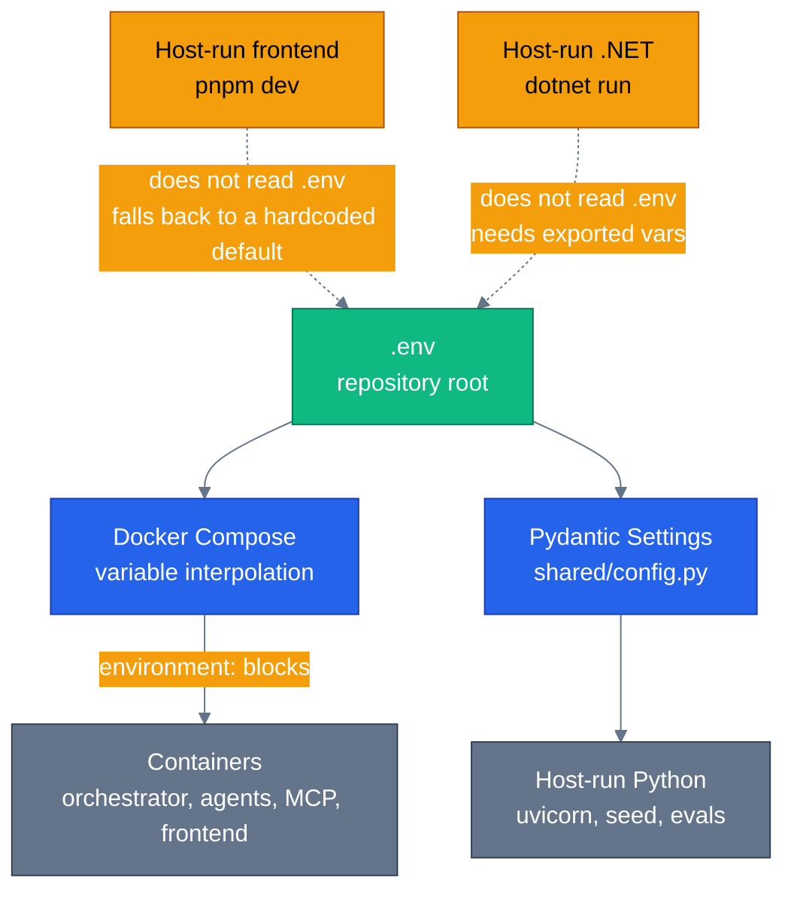

# Configuration

This page is for anyone running the application who needs to change a setting. Every configurable
value comes from **one file: `.env` at the repository root.** There is no second location, no
per-service env file, and no per-stack override file.

Most people only ever touch these:

| You want to | Do this | Details |
|---|---|---|
| Use a hosted model | Set `LLM_PROVIDER` (`openai`, `azure` or `anthropic`) and that provider's key, for example `OPENAI_API_KEY` | [Wire API](#choosing-the-openai-wire-api-llm_api), [Azure auth](#azure-openai-authentication-azure_openai_auth), [Anthropic](#anthropic-claude--python-and-net-stacks) |
| Use a local or OpenAI-compatible model | Set `LLM_BASE_URL` and `LLM_MODEL`, usually with `LLM_API=chat_completions` | [Wire API](#choosing-the-openai-wire-api-llm_api), [Embeddings](#embeddings-are-configured-separately) |
| Run with no key | Nothing in `.env`. Start with `./scripts/dev.sh --no-key` (Python only), which sets `LLM_PROVIDER=replay` and plays back recorded responses | [No-key mode](demo-guide.md#no-key-mode) |
| Choose the stack | Nothing in `.env`. `./scripts/dev.sh` runs Python and `./scripts/dev.sh --dotnet` runs .NET | [One stack at a time](#one-stack-at-a-time) |

The rest of the page explains how that one file reaches four very different consumers, lists the
settings by area, and says what you have to touch when you add a variable.

## The three files

| File | Committed | Purpose |
|---|---|---|
| `.env.minimal` | Yes | What a first run needs. One variable. Copy it to `.env` and set your key. |
| `.env.example` | Yes | The complete surface — every variable, grouped, with defaults and commentary. Reference material, not a starting point. |
| `.env` | **No** (`.gitignore`) | Yours. Created by copying one of the above. |

```bash
cp .env.minimal .env      # then set OPENAI_API_KEY
```

The file must be named exactly `.env` and must sit at the repository root. Docker Compose only
auto-loads a file with that name from the project directory — anything else requires passing
`--env-file` on every single `docker compose` invocation, which would break the plain
`docker compose up` that the quick start advertises.

## How one file reaches four consumers



### 1. Docker Compose — variable interpolation

Compose reads `.env` from the project directory and uses it to expand `${VAR}` references **inside
the compose file**. It does not inject the file into containers.

```yaml
environment:
  OPENAI_API_KEY: ${OPENAI_API_KEY:-}
  LLM_MODEL: ${LLM_MODEL:-gpt-4.1}
```

**A container only receives what its `environment:` block names.** A variable you add to `.env`
but not to the compose file will be silently absent inside every container — this is the single
most common configuration mistake in this repo, and it produces a default-valued setting rather
than an error.

Most of the agent services inherit one shared block via a YAML anchor:

```yaml
environment: &agent-env     # declared on the orchestrator
  ...

environment:
  <<: *agent-env            # every specialist merges it
  OTEL_SERVICE_NAME: ecommerce.product-discovery
```

So a variable added to `&agent-env` reaches the orchestrator and all five specialists at once. The
MCP servers and `auth-server` have their own blocks and do not inherit it.

### 2. Pydantic Settings — host-run Python

`shared/config.py` resolves the same file by **absolute path**, computed from the location of
`config.py` itself rather than from the current working directory:

```python
_REPO_ROOT = _resolve_repo_root(Path(__file__))
_ENV_FILE = _REPO_ROOT / ".env"
```

This is why `cd agents/python && uv run uvicorn product_discovery.main:app` picks up the root
`.env` even though the working directory is two levels down. It is deliberate, and two
details of the path resolution matter, both documented in the source:

- The repo root is **three** levels above `config.py`, not two. `parents[2]` is `<repo>/agents`,
  which contains no `.env`: with that path Pydantic's `env_file` loading never fires and every
  setting silently falls back to its default even with a real `.env` present.
- Inside the Docker image, `config.py` is copied flatly to `/app/shared/config.py` — the build
  context is `./agents/python`, so that path depth does not exist and a bare `parents[3]` raises
  `IndexError` at import time. `_resolve_repo_root` falls back to the immediate
  parent there, which contains no `.env` — correct, because containers get their config from the
  compose `environment:` block.

**Do not change how this path is resolved without re-reading those comments.**

### 3. The frontend — does not read `.env`

Next.js reads `web/.env.local`, not the repository root, so `pnpm dev` outside Docker sees nothing
from the root `.env`. It does not need to: `ORCHESTRATOR_URL` has a fallback that matches the
compose default.

```ts
// web/src/app/api/[...path]/route.ts
return (process.env.ORCHESTRATOR_URL ?? "http://localhost:8080").replace(/\/+$/, "");
```

So `cd web && pnpm dev` works with no configuration at all, as long as the orchestrator is on
`:8080`. Create `web/.env.local` only if you need it somewhere else.

**The browser never calls the orchestrator directly.** It calls the frontend's own origin, and
`web/src/app/api/[...path]/route.ts` forwards `/api/*` to `ORCHESTRATOR_URL`. That variable is
server-side and read per request, so changing it means restarting the container, not rebuilding the
image — and the orchestrator needs no public ingress and no CORS configuration.

A `NEXT_PUBLIC_API_URL` would not do this job, because Next **inlines it at build time**: a
second `next dev` started against a warm build directory serves the *first* one's API URL, and a
cloud deployment cannot know its own API URL before the infrastructure that assigns it exists.
`NEXT_PUBLIC_API_URL` is still honoured by
`web/src/lib/api.ts` as an escape hatch for calling an orchestrator directly, which works and
brings CORS back with it.

### Browser-facing edge: CORS, client address, rate limits

- **CORS.** `CORS_ALLOWED_ORIGINS` (comma-separated, default `http://localhost:3000`) on both
  orchestrators; credentials are never allowed (auth is a Bearer header). The web app goes through
  its same-origin proxy and needs nothing; set it only when a browser calls the orchestrator
  directly (`NEXT_PUBLIC_API_URL`). `curl`, scripts, evals and Playwright's `request` are not
  subject to CORS.
- **Auth rate limits.** Signup, login and refresh have their own buckets, separate from chat, in two
  layers so one caller cannot starve the others. The tight budget, `RATE_LIMIT_AUTH_MAX_REQUESTS` (10)
  per `RATE_LIMIT_AUTH_WINDOW_SECONDS` (60), is per **(client address, target email)** for login and
  signup — one target cannot be brute-forced, yet a script hammering one account leaves every other
  account's login alone — and per **user** for refresh, read from the verified token (an invalid or
  expired token never reaches it; opaque OAuth-mode tokens are keyed by their own digest). Over all
  three routes sits a much looser address-only ceiling, `RATE_LIMIT_AUTH_IP_MAX_REQUESTS` (300 per
  window), which is what actually bounds a single flooding source. Emails and subjects are hashed
  before they become Redis keys and are never logged. Chat, `/api/orchestration/compare` and
  `/resume` use the chat bucket. All fail open (with an error log) when Redis is down. The web client
  treats only a 401/403 from refresh as a dead session; a 429, 5xx or network error keeps the user
  signed in and surfaces a retryable error. Local Playwright runs log in repeatedly as a few accounts
  from one address, so raise both limits (e.g. 1000 and 10000) in `.env` before running them.
- **Client address.** The orchestrator takes the entry `RATE_LIMIT_TRUSTED_PROXY_HOPS` (default 1)
  places from the **right** of `X-Forwarded-For`; anything to its left is caller-supplied and ignored.
  The Next proxy writes that entry. **Limitation:** a Next 16 route handler cannot know the client
  address — there is no `NextRequest.ip` and the socket is not exposed; Next only fills
  `X-Forwarded-For` from the socket when the header is absent, so a browser-supplied value is
  indistinguishable from a real one (and behind Docker's published port the socket is the bridge
  gateway anyway). The proxy therefore strips the browser's `X-Forwarded-For`/`X-Real-IP`/`Forwarded`
  and forwards an address only when `WEB_TRUSTED_PROXY_HOPS` (default 0) says that many proxies you
  run sit in front of Next and append to the header. With the default, no address is forwarded and
  the orchestrator sees the frontend container: **all anonymous callers share one address-level auth
  ceiling and one chat bucket** (the per-account and per-user auth budgets are unaffected). Behind a load balancer or ingress that appends the client address, set
  `WEB_TRUSTED_PROXY_HOPS=1` (the orchestrator's default of 1 then needs no change). The orchestrator
  port is published **loopback-only** (`127.0.0.1:8080`) in all three compose files, like the specialists, so
  the only way to reach it from another machine is through the frontend, whose proxy writes the
  trusted entry. Were :8080 published on all interfaces, any caller could send their own
  `X-Forwarded-For` and pick their rate-limit bucket (or a victim's). Consequence: `localhost:8080`
  from the host (dev scripts, Playwright, `scripts/compose-smoke.sh`) works unchanged, but a LAN
  address, or a devcontainer / remote-IDE port forward that targets the host's external interface,
  does not reach it. Forward `127.0.0.1:8080` instead, or put your own authenticated reverse proxy in
  front (and set `RATE_LIMIT_TRUSTED_PROXY_HOPS` to match). The frontend stays on `3000:3000`.

### 4. The .NET stack — containers yes, host no

`docker-compose.dotnet.yml` interpolates from the same root `.env` in exactly the same way, so the
containerised .NET stack needs no separate configuration.

Running .NET on the host (`dotnet run`) reads environment variables and `appsettings.json` — not
`.env`. Export what you need first:

```bash
set -a && source .env && set +a      # bash/zsh
dotnet run --project agents/dotnet/src/ECommerceAgents.Orchestrator
```

## Choosing the OpenAI wire API (`LLM_API`)

`LLM_PROVIDER=openai` talks to the endpoint in `LLM_BASE_URL` (default: api.openai.com). By default
the Python stack uses OpenAI's **Responses API** (`POST /responses`). Many OpenAI-compatible
servers implement only **Chat Completions** (`POST /chat/completions`) and answer `/responses`
with a 404. Set:

```dotenv
LLM_PROVIDER=openai
LLM_BASE_URL=https://generativelanguage.googleapis.com/v1beta/openai/   # e.g. Gemini
LLM_API=chat_completions
```

| `LLM_API` | Client | Request path | Notes |
|---|---|---|---|
| `responses` (default) | `OpenAIChatClient` | `/responses` | Unchanged behaviour; replay fixtures are not affected |
| `chat_completions` | `OpenAIChatCompletionClient` | `/chat/completions` | For endpoints with no Responses route |

It applies to `LLM_PROVIDER=openai` only — `azure` is always Chat Completions, and `replay` serves
recorded fixtures. With `RECORD=true`, the recorder uses the same switch, so a fixture recorded
against a Chat-Completions-only endpoint is requested the way that endpoint accepts. The .NET
stack always uses Chat Completions and has no such setting. All three compose files forward
`LLM_BASE_URL` to the agents, and the two that run the Python stack forward `LLM_API` as well, so
the setting works the same in a container as it does for host-run Python.

### Gemini through its OpenAI-compatible endpoint

No separate provider: Gemini is `LLM_PROVIDER=openai` pointed at Google's compatible endpoint, over
Chat Completions.

```dotenv
LLM_PROVIDER=openai
LLM_BASE_URL=https://generativelanguage.googleapis.com/v1beta/openai/
LLM_API=chat_completions            # the endpoint has no /responses route
OPENAI_API_KEY=<your Gemini API key>   # the OpenAI-named variable carries the Gemini key
LLM_MODEL=<a Gemini model id from Google's model list>
EMBEDDING_PROVIDER=openai_compatible   # see below
EMBEDDING_BASE_URL=<an embeddings endpoint>
```

- **Embeddings.** Left empty, `EMBEDDING_PROVIDER` follows `LLM_PROVIDER` and would send embedding
  requests (model `text-embedding-3-small`) to the Gemini base URL. Set the `EMBEDDING_*` group
  explicitly ([below](#embeddings-are-configured-separately)), or accept that semantic search falls
  back to full-text.
- **Choose a tool-calling model** and check Google's current OpenAI-compatibility page for which
  request parameters it honours, any limits on tool schemas, and structured-output behaviour. This
  repository does not assert them: nothing here has talked to Google's servers.
- **Tested** only by `tests/test_gemini_compat_endpoint.py`, a stubbed transport: the request goes to
  `<LLM_BASE_URL>chat/completions` with the key as bearer credential, and a canned `tool_calls`
  response runs a tool and is answered with a `tool` message. That proves this repo's wiring, not
  Gemini's behaviour, and no live call has been made. A model scorecard run is where Gemini
  would be measured.

## Choosing a model per agent (`model:` in the prompt YAML)

By default every agent uses the one model in `LLM_MODEL` (or `AZURE_OPENAI_DEPLOYMENT`). Any
agent can override it with an optional `model:` block in its own
`agents/python/config/prompts/<agent>.yaml` — the files the .NET stack reads too:

```yaml
# agents/python/config/prompts/orchestrator.yaml
model:
  model: gpt-4.1-mini     # routing is a cheap decision
  temperature: 0.0
# agents/python/config/prompts/pricing-promotions.yaml
model:
  model: gpt-4.1          # arithmetic and policy reasoning deserve the stronger model
```

All three keys are optional; anything left out falls back to the global setting.

| Key | Meaning |
|---|---|
| `provider` | `openai`, `azure` or `anthropic`. Defaults to `LLM_PROVIDER`. A different provider needs that provider's own credentials (`OPENAI_API_KEY`, the three `AZURE_OPENAI_*` variables, or `ANTHROPIC_API_KEY`); the global `LLM_BASE_URL` is never inherited by an agent that switches *to* `openai` |
| `model` | Model id (`openai`, `anthropic`; the latter defaults to `ANTHROPIC_MODEL`) or deployment name (`azure`). Required when the global provider is `anthropic` and the agent switches to another one |
| `temperature` | 0–2; replaces `LLM_TEMPERATURE` for this agent |

Agent names are the file stems: `orchestrator`, `handoff-triage` (the handoff mode's triage
agent), `product-discovery`, `order-management`, `pricing-promotions`, `review-sentiment`,
`inventory-fulfillment`. Other agents' files are untouched.

- **No shipped file has a `model:` block.** The mechanism is off until you add one, so it changes no behaviour,
  score or replay fixture.
- **The block never reaches the model.** `load_prompt` composes only `system_prompt`, and replay
  fixtures are keyed by the instructions, so the composed prompt is byte-identical with or without
  it (a test proves it).
- **Validated at startup.** An unknown key, unknown provider or out-of-range temperature stops the
  service at startup with a message naming the file.
- **Replay ignores it.** Under `LLM_PROVIDER=replay` the replay client answers regardless of model.
- **Cost.** A response that names the model it served is priced as that model. Where it names none,
  pricing falls back to the model the agent's client was built with (`current_agent_model`), then
  to the global setting. A model absent from `shared/cost.py`'s table is priced at the default
  entry and logged once. On .NET, cost uses the model the provider reports and otherwise the global
  `LLM_MODEL`; the per-agent model is not yet threaded through the .NET cost fallback.

A model change is a recording-session event for replay evals only if you also want the fixtures to
reflect that model's answers; the replay key ignores the model.

## Anthropic (Claude) — Python and .NET stacks

```dotenv
LLM_PROVIDER=anthropic
ANTHROPIC_API_KEY=sk-ant-...
ANTHROPIC_MODEL=claude-sonnet-5-5     # default, on both stacks. Others: claude-opus-5-5, claude-haiku-5-5
EMBEDDING_PROVIDER=openai             # Claude has no embeddings API: see the Embeddings row
```

> **Never run against the live API.** Both stacks are wired and proven with stubbed-transport
> tests only. No smoke run with a real key has been done; until one has, treat Claude
> support as untested against real responses.

| | Python | .NET |
|---|---|---|
| Client | MAF's own connector, [`agent-framework-anthropic`](https://pypi.org/project/agent-framework-anthropic/) `1.0.0b261112`, as `shared/anthropic_client.py::ECommerceAnthropicClient` (a thin subclass that sets the default `max_tokens`). **Every release of that package is a beta** (there is no stable line), so it is pinned exactly in `agents/python/pyproject.toml` and listed in the `maf` Dependabot group; it needs `agent-framework-core >= 1.24` (the repo is on 1.26.0) and brings the official `anthropic` SDK (2.8.0, built on `httpx2`). It calls the Messages API through the SDK's `beta.messages` namespace | The official [`Anthropic`](https://www.nuget.org/packages/Anthropic) NuGet package (13.8.0), through its `IChatClient` adapter in `ChatClientFactory`. It needs `Microsoft.Extensions.AI.Abstractions` ≥ 10.5.1; the solution resolves 10.11.0, so nothing was bumped |
| Key | Required when selected; `get_chat_client` fails naming `ANTHROPIC_API_KEY` (never its value). The SDK sends it as `Authorization: Bearer` | Required when selected; startup fails naming `ANTHROPIC_API_KEY` (never its value). Same header |
| Model | `ANTHROPIC_MODEL` (default `claude-sonnet-5-5`), **not** `LLM_MODEL` — the compose files forward `LLM_MODEL` with a `gpt-4.1` default that Anthropic would reject | Same |
| Output length | Claude's API requires `max_tokens`; the connector's own fallback is 1024, which truncates specialist answers, so the client applies **4096** when a call sets none (an explicit `max_tokens` still wins) | The adapter applies 4096 when a request sets none |
| Per-agent | `provider: anthropic` is valid in an agent's `model:` block ([above](#choosing-a-model-per-agent-model-in-the-prompt-yaml)); an agent moving from anthropic to another provider must name its `model` | Same |
| Embeddings | **Anthropic has no embeddings API.** With this provider and no `EMBEDDING_PROVIDER`, semantic search is unavailable until a separate embedding provider is configured ([below](#embeddings-are-configured-separately)). The stack still starts and logs what is missing: the chat client warns once, the seeder skips embeddings, `semantic_search` falls back to its full-text arm, and `scripts/generate_embeddings.py` exits with the instruction before it clears anything | The stack still starts, logs what is missing, and product search falls back to full-text |
| Recording | `REPLAY_RECORD_PROVIDER=anthropic` with `RECORD=true` records replay fixtures through the same client. Fixtures are keyed by request, not model, so they replay under any provider | — |
| Cost | `shared/cost.py` has no Claude entries: the repo documents no Claude prices, so none were invented. The cost module logs `cost.model_unpriced` once and estimates at its default (gpt-4.1) entry. Treat cost figures as meaningless for Claude until a maintainer adds the entries from Anthropic's pricing page | Same: Claude models are unpriced in `CostEstimator` |
| Tested | `tests/test_anthropic_provider.py`: a stubbed `httpx2` transport under a real MAF `Agent` — request shape, a canned `tool_use` → Python tool call → `tool_result` follow-up, usage mapping, **blocking and streaming**; the factory, per-agent block and embeddings behaviour; the recorder round trip. **No network, no key** | A stub-`HttpMessageHandler` test: request shape, a canned `tool_use` → tool execution → `tool_result` follow-up, and usage mapping |

What the stubbed tests **cannot** prove, on either stack: that Claude picks the right tool or
arguments (tool-choice quality), prompt caching, the shape of real error responses (rate limits,
overload, a bad key), streaming edge cases beyond the canned events, or that the canned JSON
matches api.anthropic.com byte for byte (it follows the published schema). Nothing in CI calls
Claude, and nothing may put an Anthropic key behind an automatic trigger.

## Embeddings are configured separately

Semantic search needs an embedding model. It has its own setting group, separate from the chat
provider, which matters for providers with no embeddings API (Claude) and for running chat and
embeddings on different endpoints.

| Variable | Default | Meaning |
|---|---|---|
| `EMBEDDING_PROVIDER` | empty = follow `LLM_PROVIDER` | `openai`, `azure`, `openai_compatible` (any `/embeddings` endpoint: Ollama, vLLM, LM Studio) or `replay` (offline hashing vectors) |
| `EMBEDDING_BASE_URL` | empty | Endpoint for embeddings only. Required for `openai_compatible`. Following `openai`, empty falls back to `LLM_BASE_URL` as before; an explicit `EMBEDDING_PROVIDER=openai` means api.openai.com |
| `EMBEDDING_API_KEY` | empty | Replaces `OPENAI_API_KEY` (or the Azure key) for embeddings only. `openai_compatible` needs none. Whenever `EMBEDDING_BASE_URL` is set, the chat key is never sent to that host: it receives `EMBEDDING_API_KEY`, or the placeholder `not-needed` when that is empty |
| `EMBEDDING_MODEL` | `text-embedding-3-small` | Model, or the Azure deployment when `AZURE_EMBEDDING_DEPLOYMENT` is set |
| `EMBEDDING_DIM` | `1536` | Width of every vector. Must equal the `vector(N)` columns — see below |

With none of these set, nothing changes: embeddings follow the chat provider, 1536 dimensions.
`dimensions=EMBEDDING_DIM` is sent to the models that accept it (OpenAI's `text-embedding-3-*`);
for any other model a vector of the wrong size is refused with a message instead of reaching the
database. Under `LLM_PROVIDER=replay` the offline vectors are 1536 wide unless `EMBEDDING_DIM` says
otherwise.

**The dimension is a database property.** `product_embeddings.embedding` and
`agent_memories.embedding` are `vector(1536)` in the frozen baseline (`init.sql`), and changing a
vector column destroys the stored vectors — so it is an explicit operator action, not a migration:

```bash
uv run --project agents/python python scripts/reset_embeddings.py --dim 768
```

It truncates `product_embeddings`, clears (does not delete) `agent_memories.embedding` — the memory
rows hold what users told the agents, and nothing writes that column today — retypes both columns
and rebuilds the ivfflat index, in one transaction. It refuses anything over 2000 dimensions, which
pgvector cannot index: ask the API for fewer with `dimensions=` (text-embedding-3-large defaults to
3072 but accepts 1536), or store `halfvec`, which the script does not do. Afterwards set
`EMBEDDING_DIM` to match and re-embed (the seeder, or `scripts.generate_embeddings`).

**Fail fast.** The product-discovery agent, the seeder and `generate_embeddings` compare
`EMBEDDING_DIM` with the real column types (`atttypmod`) at startup and stop with a message naming
the fix when they differ; the .NET product-discovery service does the same. Migration
`0008_embedding_model.sql` adds `product_embeddings.embedding_model`, which the seeder's loader and
`generate_embeddings` fill so you can tell which model wrote a vector (`replay-hashing-vectorizer`
for offline ones). The precomputed `product_embeddings.v1.jsonl.gz` is only loaded when its header
model equals `EMBEDDING_MODEL` and its width equals `EMBEDDING_DIM`.

### Local embeddings with Ollama (documented, not exercised here)

```dotenv
EMBEDDING_PROVIDER=openai_compatible
EMBEDDING_BASE_URL=http://localhost:11434/v1      # http://host.docker.internal:11434/v1 in containers
EMBEDDING_MODEL=nomic-embed-text                  # `ollama pull nomic-embed-text`
EMBEDDING_DIM=768
```

then `scripts/reset_embeddings.py --dim 768` and `generate_embeddings` as above. This path is
documented but **has not been run**: it needs a reachable Ollama, and the build environment had
none. What is tested is everything around it — client construction for `openai_compatible`, the
width checks, the reset script and the startup check against a real Postgres.

## Runtime knobs for managed hosting

These exist for the Azure Container Apps deployment and are harmless anywhere else; the defaults
suit a local run.

| Variable | Default | Meaning |
|---|---|---|
| `LLM_TEMPERATURE` | `0.2` | Sampling temperature on every agent run. **Set but empty omits the option entirely** on both stacks: gpt-5.x models reject `temperature` with a 400. Unset is not empty. A per-agent `model: {temperature}` block still applies to that agent |
| `DB_POOL_MIN_SIZE`, `DB_POOL_MAX_SIZE` | Python `5` / `20`; .NET unset (Npgsql `0` / `100`) | Connection pool bounds per process. Every service holds its own pool, so six services plus the worker multiply them against Postgres `max_connections`; the Azure demo runs `1` / `4`. Min above max, or max below 1, fails at startup on both stacks |
| `DATABASE_URL` `?sslmode=` | unset | .NET honours `disable`, `allow`, `prefer`, `require`, `verify-ca` and `verify-full` (mapped to Npgsql's `SslMode`); an unknown value fails at startup. Python's asyncpg does too. Azure Database for PostgreSQL requires TLS, so use `?sslmode=require` |

Gotchas:

- In Compose, `${LLM_TEMPERATURE-0.2}` (no colon) is deliberate: `${VAR:-0.2}` would turn an empty
  value back into `0.2` and the omission could never be requested.
- The replay key excludes sampling parameters, so omitting the temperature changes no fixture.
- The `gpt-5.1` and `gpt-5.1-mini` rows in `shared/cost.py` and `CostEstimator.cs` are estimates,
  not confirmed list prices, and `gpt-5.1-mini` is a plausible deployment name rather than a
  confirmed model id. Until checked against a real deployment, budgets on those models are rough.

## Azure OpenAI authentication (`AZURE_OPENAI_AUTH`)

| Variable | Default | Meaning |
|---|---|---|
| `AZURE_OPENAI_AUTH` | `key` | `key` sends `AZURE_OPENAI_KEY`. `identity` sends a Microsoft Entra bearer token and no key; the key is not required and never sent. Anything else fails at startup on both stacks |
| `AZURE_CLIENT_ID` | empty | Client id of a user-assigned managed identity. Empty uses `DefaultAzureCredential` (managed identity on Azure, `az login` or environment credentials locally) |

Identity mode covers chat and, with `EMBEDDING_PROVIDER=azure`, embeddings (an explicit
`EMBEDDING_API_KEY` still wins for embeddings). The identity needs the `Cognitive Services OpenAI User`
role on the Azure OpenAI resource. Python uses `azure-identity`'s sync credentials
(`shared/azure_auth.py`); .NET uses `Azure.Identity` (`AzureIdentity.cs`). **The default stays `key`**: identity
mode has been tested against a fake credential only, never a live Azure resource, and is flipped only after a
verified Azure run. `LLM_PROVIDER=replay` and `openai` ignore both variables; recording through
`REPLAY_RECORD_PROVIDER=azure` still needs the key.

## Gateway attribution headers (`GATEWAY_HEADERS_ENABLED`, `EVAL_RUN_ID`)

| Variable | Default | Meaning |
|---|---|---|
| `GATEWAY_HEADERS_ENABLED` | `true` | Send `x-agent-name`, `x-run-id` and `x-eval-run-id` on every model call, chat and embeddings, on both stacks |
| `EVAL_RUN_ID` | empty | The value of `x-eval-run-id`. Empty omits the header |

`x-agent-name` is the agent the client was built for (`product-discovery`, `orchestrator`, `eval-judge`, ...).
`x-run-id` is a fresh opaque id per inbound request (an orchestrator chat turn, a request to a specialist); it
is not the session id. A header whose value is empty is not sent. Values are limited to ASCII
`[A-Za-z0-9._:/+=-]` and 128 characters, so an `@` or a control character never gets through, and the user's
email, role and session id and any credential are never put in these headers. The headers are added per request
by a hook on the provider SDK's HTTP client (Python) or a pipeline policy / delegating handler (.NET), so they
change with the agent and the request. Replay makes no HTTP call, so replay keys and fixtures do not change.
A2A and MCP calls are not model calls and carry none. See [model-providers.md](model-providers.md#gateways).

## Per-run cost ceiling (`COST_BUDGET_*`)

| Variable | Default | Meaning |
|---|---|---|
| `COST_BUDGET_MODE` | `observe` | `off` attaches nothing; `observe` estimates and logs each run and counts a turn past the ceiling as `cost_budget.would_block`, never refusing; `enforce` refuses the next LLM turn once a run's estimated cost passes the ceiling |
| `COST_BUDGET_USD_PER_RUN` | `0.50` in `.env.example` and the three compose files; unset in code | USD ceiling for one run. With no value, even `enforce` refuses nothing |
| `COST_BUDGET_TOKENS_PER_RUN` | unset (off) | Ceiling on input plus output tokens for one run, under the same mode and enforcement points as the dollar ceiling. Unset, empty or `0` means off. Both stacks |

`0.50` is a demo default, large enough for a normal turn and small enough to catch a runaway
agent loop. The mode stays `observe`: watch `cost_budget.would_block` (see
[telemetry.md](telemetry.md#cost-and-usage)) before choosing `enforce`. The figure is an
estimate from the pricing file below, not a bill.

The token ceiling is the one that still holds where cost is unknown: tokens are counted for a model
with no price on file. In `enforce` the next LLM turn is refused once a run has used the ceiling's
worth of tokens (a turn already in flight is never aborted, so a run can overshoot by one turn). It
fails closed: with a token ceiling set, a turn that reports no usage at all also stops the run,
because the count can no longer be trusted. In `observe` it only counts `cost_budget.would_block`.
With `COST_BUDGET_MODE=off` neither ceiling is attached.

### Model prices (`PRICING_*`)

No price is written in code. Both stacks read `agents/python/config/pricing/models.yaml`: one entry per
model, in USD per 1M tokens (the unit providers publish), each with its `source`, `as_of` date and a
`verified` flag. A dated snapshot such as `gpt-4.1-2025-04-14` uses its base entry. An Azure deployment
with a custom name needs an entry under that name.

| Variable | Default | Meaning |
|---|---|---|
| `PRICING_FILE` | the shipped file | Use another pricing file instead |
| `PRICING_OVERRIDES_FILE` | none | A file merged over the pricing file entry by entry: a local model at 0, a negotiated rate |

A model the file does not list has an **unknown** cost: `usage_logs.cost_usd`, `est_cost_usd` and the
eval report show null or "unknown", never a guessed figure. Under `COST_BUDGET_MODE=enforce` with a
ceiling set, a turn on an unpriced model stops the run, because the ceiling can no longer be checked.
An invalid file is logged (`cost.pricing_file_invalid`) and makes every cost unknown.

Every `usage_logs` row that has a cost also records `price_source` (the pricing file and a short
content digest, for example `models.yaml#3fa2c1d09b`, or `override:<file>#<digest>`; several are
comma-joined when a run's agents were priced from different files) and `priced_at` (when). Rows
from before migration `0015`, runs with no captured usage, runs on an unpriced model and modes
that make no LLM call keep both NULL. Editing a price changes the digest, so a stored cost can
always be told apart from what today's file would say.

Both variables are read by host-run processes. Containers use the copy of the file built into the
image, so rebuild after editing it.

To correct a price or add a model: copy the numbers from the provider's pricing page, set `source` and
`as_of`, set `verified: true` only if you read the page yourself, and run the pricing tests on both
stacks (`uv run pytest tests/test_cost.py` in `agents/python`; `dotnet test
tests/ECommerceAgents.Shared.Tests --filter FullyQualifiedName~CostEstimator` in `agents/dotnet`).

## Outbox worker (`OUTBOX_*`)

The `outbox-worker` service (`python -m worker.main`) drains the `outbox` table. See
[Approvals](approvals.md#the-outbox-worker-sla-and-notifications). Compose passes the first five
through; the rest are read from `.env` by host-run Python.

| Variable | Default | Meaning |
|---|---|---|
| `OUTBOX_WORKER_ENABLED` | `true` | `false` keeps the process up and idle: it drains nothing, so no reminders, escalations or timeouts happen |
| `OUTBOX_POLL_INTERVAL_SECONDS` | `2` | Sleep between polls when the table has nothing due |
| `OUTBOX_BATCH_SIZE` | `10` | Rows claimed per tick |
| `OUTBOX_MAX_ATTEMPTS` | `8` | Tries before a failing row is parked (`outbox.failed_at`) |
| `OUTBOX_LEASE_SECONDS` | `120` | How long a claimed row stays owned; a crashed worker's rows are retaken after it. Also the hard timeout of one handler |
| `OUTBOX_BACKOFF_BASE_SECONDS` | `5` | Retry delay is `base * 2^(attempts-1)` |
| `OUTBOX_BACKOFF_MAX_SECONDS` | `600` | Ceiling on that delay |
| `OUTBOX_WORKER_HEARTBEAT_FILE` | `/tmp/outbox-worker.heartbeat` | Touched every loop; the container healthcheck reads its age |
| `DOTNET_TIMEOUT_WORKER_ENABLED` | `true` | .NET orchestrator only. Runs the hosted service that applies `approval.timeout_apply` to paused returns the .NET stack opened (the Python worker skips those rows; parity row 36). `false` leaves them unprocessed. It reads the same `OUTBOX_POLL_INTERVAL_SECONDS`, `OUTBOX_BATCH_SIZE`, `OUTBOX_MAX_ATTEMPTS`, `OUTBOX_LEASE_SECONDS` and `OUTBOX_BACKOFF_*` values as the Python worker |
| `APPROVAL_REMINDER_FRACTION` | `0.5` | The reminder fires this fraction of the way through an approval's `sla_hours` |
| `MERCHANT_OPS_SCHEDULE_ENABLED` | `false` | The worker books and runs the daily merchant proposal run (`merchant.daily_run_due`); off, a stray row does nothing and does not reschedule. See [Merchant proposals](merchant-proposals.md#the-daily-run) |
| `MERCHANT_OPS_RUN_HOUR_UTC` | `6` | UTC hour of that daily run |
| `AUTONOMY_ENABLED` | `false` | The worker acts on events (`order.shipment_delayed`): inside an autonomy budget it issues a goodwill credit alone, outside it opens an approval. Off, a due event row is consumed and nothing happens. Past decisions stay listed and reversible. No model is called either way. See [Event autonomy](event-autonomy.md) |
| `AUTONOMY_SIMULATOR_ENABLED` | `false` | Also needs `AUTONOMY_ENABLED`. Enables `POST /api/admin/events/simulate` (admin only); otherwise it is a 404. There is no production event producer, so with this off no event reaches the engine |
| `HISTORY_COMPACTION_KEEP_LAST_GROUPS` | `0` | `0` is off. `N > 0` trims the rehydrated conversation history (specialist host and orchestrator `RunContext.history`) to the last N message groups, a group being a user turn with its assistant/tool messages, kept or dropped whole. Both stacks; see [Architecture](architecture.md) and parity row 43 |
| `AUTONOMY_POLICY_PATH` | *(empty)* | Use this autonomy policy file instead of `config/policies/autonomy.yaml` (tests, demos with small caps). The budgets themselves are the file, not environment |

The merchant hard limits are a file, not environment: `agents/python/config/policies/merchant_limits.yaml` (`margin_floor_pct`, `max_change_pct_per_day`, `block_during_active_promotion`, `max_lines_per_batch`, and the restock limits `max_restock_quantity` and `max_restock_order_value`, both placeholders to set for your catalogue). See [Approvals](approvals.md).

## Database bootstrap (`SEED_*`, `db-init`)

The `db-init` image (`agents/python/Dockerfile.dbinit`, built from the repo root) is a one-shot job for
environments with no bind mounts, such as an Azure Container Apps job. It runs
`python -m scripts.db_init`: migrations (advisory-locked), the seed only if `users` is empty, embeddings
only if `product_embeddings` is empty and a real embedding provider is configured (skipped with a warning
under `LLM_PROVIDER=replay` or with no provider), then `ANALYZE`. It never truncates, so it is safe to run on
every deployment. Logs are JSON lines; any failure exits non-zero.

| Variable | Default | Meaning |
|---|---|---|
| `SEED_MODE` | *(empty)* | `if-empty` makes `scripts.seed` skip, without clearing, when `users` already has rows. Same as `--if-empty`. Unset, the seeder keeps its dev behaviour of clearing and re-seeding |
| `SEED_STAFF_PASSWORD` | *(empty)* | When set, the seeded `admin`, `support` and `seller` accounts get this password instead of the published demo ones. Customers and the tour user are unchanged. Set it in any shared or public environment |
| `SEED_CLOCK_OFFSET_DAYS` | `0` | Shifts every seeded timestamp back by this many days |

`SEED_MODE` and `SEED_STAFF_PASSWORD` change no seeded row other than the staff password hashes, so replay
fixtures are unaffected.

## Signing-key rotation (`AUTH_KEY_*`)

Only meaningful under `AUTH_MODE=oauth`; `AUTH_MODE=local` has no auth-server and ignores both. Compose passes
`AUTH_KEY_RETIRE_AFTER_SECONDS` to the `auth-server` service. Runbook: [Security guide](security-guide.md#signing-key-rotation-runbook).

| Variable | Default | Meaning |
|---|---|---|
| `AUTH_KEY_RETIRE_AFTER_SECONDS` | `0` | How long a rotated-out key stays published in the JWKS. `0` derives it as `AUTH_ACCESS_TOKEN_TTL` + `AUTH_KEY_CLOCK_SKEW_SECONDS` (3600 + 300 = 4200 s by default): until the last token that key signed has expired and a verifier with a skewed clock would also agree. Set it explicitly only to lengthen the overlap. If you raise `AUTH_ACCESS_TOKEN_TTL`, the derived value follows; an explicit value does not |
| `AUTH_KEY_CLOCK_SKEW_SECONDS` | `300` | The skew allowance in the derived value. Host-run Python only; not passed through by compose |

Verifiers (every specialist, the orchestrator, both MCP servers, the .NET services) need no setting: they refetch the JWKS once, at most every 30 seconds, when a token names a `kid` they have not cached.

## One stack at a time

The Python and .NET stacks publish the same host ports — 3000, 5432, 6379, 8080–8085, 8090, 18888 —
so **only one runs at a time**. This is deliberate rather than a limitation waiting to be fixed.

Running both simultaneously would need a second published port set. It would not need a second
frontend build — one image addresses either orchestrator through `ORCHESTRATOR_URL` — but the port
collision is reason enough for a case that does not arise in normal use: you compare the stacks by
switching, not by running both.

Each stack is its own Compose project (`e-commerce-agents`, `e-commerce-agents-dotnet`,
`e-commerce-agents-demo`), set explicitly with `name:` at the top of each file. Without that they
all inherit the directory name, share container names, and `docker compose down` with one file
leaves the other's containers running as orphans that only `docker rm -f` clears.

`dev.sh` / `dev.ps1` detect the other stack at startup and stop with the command to fix it:

```bash
./scripts/dev.sh --dotnet --switch      # tear the other stack down, volumes included, then start
./scripts/dev.ps1 -Dotnet -Switch       # PowerShell equivalent
```

`--switch` drops the other stack's volumes as part of the change. That is intentional: a switch
that leaves the old volume behind is how you end up running against a database seeded for the other
stack, which is the stale-schema failure the startup probe exists to catch.

## Adding a new variable

A new setting has to be declared in more than one place. This is the actual reason `.env.example`
runs to 210 lines — not the location of the file.

1. **`agents/python/shared/config.py`** — add the field to `Settings`, with a default and a comment
   explaining what it does and what happens when it is wrong.
2. **`.env.example`** — add it to the right group, with the default and the commentary.
3. **`docker-compose.yml`** — add it to the `environment:` block of every service that needs it, as
   `${VAR:-default}`. Use the `&agent-env` anchor when all agents need it.
4. **`docker-compose.dotnet.yml`** — the same, if the .NET stack honours it.
5. **The .NET side** — `AgentSettings` / `appsettings.json`, if it applies there.
6. **`docs/deployment.md`** — add a row to the environment table.

Steps 1 and 3 are the ones that break independently: a field added to `Settings` but not to the
compose block works perfectly on the host and silently uses the default in every container.

Do **not** add it to `.env.minimal`. That file exists to stay at one variable.

## Codespaces

The Codespaces badge in the README opens `.devcontainer/`. A Codespace has no `.env` you wrote, so model keys
arrive as **Codespaces secrets**: GitHub injects each one as an environment variable when the container is
created. The creation screen asks for the ones declared under `secrets` in `devcontainer.json`; all are optional.

<!-- codespaces-secrets:start -->
| Secret | Needed for |
|---|---|
| `OPENAI_API_KEY` | OpenAI. Also the key sent to the server when `LLM_BASE_URL` is set |
| `AZURE_OPENAI_ENDPOINT` | Azure OpenAI, together with `AZURE_OPENAI_KEY` |
| `AZURE_OPENAI_KEY` | Azure OpenAI, together with `AZURE_OPENAI_ENDPOINT` |
| `AZURE_OPENAI_DEPLOYMENT` | Azure OpenAI: the chat deployment name |
| `LLM_BASE_URL` | An OpenAI-compatible server (OpenRouter, vLLM, a gateway) reachable from the internet |
| `LLM_MODEL` | Optional model name for OpenAI or the compatible server; empty keeps the default |
<!-- codespaces-secrets:end -->

There is no separate `LLM_API_KEY`: the compatible-server path reads `OPENAI_API_KEY`, as everywhere else.

**How the provider is chosen.** `.devcontainer/postCreate.sh` looks at which of those are present and writes
`LLM_PROVIDER` into `.env` (never a key; compose and the host-run Python read keys from the environment, and the
shell beats `.env` in both):

| Present | `LLM_PROVIDER` |
|---|---|
| `AZURE_OPENAI_ENDPOINT` and `AZURE_OPENAI_KEY` | `azure` |
| `LLM_BASE_URL` | `openai` (the compatible server) |
| `OPENAI_API_KEY` | `openai` |
| none | `replay`, with `EMBEDDING_PROVIDER=replay` |

`postCreate.sh` runs again on every rebuild and re-derives those lines, as long as the first line of `.env` is the
marker comment it wrote. Delete that line to take the file over; it is then never touched.

**Adding secrets.** Either way, scope it to this repository:

- Repository secrets, if you own the repo: Settings, Secrets and variables, Codespaces.
- Personal secrets, for a fork or someone else's repo: <https://github.com/settings/codespaces>, then New secret,
  and choose the repository under Repository access.

Secrets are read when the container is created. **To add or change one after the Codespace exists**, add it,
then run the command palette entry **Codespaces: Rebuild Container** (a reload is not enough), and
`postCreate.sh` picks the new provider up. The rebuild keeps your files under `/workspaces`.

**Check it.** Run the doctor in a terminal; it prints each key as `set` or `empty`, never the value:

```bash
uv run --project agents/python python -m scripts.doctor
```

Key-free (excerpt of a real run, from a checkout with the provider set through the environment; in a Codespace the
source column reads `.env` for `LLM_PROVIDER`):

```text
  LLM_PROVIDER                replay   [shell]
  OPENAI_API_KEY              empty   [default]
  EMBEDDING_PROVIDER          replay   [shell]
  [SKIP] model.endpoint: replay provider: no endpoint
  [INFO] pricing: replay calls no model; nothing to price
```

With `OPENAI_API_KEY` supplied (a deliberately invalid value, to show the failure form and that the key is not echoed):

```text
  LLM_PROVIDER                openai   [shell]
  OPENAI_API_KEY              set   [shell]
  [FAIL] model.endpoint: reachable but the credentials were rejected (HTTP 401)
```

With Azure (a placeholder host, so the endpoint is unreachable; the key is again only `set`):

```text
  LLM_PROVIDER                azure   [shell]
  AZURE_OPENAI_KEY            set   [shell]
  [FAIL] model.endpoint: cannot reach https://example.invalid/openai/models (ConnectError)
```

A valid key turns that line into `[OK  ] model.endpoint`; that exact line has not been captured here, since no key
was used. `database` and `redis` report `FAIL` until `./scripts/dev.sh` has started the stack, which is expected
before the first run.

No one has yet opened this in a real Codespace. The Gotchas in [Quick Start](quick-start.md#codespaces) list what
is unconfirmed.

## What must never go in `.env`

`.env` is gitignored, but it is still a plaintext file on a development machine. Production secrets
belong in a secret manager — Key Vault, or your platform's equivalent — injected at runtime.

`shared/config.py` fails fast on weak or placeholder secrets when `ENVIRONMENT` is not
`development`, and warns loudly even when it is. The placeholders shipped in `.env.example` are
explicitly rejected outside development, so copying it verbatim into a deployed environment cannot
work by accident.

## Gotchas

- **Precedence:** a variable you export beats a run profile, which beats `.env`.
- **Containers read the mounted pricing directory** (`/pricing`, read-only), so a price edit or an overrides file under it takes effect on restart; `PRICING_OVERRIDES_FILE` must be a path under `/pricing`, not a host path.
- **Gpt-5.x rejects `temperature`:** set `LLM_TEMPERATURE=` empty to omit it on both stacks.
- **Embeddings dimension is a database property.** Changing `EMBEDDING_DIM` needs `scripts/reset_embeddings.py`, which discards stored vectors.

## Related

- [Quick Start](quick-start.md) — the fastest path to a running stack
- [Deployment](deployment.md) — the full environment variable table, per service
- [Security Guide](security-guide.md) — secret handling and the threat model
- [Releasing](releasing.md) — how versions and images are cut
