# Demo Guide

What to click, who to sign in as, and what to ask — for a walkthrough, a
screen recording, or your first ten minutes with the app.

Start the stack first: [Quick Start](quick-start.md). The fast path is
`./scripts/dev.sh --demo`, which pulls prebuilt images rather than building.

## No-key mode

`./scripts/dev.sh --demo --no-key` (PowerShell: `./scripts/dev.ps1 -Demo -NoKey`) runs the whole stack
on recorded model responses, so it needs no API key. `docker-compose.nokey.yml` hardcodes
`LLM_PROVIDER=replay`, `DEMO_TOUR_ENABLED=true` and the settings that shape prompts, so the recorded
answers always match. The chat shows suggested prompts (the tour); each one has a recorded answer.
A prompt that was not recorded is reported in the chat as a replay miss and offers the suggestions
again. The stack stays up either way.

Sign in as `tour@example.com` / `tour123`: a dedicated account whose orders the tour depends on, with
a delivered order over $500 for the return flow. **Reset demo** in the chat puts it back after a run.
The other accounts below work too, but their recorded answers were not captured, so expect misses.

Known limit until the recording session lands: the recorded answers (`agents/python/demo/fixtures/replay/`)
are not in the images yet, so every model call is a miss. Browsing, search, cart and checkout are unaffected.

## Test Users

Pre-seeded accounts for testing different roles. These credentials belong to the local demo data the seeder creates and nothing else: a deployment to Azure generates its own staff passwords, and none of these should exist outside a throwaway environment.

| Email | Password | Role | Loyalty Tier |
|-------|----------|------|-------------|
| `admin.demo@gmail.com` | admin123 | Admin | Gold |
| `support.demo@gmail.com` | support123 | Support (staff) | Bronze |
| `seller.demo@gmail.com` | seller123 | Seller | Bronze |
| `seller2.demo@gmail.com` | seller123 | Seller | Bronze |
| `alice.johnson@gmail.com` | customer123 | Customer | Gold |
| `bob.smith@gmail.com` | customer123 | Customer | Silver |

`support` is a staff role: it reviews approvals that policy routes to support (`admin` acts as manager and can do everything support can). `power.demo@gmail.com` / `power123` is a `power_user` (a customer variant with access to every agent).

---

## Agent Catalog

| Agent | Port | Description | Key Tools |
|-------|------|-------------|-----------|
| **Customer Support** (Orchestrator) | 8080 | Routes requests to specialists via A2A | `call_specialist_agent` |
| **Product Discovery** | 8081 | Search, semantic search, comparisons, trending | `search_products`, `semantic_search`, `compare_products` |
| **Order Management** | 8082 | Order tracking, cancellation, returns, refunds | `get_user_orders`, `cancel_order`, `initiate_return` |
| **Pricing & Promotions** | 8083 | Coupon validation, cart optimization, loyalty | `validate_coupon`, `optimize_cart`, `get_active_deals` |
| **Review & Sentiment** | 8084 | Sentiment analysis, fake review detection | `analyze_sentiment`, `detect_fake_reviews` |
| **Inventory & Fulfillment** | 8085 | Stock, shipping estimates, fulfillment planning | `check_stock`, `estimate_shipping` |

---

## Demo Scenarios

Try these in the chat after logging in:

1. **Product Search**: "Find me wireless headphones under $300 with good noise cancellation"
2. **Comparison**: "Compare the Sony WH-1000XM5 with AirPods Max"
3. **Order Tracking**: "Where's my latest order?"
4. **Return Flow**: "I want to return my last order"
5. **Price Check**: "Is the Logitech MX Master 3S a good deal right now?"
6. **Review Analysis**: "What do people think about the Dyson V15?"
7. **Stock Check**: "Is the Dyson V15 Detect in stock?"
8. **Multi-Intent**: "Return my jacket and find me a warmer one under $200"

### Switch the orchestration pattern

The same orchestrator can coordinate the specialists five different ways. These three scenarios are
the quickest way to see what that means:

9. **Change the mode.** Above the chat composer, open the **Mode** dropdown and pick **Handoff Mesh**,
   then ask "Where's my latest order?". Pick **Pre-Purchase Research** and ask "Should I buy the Sony
   WH-1000XM5?". The mode's graph is drawn with the answer and highlights each node as it runs.
10. **Compare modes on one prompt.** Click **Compare** beside the dropdown, enter one prompt and
    select several modes. Each gets a result card with its answer, latency, tokens and estimated
    cost, and the graph it took. Measured numbers are in the
    [orchestration benchmark](orchestration-benchmark.md).

    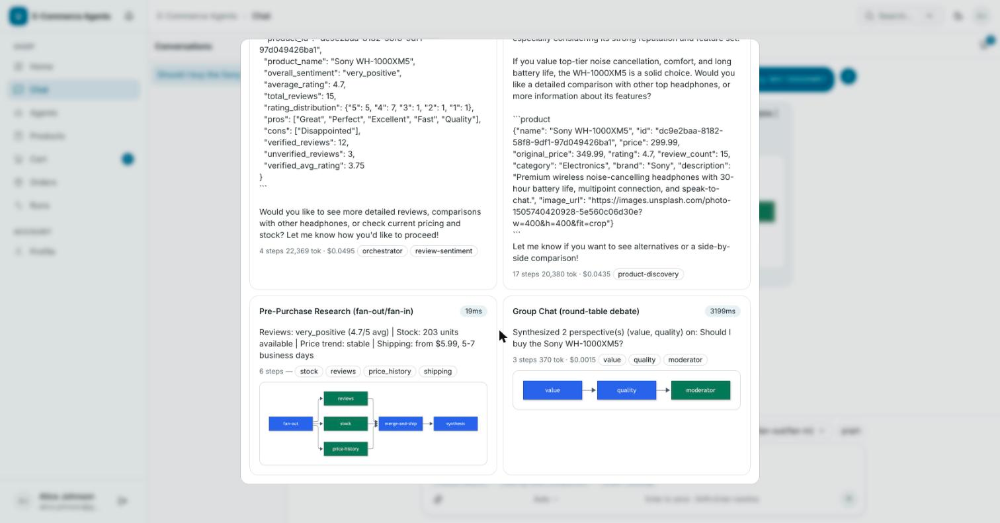
11. **Approve a paused return.** Sign in as `tour@example.com` / `tour123`, the account seeded with
    a delivered order (Alice's most recent order is still `shipped`, so her return stops at the
    eligibility check). Pick **Return & Replace** and ask "I want to return my last delivered
    order". The run pauses at the policy gate, nothing is created, and the chat shows "Awaiting
    staff review".

    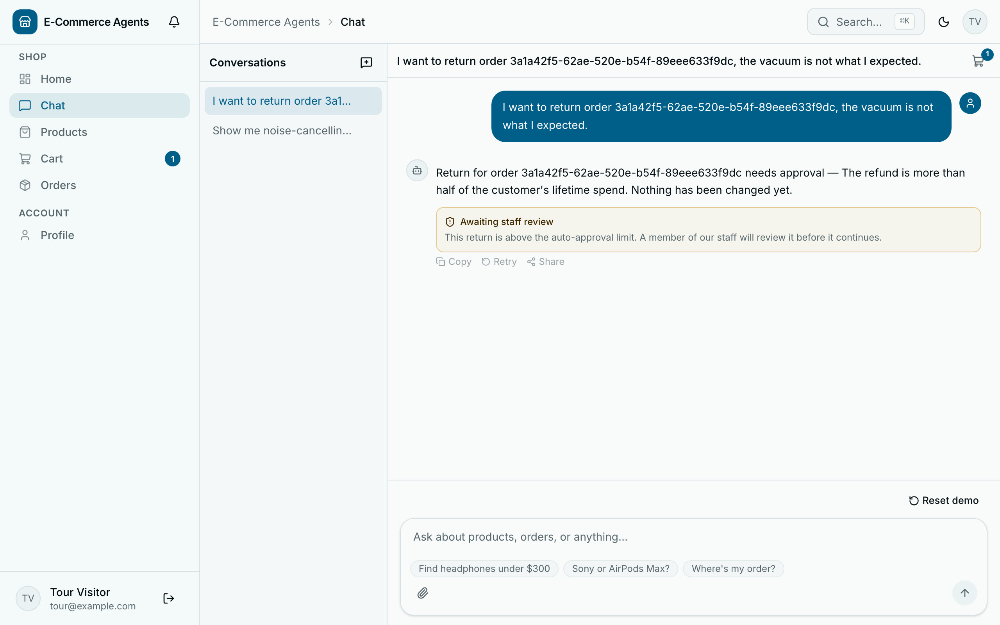

    Sign in as a reviewer in another browser and open **Approvals**. This return is over half the
    customer's lifetime spend, so policy routes it to a manager: use `admin.demo@gmail.com`.
    Choose **Approve** or **Reject**. The run resumes from its checkpoint and finishes as the
    customer; a rejected return leaves no return row behind. An admin can also decide from
    **Runs**, where the run is marked "Needs approval".

    A smaller return is routed to support instead. Ask as `alice.johnson@gmail.com` to return a
    specific delivered order of about $50 and it appears in `support.demo@gmail.com`'s inbox:

    

    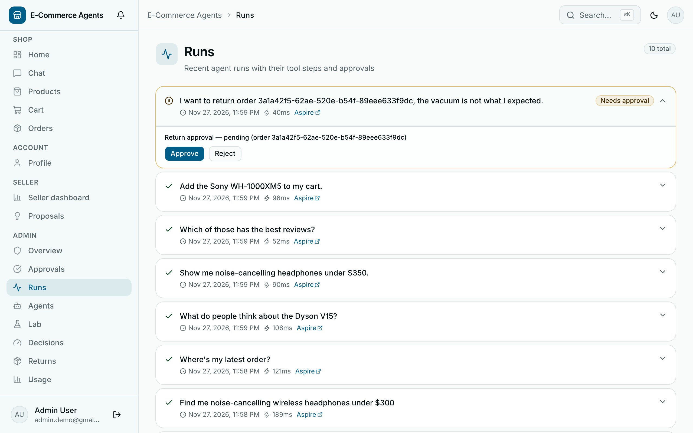

    The released 1.4.0 images predate the inbox fix: there, **Approvals** is admin-only and lists
    tool approvals only, so decide from **Runs** as an admin. See [approvals](approvals.md).

---

## Screens

Screenshots — guest browsing, the AI shopping flow, and the platform (click to collapse)

### Guest experience (no login required)

Anyone can browse the catalog, use the AI shopping assistant, and explore product details without creating an account.

<table>
<tr><td>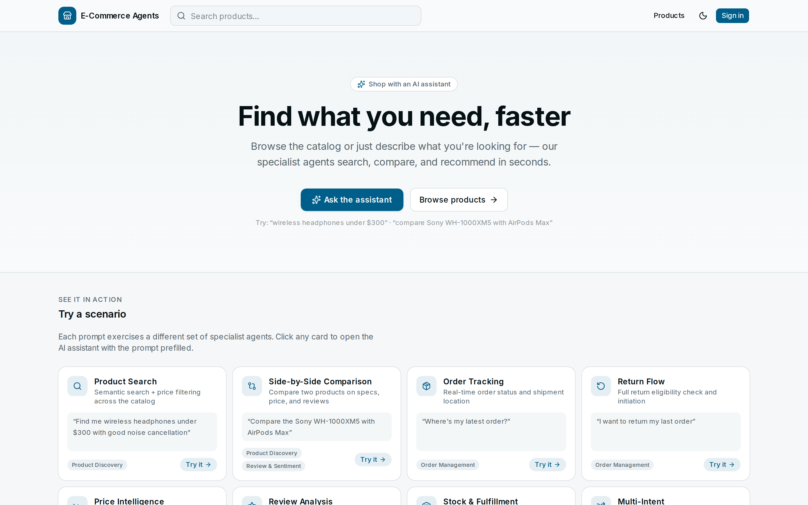</td></tr>
<tr><td align="center"><em>Product detail — full info, pricing, reviews, and stock status</em></td></tr>
<tr><td>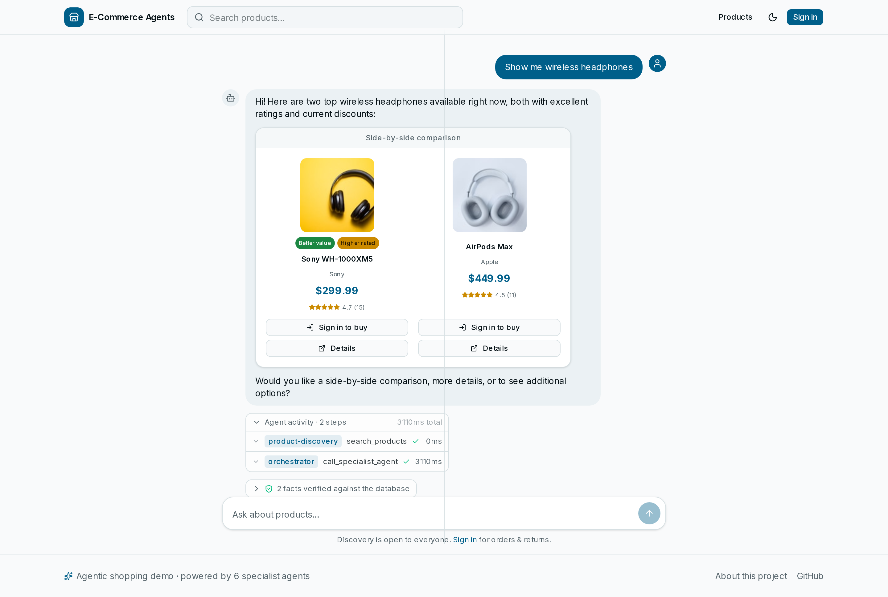</td></tr>
<tr><td align="center"><em>AI shopping assistant — product questions answered via multi-agent routing, no login needed</em></td></tr>
</table>

### AI shopping flow (signed in)

Sign in as any seeded user to access cart, checkout, order tracking, and returns — all driven by natural language in the chat interface. Every response renders as generative UI, not raw text: the component (card, table, chart, badge) is chosen by the shape of the data an agent returns.

<table>
<tr><td>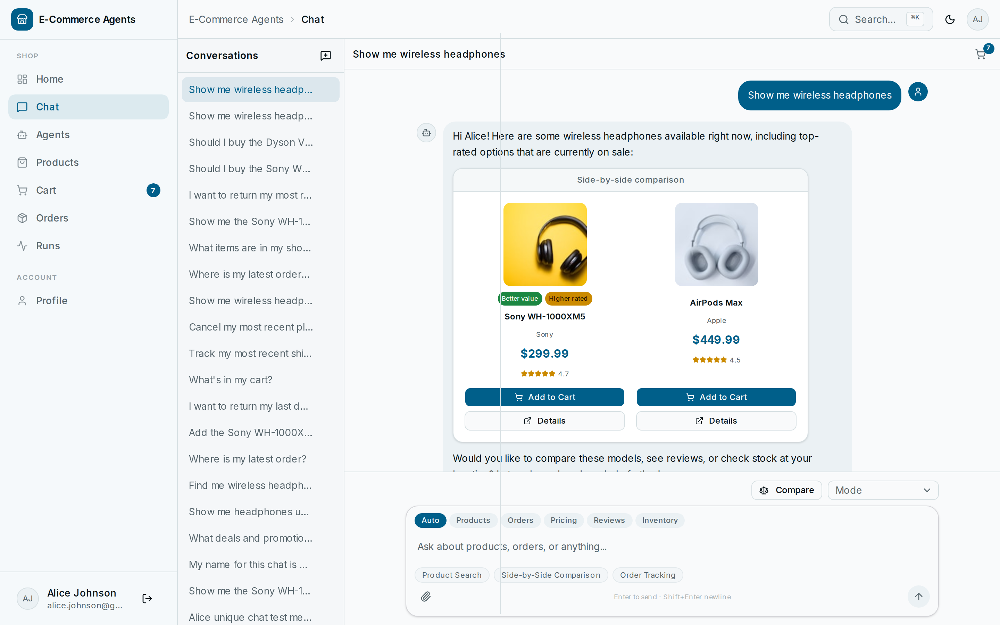</td></tr>
<tr><td align="center"><em>Find a product — orchestrator routes to Product Discovery; results render as interactive cards</em></td></tr>
<tr><td>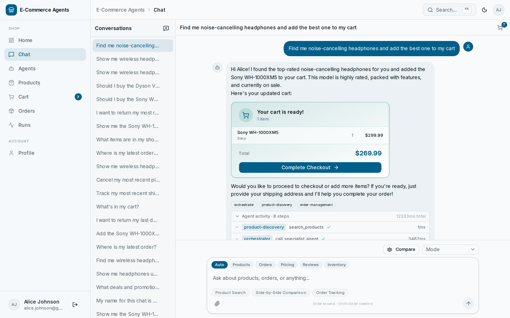</td></tr>
<tr><td align="center"><em>Add to cart — ask the assistant; it calls the cart API and confirms with a card</em></td></tr>
<tr><td>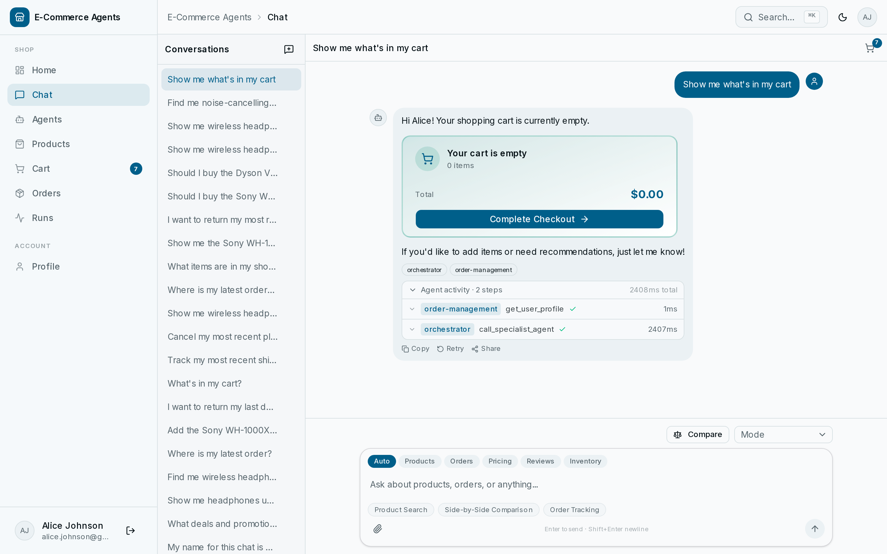</td></tr>
<tr><td align="center"><em>View cart — the agent renders a cart summary with totals and a checkout link</em></td></tr>
<tr><td>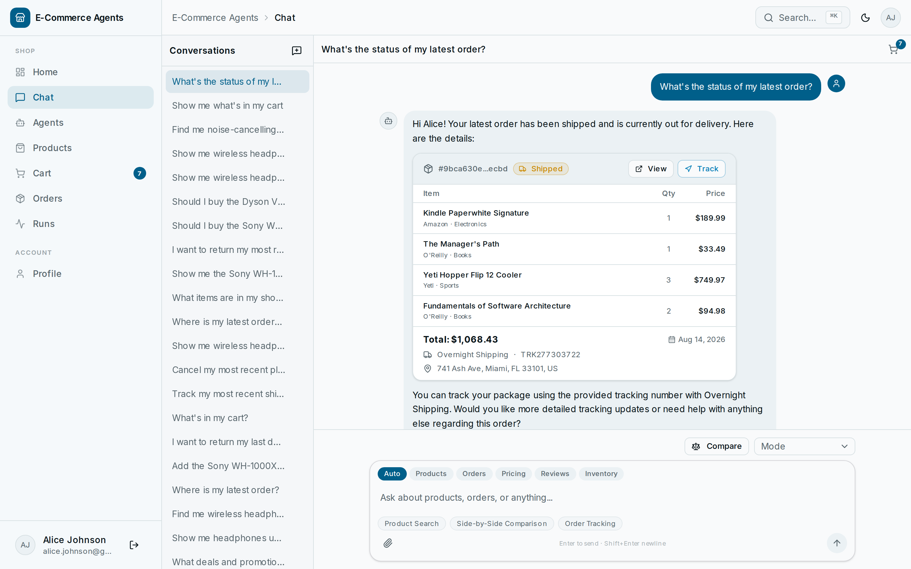</td></tr>
<tr><td align="center"><em>Track an order — Order Management agent returns live status and shipment detail</em></td></tr>
<tr><td>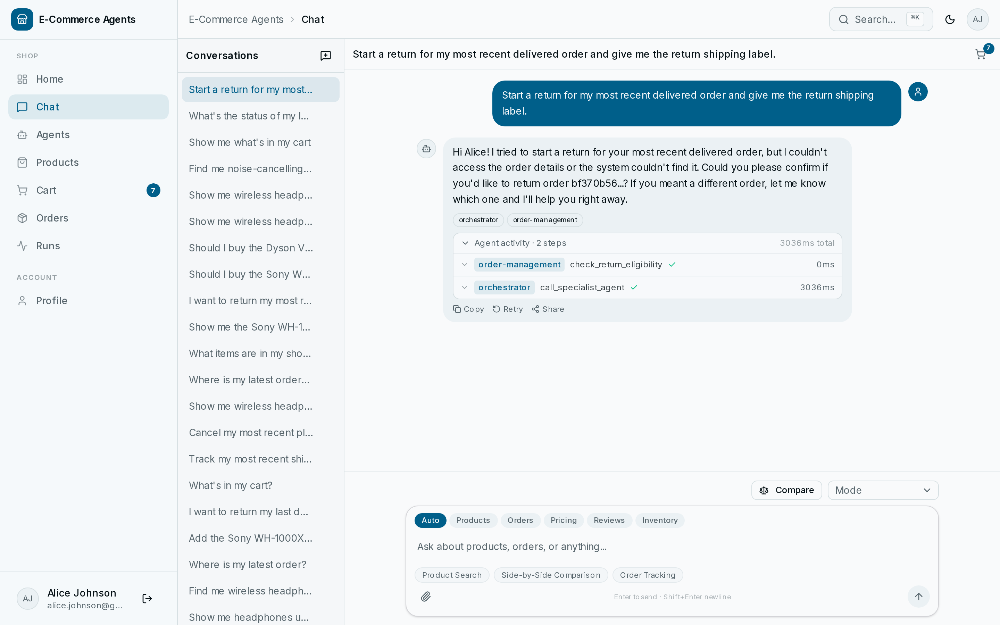</td></tr>
<tr><td align="center"><em>Return / refund — agent initiates the return flow and issues a return label</em></td></tr>
<tr><td>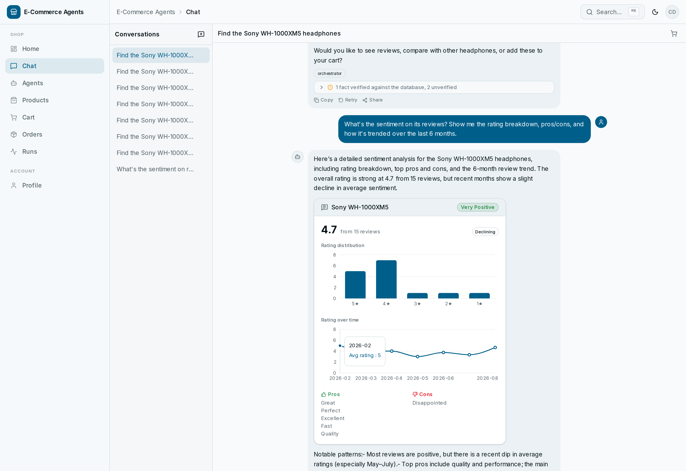</td></tr>
<tr><td align="center"><em>Generative UI — the Review & Sentiment agent's data renders as an interactive card: a rating-distribution bar chart, a 6-month trend line chart, and tone-coded pros/cons, all picked from the shape of the data itself, not a fixed template</em></td></tr>
</table>

### Platform

<table>
<tr><td></td></tr>
<tr><td align="center"><em>Agent timeline — orchestrator → specialist → tool routing surfaced live in chat</em></td></tr>
<tr><td></td></tr>
<tr><td align="center"><em>Product storefront — authenticated view with cart and account access</em></td></tr>
<tr><td></td></tr>
<tr><td align="center"><em>Agent marketplace — browse, request, and manage specialist agent access</em></td></tr>
<tr><td></td></tr>
<tr><td align="center"><em>Admin dashboard — usage analytics, approval queues, and audit log</em></td></tr>
<tr><td></td></tr>
<tr><td align="center"><em>Seller dashboard — product catalog and order management</em></td></tr>
</table>

---

