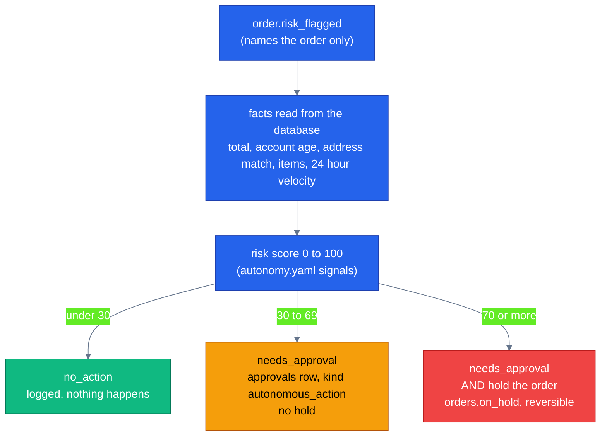
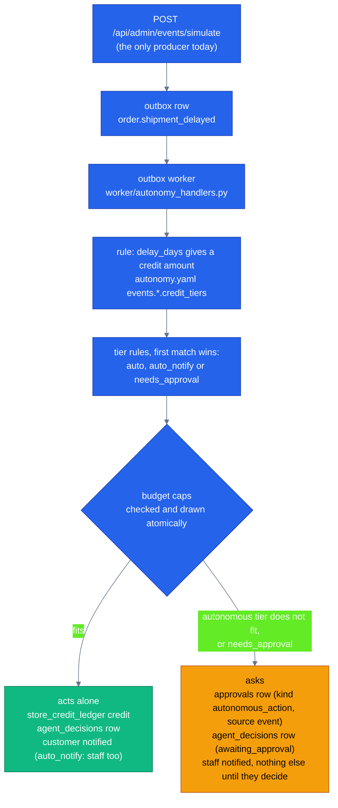

# Event autonomy

When an event arrives (a shipment running late, a price drop, a product back in stock, a damaged item, a risky order), the
system may act **on its own inside a budget**, and must **ask a person outside it**. Python only ([parity row 40](parity-matrix.md); tracked in
[#94](https://github.com/nitin27may/e-commerce-agents/issues/94) and [#299](https://github.com/nitin27may/e-commerce-agents/issues/299)).
**Off by default** (`AUTONOMY_ENABLED=false`) and it makes **no model call** unless you also turn on the optional
`AUTONOMY_RESPONDER_ENABLED` (see [The ops-responder](#the-ops-responder)): the rules are deterministic and the customer text
is a template.

## Event types

| Topic | Action (`autonomy.yaml`) | Targets | Sized by | Money |
|---|---|---|---|---|
| `order.shipment_delayed` | `goodwill_credit` | one order | `credit_tiers`: the delay in days | store credit |
| `product.price_dropped` | `price_adjustment` | every recent **order line** of the product | `(price paid - new price) x quantity`, read from the line, never from the event | store credit |
| `inventory.back_in_stock` | `back_in_stock_notice` | every customer whose cart holds the product | not sized | none |
| `order.item_damaged` | `damage_goodwill` | one order **line** | `credit_percent` of the damaged quantity's value up to `max_credit`, or a free replacement when it is cheap and in stock | store credit, or a replacement offer costed at its value |
| `order.risk_flagged` | `order_risk_review` | one order | a risk score from facts in the database (the event only names the order) | none; may **hold** the order |

All five go through the same engine: tier rules, then (for money) the budget check and draw under the advisory locks, an
append-only decision row, `run_once` plus a unique `event_key`, and the same guards (a staff beneficiary is never paid alone,
the demo tour user is never acted on, the decider is never the subject). The two newer ones **fan out**: one event becomes one
decision per target, each in its own transaction under `topic:event_id:target`, so a replayed event acts once per target.

**`product.price_dropped`** (payload `product_id`, `new_price`, optional `event_id`). Targets are order lines of orders in an
eligible status, newer than `lookback_days` (30), bought for more than the new price, at most `max_lines` (200) per event; the
tour user's lines are never selected. **One adjustment per order line, ever**: a second event for a paid line is
`no_action: line_already_adjusted` and a reversal does not free the line. The engine checks it under the order lock, and a
partial unique index (migration 0017) refuses a second paid adjustment on a line even if a bug skipped the check. The order's
`per_order_max_count` (5) bounds how many of its lines may be adjusted (`no_action: order_adjustment_limit`). Rules: within 14
days and at most a 50 percent drop, an amount up to 10.00 acts alone (`auto`), up to 20.00 acts alone and tells staff
(`auto_notify`); anything else, an older purchase, a bigger drop (more likely a pricing mistake than a sale) or a missing fact,
opens an `autonomous_action` approval. A staff approval pays once for the approval and may only lower the amount.

**`inventory.back_in_stock`** (payload `product_id`, optional `event_id`). A notice, no money and no budget: it is
`auto_notify` and is bounded by the audience instead. The engine first checks stock itself (`warehouse_inventory` sum above
zero and the product active; otherwise `no_action: product_not_in_stock`, whatever the event says), then selects carts that still
hold the product and were touched within `cart_max_age_days` (30). More than `max_recipients` (200) is
`no_action: recipients_over_cap` for a person to look at (a notice has nothing for the inbox to approve). A customer gets at most
`per_customer_per_day` (2) notices a UTC day (`no_action: customer_daily_notice_cap`); the read-then-act is serialised by the same
advisory lock keyed by the action. Staff are skipped (`recipient_is_staff`), the tour user is never selected, and staff get one
heads-up per event, not one per customer. **There is no wishlist in this repository, so carts are the only audience** (the
issue also named wishlists).

**`order.item_damaged`** (payload `order_item_id`, optional `quantity` (default 1, at most the line's) and `event_id`).
A customer-reported damaged item, simulated by the admin simulator (there is no customer-facing report path yet). The line must
belong to a `delivered` order no older than `lookback_days` (60). The remedy is sized from the line, never from the event: the
damaged quantity's value (`unit_price x quantity`) goes to a **free replacement** when the product has stock for it and the value
is at most `replacement_max_line_value` (30.00; the offer is costed at that value and drawn on the budget, **no store credit
moves**), otherwise to a **store credit of `credit_percent` (20) of the value up to `max_credit` (15.00)**. `size_damage_remedy`
is pure and has golden cases. **One remedy per order line, ever** (a reversal does not free the line): the engine checks it under
the order lock (`no_action: line_already_remedied`), a partial unique index (migration 0018) refuses a second paid remedy on a
line, and an approval already open on the line is `approval_already_open`. The order's `per_order_max_count` (2) bounds how many
of its lines may be remedied (`no_action: order_remedy_limit`). Rules: within 30 days, up to 10.00 acts alone (`auto`), up to
15.00 acts alone and tells staff (`auto_notify`); anything else asks. A replacement offer is **always** flagged to staff even
when it acts alone, because nothing in this repository ships it: somebody has to send it. A reversal of a credit takes it back
with a negating ledger entry; a reversal of a replacement withdraws the offer and touches no ledger. The ops-responder does not
word damage decisions (it has no facts for them), so no model is ever involved.

**`order.risk_flagged`** (payload `order_id`, optional `event_id`). The engine reads the order from the database and **ignores
anything else the event says**: the total, the account's age (`users.created_at`), whether shipping and billing differ (street,
zip or country; unknown when there is no billing address, and unknown adds nothing), the units in the order, and the number of
this customer's orders placed in the 24 hours up to and including this one. The `signals` in `autonomy.yaml` add points
(500 or more is +20, 1500 or more another +20, an account under 7 days old +25, an address mismatch +15, 8 or more items +15, 3 or
more orders in the window +25, 5 or more another +15) and the score is capped at 100. The action's rules read only the score:

**A risk review is never `auto`**: the loader refuses an autonomous tier on a `risk_review` action, so the engine can never clear,
cancel or refund an order itself. It also never touches the order's `status`. A **hold** is the flag `orders.on_hold` (with
`held_at` and `hold_decision_id`, the decision row that placed it), set in the same transaction as the decision row and the
approval, so a release can only ever undo the hold its own decision placed. The customer is told "your order is being reviewed" (no
fraud wording) only when a hold is placed. The approval's amount is the **order total** (what is at stake: it routes the review,
over 100 goes to a manager), nothing is paid, and there is nothing to edit (an edit is a 422).

- **Staff approve** the review: the order is cleared. An `approved_execution` row records who, and if the hold is still in
  place a `reversal` row releases it (and the customer is told). **Staff reject**: the flag was upheld, the hold stays until an
  admin releases it. An SLA breach expires the approval and, for a held order, says the order stays on hold.
- **An admin releases the hold** from the decisions page ("Release hold", `POST /api/admin/decisions/{id}/reverse`): a
  `reversal` row, the flag cleared, the customer told. The review itself stays open (its state follows the approval; the hold is
  reported separately as `hold_active`).
- **One review per order**: a second event for an order that already has a review is `no_action: order_already_reviewed`, an order
  already on hold is `order_already_held`, and only `placed` and `confirmed` orders are eligible. A staff member's own order is
  never held by the engine (`beneficiary_is_staff`: an approval only, which they cannot decide); the demo tour user is never touched.
- **Nothing in this repository advances an order to `shipped`**, so there is no fulfilment step for the flag to block. It is a
  recorded, reversible mark that a fulfilment process must honour; wiring it into one is not built.

## Monthly budgets

A budget may carry `global_per_month: {max_count, max_amount}` beside `global_per_day` (every shipped budget does; a budget
without it has no monthly limit). It caps what the system may spend alone across **every customer in one UTC calendar month**
(the 1st 00:00 UTC to the last day), summed from the same per-day draws (`budget_day`), and it must be at least the day cap
(the loader refuses less). Exactly at the cap is allowed, over it trips `global_monthly_count` / `global_monthly_amount`, and an
autonomous draw that does not fit becomes `needs_approval` with that reason, like any other cap. A reversal does not give a draw
back and a staff approval draws nothing, as for the day.

It is enforced in the same transaction and by the same helper as the day cap. `lock_budget` takes the **day lock and then the
month lock** (`autonomy_budget_month:<budget>:<YYYY-MM>`), always in that order. The month lock is not optional: two events on either
side of UTC midnight hold different day locks yet draw on the same month, so only a month-keyed lock stops both spending the last of
it (`test_autonomy_monthly.py` has the race and a negative control that fails without it). Every decision row records the month's
caps and the usage it saw (`budget.caps.global_per_month`, `budget.usage_before.month_*`), and the decisions page shows each budget's
use this month beside today's.

**Every number is a placeholder** (the `price_adjustment` budget: 20.00 per action, 3 and 40.00 per customer per day, 5 lines per
order, 50 and 400.00 global per day; the notice limits above). Changing one means bumping `policy_version` and extending
`testdata-autonomy/cases.yaml`.

`damage_goodwill` (placeholders): 15.00 per action, 1 and 15.00 per customer per day, 2 lines per order, 10 and 100.00 global per
day, 150 and 1200.00 per month. Every budget's monthly cap (300 and 3000.00, 800 and 6000.00, and that one) is a placeholder too.
The risk signals, points and the 30 and 70 thresholds are the builder's, not derived from fraud data.

The admin simulator sends them: `{"scenario": "price-drop"}` picks the most recent eligible line (a price of 20 or more, no
decision on it yet) and drops its product 10 percent; `{"scenario": "back-in-stock"}` picks an in-stock product in a recent
customer cart that the engine has not announced; or give `{"event_type", "product_id", "new_price"}` explicitly.
`{"scenario": "order-risk"}` picks the largest eligible (`placed` or `confirmed`) customer order that no review has looked at and
that is not held (or give `{"event_type": "order.risk_flagged", "order_id"}`); `{"scenario": "item-damaged"}` picks the most recent
delivered line inside the window with no decision on it (or give `{"event_type": "order.item_damaged", "order_item_id",
"quantity"?}`). An explicit event is only valid on a customer's own records: never the acting admin's, a staff member's or the demo
tour user's (422).

## The flow

Three delays in the shipped policy land in three tiers: 3 days is a $5.00 credit (`auto`), 6 days $15.00
(`auto_notify`: acted alone and staff are told), 12 days $40.00 (`needs_approval`, over the $25 per-action cap).

## The policy file

`agents/python/config/policies/autonomy.yaml`, validated whole at load (`shared/autonomy/policy.py`, errors are
`AutonomyPolicyError`), golden cases in `config/policies/testdata-autonomy/cases.yaml` (a separate folder: the approvals
golden cases next to it are read by the .NET tests too). Same `{fact, op, value}` shape as `approvals.yaml`.

- **A missing fact never satisfies a condition.** An unknown delay or amount can only fall through to `needs_approval`.
- **The default is to ask.** The loader refuses a policy whose last rule is not unconditional `needs_approval`, an
  autonomous rule without an `amount lte N` ceiling, or a ceiling above the budget's `per_action_max_amount`.
- **Money is `Decimal`**, at most two decimal places (more is an error, not a rounding).
- **Caps:** `per_action_max_amount`, `per_customer_per_day` (count and amount), `per_order_max_count` (ever),
  `global_per_day` (count and amount), UTC day. Exactly at a cap is allowed. A reversal does **not** give a draw back.
  A staff-approved action does not draw on the budget: a person authorised it.
- Every decision records the policy `version` it was judged by. **Every number in the file is a placeholder.**

## Atomic budgets

The whole decision runs in one transaction that first takes `pg_advisory_xact_lock(hash(budget, UTC day))`. Two events racing
for the last of a budget serialise on the lock; the second reads the first's committed draw and is turned into an approval.
`tests/test_autonomy_engine.py` proves it with a widened read-to-draw window, and includes the negative control (lock
removed: both spend). The lock is per budget and day, so one budget's events never wait on another's. Cost: all draws on one
budget serialise, which is right for a cap and fine at this scale.

**The per-order cap has its own lock.** The day-keyed lock cannot serialise the one cap that is not a daily cap: two events for
one order that start on either side of midnight UTC hold *different* budget locks, and two approvals for one order hold none,
so both would read "this order was not paid" and both pay. The decision therefore also takes `pg_advisory_xact_lock` on the
order, and so does executing an approved credit. **Lock order, everywhere: budget, then order, then row locks** (the approval
row, then the decision row); the approved path takes no budget lock (a person authorised it, nothing is drawn) and follows the
same order from the order lock on, so the two cannot deadlock. Both races have tests with a negative control (lock removed:
both pay).

**The day key and the per-customer cap.** The per-customer cap is *per UTC calendar day*: a draw counts on, and serialises
under, the day the event started (read before the lock is awaited, so an event that waits past midnight is still booked on the
day it arrived). One customer therefore can receive a day's cap just before and again just after midnight, which is what a
calendar-day cap means; a rolling 24-hour window would be a different policy, not a different lock. The day key is right for
both daily caps; the order lock is what bounds a single order.

## The log is append-only

Migration `0012`. `agent_decisions` and `store_credit_ledger` refuse UPDATE and DELETE (trigger). What happens later is a new row:

| `entry_type` | meaning |
|---|---|
| `decision` | the engine's verdict on an event: acted alone, asked, or found nothing to do (`no_action`, with the reason). One per event (`event_key` unique) |
| `approved_execution` | staff approved an `awaiting_approval` decision and the credit ran. One per approval |
| `reversal` | an undo, with a negating ledger entry. One per reversed row |

**TRUNCATE is refused too.** A row trigger never sees `TRUNCATE`, and the seeder's `TRUNCATE ... users CASCADE` reaches both
tables through their foreign keys, so a statement-level trigger refuses any `TRUNCATE` of either table that would destroy
rows (an empty table is let through: nothing is lost, and the blanket `TRUNCATE` every test fixture runs keeps working).
The one deliberate way to clear them is the migration's `reset_autonomy_log()` function, which opens the guard for its own
transaction only. The dev/demo seeder calls it from one named function, `scripts/seed.py::reset_autonomy_log`, before its
reset, and the Python test fixture (`clean_db`) calls it between tests; no application path does. It is a dev/demo reset
and may discard history; it is not an escape hatch for production, where the append-only guarantee is the point.

The admin page derives a state from these rows (`executed`, `awaiting_approval`, `executed_after_approval`, `rejected`,
`expired`, `failed`, `reversed`, `no_action`). Reversal refuses (409) when nothing executed, it was already reversed, or the
credit has since been spent. The ledger balance is the sum of a customer's entries; **nothing spends store credit yet**.

## At most once

`run_once` (`autonomy_event:{topic:event_id}`) in front, a unique `event_key` behind it, and the decision commits on its own
connection before `run_once` marks the event complete. A redelivered row, a second outbox row for the same event, or the same
`event_id` sent twice acts once. A second event for an order already waiting on an approval is `no_action`
(`approval_already_open`); a second *new* event on an already-credited order is `no_action` with reason
`order_already_credited` (logged in the decision log, **no approval opened**): a second goodwill credit for one order is not
something the inbox should be asked, and approving it would be refused by the same ceiling. `per_order_max_count` (1 in the
shipped policy) is that ceiling for both paths, autonomous and staff-approved; the approved execution still refuses at the
ceiling as a backstop for an approval opened before the order was credited.

## Over budget: an approval

Kind `autonomous_action` in `approvals.yaml` (`amount` over 100 routes to a manager, otherwise support; no `auto` route). The
requester is the system actor `autonomy@system`, so any staff member may decide it and the "never your own request" rule
holds. Staff approve or reject in the ordinary inbox (`POST /api/approvals/{id}/decide`, source `event`):

- approving grants the credit at most once for that approval, to the order's owner; a reviewer's edit may only **lower** the
  amount (`amount`, two decimals, positive); `request_info` is refused (nobody can answer the system);
- rejecting changes nothing; the customer is never told about a credit that did not happen;
- an SLA breach escalates support to manager once, then expires it, **never while a decide holds the claim** (the timer
  waits), and an approved credit that ran but was never recorded is recorded, not expired;
- **the credit is tied to the approval and to the claim.** The credit is written in a transaction that first locks the
  approval row (`FOR UPDATE`, the same lock the SLA handler and every state change take) and pays only if the approval is
  still `pending_review` **and** the decide's own claim token still holds it. A decide whose claim went stale mid-flight
  can be overtaken by the SLA handler (which closes the approval and tells staff nothing was done); it then pays nothing and
  answers the ordinary `409`, and the reservation is released so a legitimate retry is not blocked by a cached refusal.
  `tests/test_autonomy_review_fixes.py` drives that interleaving through a real SLA tick.

## A paid credit is recorded, never undone on paper

The credit commits on its own transaction, then the approval is recorded. A request that dies in between leaves a paid
credit under a still-pending approval, so every later path must *record* it:

- **reject** answers `409` ("approve to record it") instead of recording `rejected` (checked after the claim; the credit is
  only ever written under the claim, so no approve can start paying between the check and the record);
- **approve** replays the stored `approved_execution` row directly (not through `run_once`, whose reservation a cancelled
  attempt leaves "in progress") and records the amount that went out. A retry whose amount edit differs is `409`; a retry
  without edits records `{"amount": "<paid>"}` (status `approved_with_edits` when it differs from the proposal);
- a `run_once` reservation held by another live attempt is `409`, claim handed back, nothing recorded: only a result with a
  `success` key is a verdict, so a `{"error": ...}` shape can never close the approval as `failed`;
- the SLA handler records it; `request_info` is refused for event approvals;
- an `amount` edit that is not finite or beyond decimal precision is `422`, not `500`.

Web: the decisions page pages 50 at a time (`limit`/`offset`, "Showing N of TOTAL", "Load older decisions"; the state
filter is applied in SQL, so an old waiting decision is reachable), ignores out-of-order responses (latest-request id plus
an `AbortController`), has a Refresh button, and after a demo scenario looks again every 2 s up to 5 times, stopping as
soon as the total grows.

## Nobody approves a credit to themselves

The approval's requester is the system actor, so "never your own request" alone would let a staff member approve money for
their own account. Three layers close it, and the engine never relies on the simulator being well behaved:

- **The decider is never the subject.** `authorize_decider` (Python) / `AuthorizeDecider` (.NET) refuse the reviewer when
  they are the approval's `subject_email` (case-insensitive), for every staff-decided source, again after the claim.
  Merchant proposals are the one exemption (the seller is the subject and decides on the seller routes), named in code.
  A database CHECK (`approvals_no_beneficiary_decision`, migration 0012) says the same for every source except `proposal`.
- **The engine never acts alone for a staff beneficiary** (`support` or `admin`, whoever produced the event): the verdict
  is always `needs_approval` with reason `beneficiary_is_staff`, which another staff member decides.
- **The simulator** refuses (422) an explicit order whose owner is not a `customer`, or is the acting admin.

## The demo tour user is never acted on

`agent_decisions` holds foreign keys to `users` and `orders` with no `ON DELETE` rule (the append-only trigger would refuse
`SET NULL` and `CASCADE` anyway), and the demo reset (`shared/demo_tour.py`) runs `DELETE FROM orders WHERE user_id = ...`.
One decision row referencing the tour user's order would make every later reset fail. So the engine records
`no_action: demo_user_excluded` for the tour user **without any user or order id on the row**, the scenario picker skips the
account, and an explicit simulate on its order is a 422. Every other `DELETE FROM` in application code touches cart
items, messages, checkpoints, idempotency keys, refresh tokens, embeddings or the eval seeder's products and reviews,
none of which `agent_decisions` or `store_credit_ledger` reference. The seeder's `TRUNCATE ... users CASCADE` is the
other path; see *The log is append-only*.

## Admin API and page

| Route | |
|---|---|
| `POST /api/admin/events/simulate` | `{scenario: small\|medium\|large}` or `{order_id, delay_days, event_id?}` (delay), `{scenario: price-drop}` or `{event_type: product.price_dropped, product_id, new_price}`, `{scenario: back-in-stock}` or `{event_type: inventory.back_in_stock, product_id}`, `{scenario: order-risk}` or `{event_type: order.risk_flagged, order_id}`, `{scenario: item-damaged}` or `{event_type: order.item_damaged, order_item_id, quantity?}` (#299). 404 unless `AUTONOMY_ENABLED` **and** `AUTONOMY_SIMULATOR_ENABLED`, for every caller and *before* the role check (a 401/403 would reveal that the route exists on an install that switched it off). A scenario picks the oldest eligible order of a customer with no autonomy activity today and no event queued, so the three land on three customers. Replaying an `event_id` enqueues nothing |
| `GET /api/admin/decisions[?state=&limit=&offset=]` | decisions with state, reasons, the budget each drew on, and today's use per budget. `state` is filtered in SQL over every row (an old `awaiting_approval` decision stays findable); `limit` is at most 200, `offset` pages, `total` counts every match |
| `POST /api/admin/decisions/{id}/reverse` | admin only; works even when the feature is switched off. For a held order it **releases the hold** (no money moves) |

A decision row of a risk review also carries `hold_active` (whether its order is on hold right now). The `budgets` array reports each
budget's day use and, when it has one, `month`, `month_used_count`, `month_used_amount`, `month_max_count` and `month_max_amount`.

Web: `/admin/decisions`.

## Booting every flag at once

`scripts/flag-smoke.sh` boots the Python stack under `LLM_PROVIDER=replay` with `AUTONOMY_ENABLED`,
`AUTONOMY_SIMULATOR_ENABLED`, `RETURN_LIFECYCLE_ENABLED`, `MERCHANT_OPS_SCHEDULE_ENABLED` and `HITL_ENABLED` on, in its own
compose project (`eca-flag-smoke`), and drives the real routes and the outbox worker with no model and no key: the three
simulator scenarios (small is an executed `auto` decision, medium an executed `auto_notify`, large waits and opens an
`autonomous_action` inbox row, then the price-drop, back-in-stock, order-risk (a review is never an autonomous tier, a hold leaves
the order's status alone, and the flag matches the decision) and item-damaged (one decision per order line) scenarios, and that every
budget reports its month), a return through approval, carrier scan and inspection to `refunded`, a merchant run with its
daily timer booked, and a check that no outbox row carries an error. `--dry-run` lists the flags and checks without starting
anything; `--attach` drives a stack that is already up. CI runs it as the `flags` job in `compose-smoke.yml`.

## Gotchas

- **A flag must be passed through `docker-compose.yml` to be live in a container.** `RETURN_LIFECYCLE_ENABLED` and `MERCHANT_OPS_SCHEDULE_ENABLED` were not, so `RETURN_LIFECYCLE_ENABLED=true ./scripts/dev.sh` left the simulator route a 404 and the worker handlers off until `flag-smoke.sh` booted them together.
- **Everything is off by default.** `AUTONOMY_RESPONDER_ENABLED` is a third switch, and the only one that calls a model. `AUTONOMY_ENABLED` gates the engine and the simulator additionally needs `AUTONOMY_SIMULATOR_ENABLED`. Every number in `autonomy.yaml` is a placeholder.
- **The decision and ledger tables are append-only.** A reversal is a new row, and a reset needs `reset_autonomy_log()`: `TRUNCATE` is refused while they hold rows.
- **Lock order is budget, then order, then row locks.** Taking them in another order can deadlock two events.
- **A credited order is `no_action`.** It opens no approval.
- **A hold is a flag nothing reads yet.** `orders.on_hold` is recorded, reversible and shown on the decisions page, but no code
  path in this repository ships an order, so nothing is blocked by it.
- **The risk review's amount is the order total**, so over 100 it routes to a manager and a support reviewer cannot decide it.
- **The month lock also serialises events on different days.** The old "straddling midnight" order-lock tests keep only the day
  lock on purpose (`_straddle_midnight`), or the month lock would hide what they prove.
- **A replacement offer is not a shipment.** It is a recorded, costed promise; staff are told every time to send it.
- **.NET refuses every decision on an `event` approval** (422, "not supported on this stack").

## Not built

Still open in [#299](https://github.com/nitin27may/e-commerce-agents/issues/299): a real carrier feed. It is an external system, so
it is not built here: no producer exists for any event (no carrier, no customer damage report, no order-placed hook for a risk
score); the simulator is the only one. Also not built: fulfilment that honours `orders.on_hold`, and a customer-facing way to report
damage. The engine takes another event type by adding an action, an `events:` entry, a parser and a handler line. There is no
replay dataset for the responder: its model call is a plain chat call outside the routable agents, so it is covered by stubbed
unit tests and one recorded live validation (see the PR), not by fixtures.

## The ops-responder

`AUTONOMY_RESPONDER_ENABLED` (default `false`, needs `AUTONOMY_ENABLED`). After the engine **commits** a decision that paid a
credit (an autonomous one, or a staff-approved one), a model drafts the short customer message (an apology or an explanation)
from the decision's facts. It words a decision and cannot change one:

- **After, not during.** The engine enqueues an `autonomy.draft_requested` outbox row in the decision's own transaction (only
  when the flag is on); the worker handles it later. The ledger entry, the decision row and the customer notification already
  exist with the template text, so nothing waits on a model and a model outage loses nothing.
- **It sees only facts, and returns only text.** The prompt (`config/prompts/ops-responder.yaml`, a raw prompt, not a
  registered specialist: the orchestrator cannot route to it and no replay fixture is involved) gets a JSON object of the
  amount, order reference, delay or product and prices. Nothing it returns is read back into an amount, a tier or a state;
  `shared/autonomy/engine.py` reads `decision_drafts` only in the admin read model (a test pins that).
- **Checked against the facts** (`responder.check_draft`, built on the grounding extractor): every dollar amount must be one of
  the facts' amounts exactly (a derived sum is not accepted, unlike in chat answers), the credit amount must appear, no id, link,
  email or percentage, a day count must be the event's own, at most 450 characters.
- **Falls back to the template** on any failed check, a model error or a timeout, and stores why (`fallback_reason`).
- **Stored and shown.** One append-only `decision_drafts` row per decision (migration 0017); the admin decisions page shows the
  message and whether it is the model's or the template's; the customer's notification body is replaced with it (title and link
  unchanged), found through `notifications.decision_id`.
- Only credit and price-adjustment decisions are worded (damage remedies and risk reviews are not: no facts for them). A back-in-stock notice is not sent to a model (it could be 200 calls for one event).
- The worker container needs the chat provider variables for it; `docker-compose.yml` passes them. Cost is one short call per
  granted credit, not routed through run usage accounting.

Gotcha: because the notification is replaced after it was created, a customer who read it in the first seconds saw the template
and the next load shows the draft.

### What the TRUNCATE guard is, and is not

The triggers on `agent_decisions` and `store_credit_ledger` stop accidents: a stray `UPDATE`, `DELETE` or
`TRUNCATE` from application code, a test fixture or a console. They are not a defence against the database role the
application itself uses, which owns the tables and may call `reset_autonomy_log()`. That function is reached only from
the seeder (`scripts/seed.py::reset_autonomy_log`) and the test fixtures, never from an HTTP route. An audit log that
must survive a hostile application role needs a separate role or an external sink, which this repo does not have.
