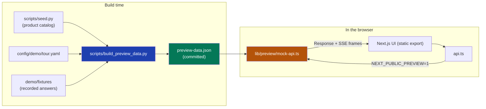

# Static web preview

A copy of the web UI that runs from a link: no Docker, no database, no API key, no server. It is
published at <https://nitinksingh.com/e-commerce-agents/preview/> and replays the answers
recorded for the [demo tour](demo-guide.md#no-key-mode).

It is a preview, not a demo of the agents. Nothing in it calls a model or an agent; every answer was
recorded earlier. To see the real system, [run it locally](quick-start.md).

## What you can do

- Sign in. The form is filled in with the tour account (`tour@example.com`), the only account.
- Open the chat and click any chip. Each one streams its recorded answer with the same timeline of
  tool calls, product, order, pricing, inventory and sentiment cards, and live orchestration graph the
  running app shows. The return chip pauses on the approval card.
- Browse the catalog (35 products from the seed data) and the two orders of the tour user.
- Type anything else and the chat answers: "This preview replays recorded answers; run it locally for
  the real thing", with a link to the quick start.

Everything that would change data (cart, checkout, signup) answers "read-only". Admin and seller pages
load but show no data.

## How it works

It is the normal Next.js app built with `NEXT_PUBLIC_PREVIEW=1`, not a second app.



- `web/src/lib/api.ts` sends every backend call through one function. With the flag set it is
  `previewFetch` (`web/src/lib/preview/mock-api.ts`), which returns real `Response` objects, so the app's own
  parsers run unchanged. Chat answers are SSE text in the orchestrator's frame shapes (`step`, `delta`,
  plain text, `node`, `handoff`, `metadata`, `run`, `replay_miss`), sent with small delays.
- `scripts/build_preview_data.py` writes `web/src/lib/preview/preview-data.json` from committed files only.
  It keeps what the UI shows: the final text, the tool calls behind the timeline, the graph frames, the
  catalog and two orders. It reads the fixtures' requests only to tell the orchestrator's turn from a
  specialist's, and never writes a request body, system prompt or tool schema.
- A normal build has no preview code: the flag is a literal, so the bundler drops the mock and its data.
  Check with `grep -r preview-token web/.next/static` after `pnpm build`; it finds nothing.

Two tour prompts call no model (`workflow:pre-purchase`, `workflow:return-replace`), so there was
nothing to record. Their text is composed from the workflow's own templates over values the recordings
show, and the data file marks them `"source": "composed"`.

## Build and test it yourself

```bash
python3 scripts/build_preview_data.py            # regenerate the data (--check to verify)
cd web
pnpm build:preview                               # static export into web/out (PREVIEW_BASE_PATH for a sub-path)
pnpm serve:preview                               # http://127.0.0.1:4173/e-commerce-agents/preview/
PREVIEW_E2E=1 pnpm exec playwright test --project=preview
```

`pnpm build:preview` moves `src/app/api` (the orchestrator proxy, a route handler) aside for the build
and puts it back afterwards; a static export cannot contain one. If a build is killed halfway, move
`src/app/_api_proxy_disabled` back to `src/app/api`.

Regenerate the data after changing `tour.yaml`, the demo fixtures or the seed catalog. CI fails a pull
request whose committed data is stale.

## Publishing

`.github/workflows/jekyll-gh-pages.yml` builds the docs with Jekyll, then builds the preview with
`PREVIEW_BASE_PATH=/e-commerce-agents/preview` and copies it to `_site/preview` before uploading the Pages
artifact. A Pages site has a single deployment, so a second workflow deploying it would replace the docs
(and be replaced by them); one workflow with one artifact cannot. `.github/workflows/preview.yml` runs on
pull requests and builds and tests the export without deploying.

## Gotchas

- Dynamic routes (`products/[id]`, `orders/[id]`, `shop/products/[id]`) are pre-rendered per id from the
  snapshot, so a product outside the snapshot is a 404. Their pages are thin server wrappers around the
  client components so they can export `generateStaticParams`.
- The `basePath` applies to links, assets and router calls, not to a hard-coded `window.location.href`.
  The preview never answers 401, the only path that uses one.
- The Open Graph image (`web/src/app/opengraph-image.tsx`) is rendered at build time. GitHub Pages serves
  its extensionless file as `application/octet-stream`; most link unfurlers sniff the type, a strict one may not.
- Data in the answers is as of the recording (an order date, a stock count), like the demo's.
