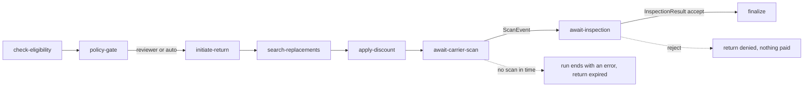

# Return lifecycle

By default an approved return finishes in the request that approved it. With `RETURN_LIFECYCLE_ENABLED` it
outlives the request: it waits for the carrier's first scan, which can be days away, then for support to inspect
what came back, and is paid out or denied. Each wait resumes from its checkpoint. Python only; the .NET stack has no equivalent (parity matrix row 41).

Off by default. With it off the graph, the replay fixtures and the .NET parity gate are exactly as before.



## How a wait works

The workflow pauses with `ctx.request_info(...)` and a checkpoint in Postgres. Three rows record each wait, written in
one transaction (`shared/return_lifecycle.py::open_wait`):

- a `hitl_requests` row (`kind = 'carrier_scan'` or `'return_inspection'`) carrying MAF's resume token and the
  checkpoint id;
- an outbox timer (`return.scan_timeout`, or `return.inspection_timeout`);
- a notification: to the customer ("Your return label is ready"), or to the `support` role (a return awaits inspection).

`return.carrier_scanned` (an outbox row) answers it. The outbox worker (`worker/return_handlers.py`) resumes the
workflow through `approvals_service.resume_workflow(kind="carrier_scan")`: the same claim, fence, timeout and
run-as-the-requester machinery a reviewer's decision uses. The return becomes `shipped_back` and gets `scanned_at`.

If the timer fires first, the workflow resumes with `received=False`: the run ends with an error, the wait is
`timeout`, the return is `expired`, and the customer is told.

| Wait ends as | `hitl_requests.status` | `returns.status` |
|---|---|---|
| Carrier scanned it | `completed` | `shipped_back` |
| No scan in time | `timeout` | `expired` |
| Inspected, accepted | `completed` | `refunded` (with `resolution`) |
| Inspected, rejected | `rejected` | `denied` |

## Inspection

Once the carrier has scanned the package the workflow pauses a second time. Support (`support` or `admin`) decides it
from `/admin/returns`, backed by `GET /api/staff/returns/inspections` and `POST /api/staff/returns/{id}/inspect`. It is
**not** an approvals-inbox item: there is no policy route to decide, only a person looking at a package, so it has its
own list and route and goes through the same `resume_workflow` machinery a reviewer's decision does.

- **Accept** picks a resolution: `refund` (back to the original payment), `store_credit`, or `replacement` (paid as
  store credit toward it). The amount may be lowered, never raised above what the return was created for.
- **Reject** denies the return and pays nothing.
- **Never the customer.** A support user cannot inspect their own return (403), as a reviewer cannot approve their own
  request.
- **Paid at most once.** `shared/return_ops.py::resolve_return` claims the return (`resolution IS NULL`) and writes the
  `store_credit_ledger` credit in one transaction, so a workflow that resumes twice cannot pay twice and a late
  rejection cannot undo a payout.
- **A slow inspection never denies the customer.** `return.inspection_timeout` (after `RETURN_INSPECTION_TIMEOUT_DAYS`)
  sends one notification to the `admin` role and leaves the return waiting. The carrier delivering a package is not the
  customer's fault, so there is nothing to expire.

`GET /api/runs/{run_id}/timeline` lists what happened to a run, oldest first: its waits and how each ended, the
approval's audit events and the checkpoints. `/runs` shows it for a return with a lifecycle wait. A customer sees the
role that acted, never a staff member's email; admins see both.

## Trying it

There is no carrier integration. The one producer of `return.carrier_scanned` is an admin-only simulator:

```bash
RETURN_LIFECYCLE_ENABLED=true ./scripts/dev.sh
# approve a return so it reaches the wait, then:
curl -X POST localhost:8080/api/admin/returns/<return_id>/simulate-scan \
  -H "Authorization: Bearer $ADMIN_TOKEN" -H 'content-type: application/json' -d '{"carrier":"UPS"}'
```

The outbox worker (`outbox-worker` in compose) picks the event up and resumes the return, which now waits for
inspection: open `/admin/returns` as support or an admin (not the customer) and accept or reject it. `/runs` shows each
wait with nothing to approve, and the timeline.

## Gotchas

- **The flag is read when the graph is built, and a checkpoint belongs to the graph that wrote it.** Flip it only
  while no return is paused, or a paused return will not resume.
- **A scan and the timer can race.** Whichever claims the wait first wins; the other finds it answered (409) and is
  dropped, not retried. A scan arriving after the timer is ignored and the return stays `expired`.
- **A finished wait leaves its timer behind.** Answering a wait does not cancel its expiry timer; when it fires it finds the wait
  answered and does nothing. The row sits in the outbox until then (14 days for a scan, 7 for an inspection).
- **A second scan for the same return is one event** (`dedupe_key = return.carrier_scanned:<return_id>`).
- **No `issue-label` step.** The plan listed one, but `initiate_return` already issues the label, so a separate step
  would only duplicate it. The label URL is kept in the workflow state and the wait.
- **A wait is not an approval.** It has no inbox row. The approval routes refuse to resume
  one (400), and the worker refuses to resume an approval, so none of them can answer another's wait.

## Configuration

| Variable | Default | Meaning |
|---|---|---|
| `RETURN_LIFECYCLE_ENABLED` | `false` | Adds the wait to the graph, enables the worker handlers and the simulator route |
| `RETURN_SCAN_TIMEOUT_DAYS` | `14` | How long a return may wait for the carrier's scan |
| `RETURN_INSPECTION_TIMEOUT_DAYS` | `7` | How long before an uninspected return nudges the admins |
