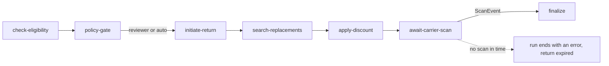

# Return lifecycle (#95)

An approved return used to finish in the request that approved it. With `RETURN_LIFECYCLE_ENABLED` it
outlives the request: it waits for the carrier's first scan, which can be days away, and resumes from its
checkpoint when the scan arrives. Python only; the .NET stack has no equivalent (parity matrix row 41).

Off by default. With it off the graph, the replay fixtures and the .NET parity gate are exactly as before.



## How a wait works

The workflow pauses with `ctx.request_info(AwaitCarrierScan)` and a checkpoint in Postgres. Three rows record the wait,
written in one transaction (`shared/return_lifecycle.py::open_scan_wait`):

- a `hitl_requests` row, `kind = 'carrier_scan'`, carrying MAF's resume token and the checkpoint id;
- an outbox timer `return.scan_timeout`, due `RETURN_SCAN_TIMEOUT_DAYS` later;
- a notification to the customer ("Your return label is ready").

`return.carrier_scanned` (an outbox row) answers it. The outbox worker (`worker/return_handlers.py`) resumes the
workflow through `approvals_service.resume_workflow(kind="carrier_scan")`: the same claim, fence, timeout and
run-as-the-requester machinery a reviewer's decision uses. The return becomes `shipped_back` and gets `scanned_at`.

If the timer fires first, the workflow resumes with `received=False`: the run ends with an error, the wait is
`timeout`, the return is `expired`, and the customer is told.

| Wait ends as | `hitl_requests.status` | `returns.status` |
|---|---|---|
| Carrier scanned it | `completed` | `shipped_back` |
| No scan in time | `timeout` | `expired` |

## Trying it

There is no carrier integration. The one producer of `return.carrier_scanned` is an admin-only simulator:

```bash
RETURN_LIFECYCLE_ENABLED=true ./scripts/dev.sh
# approve a return so it reaches the wait, then:
curl -X POST localhost:8080/api/admin/returns/<return_id>/simulate-scan \
  -H "Authorization: Bearer $ADMIN_TOKEN" -H 'content-type: application/json' -d '{"carrier":"UPS"}'
```

The outbox worker (`outbox-worker` in compose) picks the event up and resumes the return. `/runs` shows the wait
as "Carrier scan" with nothing to approve.

## Gotchas

- **The flag is read when the graph is built, and a checkpoint belongs to the graph that wrote it.** Flip it only
  while no return is paused, or a paused return will not resume.
- **A scan and the timer can race.** Whichever claims the wait first wins; the other finds it answered (409) and is
  dropped, not retried. A scan arriving after the timer is ignored and the return stays `expired`.
- **A second scan for the same return is one event** (`dedupe_key = return.carrier_scanned:<return_id>`).
- **No `issue-label` step.** The plan listed one, but `initiate_return` already issues the label, so a separate step
  would only duplicate it. The label URL is kept in the workflow state and the wait.
- **A scan wait is not an approval.** It has no inbox row and nobody decides it. The staff routes refuse to resume
  one (400), and the worker refuses to resume an approval, so neither can answer the other's wait.

## Not built yet (D-9b)

Inspection by support, the resolution (refund, store credit or replacement) and the `/runs` timeline. The columns
(`returns.approval_id`, `resolution`, `inspection`, migration 0013) are in place for them.

## Configuration

| Variable | Default | Meaning |
|---|---|---|
| `RETURN_LIFECYCLE_ENABLED` | `false` | Adds the wait to the graph, enables the worker handlers and the simulator route |
| `RETURN_SCAN_TIMEOUT_DAYS` | `14` | How long a return may wait for the carrier's scan |
| `RETURN_INSPECTION_TIMEOUT_DAYS` | `7` | Reserved for D-9b |
