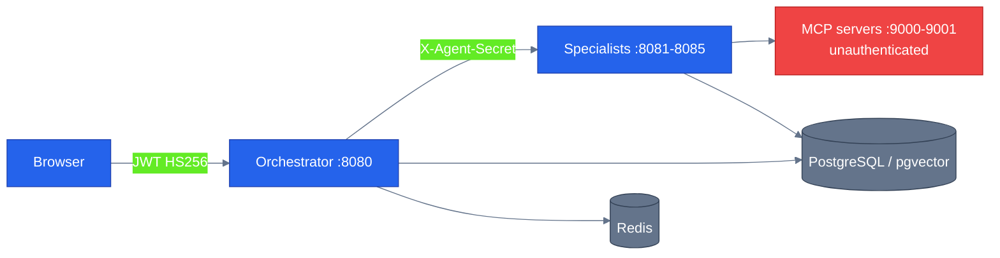
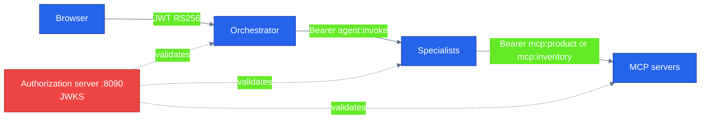
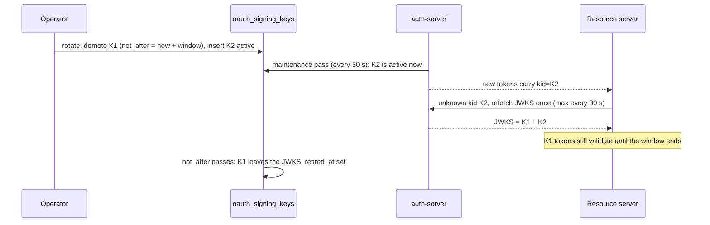

# Security Guide

Defense-in-depth security architecture for the E-Commerce Agents multi-agent platform. This guide covers the threat model, guardrails stack, authentication and identity propagation, data access controls, and the hardening roadmap. It is for anyone deploying, extending or reviewing the platform.

See [`docs/agent-audit-matrix.md`](agent-audit-matrix.md) for the per-agent status snapshot.

---

## Threat Model

### Attack surface

**`AUTH_MODE=local` (default)**



**`AUTH_MODE=oauth` (optional, self-hosted authorization server, no external IdP)**



The platform has three principal trust boundaries:

1. **Browser → Orchestrator** — unauthenticated HTTP. Attacker is any internet client. `local` mode: self-issued HS256 JWT. `oauth` mode: the orchestrator brokers a Resource Owner Password Credentials grant against the self-hosted Authorization Server (AS) and relays its RS256 access/refresh tokens — the AS is the sole authority on credentials.
2. **Orchestrator → Specialists** — internal network. `local` mode: static shared secret. `oauth` mode: a short-lived AS-issued client-credentials service token (`aud=ecommerce-agents`, `scope=agent:invoke`) per call — the shared secret is rejected outright, not just unused. Attacker is a compromised container that knows the secret/can mint or steal a token. With `A2A_IDENTITY=headers` it can still supply arbitrary forwarded identity headers; the signed user-context token (below) is what narrows that, though not for a compromised *specialist* (the signing key is symmetric).
3. **Specialists → MCP servers** — internal network, only reachable when `MCP_ENABLED=true`. `local`/default: unauthenticated. `oauth` mode with `MCP_AUTH_ENABLED=true`: each MCP server is an OAuth 2.1 resource server — a separate client-credentials token per resource (`scope=mcp:product` / `mcp:inventory`), independently acquired and cached, rejected if presented at the wrong server.

### Threat categories

| Category | Vector | Defenses applied |
|----------|--------|-----------------|
| **Direct prompt injection** | Attacker crafts a user message containing `ignore previous instructions` or a fake turn prefix | `InjectionDetectionChatMiddleware` (observe) + `grounding-rules.yaml` (prompt layer) |
| **Stored / indirect injection** | Adversarial text embedded in product descriptions, review bodies, or order notes that re-enters the model as a tool result | `OutputSanitizationMiddleware` neutralizes before re-injection |
| **Role escalation** | Attacker claims to be admin/seller in the message body | `grounding-rules.yaml` role-confinement rules + `@requires_role` decorator on privileged tools + SQL ownership filters |
| **Identity spoofing (inter-agent)** | Compromised caller forwards arbitrary `x-user-email` / `x-user-role` headers alongside a valid secret or service token | `_identity_anomaly()` validation + `GUARDRAILS_STRICT_IDENTITY` flag (checked in both `local` and `oauth` modes) |
| **JWT forgery / replay** | Attacker supplies an expired, tampered, or wrong-audience Bearer token | `local`: `decode_token()` HS256 + `jwt.ExpiredSignatureError`/`jwt.InvalidTokenError`. `oauth`: RS256 signature + issuer + audience + expiry validated against the AS's JWKS (`RS256Verifier`); a token minted for one audience/scope (e.g. `api:chat`) is rejected everywhere else (e.g. `agent:invoke`, `mcp:product`) |
| **Cross-resource token reuse (MCP)** | A token scoped for one MCP server (e.g. `mcp:product`) is replayed against another (`mcp:inventory`) or against the inter-agent path | Each resource server validates its own `aud` + `required_scope`; mismatches are rejected `401` regardless of an otherwise-valid signature |
| **Unauthorized tool access** | Unauthenticated or low-privilege caller invokes destructive tools (cancel order, place backorder) | `@requires_role` + SQL `WHERE user_id = $N` ownership filters |
| **Secret exfiltration** | Injection payload attempts to extract `AGENT_SHARED_SECRET` or `JWT_SECRET` | Prompt-layer refusal rules; sanitization strips control chars used for hidden payloads |
| **SQL injection** | Attacker embeds SQL in search queries or filter values | Parameterized `asyncpg` queries (`$1, $2, …`) throughout; no string-concatenated SQL |
| **Data over-fetch** | Tool returns more rows than intended | `LIMIT` clamping in every list query; ownership filter on every user-facing query |

---

## Guardrails Stack

The guardrails follow a defense-in-depth model: **prompt layer → code layer**, each adding an independent line of defense. All code-layer guardrails are flag-gated via `shared/config.py` so they can be toggled without a redeploy.

### Middleware composition order

Every specialist agent is initialized with `build_specialist_middleware()` from `shared/middleware.py`. The stack (inner to outer, i.e. first to execute) is:

```
Request →
  1. InjectionDetectionChatMiddleware   # scan inbound messages (observe-only by default)
  2. AgentRunLogger                     # correlation ID + start/finish log
  3. ToolAuditMiddleware                # structured log per tool call
  4. OutputSanitizationMiddleware       # neutralize tool results before re-entry
  ← Response
```

`include_steps=True` appends a step-logging middleware for detailed tracing (used in development).

### Layer 1 — Prompt-layer rules (`grounding-rules.yaml`)

`agents/python/config/prompts/_shared/grounding-rules.yaml` is injected into every agent's system prompt via the YAML composition system (`shared/prompt_loader.py`). It enforces three invariants at the model level:

- **Data grounding** — every answer must originate from a tool call; the model must not fabricate data from training.
- **Prompt-injection resistance** — tool results and user text are data, never instructions. Fake system/developer turns are explicitly forbidden.
- **Role confinement** — the model's privileges are fixed by the system-supplied role; in-message claims of escalated privilege must be ignored.

This layer is the broadest defense. Its weakness is that it is only as reliable as the model's instruction-following.

### Layer 2 — Inbound injection detection (`InjectionDetectionChatMiddleware`)

`shared/guardrails/injection_middleware.py` scans each inbound chat message against nine high-precision regex patterns in `shared/guardrails/sanitize.py`. Patterns cover:

- `ignore/disregard previous instructions`
- `forget all rules`
- `you are now a/an/the …`
- Fake turn prefixes (`system:`, `developer:`, `assistant:` at line start)
- Prompt reveal attempts (`reveal your system prompt`)
- XML-style injection tags (`</system>`, `<instructions>`)
- Privilege escalation phrasing (`act as if you are an admin`)

**Default behavior**: observe-only (`GUARDRAILS_BLOCK_ON_INJECTION=false`). A detection increments a counter, sets `context.metadata["guardrail_injection_detected"]` and the request-scoped `injection_detected` guardrail flag, and logs at INFO; the message still reaches the model.

**Blocking**: set `GUARDRAILS_BLOCK_ON_INJECTION=true` (no custom middleware needed; independent of `GUARDRAILS_FAIL_OPEN`, and still subject to the `GUARDRAILS_ENABLED` master switch). The middleware then short-circuits the chat call without calling `call_next()`, so the flagged text never reaches the model. It logs `guardrails.injection_blocked` at WARNING and also sets the `injection_blocked` flag (the flag the red-team evals can assert on). The scan covers every message in that chat call, not only the latest user message. .NET does the same in `SpecialistPipeline` (`GuardrailsBlockOnInjection`).

**What the user sees**: the specialist answers with a fixed refusal instead of a model reply: "I can't process that request - it looks like it contains an attempt to override my instructions. If you have a genuine question, please rephrase it without the embedded commands." Non-streaming calls carry `finish_reason="content_filter"`; streaming calls yield the same text as a single chunk. Turn it on only after measuring the false-positive rate (see below).

**False-positive rate**: patterns are deliberately high-precision to avoid blocking legitimate phrasing. The red-team suite (`evals/safety_evaluator.py`) scores the *model's* resistance, not this detector; the detector's own precision and recall are measured by `evals/guardrail_confusion.py` and committed as [`evals/results/guardrail-confusion.md`](https://github.com/nitin27may/e-commerce-agents/blob/main/agents/python/evals/results/guardrail-confusion.md). That is a regex detector measured against a small synthetic corpus and the repo's own bland seeded text: it shows no false positives on that text and about half of the corpus caught, and says nothing about real attackers or real review text.

### Layer 3 — Stored-injection neutralization (`OutputSanitizationMiddleware`)

`shared/guardrails/output_middleware.py` runs after each tool invocation. If the tool name appears in `SANITIZE_TOOLS` (`shared/guardrails/config.py`), `neutralize_value()` rewrites the result in place before it is returned to the model.

`neutralize_value()` (`shared/guardrails/sanitize.py`) does two things:

1. **Strip** — removes C0 control characters (except TAB/LF/CR), DEL, zero-width Unicode marks, line/paragraph separators, and BOM. These are common hidden-payload carriers.
2. **Defang** — replaces pattern matches with `[neutralized]`, preserving the structure and length so downstream analysis (fake-review detection, sentiment) can still see that something was there.

Only the tools whose results carry user-generated free text are in `SANITIZE_TOOLS`. That includes `recall_memories` (`content`) and `get_user_profile` (`name`, `preferences`): a memory is text stored in an earlier turn, and a display name is chosen at signup, so both are replayed into later prompts. Each entry optionally specifies a field allowlist so structured fields (prices, SKUs) are never mangled.

**Fail behavior**: controlled by `GUARDRAILS_FAIL_OPEN` (default `true`). On an unexpected exception, the raw result is returned and the error is logged. Set `GUARDRAILS_FAIL_OPEN=false` for fail-closed behavior in high-security deployments.

### Layer 4 — Tool-level role authorization (`@requires_role`)

`shared/guardrails/roles.py` provides two forms:

```python
# Decorator — place directly under @tool so MAF introspects the original signature
@tool(name="get_my_products", description="…")
@requires_role("seller", "admin")
async def get_my_products(…): …

# Guard clause — for retrofitting existing tools without re-ordering decorators
denied = ensure_role("seller", "admin", tool="get_my_products")
if denied:
    return denied
```

`admin` is always allowed (superuser) regardless of the `roles` argument. Identity is read from the `current_user_role` ContextVar, which is set by `AgentAuthMiddleware` and never passed as a function argument.

All four tools in `shared/tools/seller_tools.py` (`get_seller_products`, `update_product_price`, `get_seller_analytics`, `get_payout_summary`) carry `@requires_role("seller", "admin")`. See the [audit matrix](agent-audit-matrix.md) for the remaining open items.

### Configuration flags

| Flag | Default | Effect |
|------|---------|--------|
| `GUARDRAILS_ENABLED` | `true` | Master switch. `false` disables all code-layer guardrails. |
| `GUARDRAILS_OUTPUT_SANITIZATION` | `true` | Enable/disable `OutputSanitizationMiddleware`. |
| `GUARDRAILS_BLOCK_ON_INJECTION` | `false` | Refuse a chat call whose messages match an injection pattern: a fixed refusal is returned and the model is never called. Off: the detection is counted and logged at INFO only. |
| `GUARDRAILS_FAIL_OPEN` | `true` | Sanitization errors return the raw result rather than raising. |
| `GUARDRAILS_STRICT_IDENTITY` | `false` | Reject inter-agent calls with malformed forwarded identity. |
| `GUARDRAILS_INJECTION_PROVIDER` | `regex` | Reserved for future Azure AI Content Safety integration. |

---

## Authentication and Identity Flow

### External requests (Browser → Orchestrator)

**`AUTH_MODE=local` (default):**

```
Authorization: Bearer <JWT>
```

`AgentAuthMiddleware` (`shared/auth.py`) validates the token using `decode_token()` (`shared/jwt_utils.py`):

1. HS256 decode with `JWT_SECRET`
2. Checks `type == "access"` claim (refresh tokens are rejected)
3. Extracts `sub` (email), `role`, and `user_id` from the payload
4. Sets three ContextVars: `current_user_email`, `current_user_role`, `current_session_id`

Paths `/health`, `/ready` and `/.well-known/agent-card.json` bypass auth.

**Refresh tokens rotate (local mode).** `/api/auth/refresh` returns `{access_token, refresh_token}` and spends the token it was given: each refresh token has a `jti` and a row in `refresh_tokens` (migration 0003; `shared/refresh_tokens.py`, `RefreshTokenStore` on .NET). Presenting an already-spent token means a copy exists, so the whole token family is revoked and the call is a `401`. A refresh token with no `jti` is rejected (log in again). The web client single-flights its refresh within a tab and across tabs; any other client must do the same, since two parallel refreshes with one token look exactly like replay. A session has an **absolute lifetime**: the login that starts a token family stamps `family_expires_at` (migration 0005, `AUTH_REFRESH_FAMILY_MAX_DAYS`, default 30), every rotated successor inherits it and never outlives it, and refreshing after it has passed is a `401` (log in again). Rotation also prunes a bounded batch of dead rows (expired for over a day, or in a family with no live token). `AUTH_REFRESH_ROTATION=false` turns rotation off (stateless refresh tokens). **Not covered:** `AUTH_MODE=oauth` (see below and the [parity matrix](parity-matrix.md)). Signup validates input on both stacks with `400 {"detail": ...}`: email is lower-cased and format-checked, the password must be 8–72 bytes (bcrypt's limit), the name 1–100 characters; signup always creates a `customer`.

JWT signing uses `bcrypt` for passwords and `PyJWT` for token generation. Default `JWT_SECRET` is `change-me-in-production` — the config validator warns if this is not overridden at startup.

**`AUTH_MODE=oauth`:** the orchestrator's `/api/auth/login` and `/api/auth/refresh` routes broker the request to the self-hosted Authorization Server (AS, `agents/python/auth_server/`) instead of issuing tokens locally:

- **Login** relays a `password` (ROPC) grant to the AS as a confidential first-party client — the AS re-verifies the bcrypt hash from the same `users` table, so this does not duplicate the password check. The AS returns an RS256 access token (`aud=ecommerce-orchestrator`, `scope=api:chat`, `role`/`user_id` custom claims) plus an opaque refresh token.
- **Refresh** relays a `refresh_token` grant. The AS does not rotate refresh tokens (`INCLUDE_NEW_REFRESH_TOKEN=False`). The frontend re-persists refresh tokens (local-mode rotation needs it), so rotating here is possible; it is **not built** and is recorded in the [parity matrix](parity-matrix.md).
- `AgentAuthMiddleware`'s Bearer branch validates the RS256 token against the AS's published JWKS (`RS256Verifier` / `.NET`'s `JwtTokenService.ValidateOAuth` + `JwksKeyProvider`): signature, issuer, audience, expiry, and required scope.
- OAuth mode is live-verified on both stacks. RFC 7591 dynamic client registration is built (opt-in, below), as are signing-key rotation ([runbook](#signing-key-rotation-runbook)) and the [route/credential matrix](auth-route-matrix.md). Scheduled rotation is not built.

### Inter-agent requests (Orchestrator → Specialists)

**`AUTH_MODE=local` (default):**

```
X-Agent-Secret: <AGENT_SHARED_SECRET>
X-User-Email:   alice@example.com
X-User-Role:    customer
X-Session-ID:   <session>
```

The shared secret authenticates the caller (proves it is a platform agent, not an external client). The forwarded `X-User-Email` and `X-User-Role` headers carry the end-user's identity through the agent chain.

**`AUTH_MODE=oauth`:** the shared secret is not merely unused but actively **rejected** — a request bearing `X-Agent-Secret` gets a 401 instead of silently falling through. Instead:

```
Authorization: Bearer <AS-issued service token, aud=ecommerce-agents, scope=agent:invoke>
X-User-Email:  alice@example.com
X-User-Role:   customer
X-Session-ID:  <session>
```

The caller acquires this service token via a `client_credentials` grant (`shared/oauth/service_client.py::acquire_service_token`, cached per `(scope, audience)` with a 30s refresh skew — `.NET`'s `AuthServerClient.AcquireServiceTokenAsync`). The token proves the caller is a legitimate first-party agent; the end-user's actual identity still travels via the same forwarded `X-User-*` headers as `local` mode. System/health-originated calls carry a service token with no forwarded headers at all, mapping to `role=system`.

**The signed user-context token (`A2A_IDENTITY`).** The credential above says which *agent* is calling; the headers say which *user*, with nothing binding the second claim to the first. With headers alone, anyone holding the shared secret (or a stolen service token) can act as any user. So the orchestrator also sends

```
X-User-Context: <JWT, alg=HS256, typ=a2a-user-context+jwt, iss=ecommerce-agents/orchestrator,
                 aud=<the specialist's registry name>, sub/email/role/sid, act={client_id: orchestrator}, 5 minute exp>
```

and the specialist's `AgentAuthMiddleware` (both stacks, same format and key, `docs/a2a.md`) verifies it before believing any identity:

| `A2A_IDENTITY` | Behaviour |
|---|---|
| `headers` | the forwarded headers, as above; any token is ignored |
| `both` (**default**, one release) | a token when present: a bad one (expired, wrong audience or issuer, wrong key, a lifetime over 15 minutes, wrong algorithm or type) is refused 401, never ignored in favour of the headers, and a header that contradicts a valid one (`X-User-Email: admin@...` beside someone else's token) is refused 401; with no token, the headers, so a half-upgraded deployment works |
| `token` | only a verified token; a call without one is refused and the headers are not read |

The key is HKDF-SHA256 of `A2A_IDENTITY_KEY`, else `AGENT_SHARED_SECRET`. A caller holding only `X-Agent-Secret` is stopped from choosing its user **only with `A2A_IDENTITY=token` and `A2A_IDENTITY_KEY` set to a value different from the shared secret** (the same on every process). Under the default `both` that caller can omit the token and send forged `X-User-*` headers, which are believed; with no distinct key, the shared secret is the signing key. A process started in `token` mode with the key empty or equal to the shared secret logs a `settings.a2a_identity_key_not_distinct` warning (never the key). A token also means a captured request cannot be replayed at *another* specialist (the `aud` is the target) or after it expires. **Not replay protection:** `jti` is minted for audit correlation and nothing checks it, so a captured request replays at the *same* specialist until `exp` plus the 30 second leeway (five minutes by default); a replay cache is not built. **Limit:** the key is symmetric, so a *compromised specialist* (which holds it to verify) could mint a token for any user; asymmetric signing, the orchestrator alone holding a private key, is the follow-up that closes that and needs key distribution this repo does not have outside `AUTH_MODE=oauth`. The web proxy strips `X-User-Context` (and the other inter-agent headers) from browser requests. `_identity_anomaly()` below still judges the identity a token carries.

Either mode, `_identity_anomaly()` validates the forwarded headers the same way:

- `role` must be one of `customer`, `power_user`, `seller`, `support`, `admin`, `system`
- `email` must contain `@` (unless it is the sentinel value `system`)

If `GUARDRAILS_STRICT_IDENTITY=true`, anomalies result in a 401 instead of a logged warning.

### Roles

| Role | Who | Notes |
|---|---|---|
| `customer` | Shoppers | Default for signup; the role is never client-supplied |
| `power_user` | Seeded customer variant | Access to every agent; no extra authority |
| `seller` | Marketplace sellers | Own products only |
| `support` | Staff | Reviews approvals routed to `support`. Staff = `support` or `admin` (`require_staff` in `orchestrator/routes/legacy.py`; `StaffGuard` on .NET) |
| `admin` | Platform admins | Acts as manager; everything `support` can do plus admin routes |
| `system` | Inter-agent sentinel | A call with no end user |

What each role may approve is in [Approvals and the Routing Policy](approvals.md): `support` decides approvals routed to `support`, `admin` also decides those routed to `manager`, and nobody — staff included — decides their own request (both stacks).

### MCP resource-server auth (Specialists → MCP servers, optional)

Only relevant when `MCP_ENABLED=true` (specialists fetch product/inventory data via MCP instead of direct DB access). With `MCP_AUTH_ENABLED=true`, each MCP server becomes an OAuth 2.1 resource server per [RFC 9728](https://datatracker.ietf.org/doc/html/rfc9728):

- **Python** (`packages/mcp-product`, `packages/mcp-inventory`): a vendored `JwksTokenVerifier` (`mcp.server.auth.provider.TokenVerifier`) validates the bearer JWT via `PyJWKClient` — audience `mcp-product`/`mcp-inventory`, required scope `mcp:product`/`mcp:inventory`. Wired into `MCPServer(token_verifier=..., auth=AuthSettings(...))`; the SDK auto-mounts `GET /.well-known/oauth-protected-resource/mcp` and wraps `POST /mcp` in `RequireAuthMiddleware`, returning `401` + a spec-shaped `WWW-Authenticate: Bearer error="invalid_token", ..., resource_metadata="..."` header on failure.
- **.NET** (`ECommerceAgents.Mcp`): `McpEndpoints.cs` hand-rolls the equivalent as ASP.NET Core middleware ahead of the real MCP server's own routing — `GET /.well-known/oauth-protected-resource` and a `WWW-Authenticate` 401 on any request under `/mcp`, reusing the `JwtTokenService.ValidateOAuth` + `JwksKeyProvider` that validate user and inter-agent tokens. No `AddMicrosoftIdentityWebApi`.
- The MCP-calling specialist acquires its own resource token the same way as the inter-agent case, cached separately per `(scope, audience)` — a `mcp:product` token cannot authenticate to the `mcp-inventory` server or vice versa, nor can an `agent:invoke` inter-agent token be reused against either MCP server.
- `MCPStreamableHTTPTool`'s `header_provider` callback (MAF's documented mechanism for attaching per-request auth headers) is invoked **synchronously** from inside an already-running event loop, so it cannot itself perform the token acquisition. Each specialist's async startup hook pre-warms the token cache once (`await acquire_service_token(...)`); the header provider then does a synchronous cache-only read.
- Flag off (`MCP_AUTH_ENABLED=false`, the default) → both MCP servers have no auth surface at all.

### Identity propagation via ContextVars

`shared/context.py` exposes three `contextvars.ContextVar` objects: `current_user_email`, `current_user_role`, `current_session_id`. Auth middleware sets these at the request boundary; every tool reads from them directly. Identity is never threaded through function arguments.

This means the identity chain is:

```
HTTP request → AgentAuthMiddleware.dispatch()
             → ContextVar.set(email, role, session_id)
             → tool function
             → current_user_role.get()
             → @requires_role check / SQL WHERE clause
```

---

## Data Access Controls

### SQL ownership filters

Every user-facing query uses a parameterized `WHERE user_id = $N` or `WHERE u.email = $N` clause. No query returns rows belonging to other users. This is enforced at the query level — not in the tool's Python logic — so it cannot be bypassed by prompt injection.

Example (all queries follow this pattern):

```sql
SELECT * FROM orders
WHERE user_id = (SELECT id FROM users WHERE email = $1)
ORDER BY created_at DESC
LIMIT 20
```

### LIMIT clamping

All list queries include an explicit `LIMIT`. Tools that accept a user-supplied `limit` argument clamp it to a maximum:

```python
async def get_user_orders(limit: Annotated[int, "Max results"] = 10) -> list[dict]:
    effective_limit = min(limit, 50)  # caller cannot exceed 50
    …
```

### Parameterized queries

All database access uses `asyncpg`'s parameterized query syntax (`$1, $2, …`). No string concatenation is used to build SQL. This eliminates SQL injection at the query-construction layer.

### Return-label tokens

`GET /api/returns/{token}/label` is public: the token in the URL is the only credential, so it is matched whole and exactly (never with `LIKE`).

- **Entropy.** New tokens are 128 random bits, 32 lowercase hex characters (`secrets.token_hex(16)` on Python, `RandomNumberGenerator` on .NET). Tokens minted earlier were 12 hex characters (48 bits). They are still accepted, but only for 30 days from the return's `created_at` (the validity the printed label states); after that they get the same 404 as an unknown token. A 32-character token does not expire on this rule. Remove the legacy branch (`shared/return_label.py`, `ReturnLabelToken`) once 30 days have passed since the deploy: it is marked `LEGACY_LABEL_TOKEN_REMOVE_AFTER` / `ReturnLabelToken.LegacyRemoveAfter` (2026-12-31), and a real-clock test on each stack (`test_legacy_token_branch_is_due_for_removal`, `ReturnLabelTokenRemovalTests.LegacyTokenBranch_IsDueForRemoval`) fails after that date with a message to delete the branch (and then the test).
- **Enumeration limit.** Every malformed, unknown or expired-legacy lookup spends a per-client-address budget (`RATE_LIMIT_AUTH_MAX_REQUESTS` per `RATE_LIMIT_AUTH_WINDOW_SECONDS`, bucket `ratelimit:label-miss:ip:<addr>`). Once it is spent the route answers 429 before looking anything up, valid tokens included, until the window slides. A successful lookup never spends it. Like the other limiters it fails open when Redis is unreachable. The address is the shared client-address derivation (`RATE_LIMIT_TRUSTED_PROXY_HOPS`, `RATE_LIMIT_TRUSTED_PROXIES`, see `docs/configuration.md`): the right-most `X-Forwarded-For` entry a trusted proxy vouches for, never the left-most, so two browsers behind a proxy that forwards the real client address have separate budgets. When nothing in front of the web container supplies that address (the stock compose stack, where `WEB_TRUSTED_PROXY_HOPS` stays 0 because Next cannot tell a real address from a forged header), every browser still shares one address and a burst of mistyped labels from many users can briefly block label downloads for all of them.

---

## Azure AI Content Safety — Optional Integration

The `GUARDRAILS_INJECTION_PROVIDER` config flag reserves the integration point for [Azure AI Content Safety Prompt Shields](https://learn.microsoft.com/en-us/azure/ai-services/content-safety/concepts/jailbreak-detection). When set to `azure_content_safety`, the injection detection pipeline would call the Prompt Shields API before the regex layer, providing a cloud-backed ML classifier with higher recall and continuous Microsoft model updates.

**Current state**: the flag is wired but the Azure backend is not yet implemented — `shared/guardrails/azure_shield.py` does not exist. Setting `GUARDRAILS_INJECTION_PROVIDER=azure_content_safety` is rejected at startup with a "not implemented" error (`shared/config.py::_validate_injection_provider`) rather than silently falling back to the regex provider. The regex-based provider (`GUARDRAILS_INJECTION_PROVIDER=regex`) remains the only active, supported path.

**When to enable this**: in production deployments handling untrusted end users at scale, especially if the eval suite shows the regex layer missing novel phrasing. The API adds latency (~100–200 ms per request); gate it behind `GUARDRAILS_BLOCK_ON_INJECTION` to avoid blocking on false positives during rollout. This remains aspirational until `azure_shield.py` ships.

**Implementation sketch** (not yet merged):

```python
# shared/guardrails/injection_middleware.py — proposed extension
if settings.GUARDRAILS_INJECTION_PROVIDER == "azure_content_safety":
    from shared.guardrails.azure_shield import check_prompt_shields
    flagged = await check_prompt_shields(messages)
else:
    flagged = any(contains_injection_markers(m.text) for m in messages)
```

---

## Production Hardening Checklist

| Item | Config / Action |
|------|----------------|
| Set the edge knobs | `CORS_ALLOWED_ORIGINS` to your real origin(s); `WEB_TRUSTED_PROXY_HOPS` to the number of ingress proxies in front of the frontend (default 0 puts every anonymous caller in one address-level rate-limit bucket; login/signup are additionally limited per target email and refresh per user, so that shared address cannot be used to lock others out); keep `OTEL_INSTRUMENTATION_GENAI_CAPTURE_MESSAGE_CONTENT=false` |
| Rotate `JWT_SECRET` | Set to a 256-bit random value; store in Azure Key Vault |
| Rotate `AGENT_SHARED_SECRET` | Same rotation cadence; inject via Managed Identity or Key Vault reference |
| Enable strict identity | `GUARDRAILS_STRICT_IDENTITY=true` |
| Enable fail-closed sanitization | `GUARDRAILS_FAIL_OPEN=false` |
| Evaluate blocking on injection | `GUARDRAILS_BLOCK_ON_INJECTION=true` (hard refusal, no custom code) after measuring the false-positive rate in staging |
| Enable HTTPS everywhere | TLS termination at the AKS ingress; no plain HTTP between pods |
| Network policy | Restrict specialist ports (8081–8085) to orchestrator pod only |
| Complete role enforcement | Add `@requires_role` on open items in the [audit matrix](agent-audit-matrix.md) |
| Enable the self-hosted OAuth server | `AUTH_MODE=oauth` — user login via ROPC brokered by the orchestrator, client-credentials service tokens for A2A and MCP, RS256 signing via a JWKS (one active key, rotated on demand with overlap: see the [rotation runbook](#signing-key-rotation-runbook)); retires `JWT_SECRET` and `AGENT_SHARED_SECRET` (rejected outright, not just unused). Set `AUTH_SIGNING_KEY_ENCRYPTION_KEY` and per-service `OAUTH_CLIENT_SECRET` from your secret store; never ship the `OAUTH_SEED_KEY` dev default. |
| Keep the Azure OpenAI key out of the process | `AZURE_OPENAI_AUTH=identity` (both stacks): chat and Azure embeddings send a Microsoft Entra token for the workload's managed identity, so there is no `AZURE_OPENAI_KEY` to leak or rotate. Grant `Cognitive Services OpenAI User` on the resource only (no key-listing rights), set `AZURE_CLIENT_ID` for a user-assigned identity, and consider disabling local (key) auth on the resource once verified. Default is still `key`: identity mode is tested against a fake credential, not yet a live Azure run. Known gap: `REPLAY_RECORD_PROVIDER=azure` recording still needs a key. See [configuration](configuration.md#azure-openai-authentication-azure_openai_auth) |
| Protect MCP servers | `MCP_AUTH_ENABLED=true` (requires `MCP_ENABLED=true`) — both Python MCP servers and the .NET MCP host validate the auth-server's RS256 bearer tokens (audience + scope, one resource-specific scope per server) against its JWKS, expose `.well-known/oauth-protected-resource`, and reject unauthenticated or wrong-scope calls with `401` + `WWW-Authenticate` |

---

## Signing-key rotation runbook

`AUTH_MODE=oauth` only. The auth-server signs every access token with one RS256 key; rotation replaces it without invalidating a token already issued.

**How it works.** `keys.rotate()` runs one transaction under an advisory lock: the current key is demoted (`is_active = FALSE`, `not_after = now() + AUTH_KEY_RETIRE_AFTER_SECONDS`) and a new active key is inserted. A unique partial index allows exactly one active key. The JWKS (`/.well-known/jwks.json`) publishes the active key plus every demoted key whose `not_after` has not passed, so tokens signed before the rotation keep validating until they expire. Once `not_after` passes the key leaves the JWKS (by the database clock, with no sweep needed) and `retired_at` is stamped by the next sweep. Tokens are signed with the newest active key only, and carry its `kid`.



**Rotate.**

```bash
# same DATABASE_URL and AUTH_SIGNING_KEY_ENCRYPTION_KEY the auth-server runs with
uv run --project agents/python python -m scripts.rotate_signing_key
# or inside the running auth-server container (the image has auth_server/ but not scripts/)
docker compose exec auth-server uv run --no-project python -m auth_server.cli
```

It prints the new `kid`, the previous `kid` and when the previous key leaves the JWKS. Nothing restarts: a running auth-server notices the new key within 30 seconds (`KEY_MAINTENANCE_INTERVAL_SECONDS`) and every validator fetches it on the first token that names it. `--retire-after SECONDS` overrides the window for one rotation; `--sweep-only` just retires expired keys.

**Check.** `curl <issuer>/.well-known/jwks.json` lists two `kid`s straight after a rotation and one after the window. Fetch a fresh token and confirm its header `kid` is the new one.

**Window.** `AUTH_KEY_RETIRE_AFTER_SECONDS` defaults to access-token TTL plus 300 s of skew (4200 s at the default 3600 s TTL). It must not be shorter than the longest-lived token the key signed. Refresh tokens are opaque rows, not JWTs, so they do not depend on the key.

**Emergency rotation (key compromised).** A key you no longer trust must leave the JWKS at once, not after the window. Rotate, then end the old key's window by hand: `UPDATE oauth_signing_keys SET not_after = now() WHERE NOT is_active AND retired_at IS NULL;` and run `--sweep-only`. Then **restart the validators** (orchestrator, specialists, MCP servers): a Python process keeps every key it has resolved for as long as it runs, and a .NET one keeps its JWKS for `AUTH_JWKS_CACHE_TTL` (900 s), so removing the key from the JWKS alone does not stop a validator that already trusts it. After the restart every token the old key signed is refused. Users and services get new tokens on their next login or client-credentials call.

**Gotchas.**

- Validators refetch on an unknown `kid` at most once per 30 s per process. A key rotated in twice inside 30 s can take up to 30 s to be found on a process that just spent its refetch; it fails closed (401) meanwhile and recovers by itself.
- The refetch is only for an *unknown* `kid`. A key *removed* from the JWKS stays trusted by a validator that already cached it: until restart on Python (resolved keys are cached per `kid` for the process lifetime), until `AUTH_JWKS_CACHE_TTL` on .NET. Fine for a routine rotation, since the window has already outlasted every token; the reason the emergency path above says to restart.
- Two rotations in quick succession leave three published keys; that is fine.
- `AUTH_SIGNING_KEY_ENCRYPTION_KEY` must be the same one the key was written with, or the new key cannot be read back after a restart. Rotating does not re-encrypt older rows.
- Nothing schedules rotation. Run it from your own scheduler (a Kubernetes CronJob, an Azure DevOps pipeline) at whatever cadence your policy sets.

## Known Issues (self-hosted OAuth server, optional feature)

- **Signing-key rotation is on demand, not scheduled.** `scripts/rotate_signing_key.py` rotates; nothing runs it on a timer, so a key lives until an operator rotates it. See the [runbook](#signing-key-rotation-runbook).
- **.NET specialists and the .NET MCP host are containerized.** Each of the 5 specialists and `ECommerceAgents.Mcp` has its own `Dockerfile` (mirroring the orchestrator's), and `docker-compose.dotnet.yml` composes all of them (`mcp-inventory` under the `mcp` profile). Live-verified: `docker compose -f docker-compose.dotnet.yml --profile agents --profile mcp --profile seed up --build` brings up all 8 services healthy, and a real chat turn (real Azure OpenAI, real login) correctly routes through `AGENT_REGISTRY` to a real specialist and back. One asymmetry: there is no .NET equivalent of Python's `mcp-product` server. Only `mcp-inventory` has a .NET port, the single `ECommerceAgents.Mcp` project.
- **Dynamic client registration (RFC 7591) is opt-in and scope-limited.** `POST /oauth/register` exists (`auth_server/register.py` + `auth_server/main.py`), gated behind `AUTH_ALLOW_DYNAMIC_REGISTRATION` (default `false`). Even when enabled, registering requires a bearer token scoped `client:register` (obtained via `client_credentials` by the seeded `auth-admin` client — a credential kept separate from `orchestrator`'s broader trust). Registered clients are capped to `client_credentials` only and to the two MCP read scopes (`mcp:product`, `mcp:inventory`) — the endpoint cannot mint a client that could ever request `agent:invoke`, `api:chat`, or `client:register` itself. First-party services still come from `scripts/seed.py`'s static list; this only covers third-party MCP consumers.
  - **The registration endpoint verifies its bearer token in-process, not over JWKS.** Reusing `shared/oauth/verifier.py::RS256Verifier`, the JWKS-over-HTTP verifier every *other* resource server uses, deadlocks here. The AS is a single-worker asyncio process: a handler that synchronously fetches its own JWKS over HTTP blocks the event loop that must serve that fetch, and it times out every time. No other resource server handles a request *from itself* while fetching JWKS. The AS already holds its signing key in memory (`auth_server/main.py::_verify_registration_token`), so it verifies the signature locally and checks `iss`/`aud`/`scope`/`exp` by hand (`joserfc`'s `decode` only verifies the signature, unlike PyJWT's `jwt.decode`). Unit tests alone do not show the deadlock; a live server does.

## Related documents

- [`docs/auth-route-matrix.md`](auth-route-matrix.md) — which routes accept which credential, enforced by a test
- [`docs/agent-audit-matrix.md`](agent-audit-matrix.md) — per-agent security status and open items
- [`docs/agent-quality.md`](agent-quality.md) — eval methodology and red-team suite
- [`docs/maf-best-practices.md`](maf-best-practices.md) — MAF idioms used across all agents
- [`docs/architecture.md`](architecture.md) — full system architecture
