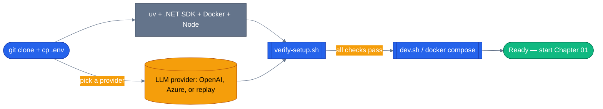

# Chapter 00 — Setup your dev environment

Get your machine ready for the series. The Python side of the chapters needs only `uv` and Python 3.12+, and no API key.

**You will learn to:**

- Run a chapter with no API key, using recorded model responses
- Install the extra tools the .NET side and the full application need
- Point the chapters at OpenAI, Azure OpenAI or a local model when you want live answers
- Check your machine with one script

**Shortest path** (Python, no key). From a Unix-like shell:

```bash
curl -LsSf https://astral.sh/uv/install.sh | sh
uv python install 3.12
git clone https://github.com/nitin27may/e-commerce-agents.git
cd e-commerce-agents
uv sync --project tutorials
uv run --project tutorials python tutorials/01-first-agent/python/main.py
```

You should see:

```text
No LLM key found - replaying the recorded fixture (set OPENAI_API_KEY or the AZURE_OPENAI_* variables for a live run).
Q: What is the capital of France?
A: The capital of France is Paris.
```

That is enough to start [Chapter 01](../01-first-agent/). Do not copy `.env.example` to `.env` for this path: the example file selects OpenAI with a placeholder key, so the chapter would try a live call. The rest of this page covers the .NET side, live model keys and the full application.

## Why this chapter

The series runs the same examples in Python and .NET, and ends with the full application in this repo, which the chapters call the capstone. Each part needs a different amount of tooling:

| You want to run | You need |
|-----------------|----------|
| Python side of the chapters | `uv`, Python 3.12+ |
| .NET side of the chapters | plus the .NET 10 SDK (the chapter projects target `net10.0`) |
| The full application | plus Docker with Compose v2, Node 20+ and pnpm |

An API key is optional throughout. Without one, the chapters replay recorded model responses.

## Prerequisites

A Unix-like shell. macOS and Linux work out of the box; on Windows use WSL2.

## The concept

Chapter 00 has no MAF (Microsoft Agent Framework) concept of its own. What it sets up is the layout every later chapter follows:

- One shared `uv` workspace for Python, so you run `uv sync` once for the whole series.
- A `dotnet run` per chapter for .NET.
- One `.env` at the repo root that every chapter and the full application read.



The diagram shows the full setup: install the tools, pick an LLM provider (or none), run the verify script, then run single chapters or bring up the full application with `dev.sh`.

## Install the toolchains

### `uv` (Python package manager)

```bash
curl -LsSf https://astral.sh/uv/install.sh | sh
uv --version          # expect: uv 0.5.x or later
uv python install 3.12
```

The repo uses `uv`, not `pip` or `poetry`. It creates the virtual environment for you.

### .NET SDK (9 or 10)

- macOS: `brew install --cask dotnet-sdk`
- Ubuntu: follow [Microsoft's official instructions](https://learn.microsoft.com/en-us/dotnet/core/install/linux-ubuntu).
- Windows: download from [dotnet.microsoft.com](https://dotnet.microsoft.com/download).

```bash
dotnet --list-sdks    # expect: 9.0.x or 10.0.x
```

Install 10 if you plan to run the .NET chapters: the chapter projects and `agents/dotnet/ECommerceAgents.sln` target `net10.0`. `verify-setup.sh` accepts either 9 or 10.

### Docker + Compose v2

Install Docker Desktop (macOS/Windows) or Docker Engine plus `docker-compose-plugin` on Linux. `docker compose version` must work. The chapters do not need Docker; the full application does, for Postgres, Redis and the Aspire telemetry dashboard.

### Node 20+ and pnpm (for the Next.js frontend)

Only the full application needs these.

```bash
# If you don't have Node:
curl -o- https://raw.githubusercontent.com/nvm-sh/nvm/v0.40.1/install.sh | bash
nvm install 20

# pnpm:
corepack enable pnpm
```

## Clone and configure

```bash
git clone https://github.com/nitin27may/e-commerce-agents.git
cd e-commerce-agents
cp .env.example .env
```

`.env` at the repo root is read by every chapter and by the full application. Each chapter picks its model provider by the same rule (`tutorials/_shared/llm.py`):

1. An explicit `LLM_PROVIDER` wins: `openai`, `azure` or `replay`.
2. Otherwise a key in the environment selects OpenAI or Azure.
3. Otherwise the chapter replays its recorded responses and prints one line saying so.

`.env.example` ships `LLM_PROVIDER=openai` with a placeholder key. After `cp .env.example .env`, a chapter tries a live call until you add a real key, comment that line out, or set `LLM_PROVIDER=replay`.

### Option A — OpenAI (or any OpenAI-compatible endpoint)

```dotenv
LLM_PROVIDER=openai
OPENAI_API_KEY=sk-...
LLM_MODEL=gpt-4.1
EMBEDDING_MODEL=text-embedding-3-small
```

### Option B — Azure OpenAI

```dotenv
LLM_PROVIDER=azure
AZURE_OPENAI_ENDPOINT=https://your-resource.openai.azure.com/
AZURE_OPENAI_KEY=...
AZURE_OPENAI_DEPLOYMENT=gpt-4.1
AZURE_OPENAI_API_VERSION=2025-03-01-preview
AZURE_EMBEDDING_DEPLOYMENT=text-embedding-3-small
```

`AZURE_OPENAI_KEY` and `AZURE_OPENAI_DEPLOYMENT` are the names this repo uses. The MAF docs spell them `AZURE_OPENAI_API_KEY` and `AZURE_OPENAI_DEPLOYMENT_NAME`; both spellings work.

Keep `JWT_SECRET` and `AGENT_SHARED_SECRET` at their `.env.example` defaults for local development. You only change them in production.

### Don't have a paid API key? Two options

**Option 1 — Ollama / LM Studio (free, real model, fully local, zero network).**
`LLM_PROVIDER=openai` plus `LLM_BASE_URL` points `OpenAIChatClient` at any OpenAI-compatible endpoint, including a model server on your own machine:

```dotenv
# Ollama — `ollama pull qwen2.5:14b` first, and start the server with a raised
# context window: OLLAMA_CONTEXT_LENGTH=64000 ollama serve
LLM_PROVIDER=openai
LLM_BASE_URL=http://localhost:11434/v1
OPENAI_API_KEY=ollama          # any non-empty string — Ollama doesn't check it
LLM_MODEL=qwen2.5:14b           # or whatever tag you pulled
```

```dotenv
# LM Studio — load a model in LM Studio's local server first, then:
LLM_PROVIDER=openai
LLM_BASE_URL=http://localhost:1234/v1
OPENAI_API_KEY=lm-studio       # any non-empty string
LLM_MODEL=<the model identifier shown in LM Studio's server tab>
```

**Gotcha:** pick a local model that supports tool calling. Every chapter from 02 onward calls at least one tool (a function the model can ask the framework to run), and the specialist agents in the full application call many. Many small or quantized local models expose an OpenAI-compatible endpoint but call tools unreliably or not at all. The agent raises no error; it stops calling tools and answers from its own knowledge, which is often made up. Prefer a model tagged for tool use (Llama 3.1+, Qwen2.5, Mistral "instruct" or "tool-use" variants). If a chapter's tool-calling test passes but the printed answer does not reflect the tool's canned data, the cause is the model's tool-calling support, not the chapter.

**Option 2 — Replay (free, no network, no key at all).** Every chapter's `tests/` directory ships fixtures: model responses recorded against a real model. With no key in the environment and `LLM_PROVIDER` unset or `replay`, the chapter plays them back:

```bash
LLM_PROVIDER=replay uv run --project tutorials python tutorials/01-first-agent/python/main.py
```

A fixture is keyed by the exact request, so a prompt you change has no recording. To record one, set `RECORD=true` and a real provider's credentials. `REPLAY_RECORD_PROVIDER` picks the provider (`openai` or `azure`, default `openai`):

```bash
LLM_PROVIDER=replay RECORD=true REPLAY_RECORD_PROVIDER=azure \
  uv run --project tutorials python tutorials/01-first-agent/python/main.py "your question"
```

Run it again without `RECORD` to confirm it replays. The new fixture lands in that chapter's `tests/fixtures/replay/`. The replay client is `tutorials/_shared/replay_client.py`; the full application has its own in `agents/python/shared/replay_client.py`.

## Verify

One script checks everything:

```bash
./scripts/verify-setup.sh
```

It checks what the full application needs, which is more than the chapters need. A failed Docker, Node or pnpm check does not block you until you run the full application.

In order, it checks:

- `uv` is present, with Python 3.12+
- a .NET SDK (9 or 10)
- Docker, Docker Compose v2, Node 20+ and pnpm
- `.env` exists and has a real (non-placeholder) key for the `LLM_PROVIDER` you picked
- the expected top-level folders exist (`tutorials/`, `agents/python/`, `agents/dotnet/ECommerceAgents.sln`, `web/`, both compose files)
- `agents/dotnet` builds, if a .NET SDK is installed

It prints a `✓`/`✗` line per check and exits non-zero on the first category of failures, so a failing run tells you what to fix.

## What's in this folder

`00-setup/python/` and `00-setup/dotnet/` hold only a `.gitkeep`. This chapter has no runnable example; the first MAF code is in Chapter 01.

## Running the tutorial chapters vs. the full capstone

You can run two things.

**A single tutorial chapter** (no Docker needed, just `uv` or `dotnet`). Python commands run from the repo root; the .NET command changes into the chapter's `dotnet` folder first, and `dotnet run` needs an API key:

```bash
uv sync --project tutorials
uv run --project tutorials python tutorials/01-first-agent/python/main.py

# or the .NET side
cd tutorials/01-first-agent/dotnet && dotnet run
```

**The full capstone app** (Docker, both backends, the seeded Postgres/Redis stack):

```bash
./scripts/dev.sh            # Python backend
./scripts/dev.sh --dotnet   # .NET backend

# On Windows (PowerShell), or anywhere with pwsh 7:
./scripts/dev.ps1
./scripts/dev.ps1 -Dotnet
```

- Frontend: http://localhost:3000
- Orchestrator: http://localhost:8080
- Aspire Dashboard (telemetry): http://localhost:18888

You don't need the full application running for Chapters 01–20b. It matters once you reach [Chapter 21 — Capstone Tour](../21-capstone-tour/).

## Side-by-side differences

There is no code yet, but two setup differences are useful to know early:

| Concern | Python | .NET |
|---------|--------|------|
| Env-var loading | `pydantic-settings` reads `.env` automatically | ASP.NET Core reads env vars + `launchSettings.json`; the shared config loader handles `.env` |
| Package management | `uv sync --project tutorials` (one command, whole series) | `dotnet restore` per chapter, or `dotnet build` on the solution |

## Gotchas

- **A 404 from Azure OpenAI** usually means a deployment name mismatch. If the Azure portal shows `gpt-4.1-prod` but your `.env` has `gpt-4.1`, requests fail. The name has to match exactly.
- **`verify-setup.sh` rejects your OpenAI key.** `OPENAI_API_KEY=sk-your-openai-api-key-here` is the placeholder shipped in `.env.example`, and the script checks for that exact string. Replace it with a real key, or set `LLM_PROVIDER=replay`, which needs no key.
- **Ports 5432 / 6379 / 8080 already in use.** This only affects the full application (`dev.sh`), not single chapters. Stop any local Postgres or Redis, or change the ports in `docker-compose.yml`.

## Tests

The setup script is the test:

```bash
./scripts/verify-setup.sh
echo "exit code: $?"   # 0 if every check passed
```

## How this shows up in the capstone

The full application is set up with the same two scripts. `scripts/verify-setup.sh` and `scripts/dev.sh` are what the main [`README.md`](../../README.md#quick-start) points to under Quick Start.

## What's next

- Next chapter: [Chapter 01 — Your First Agent](../01-first-agent/)
- [Repository root](../../) for the full quick-start
- [Series index](../README.md)
- Shared: [Mermaid style guide](../_shared/mermaid-style-guide.md) · [Jargon glossary](../_shared/jargon-glossary.md)

<!-- BEGIN GENERATED CHAPTER NAV -->
---

[Series index](../README.md) · **Next:** [Chapter 01 — Your First Agent](../01-first-agent/)
<!-- END GENERATED CHAPTER NAV -->
