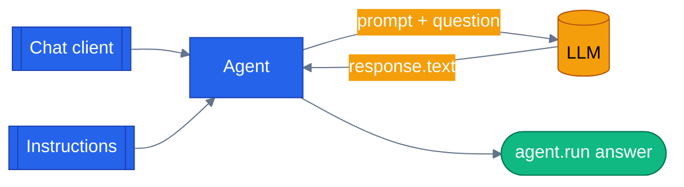

# Chapter 01 — Your First Agent

Build the smallest useful Microsoft Agent Framework (MAF) program in Python and .NET: one chat client, one instructions string, one `agent.run()` call.

**You will learn to:**

- Create an agent from a chat client and an instructions string
- Ask it a question and read the answer, in Python and in .NET
- Run a chapter with no API key by replaying a recorded model response

## Why this chapter

An *agent* in MAF is a chat client plus instructions. Every later chapter adds one thing to that starting point: tools, memory, middleware, workflows. This chapter gets the starting point running on both stacks.

You ask it one question: **"What is the capital of France?"**

## Prerequisites

- Completed [Chapter 00 — Setup](../00-setup/): `uv` for Python, and the .NET 10 SDK for the .NET side (the projects target `net10.0`). Docker is only needed for the full application.
- **No key is needed to run this chapter.** With no key in the environment, Python replays a recorded response (a fixture), and the .NET test project (`dotnet test`) drives a scripted client. Only `dotnet run` talks to a live model. For a live run, add a key to the repo-root `.env`:

| Provider | Required | Optional |
|----------|----------|----------|
| **OpenAI** | `OPENAI_API_KEY` | `LLM_MODEL` (default `gpt-4.1`) |
| **Azure OpenAI** | `AZURE_OPENAI_ENDPOINT`, `AZURE_OPENAI_KEY`, `AZURE_OPENAI_DEPLOYMENT` | `AZURE_OPENAI_API_VERSION` (default `2024-10-21`) |

## The concept

A Microsoft Agent Framework agent wraps three things:

1. A **chat client**: the object that talks to the LLM (OpenAI Responses API, Chat Completions, or Azure OpenAI).
2. **Instructions**: the agent's persona, passed as the system prompt.
3. A **name** (optional), used in logs and telemetry.

You call `await agent.run(question)` (Python) or `await agent.RunAsync(question)` (.NET) and get back a response with `.text` / `.Text`. There are no tools, no memory and no orchestration yet.



The chat client and the instructions are the only two inputs to `Agent(...)`, and `agent.run()` is the only call this chapter makes.

One detail matters for the rest of the series. MAF v1 has two code paths to OpenAI-style APIs: the **Responses API** (newer, richer) and **Chat Completions** (older, universally supported). Public OpenAI supports both, but not every Azure OpenAI deployment supports the Responses API. Both examples in this chapter use `OpenAIChatClient` / `OpenAIClient.GetChatClient` for OpenAI. With `LLM_PROVIDER=azure` they switch to the Chat Completions path: `OpenAIChatCompletionClient` in Python, and the same `GetChatClient` surface via `AzureOpenAIClient` in .NET.

## Python

Source: [`python/main.py`](./python/main.py).

Run from the repo root. All chapters share the `tutorials/` uv project, so one `uv sync` covers every chapter:

```bash
uv sync --project tutorials
uv run --project tutorials python tutorials/01-first-agent/python/main.py
```

You should see:

```text
No LLM key found - replaying the recorded fixture (set OPENAI_API_KEY or the AZURE_OPENAI_* variables for a live run).
Q: What is the capital of France?
A: The capital of France is Paris.
```

The first line appears only when no key is set. Every chapter that builds a chat client picks its provider the same way, in the shared helper `build_chat_client` in [`tutorials/_shared/llm.py`](../_shared/llm.py):

1. An explicit `LLM_PROVIDER` (`openai`, `azure` or `replay`) wins.
2. Otherwise a key in the environment selects OpenAI or Azure.
3. Otherwise the chapter replays its fixture and prints one line saying so.

That leaves the chapter code with only the agent construction:

```python
def _default_client() -> BaseChatClient:
    return build_chat_client(FIXTURES_DIR)  # tutorials/_shared/llm.py: LLM_PROVIDER, else a key, else replay


def build_agent(client: object | None = None) -> Agent:
    return Agent(client or _default_client(), instructions=INSTRUCTIONS, name="first-agent")


async def ask(agent: Agent, question: str) -> str:
    response = await agent.run(question)
    return response.text
```

`build_agent()` accepts an optional pre-built client so the tests can inject a canned one instead of calling a real LLM. The `replay` provider is `tutorials/_shared/replay_client.py`. It plays back a recorded response from `tests/fixtures/replay/`, so you get a real model's answer with no network access and no credentials.

## Notebook

`tutorials/01-first-agent/python/notebook.ipynb` walks through the same code one cell at a time. It builds the agent, then asks the chapter's default question and the city-name-only prompt. The cells import the chapter's own `main.py` and use the exact prompts the fixtures were recorded with, so the notebook runs with no key.

```bash
uv sync --project tutorials --extra dev   # installs ipykernel, nbclient and nbformat
```

Open the notebook in VS Code or JupyterLab and pick the `tutorials/.venv` interpreter as the kernel. If you edit a prompt, a replay run reports a missing fixture, because the prompt is part of the fixture's key. Set `OPENAI_API_KEY` (or the Azure variables) to try your own wording live.

## .NET

Source: [`dotnet/Program.cs`](./dotnet/Program.cs).

```bash
cd tutorials/01-first-agent/dotnet
dotnet run
```

The command changes into the chapter's `dotnet` folder first. `dotnet run` calls a live model, so it needs a key in the repo-root `.env`. With no key, run `dotnet test tutorials/01-first-agent/dotnet/tests/FirstAgent.Tests.csproj` from the repo root instead.

The equivalent provider switch and agent construction:

```csharp
public static AIAgent BuildAgent()
{
    var provider = Environment.GetEnvironmentVariable("LLM_PROVIDER")?.ToLowerInvariant() ?? "openai";

    if (provider == "azure")
    {
        var endpoint = Required("AZURE_OPENAI_ENDPOINT");
        var deployment = Required("AZURE_OPENAI_DEPLOYMENT");
        var apiKey = Environment.GetEnvironmentVariable("AZURE_OPENAI_KEY")
                     ?? Environment.GetEnvironmentVariable("AZURE_OPENAI_API_KEY")
                     ?? throw new InvalidOperationException("Azure requires AZURE_OPENAI_KEY.");

        var azureClient = new AzureOpenAIClient(new Uri(endpoint), new ApiKeyCredential(apiKey));
        return azureClient.GetChatClient(deployment).AsAIAgent(instructions: Instructions, name: "first-agent");
    }

    var openAiKey = Required("OPENAI_API_KEY");
    var model = Environment.GetEnvironmentVariable("LLM_MODEL") ?? "gpt-4.1";
    var openAi = new OpenAIClient(new ApiKeyCredential(openAiKey));
    return openAi.GetChatClient(model).AsAIAgent(instructions: Instructions, name: "first-agent");
}

public static async Task<string> Ask(AIAgent agent, string question)
{
    var response = await agent.RunAsync(question);
    return response.Text;
}
```

`Program.cs` loads the repo-root `.env` itself: `LoadDotEnv()` walks up from `AppContext.BaseDirectory` looking for it. You need neither `dotnet user-secrets` nor shell sourcing. `BuildAgent()` is a static method so the test project can call it directly, and `Ask()` is the entry point both `Main` and the tests use.

## Side-by-side differences

| Aspect | Python | .NET |
|--------|--------|------|
| Agent type | `agent_framework.Agent` | `Microsoft.Agents.AI.AIAgent` (a `ChatClientAgent` under the hood) |
| Chat client | `OpenAIChatClient` (Responses API) or `OpenAIChatCompletionClient` (Chat Completions) | `OpenAI.Chat.ChatClient` via `GetChatClient(...)`, then `.AsAIAgent(...)` |
| Instructions | `Agent(client, instructions="...")` | `.AsAIAgent(instructions: "...")` |
| Invocation | `await agent.run("...")` → `.text` | `await agent.RunAsync("...")` → `.Text` |
| `.env` loading | `tutorials/_shared/maf_bootstrap.py` (`bootstrap()`) | hand-rolled `LoadDotEnv()` in `Program.cs` |
| Test doubles | `BaseChatClient` subclass (`CannedChatClient`) | `IChatClient` implementation (`StubChatClient`) |

## Gotchas

- **"API version not supported" on Azure.** Your deployment does not support the Responses API. Set `LLM_PROVIDER=azure`. Both examples then use Chat Completions (`OpenAIChatCompletionClient` in Python, the same `GetChatClient` surface via `AzureOpenAIClient` in .NET). Python defaults to `api_version=2024-10-21`.
- **`AsAIAgent` does not resolve in .NET.** Add `using OpenAI.Chat;`. The extension method lives in that namespace.
- **The .NET build fails on a warning.** `TreatWarningsAsErrors` is on in `FirstAgent.csproj`, so an unused `using` or a nullable warning fails the build.

## Tests

Both commands run from the repo root and need no key. The Python command needs pytest from the dev extras; install them once with `uv sync --project tutorials --extra dev`:

```bash
# Python
uv run --project tutorials pytest tutorials/01-first-agent/python/tests -v

# .NET
dotnet test tutorials/01-first-agent/dotnet/tests/FirstAgent.Tests.csproj
```

In both languages a stub chat client (`CannedChatClient` in Python, `StubChatClient` in .NET) proves that the instructions and the user's question reach the chat client and that the canned answer comes back. Python also replays the recorded fixture. Each side has one integration test that calls a real LLM; without credentials in `.env` the Python one is skipped and the .NET one returns early.

## How this shows up in the capstone

Every agent in the full application in this repo (the capstone) is built this way. The orchestrator, the agent that receives each shopper's chat message and routes it to a specialist, is constructed by `create_orchestrator_agent()` in `agents/python/orchestrator/agent.py`:

```python
def create_orchestrator_agent() -> Agent:
    """Create the Customer Support orchestrator ChatAgent."""
    return Agent(
        client=create_chat_client("orchestrator"),
        default_options=agent_default_options("orchestrator"),
        name="orchestrator",
        description="Customer support orchestrator that routes requests to specialist agents.",
        instructions=get_system_prompt(current_user_role.get() or "customer"),
        tools=ORCHESTRATOR_TOOLS,
        context_providers=[ECommerceContextProvider()],
        middleware=build_specialist_middleware(),
        ...
    )
```

It is the same `client`, `instructions` and `name` from this chapter, plus `tools`, `context_providers` and `middleware`, which later chapters teach one at a time. Every specialist agent has the same shape; `create_product_discovery_agent()` in `agents/python/product_discovery/agent.py` is one example.

## What's next

- Next chapter: [Chapter 02 — Adding Tools](../02-add-tools/)
- Full source: [`python/`](./python/) · [`dotnet/`](./dotnet/)
- Shared: [Mermaid style guide](../_shared/mermaid-style-guide.md) · [Jargon glossary](../_shared/jargon-glossary.md)
- [MAF docs — Your first agent](https://learn.microsoft.com/en-us/agent-framework/get-started/?pivots=programming-language-csharp)

<!-- BEGIN GENERATED CHAPTER NAV -->
---

**Previous:** [Chapter 00 — Setup your dev environment](../00-setup/) · [Series index](../README.md) · **Next:** [Chapter 02 — Adding Tools](../02-add-tools/)
<!-- END GENERATED CHAPTER NAV -->
