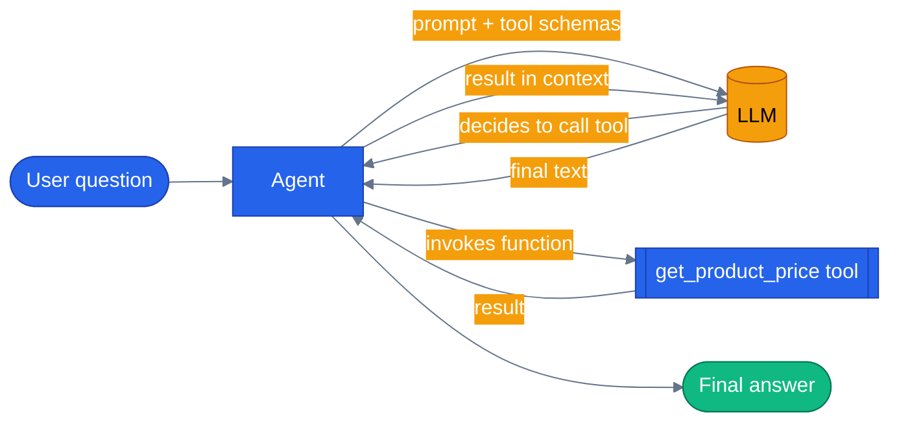

# Chapter 02 — Adding Tools

Give the Chapter 01 agent a function it can call: a product-price lookup the model decides when to use.

**You will learn to:**

- Turn a Python function or a C# method into a tool the model can call
- Describe the tool and its parameters so the model calls it at the right time
- Attach the tool to an agent and let MAF (Microsoft Agent Framework) run the call loop

## Why this chapter

A tool lets a chat agent *do* things. The LLM does not call your function directly. It decides *whether* to call it based on the user's question, and MAF handles the back-and-forth until there is a final answer.

You add **one** function: a product-price lookup backed by a hard-coded dictionary. The data is trivial; the mechanics are what matter. The same shape, a Python `@tool` decorator or a .NET `[Description]`-annotated method, is how every specialist agent in the full application in this repo (the capstone, under `agents/python/`) gives its LLM database and search capabilities.

## Prerequisites

- Completed [Chapter 01 — Your First Agent](../01-first-agent/)
- No API key needed: with none set, `main.py` replays recorded responses and prints one line saying so. To use a live model instead, put `OPENAI_API_KEY` (or the `AZURE_OPENAI_*` variables) in the repo-root `.env`.

## The concept

A MAF tool is three things:

1. **A function**: regular Python or C#.
2. **A name and description**: what the LLM sees when choosing which tool to call.
3. **Parameter annotations**: these become a JSON schema the LLM uses to format its tool call.

Python uses `@tool(...)` + `Annotated[...]` + `pydantic.Field(description=...)`. .NET uses `AIFunctionFactory.Create(method)` plus `[Description]` attributes on the method and its parameters.

MAF owns the loop. It sends the prompt and the tool schemas to the LLM. If the LLM responds with a tool call, MAF invokes the function, feeds the result back into the conversation, and asks the LLM again. This repeats until the LLM produces a regular text answer. You write the function; your code never calls `get_product_price()` directly.



The LLM never executes the function itself. It asks the framework to, then sees the result in its next request.

## Python

Run from the repo root. One `uv sync` of the shared `tutorials/` project covers every chapter:

```bash
uv sync --project tutorials
uv run --project tutorials python tutorials/02-add-tools/python/main.py
```

You should see:

```text
No LLM key found - replaying the recorded fixture (set OPENAI_API_KEY or the AZURE_OPENAI_* variables for a live run).
Q: What's the price of SKU-001?
A: The price of SKU-001 (Wireless Mouse) is $79.99.
```

The name and price in the answer come from the tool, not from the model's own knowledge.

Source: [`python/main.py`](./python/main.py). The tool itself:

```python
@tool(name="get_product_price", description="Look up the current price for a product SKU.")
def get_product_price(
    sku: Annotated[str, Field(description="The product SKU to look up, e.g. 'SKU-001'.")],
) -> str:
    canned = {
        "sku-001": "$79.99 — Wireless Mouse",
        "sku-002": "$129.99 — Mechanical Keyboard",
        "sku-003": "$45.50 — USB-C Hub",
        "sku-004": "$249.00 — 27-inch Monitor",
    }
    return canned.get(sku.lower(), f"No pricing data for {sku}.")
```

Attaching it to the agent is a one-line addition to Chapter 01's `build_agent()`:

```python
def build_agent(client: object | None = None) -> Agent:
    return Agent(
        client or _default_client(),
        instructions=INSTRUCTIONS,
        name="product-agent",
        tools=[get_product_price],
    )
```

For a price question, the LLM calls `get_product_price("SKU-001")`, reads the canned string, and puts it into a natural-language answer. For an unrelated question it answers directly without the tool, because `INSTRUCTIONS` tells the LLM when the tool applies. With a key set, pass your own question as an argument to try both.

## Notebook

`tutorials/02-add-tools/python/notebook.ipynb` walks through the same code one cell at a time. It prints the tool's schema, calls the tool directly, then lets the model call it. The cells import the chapter's own `main.py` and use the exact prompts the replay fixtures were recorded with, so the notebook runs with no key.

```bash
uv sync --project tutorials --extra dev   # installs ipykernel, nbclient and nbformat
```

Open the notebook in VS Code or JupyterLab and pick the `tutorials/.venv` interpreter as the kernel. If you edit a prompt, a replay run reports a missing fixture, because the prompt is part of the fixture's key. Set `OPENAI_API_KEY` (or the Azure variables) to try your own wording live.

## .NET

```bash
cd tutorials/02-add-tools/dotnet
dotnet run
```

The command changes into the chapter's `dotnet` folder first. `dotnet run` calls a live model, so it needs a key in the repo-root `.env`. With no key, run `dotnet test tutorials/02-add-tools/dotnet/tests/AddTools.Tests.csproj` from the repo root instead.

Source: [`dotnet/Program.cs`](./dotnet/Program.cs). The shape is the same, with attributes in place of the decorator:

```csharp
[Description("Look up the current price for a product SKU.")]
public static string GetProductPrice(
    [Description("The product SKU to look up, e.g. 'SKU-001'.")] string sku)
{
    var canned = new Dictionary<string, string>(StringComparer.OrdinalIgnoreCase)
    {
        ["SKU-001"] = "$79.99 — Wireless Mouse",
        ["SKU-002"] = "$129.99 — Mechanical Keyboard",
        ["SKU-003"] = "$45.50 — USB-C Hub",
        ["SKU-004"] = "$249.00 — 27-inch Monitor",
    };
    return canned.TryGetValue(sku, out var price) ? price : $"No pricing data for {sku}.";
}
```

`AIFunctionFactory.Create(GetProductPrice)` reflects over the method and its `[Description]` attributes to build the same JSON schema the Python decorator builds:

```csharp
var tools = new AITool[] { AIFunctionFactory.Create(GetProductPrice) };

return chatClient.AsAIAgent(
    instructions: Instructions,
    name: "product-agent",
    tools: tools);
```

The output matches the Python version, apart from the LLM's word choices.

## Side-by-side differences

| Aspect | Python | .NET |
|--------|--------|------|
| Tool declaration | `@tool(...)` decorator on function | `AIFunctionFactory.Create(method)` |
| Parameter docs | `Annotated[str, Field(description=...)]` | `[Description(...)]` attribute |
| Passing to agent | `Agent(..., tools=[my_tool])` | `AsAIAgent(..., tools: new AITool[]{ ... })` |
| Tool is callable directly? | Yes — `get_product_price.func(...)` unwraps to the original | Yes — `Program.GetProductPrice(...)` is a plain static method |

The two are structurally identical. Python puts the metadata on the decorator; .NET puts it on attributes and reads it by reflection.

## Gotchas

- **The model answers a price question with a made-up price.** The LLM chooses when to call the tool. If your instructions do not say the tool is there for price questions, it may answer without it. Use explicit wording, as `INSTRUCTIONS` does here: *"When the user asks about the price of a product by SKU, call the `get_product_price` tool."*
- **The model picks the wrong tool or none.** Descriptions matter more than names. The LLM reads both, but a tight natural-language description beats a cryptic name.
- **Calling `get_product_price(...)` in a Python test does not run your function.** `@tool` wraps it in a `FunctionTool`. Unit tests call the original through `get_product_price.func(...)`. See `test_product_price_tool_returns_canned_data` in `python/tests/test_add_tools.py`.
- **A tool that awaits something must be async:** `async def` in Python, `Task<T>` or `ValueTask<T>` in .NET. This chapter's example is sync for simplicity. Every tool in the full application (for example `agents/python/product_discovery/tools.py`) is `async` because it awaits a database call via `get_pool()`.
- **Some tests show as skipped.** The two `@pytest.mark.integration` tests call a real LLM and are skipped when `.env` has no usable key. The replay test needs neither network nor a key.

## Tests

Both commands run from the repo root and need no key. The Python command needs pytest from the dev extras; install them once with `uv sync --project tutorials --extra dev`:

```bash
# Python
uv run --project tutorials pytest tutorials/02-add-tools/python/tests -v

# .NET
dotnet test tutorials/02-add-tools/dotnet/tests/AddTools.Tests.csproj
```

The unit tests call the tool function directly, with no LLM: a known SKU, an unknown SKU, and case-insensitivity. The Python suite also checks that the tool is registered on the agent and replays a recorded run in which the model calls it. The integration tests in both languages call a real LLM to confirm it uses the tool for a price question and not for an unrelated one; without credentials the Python ones are skipped and the .NET ones return early.

## How this shows up in the capstone

Tools are how every specialist agent in the full application reaches real data. When a shopper asks for "wireless headphones under $100", the product-discovery agent's model calls `search_products`, defined at `agents/python/product_discovery/tools.py:31`:

```python
@tool(
    name="search_products",
    description=(
        "Search the product catalog using natural language. Supports filtering by category, price range, and rating."
    ),
)
async def search_products(
    query: Annotated[
        str | None, Field(description="Natural language search query (optional if using category filter)")
    ] = None,
    ...
```

It has the same shape as this chapter's `get_product_price`: `@tool` with a name and description, and `Annotated` parameters. The differences are what a real application adds. `search_products` is `async` and queries Postgres via `get_pool()` instead of returning a hard-coded dictionary. Tools that act for one shopper, such as the order tools in `agents/python/order_management/tools.py`, read the current user's identity from ContextVars (`shared/context.py`) instead of taking it as a parameter.

## What's next

- Next chapter: [Chapter 03 — Streaming and Multi-turn](../03-streaming-and-multiturn/)
- Full source: [`python/`](./python/) · [`dotnet/`](./dotnet/)
- Shared: [Mermaid style guide](../_shared/mermaid-style-guide.md) · [Jargon glossary](../_shared/jargon-glossary.md)

<!-- BEGIN GENERATED CHAPTER NAV -->
---

**Previous:** [Chapter 01 — Your First Agent](../01-first-agent/) · [Series index](../README.md) · **Next:** [Chapter 03 — Streaming and Multi-turn](../03-streaming-and-multiturn/)
<!-- END GENERATED CHAPTER NAV -->
