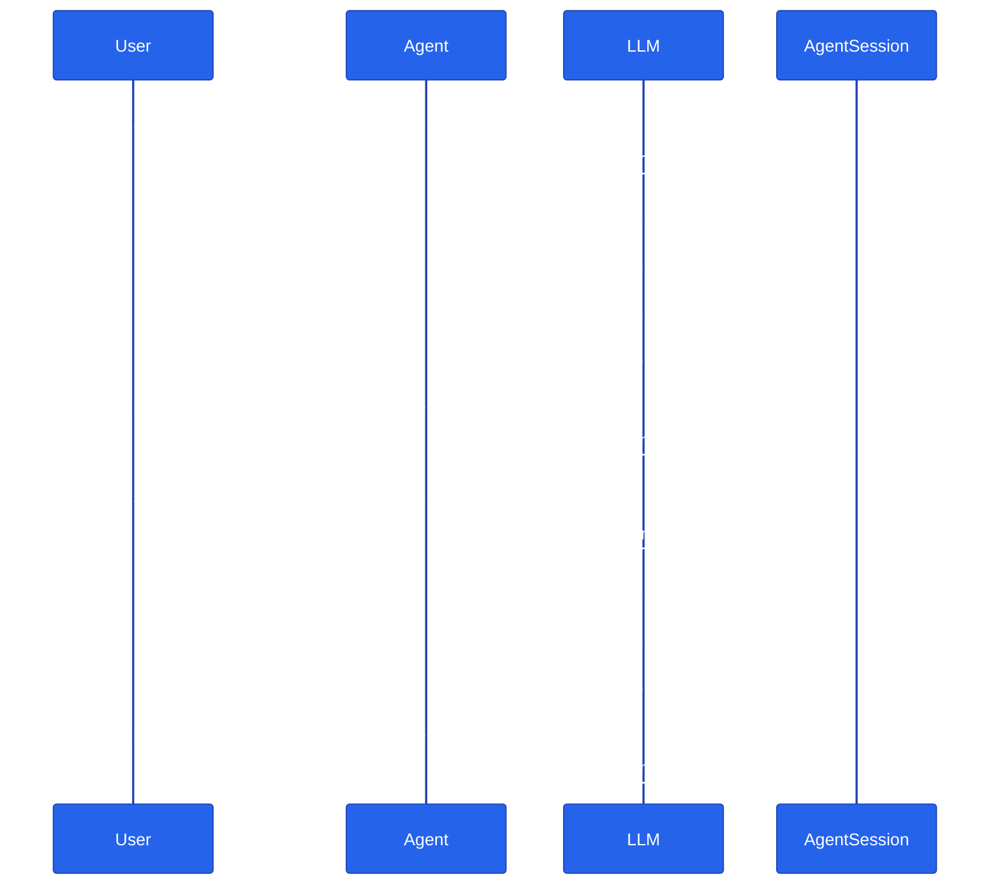

# Chapter 03 — Streaming and Multi-turn

Print an agent's answer as the model produces it, and keep one conversation going across several questions.

**You will learn to:**

- Stream an answer chunk by chunk instead of waiting for the whole response
- Carry conversation history across turns with an `AgentSession`
- Start a fresh conversation by creating a new session

## Why this chapter

This chapter makes two small upgrades to the Chapter 01 agent:

1. **Streaming.** Tokens appear in the terminal as the LLM produces them, instead of all at once when the response is done. In an interactive UI this is what makes a slow answer feel fast. The chat UI of the full application in this repo (the capstone) works this way: the orchestrator's `/api/chat/stream` endpoint sends incremental chunks over SSE (server-sent events), and a customer watches an answer about their order build up word by word.
2. **Multi-turn.** A *session* (`AgentSession` in both languages) carries conversation history between `.run()` calls. Ask *"What's Python?"* and then *"How old is it?"*, and the second turn resolves "it" correctly because both turns share one session. In the full application, a shopper can ask "is it in stock?" right after "tell me about the wireless headphones" because the specialist agent reloads that conversation's history.

## Prerequisites

- Completed [Chapter 02 — Adding Tools](../02-add-tools/)
- No API key needed: with none set, `main.py` replays recorded responses and prints one line saying so. The recordings cover the two questions shown under Python below. To ask your own, put `OPENAI_API_KEY` (or the `AZURE_OPENAI_*` variables) in the repo-root `.env`.

## The concept

**Streaming** switches from `agent.run(q)` to `agent.run(q, stream=True)`. The first returns one `AgentResponse` after the model finishes. The second returns an async iterator of `AgentResponseUpdate` objects. Each update carries a fragment of text, and concatenating them produces the full answer. *What* the model returns does not change, only how soon you can start showing it to a user.

**Sessions** are an opaque container of conversation state. Create one, pass it to every `.run(...)` call for that conversation, and the model sees the accumulated history on each turn. Create a new one to reset the context. That is what a "new conversation" button does in a chat UI.

The diagram below shows both: tokens streaming back within a single turn, and history accumulating across two turns of one session.



The second question never mentions Python by name. The agent answers correctly only because the session carried turn 1's history into turn 2's prompt.

## Python

Source: [`python/main.py`](./python/main.py).

Run from the repo root. Pass the questions as arguments; each one is a turn on the same session:

```bash
uv sync --project tutorials
uv run --project tutorials python tutorials/03-streaming-and-multiturn/python/main.py \
  "What is Python in one line?" \
  "What year was it first released? Answer with the year only."
```

You should see:

```text
No LLM key found - replaying the recorded fixture (set OPENAI_API_KEY or the AZURE_OPENAI_* variables for a live run).

Q: What is Python in one line?
A: Python is a high-level, interpreted programming language known for its readability, simplicity, and versatility across various applications.

Q: What year was it first released? Answer with the year only.
A: 1991
```

With a key you can ask anything, or omit the arguments for an interactive prompt (an empty line quits):

```bash
uv run --project tutorials python tutorials/03-streaming-and-multiturn/python/main.py
```

The core of the chapter is two small functions in `main.py`:

```python
async def stream_answer(
    agent: Agent,
    question: str,
    session: AgentSession,
) -> list[str]:
    chunks: list[str] = []
    async for update in agent.run(question, stream=True, session=session):
        if update.text:
            chunks.append(update.text)
            print(update.text, end="", flush=True)
    print()
    return chunks


async def chat(agent: Agent, questions: list[str]) -> list[list[str]]:
    """Run a scripted multi-turn conversation on one session; return per-turn chunks."""
    session = agent.create_session()
    all_chunks: list[list[str]] = []
    for q in questions:
        print(f"\nQ: {q}")
        print("A: ", end="", flush=True)
        chunks = await stream_answer(agent, q, session)
        all_chunks.append(chunks)
    return all_chunks
```

`session = agent.create_session()` runs once, outside the loop, and every question in `chat()` reuses it. `stream_answer` never looks inside the session. It hands it to `agent.run(..., stream=True, session=session)`, and MAF (Microsoft Agent Framework) reads and appends the history around the call.

## Notebook

`tutorials/03-streaming-and-multiturn/python/notebook.ipynb` walks through the same code one cell at a time. It streams two turns on one session and counts the chunks per turn. The cells import the chapter's own `main.py` and use the exact prompts the replay fixtures were recorded with, so the notebook runs with no key.

```bash
uv sync --project tutorials --extra dev   # installs ipykernel, nbclient and nbformat
```

Open the notebook in VS Code or JupyterLab and pick the `tutorials/.venv` interpreter as the kernel. If you edit a prompt, a replay run reports a missing fixture, because the prompt is part of the fixture's key. Set `OPENAI_API_KEY` (or the Azure variables) to try your own wording live.

## .NET

Source: [`dotnet/Program.cs`](./dotnet/Program.cs).

```bash
cd tutorials/03-streaming-and-multiturn/dotnet
dotnet run -- "What is Python in one line?" "How old is it? Answer with a year only."
```

The command changes into the chapter's `dotnet` folder first. `dotnet run` calls a live model, so it needs a key in the repo-root `.env`. The .NET tests (`dotnet test tutorials/03-streaming-and-multiturn/dotnet/tests/Streaming.Tests.csproj`, from the repo root) need no key, but without one they return early, so use the Python side for a keyless run.

The equivalent code:

```csharp
public static async Task<List<string>> StreamAnswer(AIAgent agent, string question, AgentSession thread)
{
    var chunks = new List<string>();
    await foreach (var update in agent.RunStreamingAsync(question, thread))
    {
        if (!string.IsNullOrEmpty(update.Text))
        {
            chunks.Add(update.Text);
            Console.Write(update.Text);
        }
    }
    Console.WriteLine();
    return chunks;
}

public static async Task<List<List<string>>> Chat(AIAgent agent, IReadOnlyList<string> questions)
{
    var thread = await agent.CreateSessionAsync();
    var allChunks = new List<List<string>>();
    foreach (var q in questions)
    {
        Console.WriteLine($"\nQ: {q}");
        Console.Write("A: ");
        allChunks.Add(await StreamAnswer(agent, q, thread));
    }
    return allChunks;
}
```

The behavior matches the Python version: one `AgentSession` is created before the loop and reused across every `StreamAnswer` call.

## Side-by-side differences

| Aspect | Python | .NET |
|--------|--------|------|
| Stream method | `agent.run(..., stream=True)` — same function, bool flag | `agent.RunStreamingAsync(...)` — separate method |
| Update type | `AgentResponseUpdate` with `.text` property | `AgentResponseUpdate` with `.Text` property |
| Iterator | `async for update in ...` | `await foreach (var update in ...)` |
| Session creation | `agent.create_session()` (sync) | `await agent.CreateSessionAsync()` (async) |
| Session type | `AgentSession` | `AgentSession` |

The .NET side needs `await` on session creation because `CreateSessionAsync` reaches the service for providers that store sessions server-side (for example the Assistants API). In Python the same call is synchronous for the in-process case.

## Gotchas

- **The answer prints one word per line.** Each `update.text` is a partial fragment meant to be concatenated, not a full line. Print with `end=""` (Python) or `Console.Write` (.NET).
- **The agent forgets the previous question.** You created a new session for that turn. Use one session per conversation. A fresh session is right for a new user, but it is easy to create one by accident inside a loop.
- **Blank chunks in your output or chunk list.** `update.text` can be empty: some updates carry only tool-call information or metadata. Skip empty strings when printing or accumulating.
- **A custom chat client streams in a plain loop but fails inside a workflow.** If you write your own `BaseChatClient` subclass for testing or replay, return `self._build_response_stream(_gen())` from `_inner_get_response`, not a bare `ResponseStream(_gen())`. The bare form wires no finalizer. A plain `async for update in agent.run(stream=True)` loop still works, but any MAF-internal caller that needs `ResponseStream.get_final_response()` breaks, for example an `AgentExecutor` inside a `WorkflowBuilder`. `ReplayChatClient` in `tutorials/_shared/replay_client.py` shows the correct form.
- **.NET session resources are not released.** The code above omits disposal for brevity. In production, wrap `AgentSession` creation in `await using`.

## Tests

Both commands run from the repo root. The Python command needs pytest from the dev extras; install them once with `uv sync --project tutorials --extra dev`:

```bash
# Python
uv run --project tutorials pytest tutorials/03-streaming-and-multiturn/python/tests -v

# .NET
dotnet test tutorials/03-streaming-and-multiturn/dotnet/tests/Streaming.Tests.csproj
```

The Python tests need no key. They prove that streaming yields several chunks that concatenate to the full answer, that a second turn sends a longer message list than the first, and, from a recorded run, that the second turn resolves "it" to Python. The .NET tests make the same streaming and multi-turn checks against a live model, plus one that two separate sessions do not share context. They only exercise anything when credentials are in `.env`.

## How this shows up in the capstone

Every chat answer in the full application is streamed to the browser this way, and every conversation is tied to a session id so a follow-up question has its context.

- [`agents/python/shared/agent_host.py`](../../agents/python/shared/agent_host.py): `_run_agent_native_stream` is the application's version of `stream_answer` above. It calls `agent.run(messages, stream=True, options=...)` and yields text chunks the same way. Once the stream is exhausted it calls `stream.get_final_response()` to pick up token usage and other metadata.
- [`agents/python/shared/session.py`](../../agents/python/shared/session.py): `session_from_id` is the application's version of `agent.create_session()`. It builds an `AgentSession` with an existing conversation's id. The conversation's turns live in Postgres, not in the in-process session this chapter uses.

## What's next

- Next chapter: [Chapter 04 — Sessions and Memory](../04-sessions/)
- Full source: [`python/`](./python/) · [`dotnet/`](./dotnet/)
- [MAF docs — Running agents](https://learn.microsoft.com/en-us/agent-framework/agents/running-agents)

<!-- BEGIN GENERATED CHAPTER NAV -->
---

**Previous:** [Chapter 02 — Adding Tools](../02-add-tools/) · [Series index](../README.md) · **Next:** [Chapter 04 — Sessions](../04-sessions/)
<!-- END GENERATED CHAPTER NAV -->
