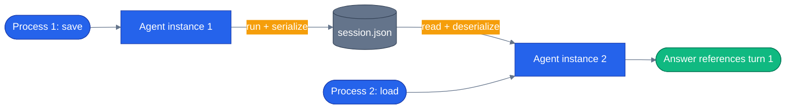

# Chapter 04 — Sessions

Save a conversation to disk and pick it up in a new process, so an agent remembers across restarts.

**You will learn to:**

- Serialize an `AgentSession` to JSON and load it back
- Continue a conversation from a second process with a brand-new agent object
- Tell what MAF (Microsoft Agent Framework) stores for you from what your code must store

## Why this chapter

Chapter 03 reused a session inside one process. That works for an interactive prompt, but not for anything that restarts: HTTP servers, background jobs, mobile clients reconnecting.

A MAF `AgentSession` is a snapshot of everything the agent remembers about a conversation. Serialize it, write it to disk, reload it in a new process, and the agent continues where it left off. The demo is small: you run the same script twice, as two separate processes, and the second run knows what the first was told. The full application in this repo (the capstone) does the same at a larger scale. Every `/api/chat` request reloads the conversation history from Postgres instead of keeping it in memory between requests.

## Prerequisites

- Completed [Chapter 03 — Streaming and Multi-turn](../03-streaming-and-multiturn/)
- Repo-root `.env` with a working LLM provider (`OPENAI_API_KEY`, or `AZURE_OPENAI_ENDPOINT` + `AZURE_OPENAI_KEY` + `AZURE_OPENAI_DEPLOYMENT`)
- **Key:** `main.py`'s default prompt has no recorded fixture, so running it needs a key (live run). Without one, the chapter's tests replay their own recorded prompt: `uv run --project tutorials pytest tutorials/04-sessions/python/tests -m "not integration"`.

## The concept

Both languages expose the same two operations:

- **Python**: `session.to_dict()` returns a JSON-able dict, and `AgentSession.from_dict(data)` rebuilds the session from it. Messages land in `session.state` because the agent is built with `context_providers=[InMemoryHistoryProvider()]`. A context provider is an object that runs around each agent call to add or record context; this one records the conversation. Without it, the session round-trips but carries no conversation.
- **.NET**: `agent.SerializeSessionAsync(session)` returns a `JsonElement`, and `agent.DeserializeSessionAsync(jsonElement)` rebuilds the session. History handling is built into the agent, so there is no separate provider to add.

In both, the agent never touches the filesystem. Your code owns the disk I/O: read the file if it exists, hand the contents to MAF to deserialize, run the turn, ask MAF to serialize the result, and write it back. MAF owns the *shape* of what is serialized; you own where it lives.



There are two separate `Agent`/`AIAgent` objects in two separate processes, and the only thing connecting them is the file on disk. The session, not the process, is what remembers.

## Python

`main.py` needs an API key, because its prompts have no recorded response. With no key, run the tests first; they replay a recorded conversation across two fresh agent objects. From the repo root:

```bash
uv sync --project tutorials --extra dev
uv run --project tutorials pytest tutorials/04-sessions/python/tests -m "not integration"
```

With a key in the repo-root `.env`, run the script twice from the repo root:

```bash
uv run --project tutorials python tutorials/04-sessions/python/main.py save "Remember: I want to buy SKU-4471."
uv run --project tutorials python tutorials/04-sessions/python/main.py load "What did I say I wanted to buy? Answer with only the SKU."
```

Source: [`python/main.py`](./python/main.py). The agent is built with a context provider that records history:

```python
def build_agent(client: object | None = None) -> Agent:
    return Agent(
        client or _default_client(),
        instructions=INSTRUCTIONS,
        name="stateful-agent",
        # InMemoryHistoryProvider turns AgentSession into a conversation carrier.
        context_providers=[InMemoryHistoryProvider()],
    )
```

And the load/run/save cycle:

```python
async def ask_and_save(agent: Agent, question: str, path: pathlib.Path) -> str:
    """Run one turn on a fresh-or-loaded session, then persist the session to disk."""
    session = _load_or_new(agent, path)
    response = await agent.run(question, session=session)
    _save(session, path)
    return response.text


def _load_or_new(agent: Agent, path: pathlib.Path) -> AgentSession:
    if path.exists():
        data = json.loads(path.read_text())
        return AgentSession.from_dict(data)
    return agent.create_session()


def _save(session: AgentSession, path: pathlib.Path) -> None:
    path.write_text(json.dumps(session.to_dict(), indent=2, default=str))
```

The `save`/`load` argument is only a label: both call the same `ask_and_save()`. What differs is whether `session.json` exists yet. The first run creates it; the second finds it and loads the earlier turns. A third mode, `reset`, deletes `session.json` so you can start over.

## Notebook

`tutorials/04-sessions/python/notebook.ipynb` walks through the same code one cell at a time. It round-trips a session through JSON, then answers a follow-up on a brand-new agent. The cells import the chapter's own `main.py` and use the exact prompts the replay fixtures were recorded with, so the notebook runs with no key.

```bash
uv sync --project tutorials --extra dev   # installs ipykernel, nbclient and nbformat
```

Open the notebook in VS Code or JupyterLab and pick the `tutorials/.venv` interpreter as the kernel. If you edit a prompt, a replay run reports a missing fixture, because the prompt is part of the fixture's key. Set `OPENAI_API_KEY` (or the Azure variables) to try your own wording live.

## .NET

```bash
cd tutorials/04-sessions/dotnet
dotnet run -- save "Remember: I want to buy SKU-4471."
dotnet run -- load "What did I say I wanted to buy? Answer with only the SKU."
```

The commands change into the chapter's `dotnet` folder first. `dotnet run` calls a live model, so it needs a key in the repo-root `.env`. The .NET tests (`dotnet test tutorials/04-sessions/dotnet/tests/Sessions.Tests.csproj`, from the repo root) need no key, but without one they return early, so use the Python tests for a keyless run.

Source: [`dotnet/Program.cs`](./dotnet/Program.cs). The load/run/save shape is the same. It is async because `SerializeSessionAsync` and `DeserializeSessionAsync` support providers that call a backing service:

```csharp
public static async Task<(string Answer, string Path)> AskAndSave(
    AIAgent agent, string question, string sessionPath)
{
    var session = await LoadOrNew(agent, sessionPath);
    var response = await agent.RunAsync(question, session);
    await Save(agent, session, sessionPath);
    return (response.Text, sessionPath);
}

public static async Task<AgentSession> LoadOrNew(AIAgent agent, string path)
{
    if (!File.Exists(path))
    {
        return await agent.CreateSessionAsync();
    }
    using var stream = File.OpenRead(path);
    using var doc = await JsonDocument.ParseAsync(stream);
    return await agent.DeserializeSessionAsync(doc.RootElement);
}

public static async Task Save(AIAgent agent, AgentSession session, string path)
{
    var element = await agent.SerializeSessionAsync(session);
    var json = JsonSerializer.Serialize(element, new JsonSerializerOptions { WriteIndented = true });
    await File.WriteAllTextAsync(path, json);
}
```

`BuildAgent()` calls `chatClient.AsAIAgent(instructions: Instructions, name: "stateful-agent")` with no explicit history provider, because history tracking is built into the agent on the .NET side. The behavior matches Python: run it twice, and the second run answers from what the first was told.

## Side-by-side differences

| Aspect | Python | .NET |
|--------|--------|------|
| Serialize | `session.to_dict()` → `dict` | `agent.SerializeSessionAsync(session)` → `JsonElement` |
| Deserialize | `AgentSession.from_dict(data)` | `agent.DeserializeSessionAsync(jsonElement)` |
| Who owns history | `InMemoryHistoryProvider` (a context provider) writes messages into `session.state` | Built into the agent; no extra provider needed |
| JSON work | `json.dumps(...)` / `json.loads(...)` | `JsonSerializer.Serialize(...)` / `JsonDocument.Parse(...)` |
| New session | `agent.create_session()` | `await agent.CreateSessionAsync()` |

The .NET side builds history handling into the agent, so you register no provider and session and agent are tightly coupled. Python keeps the two separate: you can swap `InMemoryHistoryProvider` for one backed by a file or a database, as the full application does (see below), without changing how the agent is built.

## Gotchas

- **A saved session fails to load, or loads oddly, in a different agent.** A session serialized from one agent's configuration is not guaranteed to deserialize cleanly into a differently configured agent. Treat the session as opaque: write it, load it, hand it back. Do not inspect or hand-edit the JSON.
- **`session.json` keeps growing.** Every turn adds to the serialized session. Long-lived conversations need eviction, such as replacing older messages with a summary. That is out of scope here; [Chapter 18](../18-state-and-checkpoints/) covers the related topic of state and checkpointing.
- **Python: the follow-up acts like a new conversation although `session.json` exists.** You dropped `context_providers=[InMemoryHistoryProvider()]` from `build_agent()`. The file is still written and still round-trips its `session_id`, but it carries no messages, and nothing warns you.
- **.NET: a missing `await` on `DeserializeSessionAsync` or `SerializeSessionAsync`.** Both are async so that providers backed by a real service, not just a local file, can do I/O.
- **"load" loads nothing.** `save` and `load` are labels, not code paths: both call the same `ask_and_save()` / `AskAndSave()`. Check that `session.json` exists. A missing file falls back to a fresh session without a message, whichever mode you typed.

## Tests

Both commands run from the repo root:

```bash
# Python
uv run --project tutorials pytest tutorials/04-sessions/python/tests -v

# .NET
dotnet test tutorials/04-sessions/dotnet/tests/Sessions.Tests.csproj
```

The Python unit tests round-trip an `AgentSession` through a dict and JSON with no LLM. A replay test then builds two separate `Agent` instances and confirms, from recorded responses, that the second answers from what the first was told; an integration test does the same against a live model and is skipped without a key. The .NET tests check the same persistence and the missing-file fallback against a live model, and return early when no key is configured.

## How this shows up in the capstone

In the full application, every chat request loads the shopper's earlier turns from Postgres before the agent runs, which is why a conversation survives a server restart.

The orchestrator, the agent that receives each chat message, reads history through a pluggable `HistoryProvider`. `agents/python/shared/session.py` defines three backends, selected by `settings.MAF_SESSION_BACKEND`:

- `PostgresSessionHistoryProvider`: production, backed by the `messages` and `conversations` tables.
- `FileSessionHistoryProvider`: local development, JSONL files under `settings.MAF_SESSION_DIR`.
- `InMemorySessionHistoryProvider`: tests.

`get_history_provider()` at `agents/python/shared/session.py:216` picks the backend by name. It is the same idea as this chapter's `_load_or_new` / `LoadOrNew`, with three interchangeable stores instead of one file.

`agents/python/orchestrator/routes/chat.py:374` is where the orchestrator calls it: `history = await get_history_as_dicts(get_history_provider(pool=pool), conversation_id)`. The read happens before the current turn's user message is inserted. Otherwise that message would appear twice, because `shared/agent_host.py` appends the current message itself. Writes differ from this chapter's single `_save()` call: each route does its own `INSERT`, because it stores `agent_name`, `agents_involved` and `metadata` alongside the role and content that a generic history provider saves.

## What's next

- Next chapter: [Chapter 05 — Context Providers](../05-context-providers/)
- Full source: [`python/`](./python/) · [`dotnet/`](./dotnet/)
- Shared: [Mermaid style guide](../_shared/mermaid-style-guide.md) · [Jargon glossary](../_shared/jargon-glossary.md)

<!-- BEGIN GENERATED CHAPTER NAV -->
---

**Previous:** [Chapter 03 — Streaming and Multi-turn](../03-streaming-and-multiturn/) · [Series index](../README.md) · **Next:** [Chapter 05 — Context Providers](../05-context-providers/)
<!-- END GENERATED CHAPTER NAV -->
