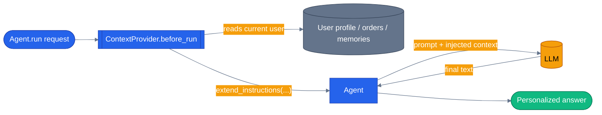

# Chapter 05 — Context Providers

Tell an agent who it is talking to on every run, with a context provider: an object that runs before each LLM call and adds to what the model sees.

**You will learn to:**

- Write a context provider that adds per-user instructions before each run
- Register it on an agent in Python and in .NET
- Share what the provider loaded with your tools through the run's `state` (Python)

## Why this chapter

You want your agent to know *who* it is talking to without hard-coding "the user is Alice" into the system prompt. Once you have more than one user, formatting a prompt string per request becomes glue code scattered across every agent. A `ContextProvider` gives you one hook instead: run some code before every LLM call, add instructions (or messages, or tools) to the context, and let the framework apply it. You write one provider per concern, compose them in a list, and reuse them across agents.

The agents in the full application in this repo (the capstone) depend on this. Each is built with a `context_providers=[...]` argument that injects the logged-in user's profile, recent orders and long-term memories before the LLM sees the request. The implementation is in `agents/python/shared/context_providers.py`.

## Prerequisites

- Completed [Chapter 04 — Sessions](../04-sessions/)
- Repo-root `.env` with working LLM credentials (`OPENAI_API_KEY`, or the `AZURE_OPENAI_*` set)
- `main.py` needs those credentials: its default prompt has no recorded response. With no key, run the chapter's tests, which replay their own recorded prompt: `uv run --project tutorials pytest tutorials/05-context-providers/python/tests -m "not integration"`.

## The concept

**Python**: subclass `agent_framework.ContextProvider` and override `before_run(*, agent, session, context, state)`. Call `context.extend_instructions("source-id", "...")` to append to the system prompt for that run only. You can also put structured data in the `state` dict so your tools (Chapter 02) can read it. Register the provider with `Agent(..., context_providers=[...])`.

**.NET**: subclass `Microsoft.Agents.AI.AIContextProvider` and override the protected `ProvideAIContextAsync(InvokingContext, CancellationToken)`. Return an `AIContext { Instructions = "..." }`. Register it through `ChatClientAgentOptions.AIContextProviders`.

Both run on every `agent.run(...)` / `agent.RunAsync(...)`, before the request reaches the LLM. The provider can read from a database, call an API or check a feature flag, whatever the current request needs. It resembles ASP.NET middleware or an Express interceptor, scoped to "the next LLM call" instead of "the next HTTP request."



The provider never talks to the LLM. It only shapes what the agent sends on the *next* call. The LLM sees one composed system prompt and cannot tell a provider ran.

## Python

`main.py` needs an API key. With no key, start with the tests, from the repo root:

```bash
uv sync --project tutorials --extra dev
uv run --project tutorials pytest tutorials/05-context-providers/python/tests -m "not integration"
```

With a key in the repo-root `.env`, run the script from the repo root:

```bash
uv run --project tutorials python tutorials/05-context-providers/python/main.py
# Uses the default user (Alice). Pass email / name / tier to swap:
uv run --project tutorials python tutorials/05-context-providers/python/main.py bob@example.com Bob gold
```

The chapter's `UserProfileProvider` in [`python/main.py`](./python/main.py):

```python
class UserProfileProvider(ContextProvider):
    """Injects the current user's profile as additional instructions for each run."""

    def __init__(self, *, email: str, name: str, loyalty_tier: str = "silver") -> None:
        super().__init__(source_id="user-profile")
        self.email = email
        self.name = name
        self.loyalty_tier = loyalty_tier

    async def before_run(
        self,
        *,
        agent: Any,
        session: Any,
        context: Any,
        state: dict[str, Any],
    ) -> None:
        context.extend_instructions(
            "user-profile",
            f"Current user: {self.name} ({self.email}). Loyalty tier: {self.loyalty_tier}.",
        )
        state["user"] = {"email": self.email, "name": self.name, "loyalty_tier": self.loyalty_tier}
```

`build_agent()` registers it with `context_providers=[provider]`. `main()` reads email, name and tier from `sys.argv`, so you can run the same script for different users without editing code.

The `source_id` argument to both `super().__init__(...)` and `extend_instructions(...)` identifies which provider injected what when several are chained, as the full application does (see below).

## .NET

```bash
cd tutorials/05-context-providers/dotnet
dotnet run
```

The command changes into the chapter's `dotnet` folder first. `dotnet run` calls a live model, so it needs a key in the repo-root `.env`. With no key, run `dotnet test tutorials/05-context-providers/dotnet/tests/ContextProviders.Tests.csproj` from the repo root instead.

The equivalent provider in [`dotnet/Program.cs`](./dotnet/Program.cs):

```csharp
public sealed class UserProfileProvider : AIContextProvider
{
    public string Email { get; }
    public string Name { get; }
    public string LoyaltyTier { get; }

    public UserProfileProvider(string email, string name, string loyaltyTier = "silver")
    {
        Email = email;
        Name = name;
        LoyaltyTier = loyaltyTier;
    }

    protected override ValueTask<AIContext> ProvideAIContextAsync(
        InvokingContext context,
        CancellationToken cancellationToken = default)
    {
        return ValueTask.FromResult(new AIContext
        {
            Instructions = $"Current user: {Name} ({Email}). Loyalty tier: {LoyaltyTier}.",
        });
    }
}
```

`BuildAgent()` registers it with `ChatClientAgentOptions.AIContextProviders = new[] { provider }`. `Program.Main` reads the same email, name and tier arguments as the Python version.

## Side-by-side differences

| Aspect | Python | .NET |
|--------|--------|------|
| Base class | `ContextProvider` | `AIContextProvider` |
| Override point | `before_run(...)` (public) | `ProvideAIContextAsync(...)` (protected) |
| Injecting instructions | `context.extend_instructions(source_id, text)` | `return new AIContext { Instructions = "..." }` |
| Shared state | `state["..."]` dict passed into `before_run` | No equivalent — use DI / a custom service |
| Registration | `Agent(..., context_providers=[...])` | `ChatClientAgentOptions.AIContextProviders = [...]` |
| Also can add | messages, tools, middleware | messages, tools |

## Gotchas

- **Python raises when you create the provider or call `extend_instructions`.** `source_id` is required in both places: `super().__init__(source_id=...)` and `extend_instructions(source_id, text)`.
- **.NET: overriding `InvokingAsync` is the wrong hook.** Override the protected `ProvideAIContextAsync` shown above. `InvokingAsync` is the base class's own pipeline method, which calls your override.
- **A value you put in `state` is missing elsewhere.** In Python, the `state` dict passed to `before_run` is scoped to the provider chain the agent was built with, and to one run. When you chain providers, as `ECommerceContextProvider` does (see below), later ones can read fields earlier ones set, but only within that run.
- **A keyless `main.py` fails with `ReplayFixtureMissingError`.** Its default prompt has no recorded response. Set a key, or run the tests.

## Tests

Both commands run from the repo root and need no key:

```bash
# Python
uv run --project tutorials pytest tutorials/05-context-providers/python/tests -v

# .NET
dotnet test tutorials/05-context-providers/dotnet/tests/ContextProviders.Tests.csproj
```

The Python unit tests prove that the injected name, tier and email reach the chat client, that `before_run` fills `state["user"]`, and that two separately built agents never see each other's user. A replay test then plays back a recorded run in which the model uses the injected name. The .NET tests check the provider's fields without a model. Tests that call a real LLM are skipped in Python, and return early in .NET, when no credentials are configured.

## How this shows up in the capstone

In the full application, context providers are how every agent knows the logged-in shopper's name, loyalty tier and recent orders without the shopper repeating them.

- `agents/python/shared/context_providers.py:35` defines `UserProfileProvider`, the application's version of this chapter's example. It looks up the `users` row for the current request's email (`shared.context.current_user_email`) and calls `context.extend_instructions("user-profile", ...)` with name, role, loyalty tier and total spend.
- The same file defines `RecentOrdersProvider` and `AgentMemoriesProvider`, which compose the same way, and `ECommerceContextProvider`, a composite that runs all three and also assembles their output into one `state["user_context"]` string.
- `agents/python/product_discovery/agent.py:92` passes `context_providers=[ECommerceContextProvider()]` to `Agent(...)`. The orchestrator and the other specialist agents pass the same argument, the way this chapter's `build_agent()` does.

## What's next

- Next chapter: [Chapter 06 — Middleware](../06-middleware/) — intercepting the agent run, tool calls, and LLM calls themselves.
- Full source: [`python/`](./python/) · [`dotnet/`](./dotnet/)
- Shared: [Mermaid style guide](../_shared/mermaid-style-guide.md)

<!-- BEGIN GENERATED CHAPTER NAV -->
---

**Previous:** [Chapter 04 — Sessions](../04-sessions/) · [Series index](../README.md) · **Next:** [Chapter 06 — Middleware and the Agent Pipeline](../06-middleware/)
<!-- END GENERATED CHAPTER NAV -->
