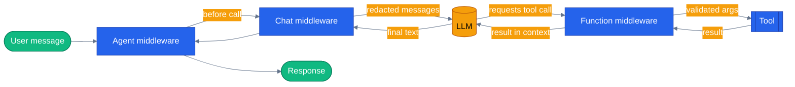

# Chapter 06 — Middleware and the Agent Pipeline

Add middleware, code that runs around an agent call, to log every run, block a tool call and redact a card number before the LLM sees it.

**You will learn to:**

- Wrap an agent run to log what happens before and after it
- Intercept a tool call and refuse it without running the tool
- Rewrite outgoing messages before they reach the model, for example to mask a card number
- Combine all three on one agent

## Why this chapter

Every agent eventually needs behavior that has nothing to do with its job: log every run, block a tool call that breaks a business rule, strip a credit-card number out of a user message before it reaches the model. Putting that logic in the tool functions or the prompt works for a demo. It stops working once several agents all need it applied the same way. The full application in this repo (the capstone) builds every agent from one shared middleware stack for that reason.

Middleware lets you observe or change an agent run at three levels:

- **Agent run**: wrap the entire invocation (before/after logging, span creation, auth checks).
- **Function/tool**: intercept tool calls (approval gates, argument validation, result transformation).
- **Chat/LLM**: transform messages before they reach the provider (PII redaction, caching, model routing).

All three compose in one pipeline, and neither your tool code nor your prompt changes.

## Prerequisites

- Completed [Chapter 05 — Context Providers](../05-context-providers/)
- No API key is needed for the default prompt: with none set, `main.py` replays a recorded response. Any other prompt, including the card-number example, needs working credentials in the repo-root `.env`.

## The concept

Think of it as an onion. Agent-run middleware is the outermost layer and sees the whole invocation, start to finish. Chat middleware wraps every call out to the LLM, and function middleware wraps every call into a tool. A request passes through the outer layer once on the way in and once on the way out. The inner layers can run several times per run, once per LLM round-trip and once per tool call.



Each layer can step in. Function middleware can refuse a tool call without invoking it, chat middleware can rewrite the outbound message list, and agent middleware can wrap the whole run in a try/except for a uniform failure log. The layers do not know about each other. They compose because the framework dispatches by type, not because you wired a chain.

## Python

Run from the repo root:

```bash
uv sync --project tutorials
uv run --project tutorials python tutorials/06-middleware/python/main.py
```

You should see:

```text
No LLM key found - replaying the recorded fixture (set OPENAI_API_KEY or the AZURE_OPENAI_* variables for a live run).
Q: What's the weather in Paris?
A: The weather in Paris is sunny with a temperature of 18°C.

agent events:    ['agent:before', 'agent:after']
tool invocations: ['Paris']
tool blocked:    []
pii redactions:  0
```

The last four lines are what each middleware recorded. With a key set, pass your own message to see the redaction count change:

```bash
uv run --project tutorials python tutorials/06-middleware/python/main.py "My card is 4111-1111-1111-1111"
```

Source: [`python/main.py`](./python/main.py). Three middleware classes, one per layer:

```python
class LoggingAgentMiddleware(AgentMiddleware):
    """Observes every agent run. Populates `events` so tests can assert order."""

    def __init__(self) -> None:
        self.events: list[str] = []

    async def process(self, context: AgentContext, call_next: Callable[[], Awaitable[None]]) -> None:
        self.events.append("agent:before")
        await call_next()
        self.events.append("agent:after")


class ArgValidatorMiddleware(FunctionMiddleware):
    """Blocks a canned forbidden city as a stand-in for business-rule validation."""

    FORBIDDEN_CITY = "Atlantis"

    async def process(
        self,
        context: FunctionInvocationContext,
        call_next: Callable[[], Awaitable[None]],
    ) -> None:
        city = context.arguments.get("city", "") if isinstance(context.arguments, dict) else ""
        self.invocations.append(city)
        if city.lower() == self.FORBIDDEN_CITY.lower():
            self.blocked.append(city)
            context.result = "Refused: that city isn't supported."
            return        # short-circuit — real tool never runs
        await call_next()


class PiiRedactionChatMiddleware(ChatMiddleware):
    """Masks credit-card-shaped numbers in outbound user messages."""

    async def process(self, context: ChatContext, call_next: Callable[[], Awaitable[None]]) -> None:
        for message in context.messages:
            for content in message.contents:
                if text := getattr(content, "text", None):
                    redacted, count = _CARD_RE.subn("[REDACTED-CARD]", text)
                    if count:
                        self.redactions += count
                        content.text = redacted
        await call_next()
```

`build_agent()` attaches all three with `Agent(client, ..., middleware=[logger, validator, redactor])`.

## .NET

```bash
cd tutorials/06-middleware/dotnet
dotnet run
```

The command changes into the chapter's `dotnet` folder first. `dotnet run` calls a live model, so it needs a key in the repo-root `.env`. The .NET tests (`dotnet test tutorials/06-middleware/dotnet/tests/Middleware.Tests.csproj`, from the repo root) need no key, but without one they return early, so use the Python side for a keyless run.

Source: [`dotnet/Program.cs`](./dotnet/Program.cs). .NET uses `DelegatingChatClient` with `IChatClient.AsBuilder().Use(...)` for chat middleware, and a plain guard inside the function for the tool intercept. Agent-run middleware exists as `AIAgentBuilder.Use(runFunc, runStreamingFunc)`; this example leaves it out to stay short.

```csharp
private sealed class PiiRedactingChatClient : DelegatingChatClient
{
    public override Task<ChatResponse> GetResponseAsync(
        IEnumerable<ChatMessage> messages, ChatOptions? options, CancellationToken ct)
    {
        Redact(messages);      // mutates TextContent in-place
        return base.GetResponseAsync(messages, options, ct);
    }
    // ... same for streaming ...
}

IChatClient pipeline = rawChat.AsIChatClient()
    .AsBuilder()
    .Use(new PiiRedactingChatClient.Factory(stats, CardPattern))
    .Build();

var agent = new ChatClientAgent(pipeline, new ChatClientAgentOptions {
    Name = "middleware-agent",
    ChatOptions = new ChatOptions { Instructions = Instructions, Tools = new[] { (AITool)weather } },
});
```

The tool-call guard (the "Atlantis" refusal) sits inside the `AIFunctionFactory.Create(...)` lambda for `get_weather`, not in a separate middleware type. This example uses no dedicated function-middleware class the way Python uses `FunctionMiddleware`; the guard gives the same early refusal.

## Side-by-side differences

| Aspect | Python | .NET |
|--------|--------|------|
| Abstraction | Three abstract classes (`AgentMiddleware`, `FunctionMiddleware`, `ChatMiddleware`) | One pattern (`DelegatingChatClient` / `AIAgentBuilder.Use`) applied at different layers, plus a plain guard for tool calls |
| Registration | `Agent(..., middleware=[...])` | `.AsBuilder().Use(...)` chain on the `IChatClient` pipeline |
| Short-circuit | Set `context.result` and return early | `throw`, or return a canned string from the tool function |

The .NET version takes more wiring, but it is plain C# delegation, with no framework-specific base class for the tool layer.

## Gotchas

- **Counters or event lists carry over from an earlier run.** A middleware object keeps its state for as long as it lives. Create a fresh one per run if your assertions depend on ordering; the tests build a new agent per test.
- **Changing `context.arguments` does not stop the tool call.** The arguments dict is not mutable in every backend. To refuse a tool call in Python, set `context.result` and return without calling `call_next()`.
- **A .NET run hangs.** A `DelegatingChatClient` must call `base.GetResponseAsync(...)` or return a cached response. If it never calls the inner client, the run does not finish.
- **A .NET tool guard cannot be reused across tools.** A guard in the function body runs as part of the tool call itself. Python's `FunctionMiddleware` wraps the call from outside. They are different layers with different observability, and the .NET guard has to be repeated in each tool.

## Tests

Both commands run from the repo root. The Python command needs pytest from the dev extras; install them once with `uv sync --project tutorials --extra dev`:

```bash
# Python
uv run --project tutorials pytest tutorials/06-middleware/python/tests -v

# .NET
dotnet test tutorials/06-middleware/dotnet/tests/Middleware.Tests.csproj
```

One Python test replays a recorded run, with no key, and confirms that the agent and function middleware both observe the weather tool call. The remaining Python tests and all the .NET tests use a live model. They cover middleware ordering, tool interception, the forbidden-city refusal, card redaction and state not leaking between agents. Without credentials the Python ones are skipped and the .NET ones return early.

## How this shows up in the capstone

In the full application, one middleware stack runs around every agent. It is what masks a shopper's card number before the model sees it, audits each tool call and pauses risky actions for a person to approve.

Every specialist and the orchestrator get that stack from `build_specialist_middleware()` in `agents/python/shared/middleware.py`. It composes more than three layers:

- `AgentRunLogger` (agent middleware, `agents/python/shared/middleware.py`): run timing and a correlation id. Always on.
- `ToolAuditMiddleware` (function middleware, `agents/python/shared/middleware.py`): a structured audit log for every tool call. Always on.
- `InjectionDetectionChatMiddleware` (chat middleware, on when `settings.GUARDRAILS_ENABLED`): flags inbound prompt injection.
- `PiiRedactionMiddleware` (chat middleware, `agents/python/shared/middleware.py`): the card and SSN redaction this chapter teaches. Always on, whatever the guardrails flag says.
- `OutputSanitizationMiddleware` (function middleware, on when `settings.GUARDRAILS_ENABLED`): defangs stored injection in tool output.
- `HITLFunctionMiddleware` (function middleware, on when `settings.HITL_ENABLED`): a human-in-the-loop (HITL) gate. A gated tool call does not run until a person approves it.
- Grounding middleware (`GROUNDING_LEDGER_MIDDLEWARE` and `GroundingVerificationMiddleware`, on unless `settings.GROUNDING_MODE` is `"off"`): grounding means checking the answer against real data. These record the product and order facts tools returned during the run and verify the final text against them.
- `CostBudgetMiddleware` and `OutputModerationMiddleware` (chat middleware, each off when its mode setting is `"off"`): track or cap per-run cost, and classify the model's own output.
- `STEP_MIDDLEWARE` (from `shared.agent_observability`, on by default through `include_steps=True`): captures each step for the run explorer UI.

The chapter's three classes (`LoggingAgentMiddleware`, `ArgValidatorMiddleware`, `PiiRedactionChatMiddleware`) have the same shape, without the guardrail, grounding and HITL layers. `AgentAuthMiddleware` in `agents/python/shared/auth.py` is a different kind of middleware: HTTP middleware (Starlette `BaseHTTPMiddleware`) that wraps the web request before it reaches the agent.

## What's next

- Next chapter: [Chapter 07 — Observability with OpenTelemetry](../07-observability-otel/)
- Full source: [`python/`](./python/) · [`dotnet/`](./dotnet/)
- Shared: [Mermaid style guide](../_shared/mermaid-style-guide.md) · [Jargon glossary](../_shared/jargon-glossary.md)
- [MAF docs — Middleware](https://learn.microsoft.com/en-us/agent-framework/agents/middleware/)

<!-- BEGIN GENERATED CHAPTER NAV -->
---

**Previous:** [Chapter 05 — Context Providers](../05-context-providers/) · [Series index](../README.md) · **Next:** [Chapter 07 — Observability with OpenTelemetry](../07-observability-otel/)
<!-- END GENERATED CHAPTER NAV -->
