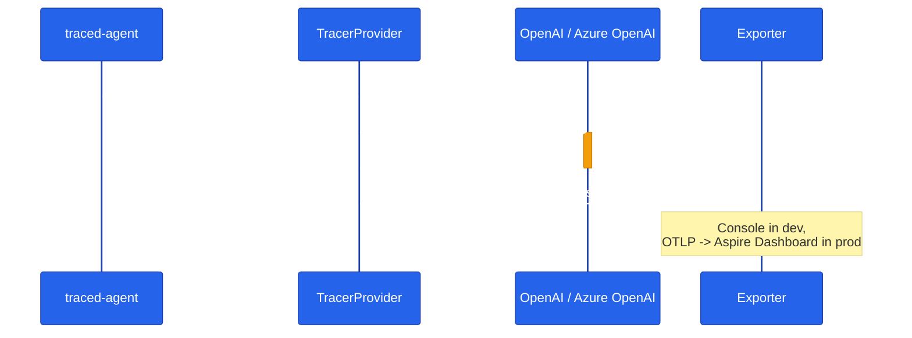

# Chapter 07 — Observability with OpenTelemetry

Turn on OpenTelemetry tracing so every agent run is recorded as spans: timed records of each operation, tagged with the model and token counts. You print them to the console here; the same setup can send them to Aspire, Jaeger or Azure Monitor.

**You will learn to:**

- Set up a tracer provider and an exporter in Python and in .NET
- Turn on the tracing built into MAF (Microsoft Agent Framework)
- Read the spans one agent run produces, including model and token-usage attributes

## Why this chapter

Agents fail in ways logs do not explain: the LLM called the wrong tool, the tool returned nothing, or the model decided not to call anything. A log line tells you an agent ran. It does not tell you what it decided, what it sent to the model, or how long each hop took. Spans do.

MAF emits OpenTelemetry spans itself. With a little setup per language you see agent-run and provider-HTTP spans carrying GenAI semantic-convention attributes (model, input tokens, output tokens, finish reason). The full application in this repo (the capstone) uses the same mechanism to show its call tree in the Aspire Dashboard: orchestrator → A2A (agent-to-agent call) → specialist → tool → LLM.

## Prerequisites

- Completed [Chapter 06 — Middleware](../06-middleware/)
- `.env` with working LLM credentials (`OPENAI_API_KEY`, or `AZURE_OPENAI_ENDPOINT` / `AZURE_OPENAI_KEY` / `AZURE_OPENAI_DEPLOYMENT`)
- **No key is needed to run this chapter.** With no key, `main.py` replays a recorded response for its default prompt, and the chapter's tests replay their own: `uv run --project tutorials pytest tutorials/07-observability-otel/python/tests -m "not integration"`. A different prompt has no recording; set a key to try your own wording.

## The concept

Both languages follow the same three steps:

1. Build a `TracerProvider` with an exporter: console for development, OTLP (the OpenTelemetry wire protocol) for Aspire, Jaeger or Azure Monitor in production.
2. Register the MAF instrumentation sources on that provider.
3. Run an agent. Spans are emitted automatically, with no manual `span.start()` calls in your own code.

Python opts in with one call, `enable_instrumentation()`, which turns on MAF's built-in instrumentation. .NET's tracing model (`System.Diagnostics.Activity`) has no single global switch, so you add `ActivitySource` names to the tracer provider to tell it which sources to listen to.

One agent run produces a small tree of nested spans. The agent invocation is the parent, and the LLM call and any tool calls are its children:



The parent span carries `gen_ai.operation.name`, and the child LLM span carries `gen_ai.request.model` and `gen_ai.usage.*`. These names are the GenAI semantic convention. Both languages emit them, and the Aspire Dashboard's GenAI view uses them to group and label spans.

## Python

Source: [`python/main.py`](./python/main.py).

```python
from agent_framework.observability import enable_instrumentation
from opentelemetry import trace
from opentelemetry.sdk.resources import SERVICE_NAME, Resource
from opentelemetry.sdk.trace import TracerProvider
from opentelemetry.sdk.trace.export import BatchSpanProcessor, ConsoleSpanExporter


def setup_tracing(service_name: str = "maf-v1-ch07", exporter: object | None = None) -> TracerProvider:
    """Configure a TracerProvider. Call once per process before agent calls."""
    resource = Resource.create({SERVICE_NAME: service_name})
    provider = TracerProvider(resource=resource)
    provider.add_span_processor(BatchSpanProcessor(exporter or ConsoleSpanExporter()))
    trace.set_tracer_provider(provider)
    enable_instrumentation(enable_sensitive_data=True)
    return provider
```

`main.py` calls `setup_tracing()` once at startup, then builds an `Agent` and runs it. `enable_instrumentation()` makes MAF emit spans for every agent and LLM call. The `BatchSpanProcessor` with a `ConsoleSpanExporter` prints them.

With no key, `main.py` replays a recorded response for its default question; one test replays a recorded run and checks the spans it emits. A reworded question has no recording. From the repo root:

```bash
uv sync --project tutorials --extra dev
uv run --project tutorials pytest tutorials/07-observability-otel/python/tests -m "not integration"
```

With a key in the repo-root `.env`, run the script from the repo root. It prints the answer and each span as JSON:

```bash
uv run --project tutorials python tutorials/07-observability-otel/python/main.py "What is Python?"
```

## .NET

Source: [`dotnet/Program.cs`](./dotnet/Program.cs).

```csharp
public static readonly string[] ActivitySources = new[]
{
    "Microsoft.Agents.AI",
    "Microsoft.Extensions.AI",
    "*",
};

public static TracerProvider BuildTracerProvider(BaseExporter<Activity> exporter)
{
    var builder = Sdk.CreateTracerProviderBuilder()
        .SetResourceBuilder(ResourceBuilder.CreateDefault().AddService("maf-v1-ch07"))
        .AddSource(ActivitySources)
        .AddProcessor(new SimpleActivityExportProcessor(exporter));
    return builder.Build()!;
}
```

`Program.Main` calls `BuildTracerProvider(new ConsoleExporter())`, builds the agent with `chatClient.AsAIAgent(...)`, and runs it. The console exporter, a small `BaseExporter<Activity>` at the bottom of `Program.cs`, prints each span's display name and tag count as it is exported.

```bash
cd tutorials/07-observability-otel/dotnet
dotnet run
```

The command changes into the chapter's `dotnet` folder first. `dotnet run` calls a live model, so it needs a key in the repo-root `.env`. The .NET tests (`dotnet test tutorials/07-observability-otel/dotnet/tests/Observability.Tests.csproj`, from the repo root) need no key, but without one they return early, so use the Python tests for a keyless run.

## Side-by-side differences

| Aspect | Python | .NET |
|--------|--------|------|
| Enable MAF instrumentation | `enable_instrumentation()` | `.AddSource("Microsoft.Agents.AI", "Microsoft.Extensions.AI", "*")` |
| Span format | OpenTelemetry SDK span | `System.Diagnostics.Activity` (OTel .NET's compat layer) |
| Default exporter | `ConsoleSpanExporter` | Custom `ConsoleExporter : BaseExporter<Activity>` |
| GenAI attributes | `gen_ai.operation.name`, `gen_ai.request.model`, `gen_ai.usage.*` | Same attribute names, exposed as `Activity` tags |
| Provider set-once rule | `trace.set_tracer_provider()` — second call is a silent no-op | `TracerProvider` is a disposable object you own; nothing stops you building two |

Both produce the same data. Swap the exporter for an OTLP one and point it at Aspire, Jaeger or Azure Monitor to see distributed traces instead of console lines.

## Gotchas

- **A second `TracerProvider` in Python is ignored.** Python sets one provider per process. A second call to `trace.set_tracer_provider()` logs a warning and the first provider stays. The tests in [`test_observability.py`](./python/tests/test_observability.py) install one module-level `InMemorySpanExporter` and call `exporter.clear()` between tests instead of rebuilding the provider.
- **No spans appear in .NET.** .NET needs explicit `ActivitySource` names. This chapter's `ActivitySources` array subscribes to three: `Microsoft.Agents.AI`, `Microsoft.Extensions.AI` and the wildcard `"*"`. The wildcard is what picks up ambient HTTP-client spans (DNS, TLS handshake, the POST itself), so you see the full network hop. The chapter's tests assert that a live run exports at least one span and that one carries an HTTP tag; they do not check which source a span came from.
- **Prompts and answers show up in your traces.** `enable_instrumentation(enable_sensitive_data=True)` includes the full prompt and response text as span attributes. That is fine for a local trace. Against real user data, leave it at the default (`False`) or put it behind an environment flag. `OTEL_INSTRUMENTATION_GENAI_CAPTURE_MESSAGE_CONTENT` in `docker-compose.yml` controls the same choice for the full application.
- **Trace volume is too high under load.** Both SDKs sample everything by default. For a high-throughput service, configure a `TraceIdRatioBased` sampler in either language.
- **No spans reach the Aspire Dashboard.** Its OTLP port is not the OTel default of `4317`. The `aspire` service in `docker-compose.yml` maps the dashboard UI to host `18888` and the OTLP receiver to host `18890` (container port `18889`). Point the exporter at `http://localhost:18890` from the host, or `http://aspire:18889` from inside the compose network, which is the value `docker-compose.yml` sets for the orchestrator's `OTEL_EXPORTER_OTLP_ENDPOINT`.

## Tests

Both commands run from the repo root:

```bash
# Python
uv run --project tutorials pytest tutorials/07-observability-otel/python/tests -v

# .NET
dotnet test tutorials/07-observability-otel/dotnet/tests/Observability.Tests.csproj
```

The Python tests are in [`python/tests/`](./python/tests/). One replays a recorded run with no key and confirms it emits spans. The others call a live model to check the GenAI attributes and that two runs get distinct trace ids; they are skipped without credentials. The .NET tests in [`dotnet/tests/ObservabilityTests.cs`](./dotnet/tests/ObservabilityTests.cs) check for agent spans and the HTTP call to the provider against a live model, and return early without credentials.

## How this shows up in the capstone

In the full application, every chat request produces one connected trace across services, so you can open the Aspire Dashboard and see which agent, tool and model call a shopper's question went through.

The setup is in `agents/python/shared/telemetry.py`:

- `setup_telemetry()` configures OTLP exporters and auto-instrumentation for the OpenAI client, `httpx`, `asyncpg` and logging. This chapter's example is the same idea with a console exporter and none of the extra instrumentation.
- `agent_run_span()` wraps one agent invocation with the same `gen_ai.operation.name` / `invoke_agent` convention this chapter uses.
- `a2a_call_span()` wraps an outbound agent-to-agent call with `SpanKind.CLIENT`, so the orchestrator → specialist hop is one connected span tree instead of two separate traces.

The `aspire` service in `docker-compose.yml` (dashboard on `:18888`, OTLP receiver on `:18890`/`18889`) receives those spans and renders the orchestrator → A2A → specialist → tool → LLM call tree.

## What's next

- Next chapter: [Chapter 08 — MCP Tools](../08-mcp-tools/)
- Full source: [`python/`](./python/) · [`dotnet/`](./dotnet/)
- Shared: [Mermaid style guide](../_shared/mermaid-style-guide.md) · [Jargon glossary](../_shared/jargon-glossary.md)
- [MAF docs — Observability](https://learn.microsoft.com/en-us/agent-framework/agents/observability/)

<!-- BEGIN GENERATED CHAPTER NAV -->
---

**Previous:** [Chapter 06 — Middleware and the Agent Pipeline](../06-middleware/) · [Series index](../README.md) · **Next:** [Chapter 08 — MCP Tools](../08-mcp-tools/)
<!-- END GENERATED CHAPTER NAV -->
