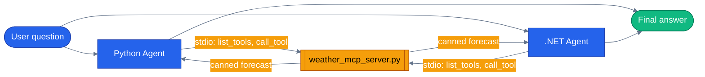

# Chapter 08 — MCP Tools

Start a small tool server that speaks MCP (Model Context Protocol, a standard way for an agent to discover and call tools it did not define itself), then call it from a Python agent and a .NET agent.

**You will learn to:**

- Write an MCP server that exposes a Python function as a tool
- Attach an MCP server to a MAF agent so the agent discovers the server's tools when it connects
- Call the same server from Python and from .NET with no adapter code

## Why this chapter

MCP is the tool-level equivalent of USB. One server exposes capabilities that any MCP-speaking client can use, whichever agent framework the client was written in. You implement a tool once, and MAF, LangChain, Claude Desktop or Cursor can all call it the same way.

This chapter starts a small Python MCP server with a single `get_weather` tool, then calls it from a Python MAF agent and a .NET MAF agent: one server, two clients, one wire protocol. The example is small so the protocol mechanics stay visible. The capstone (the full application in this repo) uses the same pattern with two MCP servers that run as their own services.

## Prerequisites

- Completed [Chapter 07 — Observability](../07-observability-otel/)
- No API key needed: with none set, `main.py` replays recorded responses and prints one line saying so. To use a live model instead, put `OPENAI_API_KEY` (or the `AZURE_OPENAI_*` variables) in the repo-root `.env`
- `uv sync --project tutorials`, run once from the repo root. It installs the `mcp` package alongside `agent-framework-core`

## The concept

MCP defines a JSON-RPC protocol over a few transports: **stdio** (start a subprocess and talk over its stdin/stdout), **HTTP/SSE**, and **Streamable HTTP**. This chapter uses stdio, the simplest transport and the right choice for a tool that only the calling process needs. The client launches the server as a child process, performs the MCP handshake, and lists the tools the server exposes.

MAF hides the wire protocol behind a small client object per language:

- **Python**: `MCPStdioTool(name, command, args=[...])` is an async context manager. Entering it starts the subprocess and runs the handshake. Pass the object straight into `Agent(..., tools=[mcp])`.
- **.NET**: `McpClient.CreateAsync(StdioClientTransport)` connects, then `ListToolsAsync()` returns `McpClientTool[]`. Each one already implements `AITool`, so it goes straight into `.AsAIAgent(tools: ...)`.

Both discover tools at connection time. Your agent code never hard-codes the tool list. It asks the server what it can do.



The same server answers both clients. MCP does not care which language wrote the tool or which language calls it.

## Python

Run from the repo root. The shared `tutorials/` uv project covers every chapter, so one `uv sync` is enough:

```bash
uv sync --project tutorials
uv run --project tutorials python tutorials/08-mcp-tools/python/main.py
```

You should see:

```
No LLM key found - replaying the recorded fixture (set OPENAI_API_KEY or the AZURE_OPENAI_* variables for a live run).
Q: What's the weather in Paris?
A: The weather in Paris is sunny and 18°C.
```

The model's reply is replayed from a recording, but the MCP server is a real subprocess and the `get_weather` call really reaches it.

The server, [`python/weather_mcp_server.py`](./python/weather_mcp_server.py), is a dozen lines of `MCPServer`:

```python
from mcp.server.mcpserver import MCPServer

server = MCPServer("maf-v1-ch08-weather")


@server.tool()
def get_weather(city: str) -> str:
    """Look up the current weather for a city (canned data)."""
    canned = {
        "paris": "Sunny, 18°C.",
        "london": "Overcast, 12°C.",
        "tokyo": "Rain, 15°C.",
    }
    return canned.get(city.lower(), f"No weather data for {city}.")


if __name__ == "__main__":
    server.run()
```

The client, [`python/main.py`](./python/main.py), starts the server and hands it to the agent:

```python
def build_mcp_tool() -> MCPStdioTool:
    """Spawns the weather MCP server as a subprocess and exposes its tools to the agent."""
    return MCPStdioTool(
        name="weather-mcp",
        command=sys.executable,
        args=[SERVER_SCRIPT],
    )


async def run(question: str) -> str:
    async with build_mcp_tool() as mcp:
        agent = Agent(
            _default_client(),
            instructions=INSTRUCTIONS,
            name="mcp-agent",
            tools=[mcp],
        )
        response = await agent.run(question)
        return response.text
```

The `async with` block starts the subprocess, performs the MCP handshake, and lists the tools. When the block exits, the subprocess is terminated.

## .NET

`dotnet run` calls a live model, so it needs `OPENAI_API_KEY` (or the `AZURE_OPENAI_*` variables) in the repo-root `.env`. The commands below start at the repo root and change into the chapter's `dotnet` directory:

```bash
cd tutorials/08-mcp-tools/dotnet
dotnet run
```

Without a key, run `dotnet test tutorials/08-mcp-tools/dotnet/tests/McpTools.Tests.csproj` from the repo root instead.

[`dotnet/Program.cs`](./dotnet/Program.cs) reuses the same Python server over stdio, so there is no .NET-side MCP server to write:

```csharp
public static async Task<McpClient> BuildMcpClientAsync()
{
    var pythonBin = Environment.GetEnvironmentVariable("PYTHON_BIN")
                    ?? FirstExisting(
                        Path.Combine(FindRepoRoot(), "tutorials", ".venv", "bin", "python"),
                        Path.Combine(FindRepoRoot(), "agents", "python", ".venv", "bin", "python"))
                    ?? "python3";

    var transport = new StdioClientTransport(new StdioClientTransportOptions
    {
        Name = "weather-mcp",
        Command = pythonBin,
        Arguments = new[] { ServerScript },
    });

    return await McpClient.CreateAsync(transport);
}
```

`Run()` then lists tools and hands them to the agent directly, since `McpClientTool` already implements `AITool`:

```csharp
await using var mcpClient = await BuildMcpClientAsync();
var tools = (await mcpClient.ListToolsAsync()).Select(t => (AITool)t).ToArray();

var chatClient = BuildChatClient();
var agent = chatClient.AsAIAgent(
    instructions: Instructions,
    name: "mcp-agent",
    tools: tools);

var response = await agent.RunAsync(question);
```

`ServerScript` walks up from the running binary to find `tutorials/08-mcp-tools/python/weather_mcp_server.py`. `PYTHON_BIN` defaults to the tutorials virtual environment (`tutorials/.venv`, which `uv sync --project tutorials` creates) and falls back to `agents/python/.venv`. Set it yourself if your interpreter lives somewhere else.

## Side-by-side differences

| Aspect | Python | .NET |
|--------|--------|------|
| Package | `mcp` (server) + `agent_framework` (client) | `ModelContextProtocol` + `ModelContextProtocol.Core` |
| Client class | `MCPStdioTool` (async context manager) | `McpClient` + `StdioClientTransport` |
| Tool discovery | Implicit on entering `async with` | Explicit `ListToolsAsync()` call |
| Lifecycle | `async with build_mcp_tool() as mcp:` | `await using var mcpClient = ...` |
| Tool-to-agent handoff | `tools=[mcp]` (whole client object) | `tools: tools` (array of `AITool`, one per discovered tool) |

Both follow the same MCP spec, so either client works against a server written in either language. The .NET client here talks to the Python server with no adapter code.

## Gotchas

- **The .NET client fails with "No such file or directory", or the server exits at once.** The subprocess needs a Python interpreter that has `mcp` installed. The .NET side picks the interpreter from the `PYTHON_BIN` environment variable, which defaults to the tutorials virtual environment and not to whatever `python3` resolves to on your `PATH`. Run `uv sync --project tutorials` first, or set `PYTHON_BIN`.
- **A server subprocess is still running after your program or test ends.** MCP servers stay alive between calls. Always scope them with `async with` (Python) or `await using` (.NET) so a crash does not leave an orphan process.
- **Agent construction raises "Duplicate tool name".** MAF refuses two tools with the same name on one agent, which happens when a local tool and an MCP server's tool (or two MCP servers) share a name. The capstone hits this: `agents/python/product_discovery/agent.py` leaves its local `get_price_history` tool out when the MCP server is attached, because the server already exposes one.

## Tests

```bash
uv sync --project tutorials
uv run --project tutorials pytest tutorials/08-mcp-tools/python/tests -v
cd tutorials/08-mcp-tools/dotnet && dotnet test
```

The first two commands run from the repo root; the third changes into the chapter's `dotnet` directory. None of them needs a key.

The Python tests ([`python/tests/test_mcp.py`](./python/tests/test_mcp.py)) start the real MCP server subprocess and replay the model's side from a recorded fixture, so they prove the agent reaches the tool without credentials. They also call the tool function directly through `get_weather.fn`, which reaches the original function that `MCPServer` wraps. Tests marked `@pytest.mark.integration` call a live model and are skipped unless credentials are present in `.env`.

The .NET tests ([`dotnet/tests/McpToolsTests.cs`](./dotnet/tests/McpToolsTests.cs)) all call a live model. Each one checks for credentials first and, if there are none, prints `[skip]` and passes without doing anything.

## How this shows up in the capstone

In the capstone, two specialist agents can read product and inventory data through MCP servers instead of querying the database themselves, so the same tools are available to any other MCP client.

- `agents/python/packages/mcp-product/src/ecommerce_mcp_product/server.py` and `agents/python/packages/mcp-inventory/src/ecommerce_mcp_inventory/server.py` are `MCPServer` apps. They expose product search, details and pricing, and inventory and warehouse data, over **Streamable HTTP** instead of stdio, because they run as standalone services: `mcp-product` on port 9000 and `mcp-inventory` on port 9001 (the `mcp` profile in `docker-compose.yml`).
- `agents/python/product_discovery/agent.py:68` builds an `MCPStreamableHTTPTool` pointed at `settings.MCP_PRODUCT_SERVER_URL` when `settings.MCP_ENABLED` is true. It passes the tool into the agent's `tools` list next to locally defined tools such as `semantic_search` and `check_stock`. That is the pattern from this chapter's Python client, over HTTP instead of stdio. With `settings.MCP_AUTH_ENABLED`, the server also requires an OAuth 2.1 access token, which `shared/oauth/service_client.py` supplies.
- `agents/python/inventory_fulfillment/agent.py` makes the same choice between MCP and direct tools for the inventory domain.

## What's next

- Next chapter: [Chapter 09 — Workflow Executors and Edges](../09-workflow-executors-and-edges/)
- Full source: [`python/`](./python/) · [`dotnet/`](./dotnet/)
- [MAF docs — Hosted MCP Tools](https://learn.microsoft.com/en-us/agent-framework/agents/tools/hosted-mcp-tools/)

<!-- BEGIN GENERATED CHAPTER NAV -->
---

**Previous:** [Chapter 07 — Observability with OpenTelemetry](../07-observability-otel/) · [Series index](../README.md) · **Next:** [Chapter 09 — Workflow Executors and Edges](../09-workflow-executors-and-edges/)
<!-- END GENERATED CHAPTER NAV -->
