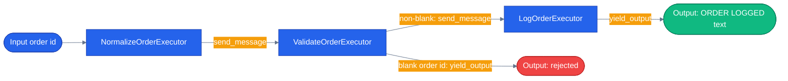

# Chapter 09 — Workflow Executors and Edges

Build the smallest useful MAF workflow: three executors (units of work) joined by two edges (message routes), where one step can end the run early.

**You will learn to:**

- Write an executor with a typed message handler
- Connect executors into a workflow with `WorkflowBuilder` and edges
- End a run early by yielding an output instead of sending a message on
- Read a workflow's outputs from its event stream

## Why this chapter

Chapters 01–08 treated each agent call as one request. Real e-commerce flows have *steps*: validate input → fetch reviews → check stock → write a recommendation. You could chain `agent.run()` calls by hand. Once you need parallel steps, a step that waits for several others, or a step that can stop the rest of the pipeline, hand-written `asyncio` code gets hard to reason about. The capstone (the full application in this repo) needs exactly that shape for its pre-purchase research: three lookups in parallel, a shipping estimate that depends on them, then a summary.

MAF's **Workflow** is a deterministic graph of **Executors** (units of work) connected by **Edges** (message routes). The scheduler runs in supersteps: every executor with a pending message runs, the messages they sent are delivered together, and then the next superstep starts. This chapter builds three executors, two edges and one early exit, so the mechanics are visible before Chapter 13 uses the same pieces to run agents in parallel.

## Prerequisites

- Completed [Chapter 08 — MCP Tools](../08-mcp-tools/)
- Python 3.12+ via `uv`; .NET SDK (9 or 10)
- No API key or environment variables needed. The executors only transform an order id and call no model

## The concept

| Piece | What it does |
|-------|--------------|
| **Executor** | A class with one or more typed message handlers (`@handler` in Python, `[MessageHandler]` in .NET). Receives a message, may send more messages downstream, may yield a workflow output. |
| **Edge** | Connects two executors. A plain edge forwards every message; a conditional edge only forwards when a predicate returns true. |
| **WorkflowBuilder** | Wires executors and edges into a `Workflow`. Declares the start executor. |
| **WorkflowContext** | Passed to each handler. `send_message(...)` forwards a value to the next executor along an outbound edge. `yield_output(...)` emits a workflow result; no downstream edge fires for the value you yield. |

The demo wires three executors in a line: `NormalizeOrder → ValidateOrder → LogOrder`. `ValidateOrder` can end the run early. An empty or whitespace-only order id yields an output at once, and `LogOrder` never runs.



`ValidateOrderExecutor` is the only branch point. A blank order id is rejected there; anything else flows through `LogOrderExecutor` to the success output.

## Python

Run from the repo root. The shared `tutorials/` uv project covers every chapter, so one `uv sync` is enough:

```bash
uv sync --project tutorials
uv run --project tutorials python tutorials/09-workflow-executors-and-edges/python/main.py "ord-8842"
uv run --project tutorials python tutorials/09-workflow-executors-and-edges/python/main.py ""   # empty -> early exit
```

You should see, for the first command and then the second:

```
input: 'ord-8842'
output: 'ORDER LOGGED: ORD-8842'
```

```
input: ''
output: '[rejected: empty order id]'
```

Source: [`python/main.py`](./python/main.py). The validating executor and the build function:

```python
class ValidateOrderExecutor(Executor):
    """Routes valid order ids downstream; short-circuits empty ids to a terminal output."""

    def __init__(self) -> None:
        super().__init__(id="validate-order")

    @handler
    async def run(self, order_id: str, ctx: WorkflowContext[str, str]) -> None:
        if not order_id:
            # Yield a workflow-terminating output; no downstream executor will run.
            await ctx.yield_output("[rejected: empty order id]")
            return
        await ctx.send_message(order_id)


def build_workflow():
    normalize = NormalizeOrderExecutor()
    validate = ValidateOrderExecutor()
    log = LogOrderExecutor()
    return (
        WorkflowBuilder(start_executor=normalize)
        .add_edge(normalize, validate)
        .add_edge(validate, log)
        .build()
    )
```

`run()` drives the workflow with `workflow.run(order_id, stream=True)` and collects every event whose `type` is `"output"`. Both results reach the caller that way: the normal `ORDER LOGGED: ...` and the early `[rejected: empty order id]`.

## .NET

No API key is needed. The commands start at the repo root and change into the chapter's `dotnet` directory:

```bash
cd tutorials/09-workflow-executors-and-edges/dotnet
dotnet run -- "ord-8842"
dotnet test
```

Source: [`dotnet/Program.cs`](./dotnet/Program.cs). `Microsoft.Agents.AI.Workflows.Generators` is a Roslyn source generator. It reads each `[MessageHandler]` method on a `partial` executor class and emits the protocol wiring (`ConfigureProtocol(...)`) at compile time.

```csharp
[SendsMessage(typeof(string))]
[YieldsOutput(typeof(string))]
internal sealed partial class ValidateOrderExecutor() : Executor("validate-order")
{
    [MessageHandler]
    public async ValueTask HandleAsync(
        string orderId,
        IWorkflowContext context,
        CancellationToken cancellationToken = default)
    {
        if (string.IsNullOrWhiteSpace(orderId))
        {
            await context.YieldOutputAsync("[rejected: empty order id]", cancellationToken);
            return;
        }

        await context.SendMessageAsync(orderId, cancellationToken);
    }
}
```

`WorkflowFactory.Build()` wires the three executors with `new WorkflowBuilder(normalize).AddEdge(normalize, validate).AddEdge(validate, log).WithOutputFrom(validate, log).Build()`. `WithOutputFrom` names *both* `validate` and `log` as output sources, because either can be the last to run depending on whether the run ends early. `WorkflowRunner.RunAsync` drives the workflow with `InProcessExecution.RunStreamingAsync(workflow, input)` and filters `WorkflowOutputEvent`s off the stream, as the Python `run()` helper does.

## Side-by-side differences

| Aspect | Python | .NET |
|--------|--------|------|
| Handler declaration | `@handler` decorator on a method | `[MessageHandler]` attribute on a `partial` class method |
| Message context | `WorkflowContext[InputT, OutputT]` | `IWorkflowContext` |
| Build pipeline | Pure Python — no extra step | Roslyn source generator runs during `dotnet build` (`Microsoft.Agents.AI.Workflows.Generators`) |
| Declaring outputs | Implicit — any `yield_output` call is an output | Explicit — `[YieldsOutput(typeof(T))]` on the class, plus naming sources in `WithOutputFrom(...)` |
| Streaming | `workflow.run(input, stream=True)` → async iterator of events | `InProcessExecution.RunStreamingAsync(workflow, input)` → `StreamingRun` with `WatchStreamAsync()` |

Python checks everything at run time, which is quicker to iterate on. .NET's source generator and explicit `[SendsMessage]`/`[YieldsOutput]` attributes cost some setup and give you compile-time verification of the message graph: the build fails if a handler tries to send a type it never declared.

## Gotchas

- **Python: the workflow has no entry point.** Pass `start_executor=` to `WorkflowBuilder`. Without it, `.build()` does not know where the input goes.
- **Python: an executor downstream of a `yield_output` call never runs.** `yield_output` emits a workflow-level output. The edges that normally follow that executor do not fire for the value you yielded; call `send_message` if the next executor should see it.
- **.NET: a compile error on an executor class.** The class must be `partial`. The source generator emits a second partial file with the protocol registration for your `[MessageHandler]` methods.
- **.NET: an output is missing from the stream.** `WithOutputFrom(...)` must list every executor that can yield. This demo lists both `validate-order` and `log-order` because the early exit ends at `validate-order`. Miss one and its output is dropped without an error.
- **You want to route on a condition without ending the run.** Python's `add_edge(...)` takes an optional `condition: (data) -> bool | Awaitable[bool]`. This chapter does not need it, because the early exit lives inside `ValidateOrderExecutor`. Parallel branches use a different mechanism, `add_fan_out_edges` / `add_fan_in_edges`, shown in the capstone section below.

## Tests

```bash
uv run --project tutorials pytest tutorials/09-workflow-executors-and-edges/python/tests -v
cd tutorials/09-workflow-executors-and-edges/dotnet && dotnet test
```

Run the first from the repo root; the second changes into the chapter's `dotnet` directory. Neither needs a key.

Both suites ([`python/tests/test_workflow.py`](./python/tests/test_workflow.py), [`dotnet/tests/WorkflowTests.cs`](./dotnet/tests/WorkflowTests.cs)) check the same behavior: the normal output text, the early exit for an empty or whitespace-only order id, and the executor and edge wiring. They also check the order of executor-invoked events, which proves `log` does not run on the early-exit path.

## How this shows up in the capstone

The capstone's pre-purchase research uses executors and edges to answer "should I buy this?": it looks up reviews, stock and price history at the same time, then writes one recommendation. The graph is wider than this chapter's chain. It fans out (sends one message to several executors at once) and fans in (waits for all of them before continuing).

`agents/python/workflows/pre_purchase.py` defines one `Executor` subclass per parallel data source: `_ReviewsExecutor`, `_StockExecutor` and `_PriceHistoryExecutor`. `_MergeAndShipExecutor` is the fan-in step and `_SynthesisExecutor` is the last node.

`PrePurchaseWorkflow._build_maf_workflow()`, in the same file, wires them with two edge helpers this chapter's demo does not need:

```python
return (
    WorkflowBuilder(start_executor=fan_out, name="pre-purchase")
    .add_fan_out_edges(fan_out, [reviews, stock, price])
    .add_fan_in_edges([reviews, stock, price], merge)
    .add_edge(merge, synthesis)
    .build()
)
```

`add_fan_out_edges` sends one message to three executors that run concurrently within a superstep. `add_fan_in_edges` waits: `_MergeAndShipExecutor.run(...)` does not fire until all three have sent their message, and it receives them as a `list[ResearchState]` instead of a single value. The vocabulary is the same as the Normalize → Validate → Log chain above, on a wider graph.

## What's next

- Next chapter: [Chapter 10 — Workflow Events and Builder](../10-workflow-events-and-builder/)
- Full source: [`python/`](./python/) · [`dotnet/`](./dotnet/)
- Shared: [Mermaid style guide](../_shared/mermaid-style-guide.md)

<!-- BEGIN GENERATED CHAPTER NAV -->
---

**Previous:** [Chapter 08 — MCP Tools](../08-mcp-tools/) · [Series index](../README.md) · **Next:** [Chapter 10 — Workflow Events and Builder](../10-workflow-events-and-builder/)
<!-- END GENERATED CHAPTER NAV -->
