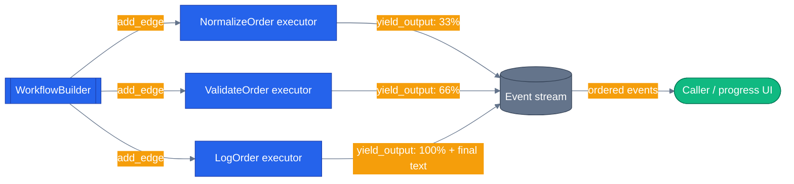

# Chapter 10 — Workflow Events and Builder

A workflow run streams two kinds of events: lifecycle events the framework emits on its own, and values your executors yield. This chapter builds a live progress indicator on that stream, in Python and .NET, and shows where the two APIs differ.

**You will learn to:**

- Stream a workflow run and read its events as they arrive
- Report progress from inside an executor while the run is still going
- Tell progress events apart from the final output, in Python and in .NET

## Why this chapter

A workflow that takes 30 seconds needs to tell the caller *what it is doing* for those 30 seconds, not only hand back an answer at the end. `Workflow.run(..., stream=True)` (Python) and `InProcessExecution.RunStreamingAsync(...)` (.NET) already emit lifecycle events for every executor invocation and every superstep (one round of the scheduler). You add your own progress payloads to the same ordered stream, and the caller can draw a progress bar instead of a spinner. The capstone (the full application in this repo) does this to show which step of a workflow is running while its `workflow:pre-purchase` mode looks up reviews, stock and price history in parallel.

The two SDKs agree on the idea and differ in the API. In Python, every executor calls `ctx.yield_output()`, and the builder decides at build time whether that executor's yields count as progress or as output. In .NET, you emit your own event subclass with a separate call. Know which one you are in before you copy a snippet from one language's docs into the other.

## Prerequisites

- Completed [Chapter 09 — Workflow Executors and Edges](../09-workflow-executors-and-edges/)
- No API key or environment variables needed. The executors only transform an order id and call no model

## The concept

Every workflow run streams a sequence of `WorkflowEvent`s (Python) or `WorkflowEvent` subclasses (.NET). Some are automatic: `ExecutorInvokedEvent`, `ExecutorCompletedEvent`, `SuperStepStartedEvent` and so on, one per executor per step, emitted whether you ask for them or not. Others are yours: values an executor produces mid-run that are not the workflow's final answer, but that a caller still wants to see as they happen.

This chapter extends the three-executor pipeline from Chapter 09 (`NormalizeOrder -> ValidateOrder -> LogOrder`) so each executor reports a `ProgressPayload(step, percent)` before it does its work. The last executor's output ("ORDER LOGGED: ...") travels on the same stream. You tell it from the progress payloads by its shape; there is no separate channel.



`WorkflowBuilder` assembles the executor graph. Each executor's `yield_output` calls land on the same ordered stream the caller iterates, interleaved with the framework's lifecycle events.

## Python

Run from the repo root. The shared `tutorials/` uv project covers every chapter, so one `uv sync` is enough:

```bash
uv sync --project tutorials
uv run --project tutorials python tutorials/10-workflow-events-and-builder/python/main.py
uv run --project tutorials pytest tutorials/10-workflow-events-and-builder/python/tests -v
```

You should see:

```
input: 'ord-8842'
  progress: normalize-order → 33%
  progress: validate-order → 66%
  progress: log-order → 100%
output: 'ORDER LOGGED: ORD-8842'
```

In [`python/main.py`](./python/main.py), every executor calls `ctx.yield_output(...)`, and `WorkflowBuilder` decides whether a given executor's yields surface as `type="output"` or `type="intermediate"`:

```python
def build_workflow():
    normalize = NormalizeOrderExecutor()
    validate = ValidateOrderExecutor()
    log = LogOrderExecutor()
    return (
        WorkflowBuilder(
            start_executor=normalize,
            intermediate_output_from=[normalize, validate],
            output_from=[log],
        )
        .add_edge(normalize, validate)
        .add_edge(validate, log)
        .build()
    )
```

`NormalizeOrderExecutor` and `ValidateOrderExecutor` are listed under `intermediate_output_from`, so every `yield_output()` call they make surfaces as `type="intermediate"`. That is the progress channel. `LogOrderExecutor` is listed under `output_from`, so its yields surface as `type="output"`, the pipeline's result.

The label is fixed per executor at build time, not chosen per call. That is why `ValidateOrderExecutor`'s early-exit `yield_output("[rejected: empty order id]")` still arrives as `type="intermediate"`, although it is the last message of that run. The consumer therefore tells progress from results by payload shape (`isinstance(data, ProgressPayload)`), not by the event's type label:

```python
async for event in workflow.run(text, stream=True):
    etype = getattr(event, "type", None)
    if etype not in ("output", "intermediate"):
        continue
    data = getattr(event, "data", None)
    if isinstance(data, ProgressPayload):
        progress.append(data)
    else:
        outputs.append(data)
```

Older MAF examples emit progress with `ctx.add_event(WorkflowEvent.emit(...))`. In the pinned SDK (`agent-framework-core==1.26.0`, set in `tutorials/pyproject.toml`) that path is deprecated. `WorkflowEvent.emit()` raises a `DeprecationWarning`, and `ctx.add_event()` refuses an `output` or `intermediate` event that an executor tries to emit directly.

## .NET

No API key is needed. The commands start at the repo root and change into the chapter's `dotnet` directory:

```bash
cd tutorials/10-workflow-events-and-builder/dotnet
dotnet run
dotnet test
```

In .NET you define your own event subclass. `ProgressEvent` subclasses `WorkflowEvent`, and executors emit it with `context.AddEventAsync(...)`. That is a separate call from `YieldOutputAsync`. In Python, progress and output both go through `yield_output`, and only the build-time lists tell them apart.

```csharp
internal sealed class ProgressEvent(string step, int percent)
    : WorkflowEvent(new ProgressPayload(step, percent))
{
    public string Step => ((ProgressPayload)Data!).Step;
    public int Percent => ((ProgressPayload)Data!).Percent;
}

[MessageHandler]
public async ValueTask HandleAsync(string orderId, IWorkflowContext context, CancellationToken ct = default)
{
    await context.AddEventAsync(new ProgressEvent("normalize-order", 33), ct);
    await context.SendMessageAsync(orderId.Trim().ToUpperInvariant(), ct);
}
```

The consumer pattern-matches on the concrete event type as it streams:

```csharp
await foreach (WorkflowEvent evt in run.WatchStreamAsync())
{
    switch (evt)
    {
        case ProgressEvent p: Console.WriteLine($"  [progress] {p.Step,-14} -> {p.Percent,3}%"); break;
        case ExecutorInvokedEvent i: Console.WriteLine($"[lifecycle] executor_invoked {i.ExecutorId}"); break;
        case WorkflowOutputEvent o: Console.WriteLine($"  [output]   {o.Data}"); break;
    }
}
```

`WorkflowFactory.Build()` uses `.WithOutputFrom(validate, log)`. Either executor can produce the final workflow output: `ValidateOrderExecutor` ends the run early on an empty order id, and `LogOrderExecutor` is the normal last step.

## Side-by-side differences

| Aspect | Python | .NET |
|--------|--------|------|
| Progress channel | `ctx.yield_output(payload)` from an executor listed under `intermediate_output_from` | `context.AddEventAsync(new ProgressEvent(...))` — a distinct call from `YieldOutputAsync` |
| Final output | `ctx.yield_output(payload)` from an executor listed under `output_from` | `context.YieldOutputAsync(payload)` |
| Telling progress from output | By payload shape (`isinstance(data, ProgressPayload)`) — both share `type="intermediate"`/`"output"` labels set at build time per executor | By event type via `switch` pattern-matching (`ProgressEvent` vs. `WorkflowOutputEvent`) |
| Old "emit anything" API | `WorkflowEvent.emit()` / `ctx.add_event()` with an arbitrary payload — **deprecated**, warns at runtime | `AddEventAsync` with a custom `WorkflowEvent` subclass — still the standard pattern |
| Stream API | `workflow.run(input, stream=True)` | `InProcessExecution.RunStreamingAsync(workflow, input)` + `run.WatchStreamAsync()` |

## Gotchas

- **A `DeprecationWarning`, or progress events that never arrive (Python).** You copied the `add_event()` pattern from an older example. `WorkflowEvent.emit()` is deprecated, and `ctx.add_event()` drops any `output` or `intermediate` event an executor emits directly and logs a warning. Use `ctx.yield_output()` with `intermediate_output_from` / `output_from`.
- **One executor cannot emit both progress and final output (Python).** Every `yield_output()` call from an executor carries the same label, set by the list (`output_from` or `intermediate_output_from`) the executor was passed to when the `WorkflowBuilder` was constructed. `ValidateOrderExecutor`'s early exit in `python/main.py` shows the effect: `"[rejected: empty order id]"` arrives as `type="intermediate"`.
- **A result is mistaken for progress, or the reverse (Python).** Filter by payload shape, not by type label alone. A `ProgressPayload` and a plain-string result can both carry `type="intermediate"`, so `isinstance()` on the payload is the reliable test.
- **The progress bar stops short of 100%.** A branch that ends early drops downstream progress. If `ValidateOrderExecutor` yields its early output and returns without calling `send_message`, `LogOrderExecutor` never runs and its 100% event never fires. Both test suites cover this case.

## Tests

```bash
uv run --project tutorials pytest tutorials/10-workflow-events-and-builder/python/tests -v
cd tutorials/10-workflow-events-and-builder/dotnet && dotnet test
```

Run the first from the repo root; the second changes into the chapter's `dotnet` directory. Neither needs a key.

Both suites (`tutorials/10-workflow-events-and-builder/python/tests/test_events.py` and `tutorials/10-workflow-events-and-builder/dotnet/tests/EventsTests.cs`) check that progress events arrive in pipeline order with the expected percentages and carry a structured `ProgressPayload`. They also check that the final output arrives after the last progress event, that an empty order id stops at `validate-order`, and that events stream one by one instead of in a batch. The .NET suite also asserts that lifecycle events and custom events interleave in arrival order.

## How this shows up in the capstone

In the capstone, a normalized event stream is what lets the chat page show which step of a workflow is running, and light up the nodes of its diagram, while the answer is still being produced.

- `agents/python/orchestrator/events.py` defines `OrchestrationEvent`, one event shape (`kind`, `node_id`, `agent`, `payload`, `ts_ms`) for workflow events, agent-run events and tool-call steps. The web UI consumes that single protocol.
- `_build_maf_workflow()` in `agents/python/workflows/pre_purchase.py` is a `WorkflowBuilder` graph that fans out and back in. `add_fan_out_edges(fan_out, [reviews, stock, price])` runs the reviews, stock and price-history executors concurrently, then `add_fan_in_edges([reviews, stock, price], merge)` joins them before `synthesis`.
- `execute()` (`agents/python/workflows/pre_purchase.py`) streams that workflow with `workflow.run(state, stream=True)` and filters on `event.type == "output"`. This chapter's `run_with_events()` uses the same loop, with a progress/output split where the capstone has a single `ResearchState` output.

## What's next

- Next chapter: [Chapter 11 — Agents in Workflows](../11-agents-in-workflows/)
- Full source: [`python/`](./python/) · [`dotnet/`](./dotnet/)
- Shared: [Mermaid style guide](../_shared/mermaid-style-guide.md) · [Jargon glossary](../_shared/jargon-glossary.md)

<!-- BEGIN GENERATED CHAPTER NAV -->
---

**Previous:** [Chapter 09 — Workflow Executors and Edges](../09-workflow-executors-and-edges/) · [Series index](../README.md) · **Next:** [Chapter 11 — Agents in Workflows](../11-agents-in-workflows/)
<!-- END GENERATED CHAPTER NAV -->
