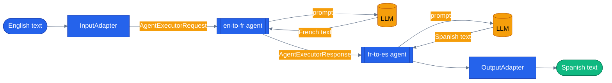

# Chapter 11 — Agents in Workflows

Put an agent inside a workflow as one of its steps, so a single graph can mix plain code with model calls.

**You will learn to:**

- Wrap an agent as a workflow executor (a unit of work in the graph)
- Adapt the workflow's plain input and output to the request and response types agent steps exchange
- Chain two agents so the first one's reply becomes the second one's input

## Why this chapter

Chapters 09–10 built executors that transform plain data: strings in, strings out, no model involved. This chapter replaces an executor with an **agent**, a step that takes a message, calls an LLM, and produces another message. The result is a workflow that mixes deterministic steps (validation, enrichment, merging) with LLM steps (translation, summarization, judgment). The graph does not care which is which.

The example is **English → French → Spanish** translation, kept small so the wiring stays visible. Each arrow is one LLM call. The workflow only passes the previous agent's output to the next agent, with no glue code in between.

The capstone (the full application in this repo) uses the same shape: an agent is one node in a larger pipeline, and whatever comes next consumes its output.

## Prerequisites

- Completed [Chapter 10 — Workflow Events and Builder](../10-workflow-events-and-builder/)
- No API key needed: with none set, `main.py` replays recorded responses and prints one line saying so. To use a live model instead, put `OPENAI_API_KEY` (or the `AZURE_OPENAI_*` variables) in the repo-root `.env`

## The concept

An **agent-executor** is a workflow node whose handler does not transform data itself. It hands the incoming message to an `Agent`, awaits the LLM call, and forwards the agent's response downstream. There are two ways to build one:

- **Adapters you write yourself.** Python's `main.py` and .NET's `--manual` mode do this. An `InputAdapter` turns the workflow's raw input into the shape the agent step expects. The agent step calls the LLM. An `OutputAdapter` unwraps the agent's response into a plain value the workflow can yield. It is more code, and it is what you need when a workflow mixes agents with non-agent steps.
- **A convenience builder.** .NET's default `--sequential` mode uses `AgentWorkflowBuilder.BuildSequential`. When every step is an agent and they run one after another, the framework wires the adapters for you: one call instead of four classes.

Either way, agent steps pass structured request and response types between themselves. In Python these are `AgentExecutorRequest` and `AgentExecutorResponse` when you use the framework's `AgentExecutor`; with hand-written agent steps they are your own types. You adapt at the workflow's edges so its public input and output stay plain types that are easy to test.



Two LLM calls happen inside this graph. The French translator's output becomes the Spanish translator's input, and no application code touches the string in between.

## Python

Run from the repo root. The shared `tutorials/` uv project covers every chapter, so one `uv sync` is enough:

```bash
uv sync --project tutorials
uv run --project tutorials python tutorials/11-agents-in-workflows/python/main.py
uv run --project tutorials pytest tutorials/11-agents-in-workflows/python/tests -v
```

You should see:

```
No LLM key found - replaying the recorded fixture (set OPENAI_API_KEY or the AZURE_OPENAI_* variables for a live run).
English input: Hello, how are you?
Spanish output: Hola, ¿cómo estás?
```

`tutorials/11-agents-in-workflows/python/main.py` uses the framework's built-in `AgentExecutor` to wrap each translator, plus two hand-written adapters at the boundaries:

```python
class InputAdapter(Executor):
    """Converts the workflow input (a plain string) into an AgentExecutorRequest."""

    def __init__(self) -> None:
        super().__init__(id="input-adapter")

    @handler
    async def run(self, message: str, ctx: WorkflowContext[AgentExecutorRequest]) -> None:
        await ctx.send_message(
            AgentExecutorRequest(
                messages=[Message(role="user", contents=[message])],
                should_respond=True,
            )
        )


def build_workflow():
    input_adapter = InputAdapter()
    english_to_french = AgentExecutor(translator("French", name="en-to-fr"), id="en-to-fr")
    french_to_spanish = AgentExecutor(translator("Spanish", name="fr-to-es"), id="fr-to-es")
    output_adapter = OutputAdapter()

    return (
        WorkflowBuilder(start_executor=input_adapter)
        .add_edge(input_adapter, english_to_french)
        .add_edge(english_to_french, french_to_spanish)
        .add_edge(french_to_spanish, output_adapter)
        .build()
    )
```

`OutputAdapter` is the mirror image. It unwraps the final `AgentExecutorResponse` and yields `response.agent_response.text` as the workflow's plain-string output.

## .NET

`dotnet run` calls a live model in both modes, so it needs `OPENAI_API_KEY` (or the `AZURE_OPENAI_*` variables) in the repo-root `.env`. Without a key, run `dotnet test tutorials/11-agents-in-workflows/dotnet/tests/AgentsInWorkflows.Tests.csproj` from the repo root. The commands below start at the repo root and change into the chapter's `dotnet` directory:

```bash
cd tutorials/11-agents-in-workflows/dotnet
dotnet build
dotnet run -- --sequential "Hello, how are you?"   # convenience builder
dotnet run -- --manual     "Hello, how are you?"   # manual adapter pattern
dotnet test
```

`tutorials/11-agents-in-workflows/dotnet/Program.cs` shows both patterns. The convenience path (`SequentialAgentWorkflow`, the `--sequential` default) hands two `AIAgent`s straight to `AgentWorkflowBuilder.BuildSequential`:

```csharp
AIAgent enToFr = Program.TranslationAgent(chatClient, "French", id: "en-to-fr");
AIAgent frToEs = Program.TranslationAgent(chatClient, "Spanish", id: "fr-to-es");

// The whole chain, wrapped and wired in one call. BuildSequential
// inserts the input/output adapters internally so the workflow
// takes a List<ChatMessage> in and surfaces a List<ChatMessage> out.
Workflow workflow = AgentWorkflowBuilder.BuildSequential(enToFr, frToEs);

var messages = new List<ChatMessage> { new(ChatRole.User, input) };
await using StreamingRun run = await InProcessExecution.RunStreamingAsync(workflow, messages);

// TurnToken triggers the wrapped agents: AgentExecutor caches
// inbound messages and only calls the LLM once a TurnToken arrives.
await run.TrySendMessageAsync(new TurnToken(emitEvents: true));
```

The `--manual` path (`ManualAdapterWorkflow`) builds the graph from custom `[MessageHandler]` executors: `InputAdapter`, two `TranslationAgentExecutor`s and `OutputAdapter`. It wires them with the same `WorkflowBuilder.AddEdge` calls Chapters 09–10 used. Read it to see what `BuildSequential` does for you; it is also the pattern to use once a graph mixes agents with non-agent steps.

## Side-by-side differences

| Aspect | Python | .NET |
|--------|--------|------|
| Wrapping an agent | Manual: `AgentExecutor(agent, id="...")` inside `WorkflowBuilder` | Convenience: `AgentWorkflowBuilder.BuildSequential(agents)`, or manual `[MessageHandler]` executors for custom graphs |
| Input/output adapters | Always explicit — you write `InputAdapter`/`OutputAdapter` | Handled internally by `BuildSequential`; explicit only in the `--manual` mode |
| Trigger to run the LLM | `should_respond=True` on `AgentExecutorRequest` | `TurnToken` sent into the running workflow |
| Request/response types | `AgentExecutorRequest` / `AgentExecutorResponse` | `List<ChatMessage>` in, `AgentResponseUpdate` events out (convenience path) |

Python's explicit adapters are more code and make the data shape obvious in tests. .NET's convenience builder is quicker to write, and its manual mode has the same shape as Python's.

## Gotchas

- **A runtime failure when a message reaches an agent-executor.** The framework's `AgentExecutor` exchanges `AgentExecutorRequest` and `AgentExecutorResponse`. Sending it a raw string (skipping `InputAdapter`) fails when the workflow runs, not when it is built.
- **An agent step runs but produces nothing (Python).** Check `should_respond=True` on the `AgentExecutorRequest`. When it is `False`, the wrapped agent adds the message to its history and does not call the LLM. That is useful for seeding context in a multi-turn workflow, and easy to leave set by mistake.
- **The .NET workflow starts and then sits there.** `BuildSequential` wires the graph, but nothing calls the LLM until you send a `TurnToken` into the running `StreamingRun`.

## Tests

```bash
uv run --project tutorials pytest tutorials/11-agents-in-workflows/python/tests -v
cd tutorials/11-agents-in-workflows/dotnet && dotnet test
```

Run the first from the repo root; the second changes into the chapter's `dotnet` directory. Neither needs a key.

The Python tests check that the built graph contains all four executors, then run the whole chain against responses recorded from a real model (`python/tests/fixtures/replay/`, replayed with `LLM_PROVIDER=replay`), which proves the French output reaches the Spanish translator. The .NET tests do the same with a scripted fake `IChatClient` and also assert that both agent-executors fire in order. On both sides, the tests that call a live model are skipped without credentials.

## How this shows up in the capstone

In the capstone, the Group Chat orchestration mode runs agents as steps of a workflow: two panelists take turns over a shared transcript to debate a purchase, then a moderator writes a verdict.

`_make_agent_responder()` in `agents/python/orchestrator/modes/group_chat_mode.py` constructs a MAF `Agent` per panelist and calls `agent.run(prompt)` inside an `async` closure. That closure is passed as the `Responder` to `_PanelistExecutor` in `agents/python/workflows/group_chat.py`, which awaits the result when it is awaitable (in its `run()` handler).

This is the write-your-own-adapter shape from this chapter. The adapter is a plain async closure instead of an `Executor` subclass, which keeps `group_chat.py` free of any LLM dependency: only `orchestrator/modes/group_chat_mode.py` knows about `Agent`. In the running application you reach this workflow with `mode=group-chat` on `/api/chat`.

## What's next

- Next chapter: [Chapter 12 — Sequential Orchestration](../12-sequential-orchestration/)
- Full source: [`python/`](./python/) · [`dotnet/`](./dotnet/)
- Shared: [Mermaid style guide](../_shared/mermaid-style-guide.md)
- [MAF docs — Agents in Workflows](https://learn.microsoft.com/en-us/agent-framework/workflows/agents-in-workflows/)

<!-- BEGIN GENERATED CHAPTER NAV -->
---

**Previous:** [Chapter 10 — Workflow Events and Builder](../10-workflow-events-and-builder/) · [Series index](../README.md) · **Next:** [Chapter 12 — Sequential Orchestration](../12-sequential-orchestration/)
<!-- END GENERATED CHAPTER NAV -->
