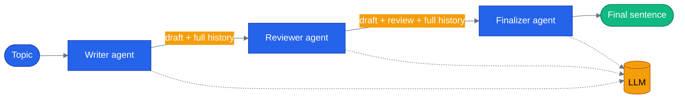

# Chapter 12 — Sequential Orchestration

Chain agents into an assembly line. `SequentialBuilder` (Python) or `AgentWorkflowBuilder.BuildSequential` (.NET) turns a list of agents into a pipeline where each one sees the whole conversation so far and adds its own turn.

**You will learn to:**

- Build a pipeline of agents from an ordered list, with no hand-written adapters
- Read each agent's turn back out of the workflow's event stream
- Run the .NET version so that it calls the model, which takes three steps that are easy to miss

## Why this chapter

In Chapter 11 you wrapped agents as workflow executors and wrote the input and output adapters yourself. Sequential orchestration does that for a chain of any length. The example here is **Writer → Reviewer → Finalizer**.

What sets it apart from chaining calls by hand: **the builder forwards the whole shared conversation automatically**. The Reviewer sees the Writer's draft and the Finalizer sees both, and neither agent's code does anything to receive it.

The capstone (the full application in this repo) uses a sequential pipeline for returns: eligibility check → approval gate → return initiation → replacement search → discount → finalize.

## Prerequisites

- Completed [Chapter 11 — Agents in Workflows](../11-agents-in-workflows/)
- For a live run, a repo-root `.env` with one LLM provider configured:

| Provider | Required | Optional |
|----------|----------|----------|
| **OpenAI** | `OPENAI_API_KEY` | `LLM_MODEL` (default `gpt-4.1`) |
| **Azure OpenAI** | `AZURE_OPENAI_ENDPOINT`, `AZURE_OPENAI_KEY`, `AZURE_OPENAI_DEPLOYMENT` | `AZURE_OPENAI_API_VERSION` (default `2024-10-21`) |

- **Key:** `main.py`'s default prompt has no recorded fixture, so running it needs a key (live run). Without one, the chapter's tests replay their own recorded prompt: `uv run --project tutorials pytest tutorials/12-sequential-orchestration/python/tests -m "not integration"`.

## The concept

Hand the builder an ordered list of agents. It returns a `Workflow` in which participant 1 runs against the input message, participant 2 runs against the input plus participant 1's response, participant 3 runs against all of that, and so on. Each participant is an ordinary MAF agent, built with `Agent(...)` or `AsAIAgent(...)` as in every earlier chapter. The builder is what turns the list into a pipeline with a shared conversation.



Each run makes three LLM calls. The Reviewer's prompt contains the Writer's output as earlier conversation turns, and the Finalizer's prompt contains both. `SequentialBuilder` / `BuildSequential` does that forwarding; you never touch a message queue or an adapter.

## Python

Source: [`python/main.py`](./python/main.py). Run from the repo root. `main.py` needs a key, because its default prompt has no recorded responses. If you have no key, run the tests first; they replay a recorded prompt:

```bash
uv sync --project tutorials
uv run --project tutorials pytest tutorials/12-sequential-orchestration/python/tests -m "not integration"
```

With a key in the repo-root `.env`:

```bash
uv run --project tutorials python tutorials/12-sequential-orchestration/python/main.py
```

It prints the topic, then one paragraph each from the Writer, the Reviewer and the Finalizer.

The three participants and the pipeline itself:

```python
def writer() -> Agent:
    return Agent(
        _default_client(),
        instructions=("You are a Writer. Draft a 2-sentence paragraph on the topic the user provides. Keep it short."),
        name="writer",
    )


def reviewer() -> Agent:
    return Agent(
        _default_client(),
        instructions=(
            "You are a Reviewer. Read the draft above and produce a single-sentence review "
            "pointing out one strength and one weakness. Do not rewrite the draft."
        ),
        name="reviewer",
    )


def build_workflow():
    return SequentialBuilder(participants=[writer(), reviewer(), finalizer()]).build()
```

Reading the results back takes some care. Each agent's turn arrives inside an `executor_completed` event whose `data` is a list of `AgentExecutorResponse` objects. There is no dedicated "data" event type:

```python
async for event in _workflow_events(workflow, topic):
    if getattr(event, "type", None) != "executor_completed":
        continue
    payload = getattr(event, "data", None)
    if not isinstance(payload, list):
        continue
    for item in payload:
        agent_resp = getattr(item, "agent_response", None)
        eid = getattr(item, "executor_id", "")
        text = getattr(agent_resp, "text", None)
        if text and eid:
            per_agent[eid] = text
```

## .NET

Source: [`dotnet/Program.cs`](./dotnet/Program.cs). `dotnet run` calls a live model, so it needs a key in the repo-root `.env`; `Program.cs` loads that file itself. Without a key, run `dotnet test tutorials/12-sequential-orchestration/dotnet/tests/Sequential.Tests.csproj` from the repo root. The commands below start at the repo root and change into the chapter's `dotnet` directory:

```bash
cd tutorials/12-sequential-orchestration/dotnet
dotnet run
```

```csharp
public static Workflow BuildWorkflow(IChatClient chatClient)
{
    AIAgent writer = chatClient.AsAIAgent(instructions: WriterInstructions, name: "writer");
    AIAgent reviewer = chatClient.AsAIAgent(instructions: ReviewerInstructions, name: "reviewer");
    AIAgent finalizer = chatClient.AsAIAgent(instructions: FinalizerInstructions, name: "finalizer");

    return AgentWorkflowBuilder.BuildSequential(new[] { writer, reviewer, finalizer });
}
```

Running the workflow is easy to get wrong, and the wrong version does not fail. It exits 0 without calling a model. Three things must all be true:

```csharp
// 1. The input type is List<ChatMessage>, not a topic string.
var messages = new List<ChatMessage> { new(ChatRole.User, topic) };

await using StreamingRun run = await InProcessExecution.RunStreamingAsync(workflow, messages);

// 2. The wrapped agents are lazy — without a TurnToken they cache their input
//    and never call the model.
await run.TrySendMessageAsync(new TurnToken(emitEvents: true));

// 3. BuildSequential emits AgentResponseUpdateEvent, never AgentResponseEvent.
//    The terminal WorkflowOutputEvent carries the whole conversation with
//    AuthorName set per agent, which is the reliable place to read turns from.
await foreach (WorkflowEvent evt in run.WatchStreamAsync())
{
    if (evt is WorkflowOutputEvent { Data: List<ChatMessage> conversation })
    {
        foreach (ChatMessage m in conversation.Where(m => m.Role == ChatRole.Assistant))
        {
            Console.WriteLine($"{m.AuthorName,-9}: {m.Text}");
        }
    }
}
```

## Side-by-side differences

| Aspect | Python | .NET |
|--------|--------|------|
| Builder | `SequentialBuilder(participants=[...]).build()` | `AgentWorkflowBuilder.BuildSequential(new[]{...})` |
| Run call | `workflow.run(topic, stream=True)` | `InProcessExecution.RunStreamingAsync(workflow, messages)` + `run.TrySendMessageAsync(new TurnToken(...))` |
| Per-agent output | `executor_completed` event, `data: list[AgentExecutorResponse]` | Terminal `WorkflowOutputEvent` carrying `List<ChatMessage>`, each tagged with `AuthorName`. `AgentResponseEvent` is *not* emitted on this path — matching on it compiles and yields nothing. |
| Checkpointing | `SequentialBuilder(..., checkpoint_storage=...)` constructor arg | Configure a checkpoint store when building the workflow (see MAF docs) |

## Gotchas

- **Your event filter matches nothing.** Neither runtime has a dedicated per-agent event. Python delivers each turn inside `executor_completed`'s `data` field as a `list[AgentExecutorResponse]`, so filtering on `event.type == "data"` finds nothing. .NET emits `AgentResponseUpdateEvent` while streaming and never `AgentResponseEvent`, so matching on the latter compiles, runs and prints nothing. On both sides, read the final conversation.
- **The .NET run finishes instantly with no output.** The wrapped agents do not start without a `TurnToken`. `AgentExecutor` caches its input and waits, and a run without the token completes normally having made no LLM call. It looks like a fast success.
- **A later agent redoes an earlier agent's job.** Every downstream agent sees the whole prior conversation, so each system prompt must say what *not* to do: "do not rewrite the draft" on the Reviewer, "output ONLY the final sentence" on the Finalizer.
- **A crashed pipeline cannot be resumed.** A sequential workflow saves no checkpoints (snapshots of workflow state you can resume from) by default. Pass `checkpoint_storage=` to the `SequentialBuilder(...)` constructor, not to `.run()`. This chapter's demo does not configure one.

## Tests

```bash
uv run --project tutorials pytest tutorials/12-sequential-orchestration/python/tests -v
cd tutorials/12-sequential-orchestration/dotnet && dotnet test tests/Sequential.Tests.csproj
```

Run the first from the repo root; the second changes into the chapter's `dotnet` directory. Neither needs a key or the network.

The Python tests (`python/tests/test_sequential.py`) check that the builder assembles a workflow, then replay a recorded run with `LLM_PROVIDER=replay` and check that all three agents respond. Tests marked `@pytest.mark.integration` call a live model and are skipped when `.env` has no credentials.

The .NET tests ([`dotnet/tests/SequentialTests.cs`](./dotnet/tests/SequentialTests.cs)) use a scripted `IChatClient`. Two of them assert things the source cannot show you. One checks that each agent's prompt contains its predecessors' output, which is the point of sequential orchestration and happens inside `BuildSequential`. The other checks that the three calls do **not** overlap in time; Chapter 13 makes the same assertion and expects the opposite answer.

## How this shows up in the capstone

In the capstone, a sequential workflow handles "return this order and find me a replacement": it checks eligibility, gets approval if the policy asks for it, starts the return, and suggests a replacement with a discount. It is one of the application's selectable orchestration modes, `workflow:return-replace`, and both stacks have it: `ReturnReplaceMode` at `agents/python/orchestrator/modes/workflow_mode.py:213` and `agents/dotnet/src/ECommerceAgents.Orchestrator/Modes/ReturnReplaceMode.cs`.

To watch it handle a real request, pick "Return & Replace (sequential + in-workflow HITL)" from the Mode dropdown above the chat box in the running application.

The Python class wraps the workflow in `workflows/return_replace.py`:

```python
class ReturnReplaceMode:
    name = "workflow:return-replace"
    label = "Return & Replace (sequential + in-workflow HITL)"
    description = (
        "MAF sequential workflow: eligibility check, then a policy gate that decides "
        "whether a person must approve (ctx.request_info — structurally different from "
        "the middleware-based approval flow `tool` mode uses; see shared/hitl.py vs this "
        "workflow's policy-gate executor), and only then return initiation, replacement "
        "search, loyalty discount and finalize."
    )
```

The pipeline has six steps: eligibility check → policy gate → return initiation → replacement search → loyalty discount → finalize. The policy gate is a human-in-the-loop (HITL) step: when the approval policy requires a person, the run pauses there until someone approves or rejects it. The paused run is saved as a checkpoint, so `POST /api/orchestration/{run_id}/resume` can continue it later (see `ReturnReplaceMode.resume()` in the same file).

Unlike this chapter's demo, the steps are code that calls tools, not agents, so the workflow is wired with `WorkflowBuilder.add_edge` from Chapter 09 instead of `SequentialBuilder`. The shape is the same: a fixed order, each step building on the one before.

## What's next

- Next chapter: [Chapter 13 — Concurrent Orchestration](../13-concurrent-orchestration/)
- Full source: [`python/`](./python/) · [`dotnet/`](./dotnet/)
- Shared: [Mermaid style guide](../_shared/mermaid-style-guide.md) · [Jargon glossary](../_shared/jargon-glossary.md)
- [MAF docs — Sequential Orchestration](https://learn.microsoft.com/en-us/agent-framework/workflows/orchestrations/sequential/)

<!-- BEGIN GENERATED CHAPTER NAV -->
---

**Previous:** [Chapter 11 — Agents in Workflows](../11-agents-in-workflows/) · [Series index](../README.md) · **Next:** [Chapter 13 — Concurrent Orchestration](../13-concurrent-orchestration/)
<!-- END GENERATED CHAPTER NAV -->
