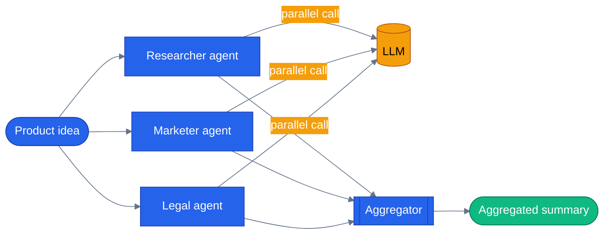

# Chapter 13 — Concurrent Orchestration

Send one input to several agents at the same time, collect every answer, and optionally reduce the answers to a single result.

**You will learn to:**

- Run a fixed set of agents in parallel on the same input with `ConcurrentBuilder` (Python) or `BuildConcurrent` (.NET)
- Collect each agent's response from the event stream
- Combine the responses with an aggregator function

## Why this chapter

If Sequential (Chapter 12) is an assembly line, Concurrent is a panel. One input goes to N independent agents at once, you collect N perspectives, and an aggregator can reduce them to one output. Use it when the agents do not depend on each other's output and you want the total time to be that of the slowest branch, not the sum of all of them.

The example is a product-idea review. A Researcher checks market fit, a Marketer proposes a positioning angle, and Legal flags one regulatory concern. All three run at once.

The capstone (the full application in this repo) runs the same fan-out and fan-in to research a product before purchase. See [How this shows up in the capstone](#how-this-shows-up-in-the-capstone).

## Prerequisites

- Completed [Chapter 12 — Sequential Orchestration](../12-sequential-orchestration/)
- For a live run, a repo-root `.env` with one LLM provider configured:

| Provider | Required | Optional |
|----------|----------|----------|
| **OpenAI** | `OPENAI_API_KEY` | `LLM_MODEL` (default `gpt-4.1`) |
| **Azure OpenAI** | `AZURE_OPENAI_ENDPOINT`, `AZURE_OPENAI_KEY`, `AZURE_OPENAI_DEPLOYMENT` | `AZURE_OPENAI_API_VERSION` (default `2024-10-21`) |

- **Key:** `main.py`'s default prompt has no recorded fixture, so running it needs a key (live run). Without one, the chapter's tests replay their own recorded prompt: `uv run --project tutorials pytest tutorials/13-concurrent-orchestration/python/tests -m "not integration"`.

## The concept

Concurrent orchestration fans one input out to a fixed set of participants (sends it to all of them at once), runs them in parallel, and fans the results back in (waits for all of them). The branches do not coordinate while they run. Each agent sees only the original input, not its siblings' output, so the pattern fits only problems where each branch is independent. If branch B needs branch A's answer, use Sequential or a custom graph.

The two SDKs differ on the fan-in side. Python's `ConcurrentBuilder` collects every participant's response into a list, and reduces it to one value only if you attach `.with_aggregator(fn)`. .NET's `AgentWorkflowBuilder.BuildConcurrent` takes the aggregator as an argument up front. In this chapter's .NET demo the aggregator concatenates strings and makes no LLM call, so the total time still tracks the slowest of the three branches.



The three branches call the same LLM concurrently. The aggregator runs only once all three have returned, so total latency tracks `max(researcher, marketer, legal)`, not their sum.

## Python

Source: [`python/main.py`](./python/main.py). Run from the repo root. `main.py` needs a key, because its default prompt has no recorded responses. If you have no key, run the tests first; they replay a recorded prompt:

```bash
uv sync --project tutorials
uv run --project tutorials pytest tutorials/13-concurrent-orchestration/python/tests -m "not integration"
```

With a key in the repo-root `.env`:

```bash
uv run --project tutorials python tutorials/13-concurrent-orchestration/python/main.py
```

It prints each agent's verdict and the wall-clock time, so you can see that the three calls overlap instead of queueing.

`build_workflow()` wires the three participants with `ConcurrentBuilder`. It attaches no aggregator; the demo collects each agent's raw response:

```python
def build_workflow():
    return ConcurrentBuilder(participants=[researcher(), marketer(), legal()]).build()
```

`analyze()` drives the workflow with `stream=True` and reads each participant's response off `executor_completed` events, keyed by `executor_id`:

```python
async def analyze(idea: str) -> tuple[dict[str, str], float]:
    workflow = build_workflow()
    per_agent: dict[str, str] = {}
    start = time.perf_counter()
    async for event in _workflow_events(workflow, idea):
        if getattr(event, "type", None) != "executor_completed":
            continue
        payload = getattr(event, "data", None)
        if not isinstance(payload, list):
            continue
        for item in payload:
            agent_resp = getattr(item, "agent_response", None)
            eid = getattr(item, "executor_id", "")
            text = getattr(agent_resp, "text", None)
            if text and eid in ("researcher", "marketer", "legal"):
                per_agent[eid] = text
    elapsed = time.perf_counter() - start
    return per_agent, elapsed
```

## .NET

Source: [`dotnet/Program.cs`](./dotnet/Program.cs). `dotnet run` calls a live model, so it needs a key in the repo-root `.env`. Without a key, run `dotnet test tutorials/13-concurrent-orchestration/dotnet/tests/Concurrent.Tests.csproj` from the repo root. The commands below start at the repo root and change into the chapter's `dotnet` directory:

```bash
cd tutorials/13-concurrent-orchestration/dotnet
dotnet run
```

`AgentWorkflowBuilder.BuildConcurrent` takes the aggregator up front, where Python makes it optional with `.with_aggregator(fn)`:

```csharp
Workflow workflow = AgentWorkflowBuilder.BuildConcurrent(
    new[] { researcher, marketer, legal },
    aggregator: SynthesizeReview);
```

`SynthesizeReview` receives one `List<ChatMessage>` per agent, in call order. It reduces them to a single message, which arrives as the workflow's final `WorkflowOutputEvent`:

```csharp
private static List<ChatMessage> SynthesizeReview(IList<List<ChatMessage>> perAgentMessages)
{
    var builder = new StringBuilder();
    builder.AppendLine("Cross-functional review:");

    foreach (List<ChatMessage> agentOutput in perAgentMessages)
    {
        if (agentOutput.Count == 0) continue;
        ChatMessage final = agentOutput[^1];
        string label = final.AuthorName ?? "agent";
        builder.Append("- ").Append(label).Append(": ").AppendLine(final.Text.Trim());
    }

    return new List<ChatMessage>
    {
        new(ChatRole.Assistant, builder.ToString().TrimEnd()) { AuthorName = "concurrent-aggregator" },
    };
}
```

The aggregator makes no LLM call, so it adds no latency on top of the slowest branch.

## Side-by-side differences

| Aspect | Python | .NET |
|--------|--------|------|
| Build | `ConcurrentBuilder(participants=[...]).build()` | `AgentWorkflowBuilder.BuildConcurrent(agents, aggregator: fn)` |
| Aggregator | Opt-in via `.with_aggregator(fn)` — default is a raw list of responses | Passed as a constructor argument; this demo's aggregator is deterministic string reduction |
| Per-agent response | `executor_completed` events carry a `list` payload keyed by `executor_id` | `AgentResponseUpdateEvent` chunks per agent while streaming, then a `WorkflowOutputEvent` for the aggregator's result. `AgentResponseEvent` is *not* emitted on this path. |
| Streaming | `workflow.run(message, stream=True)` | `InProcessExecution.RunStreamingAsync` + `run.WatchStreamAsync()` |

## Gotchas

- **Rate-limit errors appear sooner than with a sequential chain.** All three LLM calls fire at the same moment. If your provider enforces concurrency limits (Azure OpenAI TPM/RPM quotas), a wider fan-out reaches them faster.
- **Responses arrive in a different order on each run.** Agents complete as they finish, not in the order you listed them. Do not assume `researcher`'s event arrives before `marketer`'s; key on the executor id.
- **One agent cannot see another's answer.** Concurrent participants never see each other's output while running. If one branch needs another's result, use Sequential or a custom graph.
- **The .NET summary is a plain concatenation, not a written synthesis.** The aggregator here makes no LLM call. If you want an LLM-written summary, call an agent inside `SynthesizeReview` — the signature is on an async boundary, so awaiting is safe there.

## Tests

```bash
uv run --project tutorials pytest tutorials/13-concurrent-orchestration/python/tests -v
cd tutorials/13-concurrent-orchestration/dotnet && dotnet test tests/Concurrent.Tests.csproj
```

Run the first from the repo root; the second changes into the chapter's `dotnet` directory. Neither needs a key or the network.

The Python tests (`python/tests/test_concurrent.py`) check that the workflow builds, then replay recorded responses from `tests/fixtures/replay/` and check that all three agents respond. Tests marked `@pytest.mark.integration` call a live model and are skipped without credentials.

The .NET tests ([`dotnet/tests/ConcurrentTests.cs`](./dotnet/tests/ConcurrentTests.cs)) use a scripted chat client. The one to read is `The_Three_Calls_Overlap_In_Time`. It asserts concurrency from recorded start and end timestamps for each call, not from total elapsed time: a wall-clock threshold fails on a busy machine, and "it finished quickly" is a different claim from "they ran at once". Chapter 12 makes the same assertion and expects the opposite answer.

## How this shows up in the capstone

In the capstone, concurrent orchestration answers "should I buy this?": it looks up a product's reviews, stock and price history at the same time, then writes one recommendation. It is one of the application's selectable orchestration modes, `workflow:pre-purchase`, and both stacks have it: `PrePurchaseMode` at `agents/python/orchestrator/modes/workflow_mode.py:96` and `agents/dotnet/src/ECommerceAgents.Orchestrator/Modes/PrePurchaseMode.cs`.

To watch it handle a real request, pick "Pre-Purchase Research (fan-out/fan-in)" from the Mode dropdown above the chat box in the running application.

The Python workflow is in `agents/python/workflows/pre_purchase.py`. Its `_build_maf_workflow()` method (`agents/python/workflows/pre_purchase.py:291`) builds the fan-out and fan-in with `WorkflowBuilder` instead of `ConcurrentBuilder`:

```python
return (
    WorkflowBuilder(start_executor=fan_out, name="pre-purchase")
    .add_fan_out_edges(fan_out, [reviews, stock, price])
    .add_fan_in_edges([reviews, stock, price], merge)
    .add_edge(merge, synthesis)
    .build()
)
```

Three lookups (reviews, stock, price history) fan out in parallel and fan in to a merge step, which adds a shipping estimate if the product is in stock. A synthesis step then produces the recommendation. Compare it with the default `tool` mode, which makes the same lookups one at a time.

## What's next

- Next chapter: [Chapter 14 — Handoff Orchestration](../14-handoff-orchestration/)
- Full source: [`python/`](./python/) · [`dotnet/`](./dotnet/)
- [MAF docs — Concurrent Orchestration](https://learn.microsoft.com/en-us/agent-framework/workflows/orchestrations/concurrent/)

<!-- BEGIN GENERATED CHAPTER NAV -->
---

**Previous:** [Chapter 12 — Sequential Orchestration](../12-sequential-orchestration/) · [Series index](../README.md) · **Next:** [Chapter 14 — Handoff Orchestration](../14-handoff-orchestration/)
<!-- END GENERATED CHAPTER NAV -->
