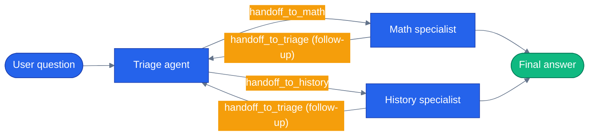

# Chapter 14 — Handoff Orchestration

Let the agents decide who answers. A triage agent reads the question and passes control to the right specialist, and a specialist can pass it back.

**You will learn to:**

- Wire agents into a handoff mesh in which each agent can pass control to the agents you allow
- Bound the back-and-forth with per-agent turn limits so the conversation cannot loop forever
- Read the event stream to see which agent answered and where the handoffs went

## Why this chapter

Sequential and Concurrent orchestration (Chapters 12 and 13) both fix the flow in advance: the graph's shape is set before any agent runs. Handoff lets the *agents* decide where the conversation goes next. A Triage agent reads the question and hands off to a specialist by calling a handoff tool that the builder generates for it. Specialists can hand back to Triage for follow-ups. Customer-support bots and research assistants that bring in domain experts on demand have this shape.

The capstone (the full application in this repo) offers the same mesh as one way for its orchestrator to route a request to a specialist agent.

The example here: **a Triage agent routes to a Math or a History specialist, which can hand back for follow-ups.**

## Prerequisites

- Completed [Chapter 13 — Concurrent Orchestration](../13-concurrent-orchestration/)
- For a live run, a repo-root `.env` with one LLM provider: `OPENAI_API_KEY` (+ optional `LLM_MODEL`, default `gpt-4.1`) or `AZURE_OPENAI_ENDPOINT` / `AZURE_OPENAI_KEY` / `AZURE_OPENAI_DEPLOYMENT` (+ optional `AZURE_OPENAI_API_VERSION`, default `2024-10-21`)
- **No key is needed to run this chapter.** With no key, `main.py` replays a recorded response for its default prompt, and the chapter's tests replay their own: `uv run --project tutorials pytest tutorials/14-handoff-orchestration/python/tests -m "not integration"` (with `PYTHONHASHSEED=0`, which the recorded fixtures assume). A different prompt has no recording; set a key to try your own wording.

## The concept

`HandoffBuilder` wires a set of agents into a mesh. For every edge you declare, it generates a handoff tool on the source agent (`handoff_to_<name>` in Python). The agent that currently holds the conversation decides, from the conversation so far, whether to answer or to call that tool and pass control to a target. Nothing outside routes the conversation. The routing decision is part of each agent's own LLM call.

That freedom is also the risk. A mesh with no exit condition can bounce a conversation between two agents forever, each one reasonably deciding to hand back. `with_autonomous_mode(agents=..., turn_limits={...})` bounds it. The loop keeps running without waiting for a human turn between hops, and each named agent gets a capped number of turns before the workflow stops.



Each specialist decides for itself whether to hand back. The mesh has no central router; every edge is a tool call one agent chooses to make.

## Python

Run from the repo root. With no key, `main.py` replays a recorded response for its default prompt (run with `PYTHONHASHSEED=0`); the tests replay their own recorded prompt:

```bash
uv sync --project tutorials
PYTHONHASHSEED=0 uv run --project tutorials pytest tutorials/14-handoff-orchestration/python/tests -m "not integration"
```

`PYTHONHASHSEED=0` matters here: the recordings assume it, and the replay test skips itself without it (see [Gotchas](#gotchas)).

With a key in the repo-root `.env`:

```bash
uv run --project tutorials python tutorials/14-handoff-orchestration/python/main.py
```

Source: [`python/main.py`](./python/main.py). The mesh is built in `build_workflow()`:

```python
def build_workflow():
    t = triage()
    m = math_expert()
    h = history_expert()
    return (
        HandoffBuilder(participants=[t, m, h])
        .with_start_agent(t)
        .add_handoff(t, [m, h])
        .add_handoff(m, [t])  # specialists can hand back to triage for follow-ups
        .add_handoff(h, [t])
        .with_autonomous_mode(agents=[t, m, h], turn_limits={"triage": 3, "math": 2, "history": 2})
        .build()
    )
```

Every participant `Agent` is constructed with `require_per_service_call_history_persistence=True`. `HandoffBuilder.build()` requires it on every participant: its middleware cuts tool calls short during a handoff, so each agent's local history has to stay in step with what the model service saw.

`ask()` drives the workflow with `stream=True` and reconstructs each agent's turn from the event stream:

```python
async for event in _workflow_events(workflow, question):
    etype = getattr(event, "type", None)
    eid = getattr(event, "executor_id", "") if etype == "output" else None
    if etype == "output" and eid in {"triage", "math", "history"}:
        if current_agent != eid:
            current_agent = eid
            buffers.append((eid, []))
        update = getattr(event, "data", None)
        text = getattr(update, "text", None) if update is not None else None
        if text:
            buffers[-1][1].append(text)
    elif etype == "handoff_sent":
        data = getattr(event, "data", None)
        target = getattr(data, "target", None)
        if target:
            handoffs.append(target)
```

Asking `"What's 37 * 42?"` routes `triage → math` and prints the numeric answer. Asking `"When did WWII end?"` routes `triage → history` and prints `1945`.

## .NET

`dotnet run` calls a live model, so it needs a key in the repo-root `.env`. Without a key, run `dotnet test tutorials/14-handoff-orchestration/dotnet/tests/Handoff.Tests.csproj` from the repo root. The commands below start at the repo root and change into the chapter's `dotnet` directory:

```bash
cd tutorials/14-handoff-orchestration/dotnet
dotnet run -- "What is 37 * 42?"
```

[`dotnet/Program.cs`](./dotnet/Program.cs) uses the convenience builder to wire the same mesh:

```csharp
Workflow workflow = AgentWorkflowBuilder.CreateHandoffBuilderWith(triage)
    .WithHandoffs(triage, new[] { mathTutor, historyTutor })
    .WithHandoffs(new[] { mathTutor, historyTutor }, triage)
    .Build();
```

The run loop watches `AgentResponseUpdateEvent` for streamed text and prints the executor id the first time each agent speaks. It takes the final transcript from the `WorkflowOutputEvent` whose `Data` is a `List<ChatMessage>`.

The .NET builder names its handoff tools by position (`handoff_to_1`, `handoff_to_2`), not by agent name. The agent's name never reaches the model, so the `description` you pass to each `AsAIAgent(...)` call is the only thing in the tool schema that tells one handoff target from another.

## Side-by-side differences

| Aspect | Python | .NET |
|--------|--------|------|
| Declare mesh | `HandoffBuilder(participants=[...]).add_handoff(source, [targets])` | `AgentWorkflowBuilder.CreateHandoffBuilderWith(start).WithHandoffs(source, targets)` |
| Autonomy | `.with_autonomous_mode(agents=[...], turn_limits={...})` | Interactive loop via `RunStreamingAsync` + `TrySendMessageAsync(new TurnToken(...))` |
| Observe handoffs | `handoff_sent` event, `event.data.target` | Inferred from `AgentResponseUpdateEvent.ExecutorId` changing |
| Streamed text | `output` event, `event.data.text` (an `AgentResponseUpdate`) | `AgentResponseUpdateEvent.Update.Text` |
| Per-participant history requirement | `require_per_service_call_history_persistence=True` on every `Agent` | Not required — handled by the .NET builder internally |

## Gotchas

- **An agent receives control but never hands off or hands back.** Every participant needs its own handoff edge. If you list an agent as a participant and never call `add_handoff(agent, [...])` / `WithHandoffs(agent, ...)` for it, it has no handoff tool to call.
- **The conversation bounces between two agents and never ends.** Set `turn_limits={...}` per agent in Python's `with_autonomous_mode(...)`. Without limits, each hop is a reasonable local decision and nothing has a view of the whole conversation.
- **`HandoffBuilder.build()` raises about history persistence (Python).** Every participant `Agent` must be constructed with `require_per_service_call_history_persistence=True`.
- **The .NET mesh routes to the wrong specialist, with no error.** The handoff tools are named by position, so the `description` on each agent is all the model has to choose by. Leave it out and the model picks between tools it cannot tell apart.
- **The replay test is skipped, or fails with a missing recording.** `HandoffBuilder` builds its mesh from a set-like collection, so the text of a specialist's follow-up turns varies with Python's per-process hash randomization, and the key of the recorded response varies with it. The recordings under `python/tests/fixtures/replay/` were made with `PYTHONHASHSEED=0`. Set the same value when you run the tests; CI (`.github/workflows/tutorials.yml`) sets it for the whole job. The other orchestration chapters do not need it, because their participant lists are consumed in list order.

## Tests

```bash
PYTHONHASHSEED=0 uv run --project tutorials pytest tutorials/14-handoff-orchestration/python/tests -v
cd tutorials/14-handoff-orchestration/dotnet && dotnet test tests/Handoff.Tests.csproj
```

Run the first from the repo root; the second changes into the chapter's `dotnet` directory. Neither needs a key or the network.

The Python tests (`python/tests/test_handoff.py`) check that the mesh builds, then replay a recorded run and check that a math question reaches the math agent. Tests marked `@pytest.mark.integration` call a live model and are skipped without credentials, because routing decisions need a real LLM.

The .NET tests ([`dotnet/tests/HandoffTests.cs`](./dotnet/tests/HandoffTests.cs)) drive the mesh with a scripted chat client. `Handoff_Tools_Are_Named_Positionally_Not_By_Agent` pins the positional tool names described above, so it fails if a later MAF version starts naming the tools after agents.

## How this shows up in the capstone

In the capstone, handoff is one of the ways the orchestrator can get a shopper's question to the right specialist agent (product discovery, orders, pricing, and so on): control passes to the specialist, whose answer is the answer. It is one of the application's selectable orchestration modes, `handoff`, and both stacks have it: `HandoffMode` in `agents/python/orchestrator/modes/handoff_mode.py` and `agents/dotnet/src/ECommerceAgents.Orchestrator/Modes/HandoffMode.cs`.

To watch it handle a real request, pick "Handoff Mesh" from the Mode dropdown above the chat box in the running application.

- `build_orchestrator_handoff_workflow()` in `agents/python/orchestrator/handoff.py` builds the `HandoffBuilder` mesh. The orchestrator is the start agent, with one edge to each remote specialist (`builder.add_handoff(orchestrator, specialists)`) and a handoff back to the orchestrator from each specialist (`builder.add_handoff(specialist, [orchestrator])`).
- Every specialist is a `RemoteSpecialistChatClient` (`agents/python/shared/remote_agent.py`) wrapped in an `Agent`. Handoffs therefore still travel over A2A, the agent-to-agent HTTP protocol the specialists are served on. Handoff is the routing mechanism; A2A stays the transport.
- `HandoffMode.run()` (`agents/python/orchestrator/modes/handoff_mode.py`) reads the workflow's event stream the way this chapter's `ask()` does: it assembles text per executor id from `output` events.
- The default mode is `tool`, where the orchestrator's LLM calls a `call_specialist_agent` tool. `handoff` runs only when a request selects it (`mode="handoff"` on `/api/chat`) or the deployment sets `ORCHESTRATION_MODE=handoff`.

## What's next

- Next chapter: [Chapter 15 — Group Chat Orchestration](../15-group-chat-orchestration/)
- Full source: [`python/`](./python/) · [`dotnet/`](./dotnet/)
- [MAF docs — Handoff Orchestration](https://learn.microsoft.com/en-us/agent-framework/workflows/orchestrations/handoff/)

<!-- BEGIN GENERATED CHAPTER NAV -->
---

**Previous:** [Chapter 13 — Concurrent Orchestration](../13-concurrent-orchestration/) · [Series index](../README.md) · **Next:** [Chapter 15 — Group Chat Orchestration](../15-group-chat-orchestration/)
<!-- END GENERATED CHAPTER NAV -->
