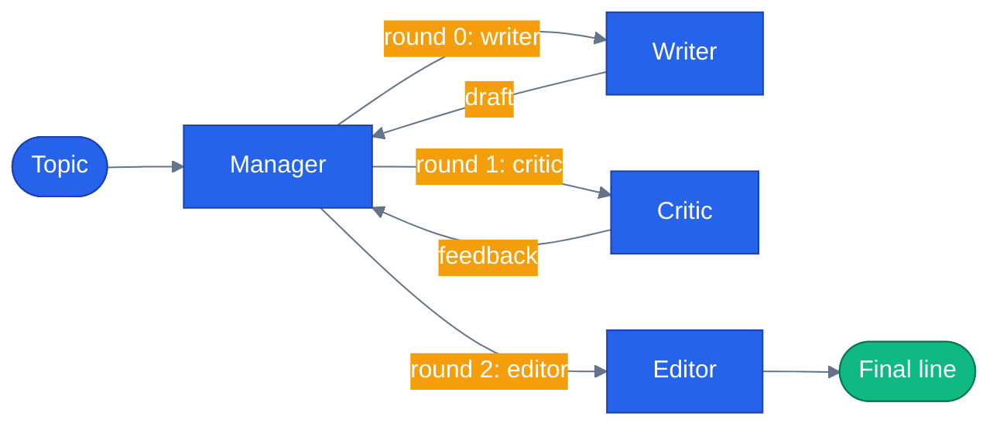

# Chapter 15 — Group Chat Orchestration

Run several agents as a meeting: everyone sees the whole conversation, and a manager decides who speaks next and when to stop.

**You will learn to:**

- Build a group chat in which a manager picks the next speaker each round
- Choose the speaker with a plain function (round-robin) or with an LLM
- Cap the number of rounds so the chat always ends

## Why this chapter

Group Chat is like a meeting: everyone is at the table, and a manager decides who talks next. Use it when agents need to build on each other's work over several rounds without a fixed handoff graph, as in review cycles, brainstorming or refining a draft from several angles. Concurrent (Chapter 13) fans out and back in, and Handoff (Chapter 14) passes control. Here every participant speaks, in an order a manager controls, and each one sees what the others have said.

The example is **Writer → Critic → Editor** drafting a marketing line together, with a manager picking the next speaker each round. The capstone (the full application in this repo) uses a round-table of the same kind to debate whether a product is worth buying.

## Prerequisites

- Completed [Chapter 14 — Handoff Orchestration](../14-handoff-orchestration/)
- No API key needed: with none set, `main.py` replays recorded responses and prints one line saying so. To use a live model instead, put `OPENAI_API_KEY` (or the `AZURE_OPENAI_*` variables) in the repo-root `.env`. Only the default round-robin run is recorded; the agent-driven `prompt` strategy needs a key:

| Provider | Required | Optional |
|----------|----------|----------|
| **OpenAI** | `OPENAI_API_KEY` | `LLM_MODEL` (default `gpt-4.1`) |
| **Azure OpenAI** | `AZURE_OPENAI_ENDPOINT`, `AZURE_OPENAI_KEY`, `AZURE_OPENAI_DEPLOYMENT` | `AZURE_OPENAI_API_VERSION` (default `2024-10-21`) |

## The concept

The central piece is the **selection function** (Python) or **manager** (.NET): given the current conversation state, it returns the next speaker. Both SDKs cap the loop with a maximum round count, so a manager that never decides to stop cannot run forever.

This chapter's code has two manager strategies:

- **Round-robin.** A plain function walks a fixed order (`writer → critic → editor`). Choosing the speaker involves no LLM call.
- **Agent-driven.** An `Agent` is given the roster and the conversation so far, and decides who speaks next and when to stop. In Python you pass it to the builder as `orchestrator_agent`. The chapter's command line calls this the `prompt` strategy.



The manager sits between every turn. Each speaker's output goes back through it before the next speaker is chosen, so the manager, not the agents, decides when the loop ends.

## Python

Run from the repo root. The shared `tutorials/` uv project covers every chapter, so one `uv sync` is enough:

```bash
uv sync --project tutorials
uv run --project tutorials python tutorials/15-group-chat-orchestration/python/main.py "slogan for a coffee shop"          # round-robin
```

You should see:

```
No LLM key found - replaying the recorded fixture (set OPENAI_API_KEY or the AZURE_OPENAI_* variables for a live run).
GroupChatOrchestrator reached max_rounds=3; forcing completion.
Topic: slogan for a coffee shop
Manager: round-robin

writer   Fuel Your Day, One Cup at a Time.

critic   Consider adding a unique detail that highlights what makes your coffee shop special to make the slogan more memorable.

editor   Fuel Your Day with Freshly Brewed Flavor.
```

The `max_rounds=3` line is the round cap doing its job: three speakers, three rounds, then the chat ends.

The agent-driven strategy has no recorded responses, so this command needs a key:

```bash
uv run --project tutorials python tutorials/15-group-chat-orchestration/python/main.py "slogan for a coffee shop" prompt   # agent-driven
```

Source: [`python/main.py`](./python/main.py). The round-robin selector is a plain function over `GroupChatState`, not a closure. It derives the next speaker from `state.current_round`, so it holds no state of its own and MAF can call it any number of times:

```python
def round_robin_selector(state: GroupChatState) -> str:
    """Round-robin: pick participants by index for each round.

    GroupChatState.participants is an OrderedDict[name, description]. Returning
    the name at ``current_round % n`` cycles through the roster deterministically.
    ``max_rounds=3`` on the builder caps total turns.
    """
    names = list(state.participants.keys())
    return names[state.current_round % len(names)]


def build_workflow(strategy: str = "round-robin"):
    participants = [writer(), critic(), editor()]

    if strategy == "prompt":
        return GroupChatBuilder(
            participants=participants,
            orchestrator_agent=prompt_driven_orchestrator(),
            max_rounds=4,  # hard safety net; the orchestrator may finish earlier
        ).build()

    return GroupChatBuilder(
        participants=participants,
        selection_func=round_robin_selector,
        max_rounds=3,
    ).build()
```

`workflow.run(message, stream=True)` runs each participant's turn and streams events. `run()` in `main.py` collects `(speaker, text)` tuples from the `group_chat` and `executor_completed` events.

## .NET

`dotnet run` calls a live model with either strategy, so it needs a key in the repo-root `.env`. Without a key, run `dotnet test tutorials/15-group-chat-orchestration/dotnet/tests/GroupChat.Tests.csproj` from the repo root. The commands below start at the repo root and change into the chapter's `dotnet` directory:

```bash
cd tutorials/15-group-chat-orchestration/dotnet
dotnet run                                    # round-robin
dotnet run -- "slogan for a bookstore" prompt  # agent-driven
dotnet test
```

[`dotnet/Program.cs`](./dotnet/Program.cs) uses the built-in `RoundRobinGroupChatManager` for the default strategy and a hand-written `PromptDrivenManager : GroupChatManager` for `prompt`. "Agent-driven" is not a separate MAF type. It is a manager subclass whose `SelectNextAgentAsync` calls an LLM instead of walking an index:

```csharp
Workflow workflow = strategy == "prompt"
    ? AgentWorkflowBuilder
        .CreateGroupChatBuilderWith(agents => new PromptDrivenManager(agents, selectorClient)
        {
            MaximumIterationCount = 3,
        })
        .AddParticipants(writer, critic, editor)
        .Build()
    : AgentWorkflowBuilder
        .CreateGroupChatBuilderWith(agents => new RoundRobinGroupChatManager(agents)
        {
            MaximumIterationCount = 3,
        })
        .AddParticipants(writer, critic, editor)
        .Build();
```

`PromptDrivenManager.SelectNextAgentAsync` asks the LLM for `{"next": "<name>"}` and matches the name against the roster. If the call throws or returns a name it does not recognize, it falls back to round-robin by `IterationCount`.

## Side-by-side differences

| Aspect | Python | .NET |
|--------|--------|------|
| Round-robin | `selection_func=round_robin_selector` (plain function over `GroupChatState`) | `RoundRobinGroupChatManager` (built-in) |
| Agent-driven | `orchestrator_agent=<Agent instance>` | Custom `GroupChatManager` subclass calling an `IChatClient` in `SelectNextAgentAsync` |
| Max rounds | `max_rounds=3` (or `4` as a safety net above the agent's own stopping logic) | `MaximumIterationCount = 3` on the manager instance |
| Termination | Selector returns a name from an exhausted roster, or `orchestrator_agent` decides to stop | Manager's `ShouldTerminateAsync` (here: "has the editor spoken") plus the iteration cap |
| Failure handling | N/A in this sample — round-robin can't fail; agent-driven relies on MAF's own retry/error surfaces | `PromptDrivenManager` explicitly catches selection failures and falls back to `_agents[(int)(IterationCount % _agents.Count)]` |

## Gotchas

- **The chat never ends.** A manager can keep choosing speakers forever, so always set a hard round cap. This chapter sets `max_rounds=3` for Python round-robin, `max_rounds=4` for Python's agent-driven path, and `MaximumIterationCount = 3` in .NET. On the agent-driven path the agent's own judgment is the main stop condition and the cap is the safety net.
- **A custom .NET manager ignores `MaximumIterationCount` and hangs.** The cap is enforced in `GroupChatManager.ShouldTerminateAsync`. If you override that method, call `base.ShouldTerminateAsync(...)` first, as `PromptDrivenManager` does. An override that skips it compiles and works whenever the model happens to end the chat, and runs forever when it does not.
- **The speaker order drifts from the round count.** A selection function must be safe to call repeatedly. `round_robin_selector` is a pure function of `GroupChatState.current_round`. A closure that carries its own iterator can get out of step with the workflow's round counter.
- **Prompts grow with every round.** By default every participant sees the full transcript so far. That is what lets the Editor react to both the Writer's draft and the Critic's feedback with no extra code, and it matters for cost and context limits on longer panels.

## Tests

```bash
uv run --project tutorials pytest tutorials/15-group-chat-orchestration/python/tests -v
cd tutorials/15-group-chat-orchestration/dotnet && dotnet test tests/GroupChat.Tests.csproj
```

Run the first from the repo root; the second changes into the chapter's `dotnet` directory. Neither needs a key or the network.

The Python tests ([`python/tests/test_group_chat.py`](./python/tests/test_group_chat.py)) check that the round-robin workflow builds, then replay the recordings in [`python/tests/fixtures/replay/`](./python/tests/fixtures/replay/) and assert that the writer speaks before the critic and the critic before the editor. Tests marked `@pytest.mark.integration` call a live model and are skipped without credentials.

The .NET tests ([`dotnet/tests/GroupChatTests.cs`](./dotnet/tests/GroupChatTests.cs)) mostly cover `PromptDrivenManager`'s failure paths: an unknown agent name, unparseable JSON, and a selector call that throws. One test has a deliberate timeout, `PromptDriven_Respects_MaximumIterationCount_When_Its_Own_Condition_Never_Fires`. It covers the hang described in Gotchas, and because that failure is a hang and not a wrong value, the test asserts against a clock.

## How this shows up in the capstone

In the capstone, a group chat answers "is this worth buying?": a value-and-pricing panelist and a quality-and-reviews panelist each speak, seeing what was said before them, and a moderator writes the verdict. It is one of the application's selectable orchestration modes, `group-chat`, and both stacks have it: `GroupChatMode` in `agents/python/orchestrator/modes/group_chat_mode.py` and `agents/dotnet/src/ECommerceAgents.Orchestrator/Modes/GroupChatMode.cs`.

To watch it handle a real request, pick "Group Chat (round-table debate)" from the Mode dropdown above the chat box in the running application.

The capstone builds its group chat differently from this chapter. `GroupChatWorkflow` in `agents/python/workflows/group_chat.py` is a round-table assembled from MAF's `Executor` and `WorkflowBuilder` primitives (Chapter 09), not from `GroupChatBuilder` and a selection function. Panelists run in a fixed order with no dynamic speaker selection. Each one appends to a shared `GroupChatState.transcript` that the next one reads, and a `_ModeratorExecutor` then writes the verdict.

The two panelists are agents. Their prompts are loaded into `_PANEL_PROMPTS` (`agents/python/orchestrator/modes/group_chat_mode.py`), and `_PanelistExecutor.run()` awaits each panelist's reply when the responder is asynchronous, which an agent-backed one is.

## What's next

- Next chapter: [Chapter 16 — Magentic Orchestration](../16-magentic-orchestration/)
- Full source: [`python/`](./python/) · [`dotnet/`](./dotnet/)
- Shared: [Mermaid style guide](../_shared/mermaid-style-guide.md) · [Jargon glossary](../_shared/jargon-glossary.md)
- [Series index](../README.md) · Previous: [Chapter 14 — Handoff Orchestration](../14-handoff-orchestration/)

<!-- BEGIN GENERATED CHAPTER NAV -->
---

**Previous:** [Chapter 14 — Handoff Orchestration](../14-handoff-orchestration/) · [Series index](../README.md) · **Next:** [Chapter 16 — Magentic Orchestration](../16-magentic-orchestration/)
<!-- END GENERATED CHAPTER NAV -->
