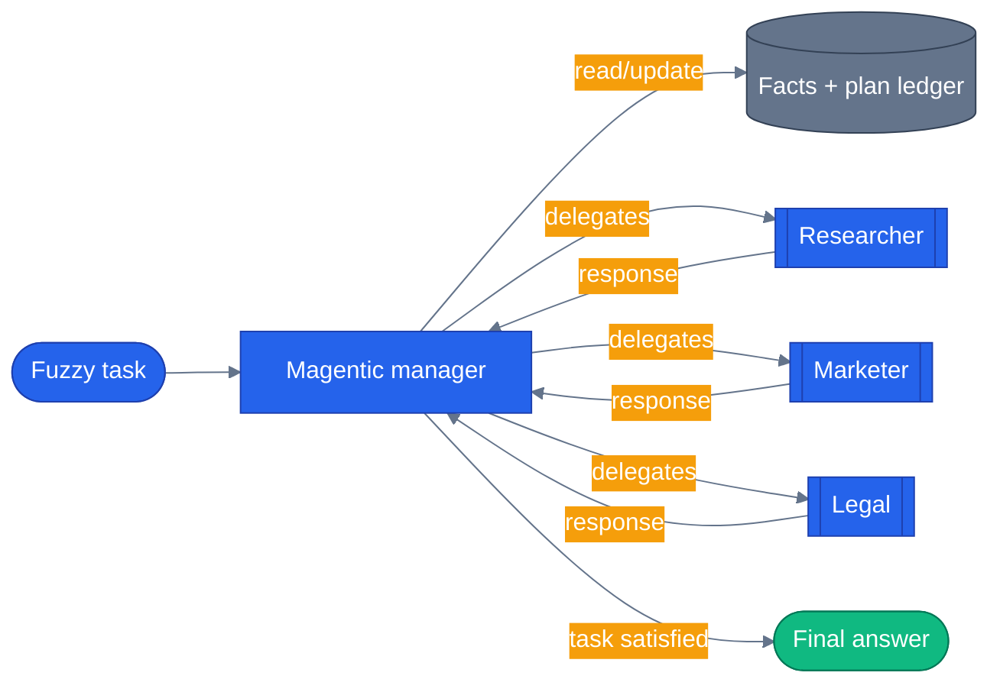

# Chapter 16 — Magentic Orchestration

Let a manager agent plan a task, delegate it to worker agents, and replan as results come in,
instead of following a path you fixed in advance.

**You will learn to:**

- Build a Magentic workflow from a manager agent and a set of worker agents
- Cap the manager's loop with `max_round_count` and `max_stall_count`
- Read the event stream to see which workers the manager consulted

## Why this chapter

Sequential knows the path. Concurrent runs everything at once. Handoff lets agents pick their own
neighbor. Group Chat uses a manager to schedule speakers round by round. **Magentic** goes further:
the manager reasons over a **task ledger** (what is known, what is unknown, what to try next). It
delegates to workers until the task is done, and replans when progress stalls.

Use this pattern when you can't predict the flow ahead of time and want the manager to adapt to
intermediate results. Take "put together a launch brief for a new product". That is not a fixed
sequence: the manager might consult a market researcher once, or go back twice if the first answer
was thin. It decides that at run time.

## Prerequisites

- Completed [Chapter 15 — Group Chat Orchestration](../15-group-chat-orchestration/)
- Repo-root `.env` with one LLM provider configured:

| Provider | Required | Optional |
|----------|----------|----------|
| **OpenAI** | `OPENAI_API_KEY` | `LLM_MODEL` (default `gpt-4.1`) |
| **Azure OpenAI** | `AZURE_OPENAI_ENDPOINT`, `AZURE_OPENAI_KEY`, `AZURE_OPENAI_DEPLOYMENT` | `AZURE_OPENAI_API_VERSION` (default `2024-10-21`) |

- **Budget.** Magentic makes several manager LLM calls on top of every worker call. Expect
  between 5 and 15 LLM calls for a single task on the default settings.
- **Key:** `main.py`'s default prompt has no recorded fixture, so running it needs a key (live run). Without one, the chapter's tests replay their own recorded prompt: `uv run --project tutorials pytest tutorials/16-magentic-orchestration/python/tests -m "not integration"`.

## The concept

Two kinds of agents are involved:

- **Workers** are your specialists (Researcher, Marketer and Legal in this chapter's example).
  They have the same shape as every earlier chapter's agents.
- **Manager** is a `StandardMagenticManager` wrapping its own planning LLM. The manager owns the
  loop; the caller does not.

The manager's loop, each round:

1. Build or refresh a **facts ledger** — what's known, what's still needed.
2. Draft or revise a **plan** — the ordered subtasks left to do.
3. Pick the next worker based on the plan and what's happened so far.
4. Observe that worker's response and update the ledger.
5. Repeat until the task is satisfied, or `max_round_count` / `max_stall_count` trips.



The manager's own reasoning (the ledger updates and delegation choices) is not exposed to the
caller. From the outside you see only which worker was called and the final synthesized answer.

## Python

Run these from the repo root. They use the shared `tutorials/` uv project, so one `uv sync` covers
every chapter. Start with the tests, which need no key because they replay recorded model
responses:

```bash
uv sync --project tutorials
uv run --project tutorials pytest tutorials/16-magentic-orchestration/python/tests -m "not integration"
```

`main.py` needs a key in the repo-root `.env`, because it calls a live model:

```bash
uv run --project tutorials python tutorials/16-magentic-orchestration/python/main.py "plan a product launch for an AI meal planner"
```

Source: [`python/main.py`](./python/main.py). The three workers and the manager are all plain
`Agent` instances. The manager's instructions are what make it a *planner*, not a special type:

```python
# tutorials/16-magentic-orchestration/python/main.py:62-84
def manager_agent() -> Agent:
    """A planning LLM the Magentic manager uses to decompose and delegate."""
    return Agent(
        _default_client(),
        instructions=(
            "You are a program manager coordinating a small team. "
            "Decompose the user's task into concrete subtasks and route each to the "
            "right specialist. Keep your reasoning tight."
        ),
        name="magentic-manager",
    )


def build_workflow():
    manager = StandardMagenticManager(
        agent=manager_agent(),
        max_round_count=6,
        max_stall_count=2,
    )
    return MagenticBuilder(
        participants=[researcher(), marketer(), legal()],
        manager=manager,
    ).build()
```

`plan()` (`main.py:101-125`) drives the streamed run and separates two kinds of events. A
`group_chat` event whose payload is a `GroupChatRequestSentEvent` is the manager dispatching to a
named worker. An `output` event carries the final synthesized answer. Sample output from a live
run (yours will differ):

```
Task: plan a product launch for an AI meal planner

Delegates consulted: marketer, researcher

Final answer:
Here's a concise launch brief for your AI meal planner:
  Are you tired of stressing over what to cook each day? ...
```

## .NET

The .NET side of this chapter is a stub: [`dotnet/Program.cs`](./dotnet/Program.cs) prints a
pointer back to the Python example, and its tests only check that the Magentic types exist in the
SDK. It needs no key.

```bash
cd tutorials/16-magentic-orchestration/dotnet   # from the repo root
dotnet run   # prints the "not yet ported" status and points back at the Python example
```

The SDK itself does support the pattern. `Microsoft.Agents.AI.Workflows` 1.28.0 exports
`MagenticWorkflowBuilder` plus `MagenticPlanCreatedEvent`, `MagenticReplannedEvent`,
`MagenticProgressLedgerUpdatedEvent` and the ledger and prompt-override types. The Python names
(`MagenticBuilder`, `StandardMagenticManager`) do not exist in the .NET assembly, so a port is a
rewrite against the .NET API, not a line-by-line translation.

## Side-by-side differences

| Aspect | Python | .NET |
|--------|--------|------|
| Availability | Fully supported (`agent_framework.orchestrations.MagenticBuilder`) | In the SDK as `MagenticWorkflowBuilder`; this chapter has no .NET sample |
| Builder | `MagenticBuilder(participants=..., manager=...).build()` | n/a |
| Standard manager | `StandardMagenticManager(agent=..., max_round_count=, max_stall_count=)` | n/a |
| Delegation event | `group_chat` event with a `GroupChatRequestSentEvent` payload | n/a |
| Final output | `output` event carrying the synthesized answer | n/a |

## Gotchas

- **The bill is larger than the answer suggests.** Magentic makes several manager calls per round
  on top of every worker call. The default `max_round_count=6` against 3 workers can mean 10 or
  more LLM calls for one task. Set `max_round_count` and `max_stall_count` low for anything
  interactive.
- **A short answer may be a stalled run.** If the manager makes no progress for `max_stall_count`
  consecutive rounds, the whole workflow ends, not just that round. Check the logs for stall
  warnings before you treat a short answer as success.
- **Vague delegation comes from a vague manager prompt.** Give the manager short, directive
  instructions, as `manager_agent()` does above.
- **Overlapping, redundant worker answers mean the workers' instructions are too broad.** Keep
  each worker to one concrete kind of output so the manager can chain them reliably.

## Tests

```bash
uv run --project tutorials pytest tutorials/16-magentic-orchestration/python/tests -v
dotnet test tutorials/16-magentic-orchestration/dotnet/tests/Magentic.Tests.csproj
```

Run both from the repo root. Neither needs a key.

The Python suite in [`python/tests/`](./python/tests/) checks that `build_workflow()` constructs,
then replays recorded model responses and asserts the manager produces a substantive final answer.
Two tests marked `integration` run a live manager loop and are skipped when no LLM credentials are
present. The number of rounds the manager takes varies from run to run, so the tests assert on
the outcome, not on an exact call count or turn sequence.

The .NET tests in [`dotnet/tests/MagenticTests.cs`](./dotnet/tests/MagenticTests.cs) have no
behaviour to test, because the project is a stub. They reflect over the SDK assembly and assert
that the Magentic types are present, that the Python names are absent, and that the stub's output
points at the Python example. A rename or removal in a later SDK version fails them.

## How this shows up in the capstone

The capstone (the full application in this repo) does not use Magentic: no orchestration mode
runs it, so a user of the application never reaches this pattern. The mode registry in
`agents/python/orchestrator/modes/__init__.py:27` lists five modes: `tool`, `handoff`,
`workflow:pre-purchase`, `workflow:return-replace` and `group-chat`. Calling `get_mode("magentic")`
raises a named `UnknownModeError` instead of falling through to a default. The "What's missing"
section of `docs/concepts/06-orchestration-patterns.md` says the same from the application side.

This chapter's own code is therefore the reference example of the pattern:

```
tutorials/16-magentic-orchestration/python/main.py:75-84
```

`build_workflow()` wraps three workers in a `StandardMagenticManager`. A Magentic mode in
`orchestrator/modes/` would have the same manager and worker split and the same event stream,
pointed at the e-commerce specialist agents instead of Researcher, Marketer and Legal.

## What's next

- Next chapter: [Chapter 17 — Human-in-the-Loop](../17-human-in-the-loop/)
- Full source: [`python/`](./python/) · [`dotnet/`](./dotnet/)
- [MAF docs — Magentic Orchestration](https://learn.microsoft.com/en-us/agent-framework/workflows/orchestrations/magentic/)

<!-- BEGIN GENERATED CHAPTER NAV -->
---

**Previous:** [Chapter 15 — Group Chat Orchestration](../15-group-chat-orchestration/) · [Series index](../README.md) · **Next:** [Chapter 17 — Human-in-the-Loop](../17-human-in-the-loop/)
<!-- END GENERATED CHAPTER NAV -->
