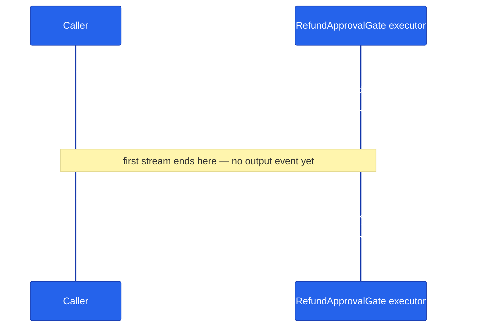

# Chapter 17 — Human-in-the-Loop

Pause a workflow mid-run, ask a human, and resume with their answer. From the caller's side that is two calls to `workflow.run()` tied together by one `request_id`.

**You will learn to:**

- Pause a workflow from inside an executor with `ctx.request_info()` (Python) or a `RequestPort` (.NET)
- Catch the pause as a caller and resume the run with the human's answer
- Tell a paused run from a finished one by the events it emits

## Why this chapter

Some decisions shouldn't be autonomous: approving a refund over $500, confirming a return shipping label, choosing which of three draft emails to send. A workflow needs a way to pause for a human and resume when the answer arrives, without losing the state the run has built up.

This pattern is called human-in-the-loop (HITL). MAF provides `ctx.request_info()` in Python and `RequestPort` in .NET. The workflow suspends, emits a request event, and waits for the caller to supply a response. This chapter shows the pattern with a refund-approval gate: a workflow holds a proposed refund and pauses to ask a human to approve or deny it. The domain logic is kept small so the pause and resume mechanics stay in view.

## Prerequisites

- Completed [Chapter 16 — Magentic Orchestration](../16-magentic-orchestration/)
- No API key needed. HITL is framework plumbing, not model behavior, and the demo runs offline
- Environment variables: none

## The concept

1. An executor (a node in the workflow graph) calls `await ctx.request_info(request_data, response_type)`.
2. The workflow emits a `request_info` event containing a unique `request_id` and the request payload, then suspends.
3. The caller's streaming loop over the first `workflow.run(..., stream=True)` call sees that event but never sees an `output` event. The run has paused, not finished.
4. The caller pairs the `request_id` with a human-supplied response and calls `workflow.run(responses={request_id: value}, stream=True)` again.
5. A method decorated with `@response_handler` on the same executor receives `(request, response, ctx)` and continues the workflow from where it left off.



The diagram shows the two separate `run()` calls a caller makes. The first pauses on `request_info`. The second resumes with `responses={...}` and drives the workflow to an `output` event.

## Python

Source: [`python/main.py`](./python/main.py). Run from the repo root:

```bash
uv sync --project tutorials
uv run --project tutorials python tutorials/17-human-in-the-loop/python/main.py
```

The demo asks for a decision on stdin. Type `y` and press Enter. You should see:

```
Approve refund of $245.50 for order ord-482? [y/n]: y
refund approved for order ord-482: $245.50
```

The executor pauses on `request_info` and resumes in a method marked `@response_handler`:

```python
class RefundApprovalGate(Executor):
    def __init__(self) -> None:
        super().__init__(id="refund-approval-gate")

    @handler
    async def start(self, refund: RefundApprovalRequest, ctx: WorkflowContext[None, str]) -> None:
        await ctx.request_info(request_data=refund, response_type=bool)

    @response_handler
    async def check(
        self,
        request: RefundApprovalRequest,
        approved: bool,
        ctx: WorkflowContext[None, str],
    ) -> None:
        if approved:
            await ctx.yield_output(f"refund approved for order {request.order_id}: ${request.amount:.2f}")
        else:
            await ctx.yield_output(f"refund denied for order {request.order_id}")
```

`run_with_response()`, which the tests use, shows the caller side: two `workflow.run()` calls tied together by `pending_request_id`.

```python
pending_request_id: str | None = None
async for event in workflow.run(RefundApprovalRequest(order_id=order_id, amount=amount), stream=True):
    if pending_request_id is None and getattr(event, "type", None) == "request_info":
        pending_request_id = getattr(event, "request_id", None)

outputs: list[str] = []
async for event in workflow.run(responses={pending_request_id: approved}, stream=True):
    if getattr(event, "type", None) == "output":
        outputs.append(event.data)
```

## .NET

No key is needed. From the repo root:

```bash
cd tutorials/17-human-in-the-loop/dotnet
dotnet run -- y   # scripted, non-interactive: approves the refund
dotnet run -- n   # scripted, non-interactive: denies the refund
```

.NET's `RequestPort` folds request and response into a single `StreamingRun` loop instead of two separate calls. The port is wired into the graph as both the workflow's start node and the upstream source of the decision executor:

```csharp
RequestPort approvalPort = RequestPort.Create<RefundRequest, bool>("ApproveRefund");
RefundDecisionExecutor decision = new(refund);

Workflow workflow = new WorkflowBuilder(approvalPort)
    .AddEdge(approvalPort, decision)
    .WithOutputFrom(decision)
    .Build();

await using StreamingRun run = await InProcessExecution.RunStreamingAsync(workflow, refund);

await foreach (WorkflowEvent evt in run.WatchStreamAsync())
{
    switch (evt)
    {
        case RequestInfoEvent request:
            bool approved = scriptedApproval ?? ReadApprovalFrom(request);
            await run.SendResponseAsync(request.Request.CreateResponse(approved));
            break;
        case WorkflowOutputEvent output:
            Console.WriteLine(output.Data);
            return 0;
    }
}
```

`RefundDecisionExecutor` receives the routed `bool` decision directly in `HandleAsync` and reports the outcome. It captures the refund's `order_id` and `amount` at construction time, since the same run already knows what it is asking approval for.

## Side-by-side differences

| Aspect | Python | .NET |
|--------|--------|------|
| Request | `ctx.request_info(request_data, response_type)` | `RequestPort.Create<TRequest, TResponse>(id)` wired into the graph |
| Response handler | `@response_handler` method with `(self, request, response, ctx)` | Downstream executor receives the routed value directly via `HandleAsync` |
| Resume | A **second, separate** `workflow.run(responses={request_id: value}, stream=True)` call | `run.SendResponseAsync(...)` inside the **same** `StreamingRun`/`WatchStreamAsync()` loop |
| Caller shape | Two async generators, correlated by `request_id` | One `await foreach` handling every pause inline |

## Gotchas

- **`RuntimeError: Workflow is already running` when you resume.** On `agent-framework-core` older than 1.11.0, breaking out of the first `workflow.run(..., stream=True)` loop as soon as `request_info` arrives leaves the workflow marked as running. The tutorials pin 1.26.0, where breaking early works, and `main()` does exactly that because it only needs the `request_id`. `run_with_response()` drains the whole first stream before resuming, which is safe on every version.
- **You look for the approval code and find a second, different mechanism.** The application has two. This chapter and `_PolicyGateExecutor` (below) pause and resume the workflow graph with `ctx.request_info` and `@response_handler`. `agents/python/shared/hitl.py` is function middleware (code that wraps every tool call). It intercepts a gated tool call before it runs, and the tool does not execute until an admin approves it through a separate code path. No workflow pauses there.
- **A bare `WorkflowContext` on `ctx` is not enough.** Both the handler that emits the request and the response handler need the type parameters, `WorkflowContext[T, U]`, so MAF can validate the request and response types.

## Tests

```bash
uv run --project tutorials pytest tutorials/17-human-in-the-loop/python/tests -v
dotnet test tutorials/17-human-in-the-loop/dotnet/tests/Hitl.Tests.csproj
```

Run both from the repo root. Neither calls a model.

The Python tests in [`python/tests/test_hitl.py`](./python/tests/test_hitl.py) drive `run_with_response()` with each decision and assert on the message. One test drains the first `workflow.run(..., stream=True)` and asserts it emits a `request_info` event but no `output` event, which proves the workflow pauses instead of completing.

The .NET tests in [`dotnet/tests/HitlTests.cs`](./dotnet/tests/HitlTests.cs) pass the decision to `Program.RunAsync` as a `Func<RequestInfoEvent, bool>`: a console prompt in the app, a lambda in the tests. Without that parameter a test would hang on `Console.ReadLine`. `Nothing_Downstream_Runs_Before_The_Decision_Arrives` checks the order of events, not the final answer, because a gate that its own downstream executor could overtake would still produce the right message.

## How this shows up in the capstone

In the capstone (the full application in this repo), a customer's return that needs review pauses the `workflow:return-replace` run until a staff member approves or rejects it. The executor that pauses it is `_PolicyGateExecutor` in `agents/python/workflows/return_replace.py`.

The gate asks the approval policy (`config/policies/approvals.yaml`, kind `return_approval`) how to route the return. `RETURN_HITL_THRESHOLD`, default `$500`, is only the fallback when the policy engine cannot decide. Unless the route is `auto`, the gate calls `ctx.request_info(...)` in `_PolicyGateExecutor.run()` (`agents/python/workflows/return_replace.py`), which pauses the workflow before any return is created. The `@response_handler` method `on_decision()` in the same class resumes it with a `ReturnDecision`. It restores the full `WorkflowState` the request carried, then either continues the chain or yields a rejection. That is the same pair of calls this chapter teaches, inside a multi-step workflow instead of a single gate.

The web app shows the pause as a pending approval row in `/runs` (`web/src/app/(app)/runs/page.tsx`). `POST /api/orchestration/{run_id}/resume` calls `ReturnReplaceMode.resume()`, which builds a fresh `Workflow` object and resumes from `checkpoint_id` plus `responses={request_id: ReturnDecision(...)}`. It cannot reuse the original object, because the process that paused the run may not be the one handling the resume. Chapter 18 covers checkpoints, the saved snapshots that make this possible.

The second mechanism, `agents/python/shared/hitl.py`, does not pause a workflow at all. The gated tools (`cancel_order`, `modify_order`, `process_refund`, `initiate_return`, `place_backorder`; see `HITL_GATED_TOOLS`) are declared `@tool(approval_mode="always_require")`, so MAF stops the run itself, before any function middleware, and the model's call comes back as a `function_approval_request`. After the run the specialist host calls `park_pending_approvals` (`agents/python/shared/agent_host.py`), which calls `park_gated_call` to write a `tool_approval_requests` row and its inbox approval, once, and tells the user in one fixed sentence that nothing has changed yet. `HITLFunctionMiddleware` is a fail-closed backstop that does the same for a gated tool registered without `always_require`; it is not reached on the real path. The tool runs later, only when a staff member (`support` or `admin`, never the requester) approves it through `POST /api/approvals/{id}/decide`, which calls `execute_approved_action()` as the original requester.

## What's next

- Next chapter: [Chapter 18 — State and Checkpoints](../18-state-and-checkpoints/)
- Full source: [`python/`](./python/) · [`dotnet/`](./dotnet/)
- Shared: [Mermaid style guide](../_shared/mermaid-style-guide.md) · [Jargon glossary](../_shared/jargon-glossary.md)

<!-- BEGIN GENERATED CHAPTER NAV -->
---

**Previous:** [Chapter 16 — Magentic Orchestration](../16-magentic-orchestration/) · [Series index](../README.md) · **Next:** [Chapter 18 — State and Checkpoints](../18-state-and-checkpoints/)
<!-- END GENERATED CHAPTER NAV -->
