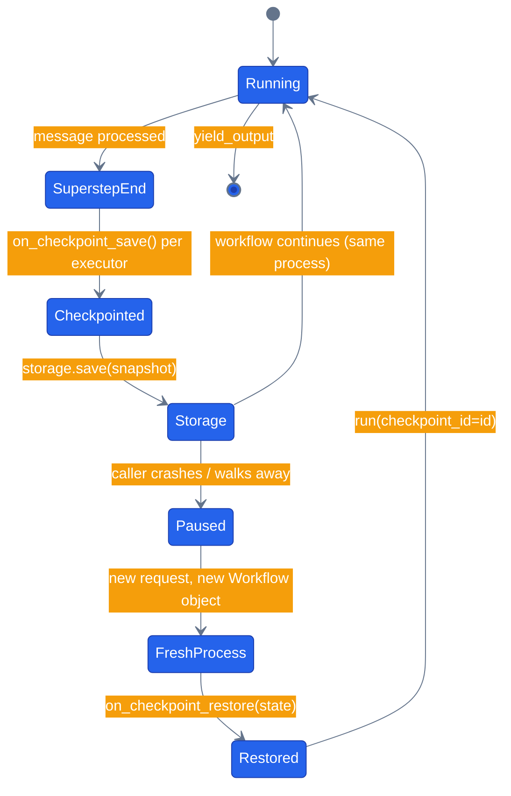

# Chapter 18 — State and Checkpoints

Save a workflow's state as it runs, so a different process can pick the run up later from where it stopped.

**You will learn to:**

- Give an executor save and restore hooks so its state is included in each checkpoint
- Attach a checkpoint storage backend to a workflow run
- Resume a run from a checkpoint in a fresh workflow instance

## Why this chapter

Long-running workflows need to survive a process restart: a multi-day return, an overnight research report, an approval paused for a human (Chapter 17). If the workflow lives only in memory, a redeploy or a crash mid-run loses its state.

MAF's answer is `CheckpointStorage`. A checkpoint is a saved snapshot of the workflow's state. The framework snapshots every executor (a node in the workflow graph) and hands the result to a storage backend: `InMemoryCheckpointStorage` for tests, `FileCheckpointStorage` for durable local runs, and a Postgres- or Cosmos-backed implementation for production. You don't write the serialization protocol. You implement two hooks per executor that say what to save and how to restore it.

The full application in this repo depends on this. Its `workflow:return-replace` mode uses a Postgres checkpoint store to keep a paused approval alive across separate HTTP requests, which different processes may serve. See [How this shows up in the capstone](#how-this-shows-up-in-the-capstone).

## Prerequisites

- Completed [Chapter 17 — Human-in-the-Loop](../17-human-in-the-loop/)
- No API key needed. The example adds up refund amounts and calls no model

## The concept

An executor opts into checkpointing by implementing two hooks: `on_checkpoint_save` and `on_checkpoint_restore` in Python, `OnCheckpointingAsync` and `OnCheckpointRestoredAsync` in .NET.

MAF saves at the end of every superstep. A superstep is one round of the workflow scheduler: every executor processes its current batch of messages, then the workflow moves on. At that point MAF calls the save hook on every executor that defines one (in .NET the hook queues state with `QueueStateUpdateAsync`). It bundles the results with the messages still in flight and hands the bundle to the storage backend.

To resume, you point a *fresh* workflow instance at a `checkpoint_id`. MAF restores each executor's state through the restore hook, then replays the pending messages.

The process that resumes does not need to be the process that paused. That is what makes checkpoints useful for human-in-the-loop (HITL) approvals. You can pause a workflow, return an HTTP response, let the container recycle, and resume days later from a different request, as long as the checkpoint reached durable storage.



The checkpoint written at `SuperstepEnd` is the only thing that has to survive the gap. A new process rebuilds every executor from scratch and takes the snapshot's values over any constructor default.

## Python

Source: [`python/main.py`](./python/main.py). Run from the repo root:

```bash
uv sync --project tutorials
uv run --project tutorials python tutorials/18-state-and-checkpoints/python/main.py
```

You should see (the checkpoint id differs on every run):

```
Phase 1: initial_refund=10.0, item_refund=5.0
Phase 1 result: refund_amount = 15.0

3 checkpoint file(s) on disk.
Resuming from be6c00c0… with initial_refund=999.0
Phase 2 result: refund_amount = 15.0 (expected 15.0)
```

The workflow has two executors, standing in for part of a return-request pipeline. `ReturnRequestExecutor` holds a running refund amount. It starts from an initial refund and grows as return line items are processed. It forwards the amount to a stateless `FinalizeReturnExecutor`, which yields the refund total as the workflow's output. `ReturnRequestExecutor`'s state round-trips through its two hooks:

```python
class ReturnRequestExecutor(Executor):
    def __init__(self, initial_refund: float) -> None:
        super().__init__(id="return-request")
        self.refund_amount = initial_refund

    @handler
    async def handle(self, item_refund: float, ctx: WorkflowContext[float, None]) -> None:
        self.refund_amount += item_refund
        await ctx.send_message(self.refund_amount)

    async def on_checkpoint_save(self) -> dict[str, Any]:
        return {"refund_amount": self.refund_amount}

    async def on_checkpoint_restore(self, state: dict[str, Any]) -> None:
        self.refund_amount = float(state.get("refund_amount", 0.0))
```

The proof is in `demo()`. It runs the workflow end to end with `FileCheckpointStorage` and takes the *first* checkpoint (superstep 1, before `FinalizeReturnExecutor` emits output). Then it builds a **second** `ReturnRequestExecutor` seeded with an initial refund of `999.0`, a deliberately wrong value, and resumes from that checkpoint:

```python
wrong_initial_refund = 999.0
replayed = await resume_from_checkpoint(
    storage, first.checkpoint_id, resume_initial_refund=wrong_initial_refund
)
print(f"Phase 2 result: refund_amount = {replayed} (expected {result})")
```

The replayed `refund_amount` matches the original run instead of reflecting `resume_initial_refund=999.0`. So the checkpoint, not the constructor, is the source of truth. `main.py` accepts `initial_refund` and `item_refund` as CLI arguments. The defaults are `10.0 5.0`, which gives a `refund_amount` of `15.0`.

## .NET

Source: [`dotnet/Program.cs`](./dotnet/Program.cs). No key is needed. From the repo root:

```bash
cd tutorials/18-state-and-checkpoints/dotnet
dotnet run
```

The shape is the same two executors, but .NET splits the checkpoint API into a store and a manager. `FileSystemJsonCheckpointStore` writes one JSON file per checkpoint plus an index. `CheckpointManager.CreateJson(store)` wraps it with the JSON marshaller the workflow engine talks to.

```csharp
var store = new FileSystemJsonCheckpointStore(checkpointDir);
CheckpointManager checkpointManager = CheckpointManager.CreateJson(store);

await using StreamingRun run = await InProcessExecution
    .RunStreamingAsync(workflow1, input: itemRefund, checkpointManager, sessionId);
```

`ReturnRequestExecutor` uses `QueueStateUpdateAsync` / `ReadStateAsync` against a string key instead of returning a dict:

```csharp
protected override ValueTask OnCheckpointingAsync(
    IWorkflowContext context, CancellationToken cancellationToken = default) =>
    context.QueueStateUpdateAsync(StateKey, _refundAmount, cancellationToken: cancellationToken);

protected override async ValueTask OnCheckpointRestoredAsync(
    IWorkflowContext context, CancellationToken cancellationToken = default)
{
    _refundAmount = await context.ReadStateAsync<double>(StateKey, cancellationToken: cancellationToken);
}
```

Resuming builds a fresh `Workflow` with `BuildWorkflow(initialRefund)` and calls `InProcessExecution.ResumeStreamingAsync(workflow2, firstCheckpoint, checkpointManager)`. The .NET demo reuses the same initial refund; it does not seed a wrong value the way Python's does. The program exits `0` if the replayed `refund_amount` matches the first run and `2` if it doesn't, so `dotnet run` works as a quick check on its own.

## Side-by-side differences

| Aspect | Python | .NET |
|--------|--------|------|
| Save hook | `async on_checkpoint_save() -> dict` | `OnCheckpointingAsync(ctx, ct)` + `context.QueueStateUpdateAsync(key, value)` |
| Restore hook | `async on_checkpoint_restore(state: dict)` | `OnCheckpointRestoredAsync(ctx, ct)` + `context.ReadStateAsync<T>(key)` |
| Storage shape | One `CheckpointStorage` object (`FileCheckpointStorage`, `InMemoryCheckpointStorage`, ...) | `store` (backing files) + `CheckpointManager` (marshalling) kept separate |
| Listing checkpoints | `await storage.list_checkpoints(workflow_name=...)` | `await store.RetrieveIndexAsync(sessionId)` |
| Resume | `workflow.run(stream=True, checkpoint_id=id, checkpoint_storage=storage)` | `InProcessExecution.ResumeStreamingAsync(workflow, checkpointInfo, checkpointManager)` |

## Gotchas

- **You can't pass a new message when you resume.** Passing `checkpoint_id=` to `workflow.run()` continues from the saved superstep's pending messages. You can't also pass a fresh `message=` to start it differently.
- **Checkpoints are on disk but you can't find them.** You look them up by the workflow's `name` in Python (`storage.list_checkpoints(workflow_name=...)`) and by `sessionId` in .NET (`RetrieveIndexAsync`). Keep both stable. Without them the files exist but the normal API cannot reach them.
- **A custom object in your state does not survive a checkpoint.** State must round-trip through the backend's serializer. Python's `on_checkpoint_save` returns a plain `dict` that has to survive JSON. .NET's `QueueStateUpdateAsync` is generic, but bound by what `CheckpointManager.CreateJson` can marshal. Serialize custom objects explicitly, and never return an open file handle or a live database connection.
- **The checkpoint directory keeps growing.** Neither `FileCheckpointStorage` nor `FileSystemJsonCheckpointStore` deletes old snapshots. A production backend needs its own retention policy.
- **.NET throws "already in use by another process" from your own process.** `FileSystemJsonCheckpointStore` takes an exclusive lock on its directory and does not release it when the run ends. Constructing a second store over the same directory fails, even after the first run has finished.

## Tests

```bash
uv run --project tutorials pytest tutorials/18-state-and-checkpoints/python/tests -v
dotnet test tutorials/18-state-and-checkpoints/dotnet/tests/Checkpoints.Tests.csproj
```

Run both from the repo root. Neither calls a model.

The Python tests in [`python/tests/test_checkpoints.py`](./python/tests/test_checkpoints.py) check that the two hooks round-trip `refund_amount`, that a run writes checkpoint files, and that resuming into a fresh workflow instance restores the saved state. They also check that `InMemoryCheckpointStorage` gives the same replay result as the file-backed store.

In the .NET tests ([`dotnet/tests/CheckpointsTests.cs`](./dotnet/tests/CheckpointsTests.cs)), `The_Restored_Total_Is_Not_Merely_The_Constructor_Seed` matters most. The resumed run builds a fresh executor seeded with the initial refund, so a restore hook that does nothing produces exactly `10.0`: a plausible number, with no exception and no warning. Another test pins the directory lock described in Gotchas.

## How this shows up in the capstone

In the capstone (the full application in this repo), checkpoints are what let a staff member approve a customer's paused return hours later, from a different request, and have the return carry on from where it stopped.

The workflow involved is `workflow:return-replace` (`agents/python/workflows/return_replace.py`). It is larger than this chapter's example: six executors carry a `WorkflowState` dataclass through `check-eligibility → policy-gate → initiate-return → search-replacements → apply-discount → finalize`. The state holds the order id, refund amount, replacement products, HITL flags and a completed-steps list. The mechanic underneath is the one this chapter isolates: state saved at a superstep boundary and restored into a fresh workflow.

Where this chapter uses `FileCheckpointStorage`, the capstone uses Postgres. `agents/python/shared/checkpoint_storage.py` defines `PostgresCheckpointStorage`, a `CheckpointStorage` implementation backed by `asyncpg` that reads and writes the `workflow_checkpoints` table (`docker/postgres/init.sql`). It encodes each snapshot with MAF's own `encode_checkpoint_value`, so the format matches what `FileCheckpointStorage` writes to disk. `shared.factory.get_checkpoint_storage()` selects it when `MAF_CHECKPOINT_BACKEND=postgres`, the default. Every run wraps the storage in `RecordingCheckpointStorage` (`agents/python/orchestrator/modes/workflow_mode.py`), so each save appears as its own `kind="checkpoint"` event on the stream sent to the browser. MAF's own event stream does not mention a save.

The approval gate from Chapter 17 depends on this. When the workflow pauses on `ctx.request_info`, the orchestrator records the paused checkpoint against a `hitl_requests` row. `POST /api/orchestration/{run_id}/resume` (`resume_run()` in `agents/python/orchestrator/routes/orchestration.py`) reaches `ReturnReplaceMode.resume()` (`agents/python/orchestrator/modes/workflow_mode.py`). It builds a **fresh** `Workflow` object, because the one that paused lived in an earlier request's process memory. It then resumes from `checkpoint_id` plus the reviewer's decision, as this chapter's Phase 2 does.

`GET /api/runs/{run_id}/checkpoints` (`get_run_checkpoints()` in `agents/python/orchestrator/routes/legacy.py`) tells the UI which runs have a pending approval. `web/src/app/(app)/runs/page.tsx` reads it and shows Approve and Reject buttons that call the resume endpoint, so you can watch a paused return resume on the `/runs` page.

## What's next

- Next chapter: [Chapter 19 — Declarative Workflows](../19-declarative-workflows/)
- Full source: [`python/`](./python/) · [`dotnet/`](./dotnet/)
- [MAF docs — Checkpointing](https://learn.microsoft.com/en-us/agent-framework/workflows/checkpoints/)

<!-- BEGIN GENERATED CHAPTER NAV -->
---

**Previous:** [Chapter 17 — Human-in-the-Loop](../17-human-in-the-loop/) · [Series index](../README.md) · **Next:** [Chapter 19 — Declarative Workflows](../19-declarative-workflows/)
<!-- END GENERATED CHAPTER NAV -->
