# Chapter 19 — Declarative Workflows

Define a workflow in YAML and load it at runtime, so you can change the graph without changing code.

**You will learn to:**

- Describe a workflow's executors and edges in a YAML file
- Write a loader that turns that file into a real MAF `Workflow`
- Map op names in the file to functions through a small registry

## Why this chapter

Code-built workflows work well when engineers own the graph. A declarative workflow, one described in data instead of code, fits better when:

- Non-engineers adjust step ordering (ops, support, compliance).
- You want workflow changes to show up in pull requests as YAML diffs, not code diffs.
- You need to change a pipeline's shape without a deploy, because the graph lives in a config file.

MAF ships a built-in declarative schema (`Microsoft.Agents.AI.Workflows.Declarative` on .NET; a Python equivalent exists too). The simplest way to *understand* the pattern is to write a minimal loader yourself, which is what this chapter does.

## Prerequisites

- Completed [Chapter 18 — State and Checkpoints](../18-state-and-checkpoints/)
- Familiar with YAML
- No API key needed. The ops are plain string transformations and call no model

## The concept

A workflow spec names the executors (the nodes of the workflow graph), the behavior each one runs (an op plus optional config), and the edges between them. A loader reads the YAML and produces the same `Workflow` object you would get from the hand-wired `WorkflowBuilder` calls in Chapter 9. The graph's shape has moved from Python or C# source into data.

```yaml
name: text-pipeline
start: uppercase
executors:
  - id: uppercase
    op: upper
  - id: validate
    op: non_empty
  - id: log
    op: prefix
    prefix: "LOGGED: "
edges:
  - from: uppercase
    to: validate
  - from: validate
    to: log
```

Each `op` name resolves to a small pure function (`upper`, `non_empty`, `prefix`, …) through a registry. The loader creates one real `Executor` instance per YAML entry and wires them with `WorkflowBuilder.add_edge(...)`, as the code-built version does. The only difference is *where* the graph's shape comes from.

```mermaid
%%{init: {'theme':'base', 'themeVariables': {
  'primaryColor': '#2563eb','primaryTextColor': '#ffffff','primaryBorderColor': '#1e40af',
  'lineColor': '#64748b','secondaryColor': '#f59e0b','tertiaryColor': '#10b981',
  'background': 'transparent'}}}%%
flowchart LR
  classDef core     fill:#2563eb,stroke:#1e40af,color:#ffffff
  classDef external fill:#f59e0b,stroke:#b45309,color:#000000
  classDef success  fill:#10b981,stroke:#047857,color:#ffffff
  classDef infra    fill:#64748b,stroke:#334155,color:#ffffff

  yaml[(workflow.yaml)]
  loader[Declarative loader]
  upper[[uppercase executor]]
  validate[[validate executor]]
  log[[log executor]]
  out([Terminal output])

  yaml -- "parsed spec" --> loader
  loader -- "builds + wires" --> upper
  upper --> validate
  validate -- "blank input" --> out
  validate -- "non-blank" --> log
  log --> out

  class yaml infra
  class loader core
  class upper core
  class validate core
  class log core
  class out success
```



The loader never sees your business logic. It sees only op names and config. The graph's shape is data; the behavior lives in the op registry.

## Python

Source: [`python/main.py`](./python/main.py) and [`python/workflow.yaml`](./python/workflow.yaml). Run from the repo root:

```bash
uv sync --project tutorials
uv run --project tutorials python tutorials/19-declarative-workflows/python/main.py "hello world"
uv run --project tutorials python tutorials/19-declarative-workflows/python/main.py ""
```

You should see, for the two commands in turn:

```
spec: workflow.yaml
input: 'hello world'
output: 'LOGGED: HELLO WORLD'
```

```
spec: workflow.yaml
input: ''
output: '[skipped: empty input]'
```

The second run stops at `validate`, because the input is blank. The op functions and the executor that runs them:

```python
def _build_op(op: str, config: dict[str, Any]) -> Callable[[str], tuple[str | None, str | None]]:
    """Returns a pure function: input_text -> (forwarded_text, terminal_text)."""
    if op == "upper":
        return lambda s: (s.upper(), None)
    if op == "non_empty":
        def _non_empty(s: str) -> tuple[str | None, str | None]:
            return (s, None) if s.strip() else (None, "[skipped: empty input]")
        return _non_empty
    if op == "prefix":
        prefix = config.get("prefix", "")
        return lambda s: (None, f"{prefix}{s}")
    raise ValueError(f"unknown op: {op!r}")


class DeclarativeExecutor(Executor):
    """An executor whose behavior is defined by a YAML 'op' string."""

    def __init__(self, executor_id: str, op: str, config: dict[str, Any]) -> None:
        super().__init__(id=executor_id)
        self._op = _build_op(op, config)

    @handler
    async def run(self, message: str, ctx: WorkflowContext[str, str]) -> None:
        forward, terminal = self._op(message)
        if terminal is not None:
            await ctx.yield_output(terminal)
            return
        if forward is not None:
            await ctx.send_message(forward)
```

`load_workflow()` parses the YAML, builds one `DeclarativeExecutor` per entry, and wires them with `WorkflowBuilder.add_edge(...)`. The result matches Chapter 9's hand-built graph, but `workflow.yaml` drives all of it.

## .NET

[`dotnet/Program.cs`](./dotnet/Program.cs) has the same shape as the Python side: a `WorkflowSpec` record deserialized by YamlDotNet, an `OpRegistry` that maps op names to functions, and a `DeclarativeWorkflowLoader` that builds the `Workflow` from the spec. This loader is a minimal one written for teaching. For the supported full schema (agent invocation, human-in-the-loop, control flow, Power Fx expressions), see `Microsoft.Agents.AI.Workflows.Declarative` and `DeclarativeWorkflowBuilder.Build<TInput>(path, options)`.

No key is needed. From the repo root:

```bash
cd tutorials/19-declarative-workflows/dotnet
dotnet run                 # defaults to "hello world"
dotnet run -- ""           # empty  -> validate short-circuits
dotnet run -- "maf rocks"  # happy path
```

## Side-by-side differences

| Aspect | Python | .NET |
|--------|--------|------|
| YAML parser | `pyyaml` | `YamlDotNet` |
| Op registry | Module-level `_build_op` if/elif chain | `OpRegistry` static class |
| Loader | `load_workflow()` function returning a `Workflow` | `DeclarativeWorkflowLoader.Load(path)` static method |
| Built-in declarative surface | Python-side equivalent of MAF's declarative schema | `Microsoft.Agents.AI.Workflows.Declarative` |

## Gotchas

- **A typo in the YAML fails at run time with an unhelpful error.** A spec file is a small language that no compiler checks, so the loader must validate it. The .NET loader rejects an unknown `op`, a duplicate executor id and an edge that names an undeclared executor, each with a message naming the problem. The Python loader is smaller: it raises a clear error for an unknown `op`, but an undeclared edge target surfaces as a bare `KeyError` and a duplicate id silently replaces the earlier entry. Add those checks to any loader you write.
- **Every YAML entry costs an object.** Each one builds a real `Executor` instance. For very large specs, create them lazily.
- **A new op means editing the registry.** In Python, ops are an `if` chain inside `_build_op` in `main.py`, so you add a branch. In .NET, `OpRegistry.Register(name, factory)` adds one without touching the loader.

## Tests

```bash
uv run --project tutorials pytest tutorials/19-declarative-workflows/python/tests -v
dotnet test tutorials/19-declarative-workflows/dotnet/tests/Declarative.Tests.csproj
```

Run both from the repo root. Neither calls a model.

The Python tests in [`python/tests/test_declarative.py`](./python/tests/test_declarative.py) exercise every built-in op and the unknown-op error. They also check that the YAML-driven pipeline gives the same result as the code-built one, for normal input and for blank input.

The .NET tests in [`dotnet/tests/DeclarativeTests.cs`](./dotnet/tests/DeclarativeTests.cs) are mostly about validation, because a config file can be wrong and its errors surface at run time. Each error test asserts that the message names the thing that is wrong. A generic "workflow spec invalid" would not pass.

## How this shows up in the capstone

The capstone (the full application in this repo) has no declarative loader, so nothing a user does there runs a YAML-defined workflow. Its two workflows, return/replace and pre-purchase, are hand-coded MAF `WorkflowBuilder` graphs (`agents/python/workflows/return_replace.py:565`, `agents/python/workflows/pre_purchase.py:300`). This chapter is self-contained: its loader and its `workflow.yaml` live in `python/` and `dotnet/` here, and it imports nothing from `agents/`.

## What's next

- Next chapter: [Chapter 20 — Visualization](../20-visualization/)
- Full source: [`python/`](./python/) · [`dotnet/`](./dotnet/)
- Shared: [Mermaid style guide](../_shared/mermaid-style-guide.md) · [Jargon glossary](../_shared/jargon-glossary.md)

<!-- BEGIN GENERATED CHAPTER NAV -->
---

**Previous:** [Chapter 18 — State and Checkpoints](../18-state-and-checkpoints/) · [Series index](../README.md) · **Next:** [Chapter 20 — Workflow Visualization](../20-visualization/)
<!-- END GENERATED CHAPTER NAV -->
