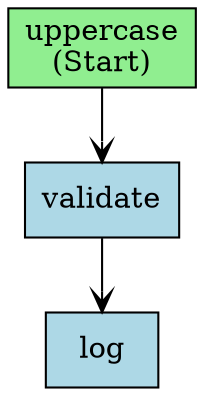

# Chapter 20 — Workflow Visualization

Turn any `Workflow` object into a Mermaid or Graphviz diagram that you can commit and diff.

**You will learn to:**

- Render a workflow as Mermaid and as Graphviz DOT, in Python and in .NET
- Commit the rendered files so a change to the graph shows up as a diff in review
- Keep the output identical between runs by building the graph in a stable order

## Why this chapter

A workflow you can't see is hard to review and hard to reason about when you are on call at 3 AM. MAF ships helpers that turn any `Workflow` object into Mermaid (which GitHub renders inline in markdown, issues and PRs) or Graphviz DOT (for architecture diagrams, wikis and runbooks). Both are deterministic: the same graph always produces the same bytes. You can commit the output and diff real changes in a PR instead of comparing screenshots.

The full application in this repo uses the same API to regenerate the diagrams of its workflows, and a live variant draws the graph you see in the web UI while a run is in progress. See [How this shows up in the capstone](#how-this-shows-up-in-the-capstone).

## Prerequisites

- Completed [Chapter 19 — Declarative Workflows](../19-declarative-workflows/)
- No API key needed. This chapter only renders a graph and calls no model
- Optional: `graphviz` installed locally, if you want to turn the `.dot` output into PNG or SVG with the `dot` CLI

## The concept

`WorkflowViz` (Python) and `WorkflowVisualizer` (.NET) walk the graph of executors (workflow nodes) you built with `WorkflowBuilder` and serialize it to two formats:

- **Mermaid** is a `flowchart` block that GitHub renders inline with no extra tooling.
- **Graphviz DOT** is a `digraph` you pipe through the `dot` CLI to get PNG or SVG for docs or wikis.

Both come from the graph's structure (executor ids and edges), not from any one run. The diagram shows every possible path through the workflow, not only the path a particular input took.


This is the `demo-pipeline` workflow that this chapter's `main.py` renders, with the house colors added: three executors and two edges.

## Python

Run from the repo root. The shared `tutorials/` uv project means one `uv sync` covers every chapter:

```bash
uv sync --project tutorials
uv run --project tutorials python tutorials/20-visualization/python/main.py
# writes workflow.mmd + workflow.dot into tutorials/20-visualization/python/
```

You should see both renderings, then the path the files were written to:

```
=== Mermaid ===
flowchart TD
  uppercase["uppercase (Start)"];
...
=== Graphviz DOT ===
digraph Workflow {
...
Wrote workflow.mmd and workflow.dot to .../tutorials/20-visualization/python
```

Source: [`python/main.py`](./python/main.py). The workflow is the three-executor pipeline from the earlier workflow chapters (uppercase, then a non-empty gate, then a logger), built with the normal `WorkflowBuilder`:

```python
from agent_framework import WorkflowViz
from agent_framework import WorkflowBuilder

def build_workflow():
    up = UppercaseExecutor()
    validate = ValidateExecutor()
    log = LogExecutor()
    return (
        WorkflowBuilder(start_executor=up, name="demo-pipeline")
        .add_edge(up, validate)
        .add_edge(validate, log)
        .build()
    )

def render_mermaid() -> str:
    return WorkflowViz(build_workflow()).to_mermaid()

def render_dot() -> str:
    return WorkflowViz(build_workflow()).to_digraph()
```

`main.py` writes both outputs to disk next to itself. `WorkflowViz` and `WorkflowBuilder` both come from the public `agent_framework` package.

Rendered Mermaid (this is `workflow.mmd`, byte-for-byte):

```
flowchart TD
  uppercase["uppercase (Start)"];
  validate["validate"];
  log["log"];
  uppercase --> validate;
  validate --> log;
```

Rendered DOT (this is `workflow.dot`, byte-for-byte):



## .NET

No key is needed. From the repo root:

```bash
cd tutorials/20-visualization/dotnet
dotnet run
```

[`dotnet/Program.cs`](./dotnet/Program.cs) builds the same three-executor pipeline as the Python side and renders it both ways:

```csharp
using Microsoft.Agents.AI.Workflows;

string mermaid = WorkflowVisualizer.ToMermaidString(workflow);
string dot     = WorkflowVisualizer.ToDotString(workflow);

File.WriteAllText("workflow.mmd", mermaid);
File.WriteAllText("workflow.dot", dot);
```

These are **static methods on `WorkflowVisualizer`**, not extension methods on `Workflow`. `workflow.ToMermaidString()` does not compile. It is what most people try first, because Python wraps the workflow in a `WorkflowViz` object and the .NET name reads like an extension.

## Side-by-side differences

| Aspect | Python | .NET |
|--------|--------|------|
| Mermaid | `WorkflowViz(workflow).to_mermaid()` | `WorkflowVisualizer.ToMermaidString(workflow)` |
| DOT | `WorkflowViz(workflow).to_digraph()` | `WorkflowVisualizer.ToDotString(workflow)` |
| Import surface | Public package (`from agent_framework import WorkflowViz`) | Public static methods on `WorkflowVisualizer` (`Microsoft.Agents.AI.Workflows`) |
| Bitmap export | Pipe `.dot` text through the `dot` CLI | Pipe `.dot` text through the `dot` CLI (same approach both languages) |

## Gotchas

- **The build fails before you get a diagram.** Two executors sharing an `id` (for example two `ValidateExecutor()` instances that both default to `id="validate"`) fail at `WorkflowBuilder.build()`, not at rendering. A diagram renders only after the build succeeds, so a rendering problem is usually a graph problem.
- **The `.dot` file doesn't display anywhere.** GitHub renders Mermaid inline in issues, PRs and wikis with no extra tooling, so commit the `.mmd` files. Turning `.dot` text into PNG or SVG needs `graphviz` installed locally or in CI.
- **The rendered output changes between runs although the graph did not.** `WorkflowViz` renders whatever edge order the graph gives it. If your code adds edges by iterating a `set`, the order can change from run to run. Build the graph from ordered collections such as lists and tuples.

## Tests

```bash
uv run --project tutorials pytest tutorials/20-visualization/python/tests -v
dotnet test tutorials/20-visualization/dotnet/tests/Visualization.Tests.csproj
```

Run both from the repo root. Neither calls a model.

The Python tests in [`python/tests/test_visualization.py`](./python/tests/test_visualization.py) check that every executor id appears in the Mermaid and DOT output, that both edges appear in the Mermaid, and that rendering twice gives the same text.

The .NET tests in [`dotnet/tests/VisualizationTests.cs`](./dotnet/tests/VisualizationTests.cs) compare the rendered output against the graph's actual nodes and edges, because a diagram with the right nodes and the wrong arrows is worse than no diagram. `Rendering_Is_Deterministic` protects the reason for committing diagrams: diffing them in PRs only works if identical graphs render to identical bytes.

## How this shows up in the capstone

The capstone (the full application in this repo) draws its workflows in two places: as committed diagram files under `docs/workflows/`, and as the graph beside the chat that lights up node by node while a run is in progress.

- **Committed files.** [`scripts/visualize_workflows.py`](../../scripts/visualize_workflows.py) builds the application's `pre-purchase` and `return-replace` `WorkflowBuilder` graphs and renders each with the same `WorkflowViz` API this chapter teaches (`scripts/visualize_workflows.py:57`). It writes `docs/workflows/{name}.mmd` and `{name}.dot`. Its `--check` flag (`scripts/visualize_workflows.py:109`) fails on drift: missing files, content that no longer matches the graph, or leftover output. CI runs that check when `WORKFLOW_VISUALIZATION_ON_BUILD=true`.
- **Live graph.** `web/src/components/chat/orchestration-graph.tsx` fetches a mode's `graph_mermaid()` output from `GET /api/orchestration/modes/{name}/graph` (`agents/python/orchestrator/routes/orchestration.py:54`) and renders it in the browser with the house Mermaid colors. During a run the server streams `node` events to the browser, and the component gives active, done and errored executors different node classes (`web/src/components/chat/orchestration-graph.tsx:101`). To match a live `node_id` to a diagram node, every mode's `graph_mermaid()` uses the real executor id with dashes swapped for underscores as the Mermaid node id. The comment on `PrePurchaseMode.graph_mermaid()` at `agents/python/orchestrator/modes/workflow_mode.py:172` explains why.

The two are separate code paths. The script renders the graphs ahead of time and CI diffs the files. The web UI renders a mode's fixed graph on request and animates it against a live run.

## What's next

- Next chapter: [Chapter 20b — DevUI](../20b-devui/)
- Full source: [`python/`](./python/) · [`dotnet/`](./dotnet/)
- Shared: [Mermaid style guide](../_shared/mermaid-style-guide.md)

<!-- BEGIN GENERATED CHAPTER NAV -->
---

**Previous:** [Chapter 19 — Declarative Workflows](../19-declarative-workflows/) · [Series index](../README.md) · **Next:** [Chapter 20b — DevUI: interactive dashboard for agents and workflows](../20b-devui/)
<!-- END GENERATED CHAPTER NAV -->
