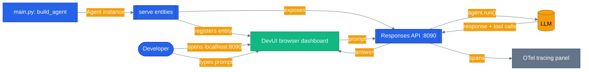

# Chapter 20b — DevUI: interactive dashboard for agents and workflows

> **Post:** [https://nitinksingh.com/posts/maf-v1-20b-devui/](https://nitinksingh.com/posts/maf-v1-20b-devui/) — concept, diagrams, walkthrough.

DevUI is MAF's browser dashboard for local development: type a prompt, watch the tool calls, and inspect OpenTelemetry (OTel) trace spans as the agent runs. **This chapter is Python only.** DevUI for .NET exists only as a prerelease package; [`dotnet/README.md`](./dotnet/README.md) explains why this chapter does not use it.

**You will learn to:**

- Register an agent with DevUI using one `serve()` call
- Drive the agent from a browser and watch its tool calls and trace spans
- Decide when DevUI is the right tool, and why it must stay on your own machine

## Why this chapter

Every earlier chapter drives an agent from a script or a test, so you never *see* it work. That is fine for learning one concept at a time. It is a poor way to debug an agent with several tools or a workflow graph: which tool fired, in what order, with what arguments, and what did the LLM see in response?

DevUI answers that without any UI code from you. Point it at an agent or a workflow, open a browser tab, type a prompt, and watch the tool calls and OTel spans arrive live. Use it to iterate on prompts and tools before you wire an agent into a real chat UI. Use it too when one specialist agent in the capstone (the full application in this repo) misbehaves and you want to test it on its own.

## Prerequisites

- Completed [Chapter 20 — Visualization](../20-visualization/).
- Repo-root `.env` with one LLM provider:

| Provider | Required | Optional |
|----------|----------|----------|
| **OpenAI** | `OPENAI_API_KEY` | `LLM_MODEL` (default `gpt-4.1`) |
| **Azure OpenAI** | `AZURE_OPENAI_ENDPOINT`, `AZURE_OPENAI_KEY`, `AZURE_OPENAI_DEPLOYMENT` | `AZURE_OPENAI_API_VERSION` (default `2024-10-21`) |

This is the one Python chapter that needs a key. It is a long-running dev server that takes arbitrary prompts from a browser, and no recorded response can answer those, so `main.py` needs a live key to start. Its smoke tests skip when no credentials are present (see Gotchas).

## The concept

DevUI ships as its own pre-release package, `agent-framework-devui`, with a single entry point: `serve(entities=[...])`. Hand it a list of MAF `Agent` or `Workflow` objects and it starts a local web server that does three things:

- It serves a browser dashboard for typing prompts and watching structured tool-call and response traces.
- It exposes an OpenAI-compatible Responses API on the same port, so any HTTP client, including a test, can drive it.
- It streams OTel spans into a live tracing panel as the agent runs.

DevUI has a second mode, directory discovery, where it scans a folder of agent modules and registers them for you. This chapter calls `serve()` directly, because it has a single demo agent.

DevUI is not for production. It has no auth, no persistence beyond the life of the process, and no isolation between tenants. It is the interactive counterpart to the Aspire Dashboard from [Chapter 07 — Observability](../07-observability-otel/): Aspire shows what already happened across every service, and DevUI lets you drive one agent and watch it happen.



`serve()` is the only code between an ordinary MAF `Agent` and the dashboard. Nothing in `build_agent()` changes to make it work with DevUI.

## Python

Source: [`python/main.py`](./python/main.py). `main.py` needs a key in the repo-root `.env`, and there is no keyless run for this chapter. From the repo root:

```bash
cd tutorials/20b-devui/python
uv sync
uv run python main.py
# → DevUI opens at http://localhost:8090 (auto-opens browser)
```

Unlike the other chapters, this one does not use the shared `tutorials/` uv project. It has its own `pyproject.toml`, which declares the separate pre-release package `agent-framework-devui`. That is why you `cd` into the chapter and run a plain `uv sync`.

The agent is built like any other chapter's agent, with no DevUI wiring on the `Agent` itself:

```python
def build_agent() -> Agent:
    """Single demo agent — DevUI registers it under the id 'devui-demo'."""
    return Agent(
        _client(),
        instructions="You are a friendly e-commerce assistant for a demo store.",
        name="devui-demo",
        description="Demo agent registered with MAF DevUI",
    )
```

All the DevUI-specific behavior lives in one call, at the bottom of `main.py`:

```python
if __name__ == "__main__":
    # DevUI will open the browser at http://localhost:8090 and stream
    # OpenTelemetry spans into its tracing tab for every run.
    serve(
        entities=[build_agent()],
        port=8090,
        auto_open=True,
        instrumentation_enabled=True,
    )
```

`entities` accepts a list, so you can register several agents or a `Workflow` side by side and switch between them in the browser. This chapter registers one. `instrumentation_enabled=True` turns on the live OTel tracing tab. Without it you still get the chat panel, but no spans.

## .NET

This chapter is Python only, and `dotnet/` holds no runnable code. A `Microsoft.Agents.AI.DevUI` package exists on NuGet, but every release is a prerelease, and the other .NET chapters are pinned to the stable `Microsoft.Agents.AI` 1.28.0. [`dotnet/README.md`](./dotnet/README.md) gives the full reasoning. See also the upstream [DevUI docs](https://learn.microsoft.com/en-us/agent-framework/devui/).

DevUI speaks the OpenAI Responses API, so a .NET `HttpClient` can drive the Python-hosted server if you want to exercise it from .NET code.

## Side-by-side differences

| Aspect | Python | .NET |
|--------|--------|------|
| Package | `agent-framework-devui` (pre-release) | `Microsoft.Agents.AI.DevUI`, prerelease only; not used in this chapter |
| Entry point | `serve(entities=[...])` | N/A |
| Registration | Programmatic (this chapter) or directory discovery | N/A |
| Transport | OpenAI-compatible Responses API on `localhost:8090` | Same API, reachable from .NET via `HttpClient` against the Python server |

## Gotchas

- **Anyone who can reach the port can use your agent.** DevUI has no auth and no tenant isolation. Run it on your own machine against a local `.env`, and never expose it on a shared or public host.
- **The server fails to start because port 8090 is taken.** `serve(..., port=8090)` is hardcoded in this chapter's `main.py`, and DevUI does not pick a free port for you. Change the `port=` argument.
- **The DevUI version you get depends on where you run from.** DevUI is a separate pre-release package, not part of `agent-framework` core. This chapter's own [`python/pyproject.toml`](./python/pyproject.toml) asks for the range `agent-framework-devui>=0.1.0b0`, while the shared `tutorials/pyproject.toml` pins `==1.0.0b261112`. If the dashboard differs from what you read here, check which version is installed.
- **The tests pass but ran nothing.** `python/tests/test_main.py` builds a real `Agent` with `build_agent()`, which needs a working chat client. The whole module is skipped when neither `OPENAI_API_KEY` nor the Azure variables are set. A green run does not prove that credentials are configured.

## Tests

```bash
cd tutorials/20b-devui/python   # from the repo root
uv run pytest -v
```

The tests in `python/tests/test_main.py` need a key and skip without one. They are smoke tests that do not start a DevUI server. They check that `agent_framework.devui.serve` and this chapter's `main` module import, that `build_agent()` returns a MAF `Agent`, and that the agent is named `"devui-demo"`. DevUI uses that name as the entity id in its dashboard URLs.

## How this shows up in the capstone

The capstone ships a launcher, [`scripts/devui.py`](../../scripts/devui.py), whose `build_entities()` registers the application's five specialist agents and two workflows with DevUI, so a developer can test one specialist without the orchestrator in front of it. It is a development tool only: no user-facing part of the application depends on DevUI. [`docs/devui.md`](../../docs/devui.md) has the command and the setup it needs.

Where this chapter's [`python/main.py`](./python/main.py) registers a demo agent, the launcher builds its list from the application's real agent factories. Take Product Discovery's factory, `create_product_discovery_agent()` in `agents/python/product_discovery/agent.py`:

```python
def create_product_discovery_agent() -> Agent:
    """Create the Product Discovery ChatAgent.

    Uses the MCP server when ``MCP_ENABLED=true``, direct asyncpg tools otherwise.
    """
```

Its `return Agent(...)` produces an ordinary MAF `Agent`, the same type this chapter's `build_agent()` returns. That is why DevUI can host the real product-discovery agent, with its semantic search, price history and stock checks, without any change to the factory. The launcher adds what the real tools need around it: a database connection pool and a user identity to run as.

## What's next

- Next chapter: [Chapter 21 — Capstone Tour](../21-capstone-tour/)
- Full source: [`python/`](./python/) · [`dotnet/`](./dotnet/README.md)
- Shared: [Mermaid style guide](../_shared/mermaid-style-guide.md) · [Jargon glossary](../_shared/jargon-glossary.md)
- [MAF docs — DevUI](https://learn.microsoft.com/en-us/agent-framework/devui/)

<!-- BEGIN GENERATED CHAPTER NAV -->
---

**Previous:** [Chapter 20 — Workflow Visualization](../20-visualization/) · [Series index](../README.md) · **Next:** [Chapter 21 — Capstone Tour](../21-capstone-tour/)
<!-- END GENERATED CHAPTER NAV -->
