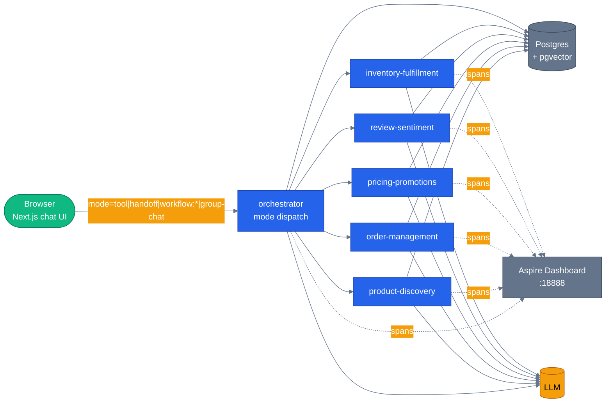

# Chapter 21 — Capstone Tour

This chapter maps every concept from the earlier chapters to the file and symbol where it lives in
the capstone, the full e-commerce application in this repo. It also shows what no other chapter
can: the same question run through five orchestration mechanisms, side by side, with measured
numbers.

**You will learn to:**

- Start the full application and find where each chapter's idea runs in it
- Switch the orchestration mode from the chat box and watch its graph run
- Compare several modes on one prompt by answer, latency, tokens and cost

## Why this chapter

Each earlier chapter teaches one Microsoft Agent Framework concept in isolation, against a small
standalone example. That is the right way to learn a concept, but it leaves a question open: does
any of this change how you would build a real system?

It does, and you can see it here. Every pattern you learned runs in the same multi-agent
e-commerce platform: a `tool` router, MAF's `HandoffBuilder` mesh, two MAF `WorkflowBuilder`
graphs (one concurrent, one sequential with a pause for human approval), and a round-table group
chat. You select one per request, on the same domain. If you have read the earlier chapters, you
can open any file this chapter points at and recognize its shape.

## Prerequisites

- Completed [Chapter 00 — Setup](../00-setup/), and ideally the chapters your interests touch.
  This tour assumes the vocabulary of chapters 01–20 and does not teach it again.
- Docker running. For live answers you also need a `.env` at the repo root with one LLM provider
  configured, as in every other chapter (Chapter 00 has the full variable reference). The guided
  tour with no key, [`run.sh`](./run.sh) below, needs nothing else.
- [`docs/concepts/06-orchestration-patterns.md`](../../docs/concepts/06-orchestration-patterns.md)
  is the conceptual companion to this chapter's mode table, one of the documents in
  [`docs/concepts/`](../../docs/concepts/). Read it first if "handoff vs. workflow vs. group-chat"
  still feels fuzzy.

## The concept

Nobody else publishing Microsoft Agent Framework samples runs the same domain through five
orchestration mechanisms side by side. A router-agent sample, a handoff-mesh sample and a workflow
sample are each easy to find. What is hard to find, and what you need most when you evaluate MAF
for a real project, is an answer to this: when do I reach for which one, and what does that choice
cost in latency, tokens and predictability? You can only answer that by measurement on one domain.
Five unrelated examples that each show their own mechanism cannot answer it.

This repository lets you answer it yourself. Open the chat UI, pick a mode from the switcher, ask
a question, then rerun the same question through a different mode and compare. This chapter is
the map for that tour: where each pattern lives, what each mode is, and what this project's own
evals (scored test runs of each agent) say about the answers.



## The five orchestration modes, and what each one actually costs

Every mode implements the same `run()` contract (`agents/python/orchestrator/modes/base.py`) and
is registered in one place, `agents/python/orchestrator/modes/__init__.py`:

```python
MODES: dict[str, OrchestrationMode] = {
    "tool": ToolRouterMode(),
    "handoff": HandoffMode(),
    "workflow:pre-purchase": PrePurchaseMode(),
    "workflow:return-replace": ReturnReplaceMode(),
    "group-chat": GroupChatMode(),
}
```

| Mode | File | What it is | When to choose it |
|---|---|---|---|
| `tool` (default) | `orchestrator/modes/tool_router.py` | LLM decides which specialist to call, per turn, via a tool call | Open-ended questions where the right specialist isn't knowable in advance |
| `handoff` | `orchestrator/modes/handoff_mode.py` | MAF `HandoffBuilder` mesh — a fixed topology of participants, model decides *when* to hand off within it | A bounded, known set of possible transitions, still needing model judgment on timing |
| `workflow:pre-purchase` | `orchestrator/modes/workflow_mode.py` (`PrePurchaseMode`) | Fixed MAF graph, fan-out to 3 concurrent checks (reviews/stock/price), fan-in, synthesize | The steps are always the same and some genuinely parallelize |
| `workflow:return-replace` | `orchestrator/modes/workflow_mode.py` (`ReturnReplaceMode`) | Fixed sequential MAF graph with an in-workflow HITL (human-in-the-loop) pause (`ctx.request_info`) for high-value returns | A fixed sequence where part of it must be able to pause across requests |
| `group-chat` | `orchestrator/modes/group_chat_mode.py` | Named panelists take turns over a shared transcript, moderator synthesizes a verdict | Multiple perspectives should be visible to each other before a verdict |

In the table, fan-out means sending one input to several steps at once, and fan-in means
collecting their results.

`magentic` is **not** in this table, because the application has no Magentic mode. See
[Chapter 16](../16-magentic-orchestration/) and
[`docs/concepts/06-orchestration-patterns.md`](../../docs/concepts/06-orchestration-patterns.md#whats-missing).

**What each mode costs.** `tool` and `handoff` both pay for at least one extra LLM round trip, the
routing or handoff decision, on top of the specialist's own turn. `handoff` also builds a MAF mesh,
which has its own overhead. The two `workflow:*` modes skip that for their fixed steps: no model
decides *whether* to check stock, and only the final synthesis step calls an LLM. For the question
each is built for, they are faster and cheaper per token than `tool` mode making the same calls
one at a time. `group-chat` costs the most. Every panelist speaks, and the moderator takes a turn,
whatever the question.

No benchmark committed to this repo enforces these claims. They follow from what each mode does,
which is why the next section has you run the comparison yourself.

## Run the comparison yourself

```bash
# from the repo root
./scripts/dev.sh                     # PowerShell: ./scripts/dev.ps1
open http://localhost:3000
```

No key? `./tutorials/21-capstone-tour/run.sh` is `./scripts/dev.sh --demo --no-key`. It pulls the
prebuilt images and plays back recorded model responses. The suggested prompts in the chat get
answers, and anything else says it was not recorded. Sign in as `tour@example.com` / `tour123`.

In the chat UI, pick **Compare** from the mode switcher, enter a prompt, select 2 or more modes,
and run it. `POST /api/orchestration/compare` (`agents/python/orchestrator/routes/orchestration.py`)
runs your prompt through every selected mode **sequentially**, so the modes do not compete for
resources and the latency comparison is fair. It returns each mode's text, latency, step count
and graph, which `web/src/components/chat/mode-comparison.tsx` renders as one column per mode.
Two prompts worth trying, each matched to a difference between modes:

- *"Is this order eligible for return, and what happens next?"* Compare `tool` (one specialist
  call) against `workflow:return-replace` (the fixed 5-step pipeline with the HITL gate).
- *"Should I buy these headphones?"* Compare `tool` against `workflow:pre-purchase` (concurrent
  reviews/stock/price checks) and `group-chat` (value and quality panelists debating it).

Each result card shows the mode's answer, latency, input and output tokens and estimated cost
(`tokens_in`, `tokens_out`, `est_cost_usd`). The two workflow modes call no model, so theirs are
an explicit zero. The compare response does not include the result of grounding verification
(the check that an answer is backed by tool results), so judge correctness by reading the
response text and the timeline. Measured numbers for all five modes are in the
[orchestration benchmark](../../docs/orchestration-benchmark.md).

**Also try the single-mode chat.** `web/src/components/chat/mode-switcher.tsx` lets you pin one
mode per conversation. `orchestration-graph.tsx` animates the live graph next to the response as
the server streams `event: node` frames to the browser. For `workflow:pre-purchase` you watch
three nodes go active at once, then converge.

## Concept → file:line map

Each row points at the code for one chapter's concept. If a pointer has drifted, the chapter it
came from is out of sync too; open an issue.

| Chapter | Where it lives today |
|---|---|
| [01 First Agent](../01-first-agent/) | `agents/python/orchestrator/agent.py` — `create_orchestrator_agent()`, the same `client`+`instructions`+`name` triple as this chapter, plus tools/context/middleware later chapters add |
| [02 Tools](../02-add-tools/) | `agents/python/product_discovery/tools.py` — `search_products`, same `@tool`+`Annotated` shape as this chapter's `get_weather`, now hitting Postgres for real |
| [03 Streaming + Multi-turn](../03-streaming-and-multiturn/) | `agents/python/shared/agent_host.py` — `_run_agent_native_stream`; `agents/python/shared/session.py` — `session_from_id` |
| [04 Sessions](../04-sessions/) | `agents/python/shared/session.py` — `get_history_provider()`, 3 pluggable backends; `agents/python/orchestrator/routes/chat.py` — the real call site |
| [05 Context Providers](../05-context-providers/) | `agents/python/shared/context_providers.py` — `UserProfileProvider`; `agents/python/product_discovery/agent.py` — wired into every specialist |
| [06 Middleware](../06-middleware/) | `agents/python/shared/middleware.py` — `build_specialist_middleware()`, the single wiring point every agent uses, composing 8 layers today |
| [07 Observability](../07-observability-otel/) | `agents/python/shared/telemetry.py` — `setup_telemetry`/`agent_run_span`/`a2a_call_span`; Aspire at `:18888` |
| [08 MCP Tools](../08-mcp-tools/) | `agents/python/packages/mcp-product/`, `mcp-inventory/` — two real MCPServer servers over Streamable HTTP; `agents/python/product_discovery/agent.py` |
| [09 Executors + Edges](../09-workflow-executors-and-edges/) | `agents/python/workflows/pre_purchase.py` — the fan-out/fan-in executor graph |
| [10 Events + Builder](../10-workflow-events-and-builder/) | `agents/python/orchestrator/events.py` — `OrchestrationEvent`, the normalized protocol every mode's stream uses |
| [11 Agents in Workflows](../11-agents-in-workflows/) | `agents/python/orchestrator/modes/group_chat_mode.py` — `_make_agent_responder()`, an `Agent` wrapped as a workflow responder |
| [12 Sequential](../12-sequential-orchestration/) | `agents/python/orchestrator/modes/workflow_mode.py` — `ReturnReplaceMode`, live as `workflow:return-replace` |
| [13 Concurrent](../13-concurrent-orchestration/) | `agents/python/workflows/pre_purchase.py` — same fan-out/fan-in graph, live as `workflow:pre-purchase` |
| [14 Handoff](../14-handoff-orchestration/) | `agents/python/orchestrator/handoff.py` — `build_orchestrator_handoff_workflow()`; `orchestrator/modes/handoff_mode.py` — live as `handoff` |
| [15 Group Chat](../15-group-chat-orchestration/) | `agents/python/workflows/group_chat.py` — `GroupChatWorkflow`; `orchestrator/modes/group_chat_mode.py` — live as `group-chat` |
| [16 Magentic](../16-magentic-orchestration/) | Not live — see the note under the mode table above |
| [17 HITL](../17-human-in-the-loop/) | `agents/python/workflows/return_replace.py` — `ctx.request_info`/`on_decision`, distinct from `shared/hitl.py`'s middleware gate |
| [18 Checkpoints](../18-state-and-checkpoints/) | `agents/python/shared/checkpoint_storage.py` — `PostgresCheckpointStorage`, real `workflow_checkpoints` table, resumable from `/runs` |
| [19 Declarative](../19-declarative-workflows/) | none — the capstone has no declarative loader; return-replace/pre-purchase are hand-coded `WorkflowBuilder` graphs, not YAML |
| [20 Visualization](../20-visualization/) | `scripts/visualize_workflows.py` (static, CI-drift-checked) + `web/src/components/chat/orchestration-graph.tsx` (live, SSE-animated) — two complementary mechanisms |
| [20b DevUI](../20b-devui/) | Not part of the live capstone — it's the recommended way to locally exercise any of these six agents during development |
| [22 Group-Chat Debate](../22-group-chat-debate/) | Same production code as Ch15 — `workflows/group_chat.py` / `group_chat_mode.py`, no separate toy implementation |

## What the evals actually say

The eval harness (`agents/python/evals/harness.py`) runs every specialist agent's golden dataset,
a fixed set of questions with expected answers, through the same production path a user's request
takes. [The evaluation concept page](../../docs/concepts/12-evaluation.md) explains the method.
The committed baselines (`agents/python/evals/baselines/*.json`) are low:

| Agent | Groundedness | Correctness | Completeness | Overall |
|---|---|---|---|---|
| product-discovery | 40% | 10% | 88% | 37.6% |
| order-management | 40% | 70% | 35% | 51% |
| pricing-promotions | 80% | 40% | 40% | 56% |
| review-sentiment | 100% | 20% | 0% | 48% |
| inventory-fulfillment | 80% | 40% | 20% | 52% |
| orchestrator (routing) | 33.3% | 83.3% | 83.3% | 63.3% |

Every one of these is below the 70% pass threshold the harness itself uses. The harness is not at
fault. These scores are the current quality of the six agents' prompts and tool coverage, measured
instead of judged from a demo. Re-run them yourself: `LLM_PROVIDER=replay uv run
--project agents/python python -m evals.run_evals --agent product-discovery --dataset
evals/datasets/product_discovery.json` (see [`evals/README.md`](../../agents/python/evals/README.md)).
This table is what makes the "grounded" and "evaluated" claims elsewhere in this project something
you can check.

## Gotchas

- **Compare is slower than you expect, because it runs modes one after another.** A concurrent
  compare would render sooner, but it could not tell "this mode is slow" from "five modes were
  competing for the same LLM rate limit". With sequential runs, the latency you see belongs to
  that mode alone.
- **The default mode is `tool`, which is not the "best" mode.** `settings.ORCHESTRATION_MODE`
  (`shared/config.py`) sets the deployment default, a per-request `mode` field overrides it, and a
  conversation can pin its own mode. Picking `handoff` or a `workflow:*` mode for one conversation
  changes nothing for any other conversation.
- **Some modes show no animated diagram.** Only `workflow:pre-purchase`, `workflow:return-replace`
  and `group-chat` implement `graph_mermaid()`. `tool` and `handoff` both return `None`, and each
  mode's `capabilities` reports this as `is_graph`. See
  [Chapter 07 — Graphs in agent systems](../../docs/concepts/07-graphs-in-agent-systems.md).
- **The eval table above goes out of date.** These are the scores at the committed baseline. If
  you improve a prompt or add a tool, re-run the suite and update `evals/baselines/`, or the
  numbers in this chapter stop being true.

## What was deliberately left out, and why

- **Magentic orchestration** (Chapter 16) has no live mode. The manager and worker planning pattern
  is MAF functionality this repo teaches, but there is no sixth `orchestrator/modes/` entry for it.
- **A grounding column on the Compare response** — the grounding verifier exists but its result is
  not threaded into `CompareModeResult`.
- **Production concerns** (idempotency, retries, rate limiting and the rest) are not toured here —
  see [`docs/concepts/14-production-concerns.md`](../../docs/concepts/14-production-concerns.md)
  for what the application does about each.
- **A `.NET` version of this tour** isn't written. The .NET backend runs the same five modes
  (`agents/dotnet/src/ECommerceAgents.Orchestrator/Modes/`, start it with `./scripts/dev.sh --dotnet`),
  but the file pointers in this chapter are to the Python code; the
  [parity matrix](../../docs/parity-matrix.md) lists the differences.

## What's next

This is where the course's concepts meet the application. From here:

- [`docs/concepts/`](../../docs/concepts/) — the foundations layer, if you started here instead of
  at Chapter 00 and want the conceptual version of everything this tour just pointed at in code.
- [`docs/architecture.md`](../../docs/architecture.md) — the system-level view: auth, data flow,
  technology decisions, beyond what one chapter can cover.
- [Chapters 22 to 32](../README.md#learning-paths) — more orchestration patterns (round-table
  debate, agent-as-tool, reflection, planner-executor, subworkflows) and the production chapters
  (A2A, grounding, guardrails, evals, compensation, cost budgets).
- [`docs/parity-matrix.md`](../../docs/parity-matrix.md) — what the Python and .NET backends each
  cover, row by row.
- Or go build something — every pattern in this repo is meant to be copied, not just read.

<!-- BEGIN GENERATED CHAPTER NAV -->
---

**Previous:** [Chapter 20b — DevUI: interactive dashboard for agents and workflows](../20b-devui/) · [Series index](../README.md) · **Next:** [Chapter 22 — Group-Chat Debate (Round-Table Orchestration)](../22-group-chat-debate/)
<!-- END GENERATED CHAPTER NAV -->
