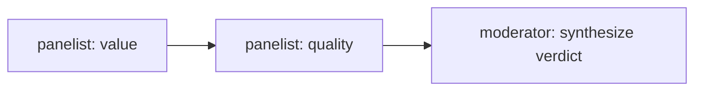

# Chapter 22 — Group-Chat Debate (Round-Table Orchestration)

Run a **round-table**: several panelists debate a question over a shared transcript,
then a moderator synthesizes a verdict. In the capstone (the full application in this
repo) this is `group-chat`, one of the five orchestration modes it runs. The others are
`tool`, `handoff`, `workflow:pre-purchase` and `workflow:return-replace`. The code is
`workflows/group_chat.py`, and this chapter runs it directly.

**You will learn to:**

- Build a round-table workflow from an ordered list of panelists and a moderator
- Give each panelist the transcript so far, so it can respond to earlier turns
- Run and test the debate with plain functions in place of model calls

## Why this chapter

[Chapter 15 — Group Chat Orchestration](../15-group-chat-orchestration/) covers the
cooperative shape of group chat. A manager, round-robin or agent-driven, picks who speaks
next, and the roster (Writer → Critic → Editor) *refines a single artifact* across rounds.
Every participant works toward the same output. The manager decides whose turn it is, with
a hard `max_rounds` cap because the speaker-selection loop could otherwise run forever.

This chapter uses the same primitive, a shared transcript passed through named
participants, for a **debate** instead of a refinement pipeline. Each panelist holds a
fixed, named perspective for the whole run (a value and pricing voice, a quality and
reviews voice) and never revises anyone else's turn. Panelists see the running transcript,
so they can build on or push back against what has been said. Their *position* does not
change; only their argument gains context.

No manager selects a speaker either. The order is fixed at construction time by the order
of the `panelists` list, so there is nothing to loop or cap. The moderator does not polish
one artifact into its next draft. It weighs positions that were never reconciled during
the conversation and gives a single verdict. So Chapter 15 refines one output, and this
chapter synthesizes across fixed, independent positions.

## When to use it

Use a round-table when several perspectives must *react to each other* before a
decision. An example is "is this product worth buying?", weighed by a value and pricing
voice and a quality and reviews voice. In the concurrent pattern, independent checks run
separately and are merged once. Here each panelist sees the running transcript and can
build on or counter earlier turns.



## How it works

Each panelist is an `Executor` (a node in the workflow graph) that appends one turn to
a shared `GroupChatState` transcript and forwards it. The moderator is the last executor
and yields the synthesized verdict. In outline:

```python
from agent_framework import Executor, handler
from agent_framework import WorkflowContext

class _PanelistExecutor(Executor):
    @handler
    async def run(self, state, ctx: WorkflowContext[GroupChatState, GroupChatState]):
        state.transcript.append({"speaker": self._name,
                                 "text": self._responder(state.question, state.transcript)})
        await ctx.send_message(state)          # forward to the next panelist
```

The forwarders are typed `WorkflowContext[State, State]`; the moderator (terminal)
is `WorkflowContext[None, State]` and calls `ctx.yield_output(state)`.

## Prerequisites

- No API key needed. `main.py` imports no chat client. Its panelists and synthesizer are plain callables, so the run below makes no model call.
- `main.py` imports the application's `workflows.group_chat` module from `agents/python`, which is why the run command sets `PYTHONPATH`.

## Run it

From the repo root:

```bash
PYTHONPATH=agents/python uv run --project tutorials python tutorials/22-group-chat-debate/python/main.py
```

You should see:

```
Transcript:
     value: Strong price for the feature set; frequent discounts.
   quality: Considering 1 prior point(s): reviews show excellent build quality.

Moderator verdict:
  Verdict on 'Is the Sony WH-1000XM5 worth it?': both value and quality perspectives are positive across 2 turns — recommended.
```

The `quality` line reports `1 prior point(s)`: it saw the `value` turn before it spoke. The Python and .NET demos both pass their own moderator (`synthesize` / `Synthesize`), which produces the "Verdict on ..." line; without one, the application's default moderator lays out each panelist's actual words under the question, with no model call.
`workflows/group_chat.py` is the application's own module, not a copy, and it lives in
the `agents/python` package. `PYTHONPATH=agents/python` is what lets the demo import it
as `workflows.group_chat`.

Panelist behavior is a plain `Responder` callable, so the same workflow runs without an
LLM in a few lines:

```python
import asyncio
from workflows.group_chat import GroupChatWorkflow

wf = GroupChatWorkflow(panelists=[
    ("value",   lambda q, transcript: "Strong price for the feature set."),
    ("quality", lambda q, transcript: f"Considering {len(transcript)} prior point(s): build quality is excellent."),
])
state = asyncio.run(wf.execute("Is the Sony WH-1000XM5 worth it?"))
print(state.verdict)
for turn in state.transcript:
    print(f"  {turn['speaker']}: {turn['text']}")
```

The chapter's tests put `agents/python` on `sys.path` themselves, so they run under
the `tutorials/` project like every other chapter, also from the repo root:

```bash
uv run --project tutorials pytest tutorials/22-group-chat-debate/python/tests -v
```

They cover this chapter's demo: its panelists, its synthesizer, and the claim that a
later panelist sees earlier turns. `agents/python/tests/test_workflow_group_chat.py`
is a separate file that tests the **module**. The shared-transcript claim needs its own
test, because two panelists that never mention each other produce the same transcript
whether or not the state is shared.

In the application, each panelist is backed by a model: you pass a responder that calls
an agent in place of the plain function.

## .NET

Source: [`dotnet/Program.cs`](./dotnet/Program.cs). No key is needed. From the repo root:

```bash
cd tutorials/22-group-chat-debate/dotnet
dotnet run
dotnet test tests/GroupChatDebate.Tests.csproj
```

**The two language sides of this chapter differ on purpose.** Python imports the
application's module and runs shipped code. .NET has no equivalent standalone type: the
application's .NET round-table lives inside
`ECommerceAgents.Orchestrator.Modes.GroupChatMode` as an LLM-backed sequential loop,
not a reusable workflow class. So the .NET side of this chapter reimplements the same
shape as a standalone program.

The behaviour matches. Keep in mind that the Python side runs the application's code
and the .NET side is a model of it.

```csharp
public sealed record GroupChatWorkflow(
    IReadOnlyList<(string Name, Responder Responder)> Panelists,
    Func<GroupChatState, string>? Synthesizer = null);
```

`GroupChatState` is a **class, not a record**, on purpose. It is passed by reference
from executor to executor, and that shared mutable instance *is* the transcript. A
record with value semantics would hand each panelist a private copy and turn the
round-table into a fan-out (independent steps that never see each other). Every
panelist would see an empty transcript, and nothing would raise an error.

`Responder` returns `ValueTask<string>`, so an agent-backed panelist fits without a
change to the signature.

The tests on both sides hand panelists a responder that *reports what it could see*,
because that is the only way to tell a round-table from a fan-out.

## Gotchas

- **You look for a `max_rounds` setting and there is none.** Chapter 15's
  manager-driven group chat needs a cap to stop a selector that might never terminate.
  This workflow has no loop to cap. `GroupChatWorkflow._build()`
  (`agents/python/workflows/group_chat.py`) wires a straight chain,
  `panelist[0] -> panelist[1] -> ... -> moderator`, from the order of the `panelists`
  list. The debate is always exactly `len(panelists)` turns long. To get more turns,
  add another `(name, responder)` pair.
- **A panelist's turn reads "(name could not respond: ...)" and the run still
  succeeds.** `_PanelistExecutor.run()` (`agents/python/workflows/group_chat.py`)
  wraps the responder call in `try/except`. On failure it logs
  `group_chat.panelist_failed`, appends `"({name} could not respond: {exc})"` as that
  panelist's turn, and lets the chain continue, so the moderator still gives a verdict.
  A broken panelist (a bad prompt, an LLM timeout) therefore raises no error to the
  caller. Check the logs or look for the placeholder text. The one exception is a
  missing replay recording, which is re-raised. See `test_panelist_failure_is_contained`
  (`agents/python/tests/test_workflow_group_chat.py`).
- **A coroutine object shows up in the transcript instead of text.** That is what an
  `async` responder would produce if nothing awaited it. `Responder` accepts sync or
  async callables, and `_PanelistExecutor.run()` checks `inspect.isawaitable(result)`
  before awaiting. An agent-backed
  panelist, an `async def` closure that calls `agent.run()`, therefore fits without
  `workflows/group_chat.py` knowing anything about MAF `Agent` objects.
  `test_async_responder_is_awaited`
  (`agents/python/tests/test_workflow_group_chat.py`) guards this.

## How this shows up in the capstone

In the capstone, a user picks **group-chat** in the chat UI's mode switcher and gets a
verdict that a value panelist and a quality panelist have argued over first. The class
behind it is the one this chapter runs: `GroupChatWorkflow`
(`agents/python/workflows/group_chat.py`). Both
`tutorials/22-group-chat-debate/python/main.py` and
`agents/python/tests/test_workflow_group_chat.py` import it from
`workflows.group_chat`. No second copy of the pattern lives under `tutorials/`.

The application's caller is `GroupChatMode`
(`agents/python/orchestrator/modes/group_chat_mode.py`), registered in the
orchestrator as the `group-chat` mode. It uses the same two panelist names as this
chapter's demo, `value` and `quality` (`_PANEL_PROMPTS` in the same file). In place of the plain
callables above, `_make_agent_responder()` builds an `Agent` per
panelist and awaits `agent.run(...)`. That is the case the async-responder gotcha
describes.

## Key points

- Sequential round-table ≠ concurrent fan-out: turns are ordered and each sees the
  shared transcript.
- Inject panelist behavior so the workflow is unit-testable without a live LLM.
- Type the terminal executor `WorkflowContext[None, State]` — a forwarding type on
  the terminal stops the chain early.

<!-- BEGIN GENERATED CHAPTER NAV -->
---

**Previous:** [Chapter 21 — Capstone Tour](../21-capstone-tour/) · [Series index](../README.md) · **Next:** [Chapter 23 — A2A Protocol](../23-a2a-protocol/)
<!-- END GENERATED CHAPTER NAV -->
