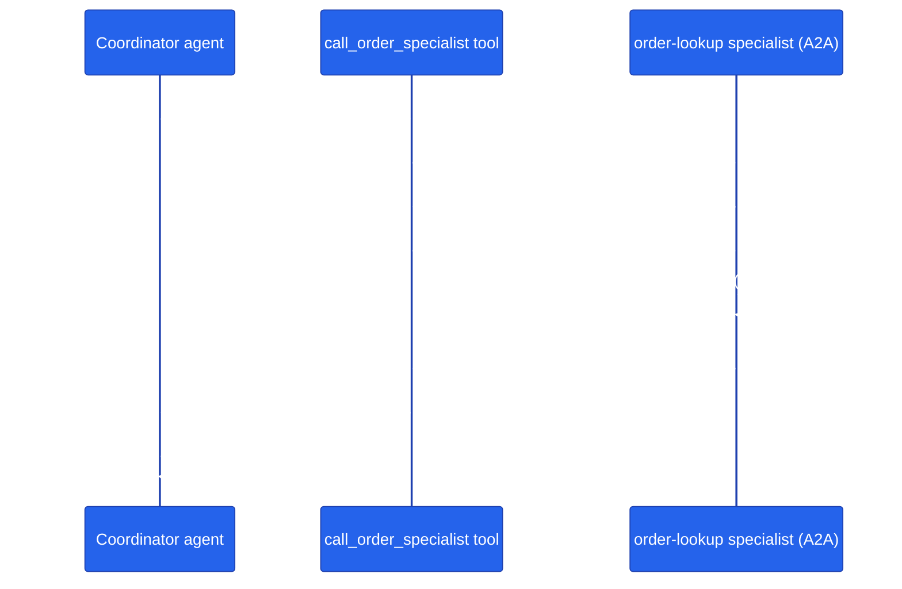

# Chapter 23 — A2A Protocol

This chapter puts an agent behind three HTTP endpoints and calls it from a second agent that never imports its code. A2A (agent-to-agent) is the name for that kind of call between agent processes.

**You will learn to:**

- Serve an agent over HTTP with an identity document, a blocking endpoint and a streaming endpoint
- Call that agent from another agent's tool, using nothing but an HTTP client
- Read a Server-Sent Events (SSE) reply and tell a finished stream from a failed one
- Decide when a process boundary between two agents is worth its cost

## Why this chapter

Every other chapter in this series builds an `Agent` in one process and calls `.run()` on it directly. In the capstone (the full application in this repo) that is not possible. Each specialist agent — product discovery, order management, pricing, reviews, inventory — runs as its own FastAPI process on its own port, deployed and scaled independently.

The orchestrator reaches them over HTTP. Its main tool, `call_specialist_agent` (`agents/python/orchestrator/agent.py:93`), is an HTTP call wrapped in a tool. This is the first chapter where the caller and the agent are different processes, and that gap is the subject.

The application serves two wires on every specialist. One is the standard A2A 1.0 protocol, JSON-RPC at `/a2a/v1`, built on the official SDKs. The other is a simpler pair of endpoints, `POST /message:send` and `POST /message:stream`, which is what the orchestrator speaks by default. This chapter teaches the simple pair, because you can build both sides of it by hand in one file and see every byte.

## Prerequisites

- Completed [Chapter 02 — Adding Tools](../02-add-tools/). A tool is how the coordinator agent triggers the A2A call.
- Read [docs/concepts/04-agent-harness.md](../../docs/concepts/04-agent-harness.md), which introduces the transport and identity shapes this chapter builds.
- No API key needed: with none set, `main.py` replays recorded responses and prints one line saying so. To use a live model instead, put `OPENAI_API_KEY` (or the `AZURE_OPENAI_*` variables) in the repo-root `.env`

## The concept

The wire in this chapter is three plain HTTP endpoints in front of an `Agent`, plus a caller that knows their shapes. MAF's `Agent` class knows nothing about any of it. In the application, `agents/python/shared/agent_host.py::create_agent_app()` puts these endpoints in front of every specialist, and `call_specialist_agent` is the calling side.

**Identity.** Every specialist serves `GET /.well-known/agent-card.json`. The agent card is a JSON document a caller fetches to confirm who it is about to talk to before sending real traffic. This chapter's specialist serves a four-field card (name, description, url, version) at the same well-known path. The application's card is the fuller A2A 1.0 document, which also lists the agent's interfaces, capabilities and skills.

**Transport, in two shapes.** `POST /message:send` (`agents/python/shared/agent_host.py:302`) is blocking request/response. You send `{"message": "..."}` and get back `{"response": "...", "steps": [...]}` once the specialist's `agent.run()` finishes.

`POST /message:stream` (`agents/python/shared/agent_host.py:351`) takes the same request body and replies with Server-Sent Events. Each piece of text is a `data: <chunk>` frame, each tool call the specialist made is an `event: step` frame, and the stream ends with `data: [DONE]`. A failure arrives as `data: [ERROR...]`.

The orchestrator's `call_specialist_agent` speaks both. It opens the streaming endpoint when the browser has a live SSE connection, and forwards chunks as they arrive. Otherwise it uses the blocking endpoint.

**Why this matters.** A process boundary lets each specialist run as an independent, separately scaled, separately deployed service, instead of one large agent holding every tool. You can redeploy the product-discovery agent, run three replicas of it, or rewrite it in another language, and the orchestrator's code does not change. The orchestrator depends on the HTTP contract and nothing else.

**When to use it, and when not to.** Use A2A at a real process boundary: another service, another team, another language, or a component that must scale or deploy on its own. It costs a network hop, JSON serialization, and a new failure mode, because the callee can be down, slow or unreachable. If two agents always live in the same process and the same deployment, that cost buys nothing. `Agent.as_tool()` ([Chapter 27](../27-agent-as-tool/)) wraps a second agent as an in-process tool call with no HTTP at all.



The coordinator never imports the specialist's code. It knows an HTTP address and the shape of the endpoints, which is the same relationship the application's orchestrator has with each of its five specialists.

## Python

Run from the repo root. The shared `tutorials/` uv project covers every chapter, so one `uv sync` is enough:

```bash
uv sync --project tutorials
uv run --project tutorials python tutorials/23-a2a-protocol/python/main.py
```

You should see:

```text
No LLM key found - replaying the recorded fixture (set OPENAI_API_KEY or the AZURE_OPENAI_* variables for a live run).
Q: What's the status of order ORD-1001?
A: Order ORD-1001 has been shipped and is scheduled to arrive on 2026-08-22.

Agent card: {'name': 'order-lookup', 'description': 'Looks up order status by order id.', 'url': 'http://order-lookup.local', 'version': '1.0'}
Streamed frames: ['Shipped, arriving 2026-08-22.']
```

The answer comes from the model calling `call_order_specialist`, which makes an A2A round trip to the specialist app. The last two lines are a raw agent-card fetch and a raw streamed call, so you can see both transport shapes without the model in the way.

Source: [`python/main.py`](./python/main.py).

### Why an in-process transport

The application binds a real TCP port per specialist and calls it with a real `httpx.AsyncClient`. Starting a `uvicorn` server inside a tutorial's tests invites port collisions, startup races and leaked sockets. So this chapter's specialist is a real ASGI app, with real Starlette routing, JSON encoding and SSE framing, driven through `httpx.ASGITransport`. That transport calls the app in-process instead of opening a socket:

```python
def _specialist_client() -> httpx.AsyncClient:
    transport = httpx.ASGITransport(app=SPECIALIST_APP)
    return httpx.AsyncClient(transport=transport, base_url=SPECIALIST_BASE_URL, timeout=10)
```

Every request still goes through Starlette's full routing and serialization. The request and response shapes match what `agent_host.py` serves; only the socket is skipped.

### The specialist: real A2A endpoints

```python
def build_specialist_app() -> Starlette:
    return Starlette(
        routes=[
            Route("/.well-known/agent-card.json", _agent_card, methods=["GET"]),
            Route("/message:send", _message_send, methods=["POST"]),
            Route("/message:stream", _message_stream, methods=["POST"]),
        ]
    )
```

These are the same three paths every specialist in the application serves. `_message_send` returns `{"response": ..., "steps": []}`. `_message_stream` yields `data: <chunk>` frames and finishes with `data: [DONE]`, the sentinel `call_specialist_agent` looks for.

### The coordinator's tool: the A2A call

```python
@tool(name="call_order_specialist", description="Call the order-lookup specialist over A2A ...")
async def call_order_specialist(message: Annotated[str, Field(description="...")]) -> str:
    request_body = {"message": message}
    async with _specialist_client() as client:
        resp = await client.post("/message:send", json=request_body)
        resp.raise_for_status()
        data = resp.json()
        return str(data.get("response", resp.text))
```

This is the blocking path of `orchestrator/agent.py`, without the streaming branch and the registry lookup: build a body, `POST /message:send`, read `response`. The model decides to call this tool the same way it decided to call Chapter 02's `get_product_price`. The difference is what the tool does once called: an HTTP round trip instead of a dictionary lookup.

## .NET

Source: [`dotnet/Program.cs`](./dotnet/Program.cs).

```bash
# From the repo root. Needs no API key.
dotnet test tutorials/23-a2a-protocol/dotnet/tests/A2AProtocol.Tests.csproj

# Needs an API key in the repo-root .env. Note the cd.
cd tutorials/23-a2a-protocol/dotnet
dotnet run
```

`dotnet run` calls a live model, so it needs `OPENAI_API_KEY` or the `AZURE_OPENAI_*` variables. Run the tests first if you have no key.

**The chapter's wire needs no SDK.** It is three endpoints and an SSE frame format, so the .NET specialist is ordinary ASP.NET Core minimal APIs:

```csharp
app.MapGet("/.well-known/agent-card.json", () => Results.Json(Card));

app.MapPost("/message:send", (A2ARequest request) =>
    string.IsNullOrWhiteSpace(request.Message)
        ? Results.Json(new { error = "No message provided" }, statusCode: 400)
        : Results.Json(new A2AResponse(LookupOrder(request.Message), Array.Empty<string>())));
```

Any language with an HTTP client can be the caller, and any web framework can host the agent. The official A2A .NET SDK is a preview release, and the application uses it only for its A2A 1.0 wire.

The in-process transport is `Microsoft.AspNetCore.TestHost`, the counterpart to Python's `httpx.ASGITransport`. You get real routing, real model binding and real SSE writing, with no socket.

### The asymmetry between the two transports

`/message:send` can reject an empty message with a `400`. `/message:stream` **cannot**: `200 OK` went out before anything went wrong, so the failure has to travel in-band as a frame:

```csharp
await context.Response.WriteAsync("data: [ERROR: no message]\n\n");
```

A caller that only checks the status code sees a successful, empty answer. That is why the SSE reader treats an `[ERROR` prefix as a failure and the `[DONE]` sentinel as termination, and why the tests assert both.

## Side-by-side differences

| Aspect | This chapter | The application (`agents/python/`) |
|--------|--------------|-----------------------------------|
| Transport | `httpx.ASGITransport` (in-process, no socket) | Real TCP, `httpx.AsyncClient` over the network |
| Specialist host | `Starlette` app built ad hoc in `main.py` | `shared/agent_host.py::create_agent_app()`, one per specialist microservice |
| Identity | Four-field card at `/.well-known/agent-card.json` | Same path, full A2A 1.0 card (`shared/a2a_server.py`) |
| Blocking call | `POST /message:send`, same body/response shape | Same endpoint (`orchestrator/agent.py:248-265`) |
| Streaming call | `POST /message:stream`, same SSE framing | Same endpoint (`orchestrator/agent.py:126-211`), forwarded live to the browser |
| Standard A2A 1.0 | Not shown | JSON-RPC at `/a2a/v1` on every specialist, chosen by the caller with `A2A_TRANSPORT=a2a` |
| Auth headers | None: same process, no trust boundary to cross | `X-Agent-Secret` plus the user's identity (`build_a2a_headers()`) |

## Gotchas

- **A stream that ends with no text may be a failure.** `[DONE]` and `[ERROR...]` are string prefixes on the SSE payload, not a structured field. If you skip the `[ERROR` check, an upstream failure becomes an empty or garbage answer instead of a caught error. `demo_stream_call()` raises `RuntimeError(payload)` for this case.
- **A failed streaming call is not always safe to retry on the blocking endpoint.** The two endpoints are separate code paths. Once the specialist has accepted a stream, its tools may already have run, so the application retries on `/message:send` only when the request provably never started (`_request_never_ran` in `orchestrator/agent.py`).
- **Tests pass but the real call times out.** `ASGITransport` proves the request and response shapes without a live server. It does not exercise timeouts, connection resets or DNS, which the application's `httpx.TimeoutException` / `httpx.HTTPStatusError` handling has to cover.
- **Copying this demo into a real service leaves the call unauthenticated.** The coordinator and specialist here are one trusted process, so no auth headers are sent. The application attaches `X-Agent-Secret` and the user's identity to every call (`build_a2a_headers()` in `shared/oauth/service_client.py`), because a specialist is a real trust boundary.
- **This chapter's wire is not the standard A2A 1.0 protocol.** A standard A2A client expects JSON-RPC and the full agent card, and cannot talk to these endpoints. For that wire, see the application's `/a2a/v1` surface in [docs/a2a.md](../../docs/a2a.md).

## Tests

```bash
uv run --project tutorials pytest tutorials/23-a2a-protocol/python/tests -v
dotnet test tutorials/23-a2a-protocol/dotnet/tests/A2AProtocol.Tests.csproj
```

Run both from the repo root. Neither needs an API key.

The tests drive the real Starlette app through `ASGITransport`. They prove the agent card, the blocking round trip, and the stream's `[DONE]` and `[ERROR` handling, then replay a recorded model conversation in which the coordinator calls the specialist. Tests against a live model are skipped unless credentials are present.

## How this shows up in the capstone

Every specialist in the application is served this way, so each chat request you send in the web UI reaches a specialist over one of these calls. The specialists serve two wires side by side, on both the Python and .NET stacks:

- **A2A 1.0, the standard protocol.** `agents/python/shared/a2a_server.py:715` is `mount_a2a`, which adds the agent card at `/.well-known/agent-card.json` and the JSON-RPC routes at `/a2a/v1`, using the official `a2a-sdk`. The .NET specialists do the same with the official A2A .NET SDK. [docs/a2a.md](../../docs/a2a.md) has the detail.
- **The pair this chapter teaches.** `agents/python/shared/agent_host.py:302` and `agents/python/shared/agent_host.py:351` are the `/message:send` and `/message:stream` handlers that this chapter's `_message_send` and `_message_stream` mirror.

The caller picks the wire with `A2A_TRANSPORT`, which defaults to `legacy`, the `/message:send` pair. Setting it to `a2a` switches the orchestrator to A2A 1.0.

- `agents/python/orchestrator/agent.py:93` is `call_specialist_agent`, the orchestrator's A2A-calling tool. It builds the same `{"message": ...}` body and opens an `a2a_call_span` for tracing. It streams when the browser has an SSE connection and blocks otherwise, with the `[DONE]`/`[ERROR` handling that `demo_stream_call()` reproduces. With `A2A_TRANSPORT=a2a` it hands the call to `_call_over_a2a` (`agents/python/orchestrator/agent.py:293`) instead.
- `agents/python/shared/remote_agent.py:71` is `RemoteSpecialistChatClient`, a second caller. It wraps a specialist as a MAF `BaseChatClient` so `HandoffBuilder` can route to a remote specialist as if it were a local `Agent`.

For the harness side — lifecycle, telemetry, session rehydration — see [docs/concepts/04-agent-harness.md](../../docs/concepts/04-agent-harness.md).

## What's next

- Next chapter: [Chapter 24 — RAG and Grounding](../24-rag-and-grounding/)
- Full source: [`python/`](./python/)
- Shared: [Mermaid style guide](../_shared/mermaid-style-guide.md) · [Jargon glossary](../_shared/jargon-glossary.md)

<!-- BEGIN GENERATED CHAPTER NAV -->
---

**Previous:** [Chapter 22 — Group-Chat Debate (Round-Table Orchestration)](../22-group-chat-debate/) · [Series index](../README.md) · **Next:** [Chapter 24 — RAG and Grounding](../24-rag-and-grounding/)
<!-- END GENERATED CHAPTER NAV -->
