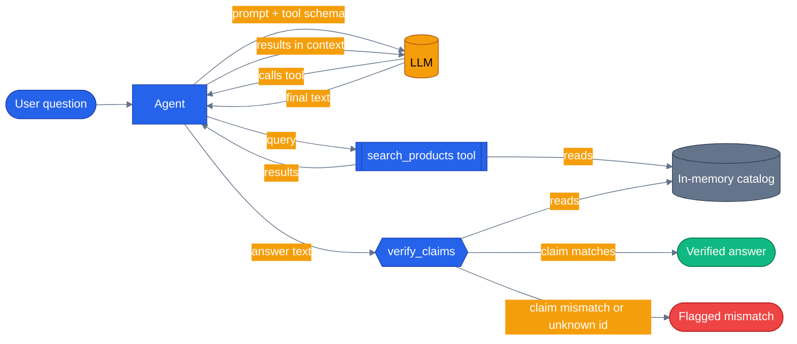

# Chapter 24 — RAG and Grounding

This chapter gives an agent a search tool so it answers from real data, then checks the finished answer against that data. The first half is retrieval (the R in RAG, retrieval-augmented generation). The second half is grounding: confirming that what the model wrote matches the source.

**You will learn to:**

- Give an agent a search tool over a catalog instead of letting it answer from memory
- Extract the checkable claims (a product id, a price) from a model's answer
- Verify each claim against the source of truth and flag a mismatch
- Tell retrieval apart from verification, and know when each is worth its cost

## Why this chapter

Every earlier chapter trusted the model's final sentence. Chapter 02 gave the agent a
`get_product_price` tool and assumed that whatever the model said afterwards matched the tool's
result. For a four-item demo catalog that is safe enough.

It stops being safe when "the model says a price" is a support conversation with money attached.
Nothing in Chapter 02 checks that the number in the model's sentence matches the number the tool
returned. A model that paraphrases "\$79.99" as "\$97.99" goes undetected.

This chapter builds the two mechanisms that close the gap: a **retrieval** tool so the agent has
real data to answer from, and a **grounding verification** step that checks the answer's specific
claims against that data. They are not the same thing, and treating them as one is the most common
mistake in RAG write-ups. [`docs/concepts/09-grounding-and-rag.md`](../../docs/concepts/09-grounding-and-rag.md)
explains why models fabricate in the first place.

## Prerequisites

- Completed [Chapter 02 — Adding Tools](../02-add-tools/) (tool decorators, `Annotated` params)
- Read [`docs/concepts/09-grounding-and-rag.md`](../../docs/concepts/09-grounding-and-rag.md).
  This chapter is the hands-on companion to it.
- No API key needed: with none set, `main.py` replays recorded responses and prints one line saying so. To use a live model instead, put `OPENAI_API_KEY` (or the `AZURE_OPENAI_*` variables) in the repo-root `.env`

## The concept

**Retrieval** is giving the agent a `search` tool over a real knowledge base instead of letting
it answer from training data. Mechanically it is Chapter 02's tool-calling loop again: the model
sees a tool schema, decides to call it, MAF invokes the function, and the result lands in context
before the model writes its final answer. What is new is the reason. A product catalog changes
daily; the model's weights do not. Without a search tool, the model can only generate something
plausible for "do you have noise-cancelling headphones", and plausible text looks exactly like
true text.

**Grounding verification** is a separate mechanism that runs *after* the model answers. Having
real data available during generation does not guarantee the model repeats it correctly. The final
answer is still the most statistically plausible continuation, not a copy of the tool result. A
model can call `search_products`, see `{"id": "P001", "price": 129.99}`, and still write "$119.99".

Verification closes that gap. It extracts the checkable claims from the model's answer (a product
id, a price) and checks each one against the same source of truth the tool used. Anything that
does not match is flagged.

This chapter's demo skips Postgres and pgvector. A Python list of dicts stands in for the product
table, a keyword match stands in for a search query, and a small dataclass-based verifier stands
in for a full grounding pipeline. The shape is the same one
`agents/python/product_discovery/tools.py` and `agents/python/shared/grounding/verifier.py` have
in the capstone (the full application in this repo): a search tool in, claim extraction and a
source-of-truth check out.

Grounding earns its cost when an answer contains specific facts that are expensive to get wrong:
a price, an order status, a stock count. A purely conversational reply ("happy to help — what are
you looking for?") makes no factual claim, so there is nothing to verify. This chapter's
`verify_claims()` reports zero claims for that case and does not treat it as a failure.



Retrieval (the loop through the tool) happens *during* generation. Verification happens *after*
the final text comes back. It is a second pass against the same source of truth, and it does not
care whether the model had access to the right answer.

## Python

Run from the repo root. The shared `tutorials/` uv project covers every chapter, so one `uv sync`
is enough:

```bash
uv sync --project tutorials
uv run --project tutorials python tutorials/24-rag-and-grounding/python/main.py
```

You should see:

```
No LLM key found - replaying the recorded fixture (set OPENAI_API_KEY or the AZURE_OPENAI_* variables for a live run).
Q: Do you have any noise-cancelling headphones? What's the price and product id?
A: Yes, we have Wireless Noise-Cancelling Headphones (product id: P001) available for $129.99.
Grounding: 1/1 claims verified
```

The `A:` line is retrieval at work. The `Grounding:` line is the separate check on what the model
wrote.

Source: [`python/main.py`](./python/main.py). The retrieval tool is a substring match over an
in-memory catalog, standing in for the pgvector query in `product_discovery/tools.py`:

```python
@tool(
    name="search_products",
    description="Search the product catalog by keyword. Returns matching products with id, name, and price.",
)
def search_products(
    query: Annotated[str, Field(description="Keyword(s) to match against product name or category.")],
) -> list[dict]:
    words = [w for w in query.lower().split() if w]
    matches = []
    for product in CATALOG:
        haystack = f"{product['name']} {product['category']}".lower()
        if any(word in haystack for word in words):
            matches.append(product)
    return matches
```

The verification step runs after `ask()` returns. It is not a tool, so the model cannot see it or
skip it:

```python
def verify_claims(claims: list[ProductClaim], catalog: list[dict] | None = None) -> GroundingReport:
    catalog_by_id = {p["id"]: p for p in (catalog or CATALOG)}
    verdicts: list[ClaimVerdict] = []
    for claim in claims:
        product = catalog_by_id.get(claim.id)
        if product is None:
            verdicts.append(ClaimVerdict(claim.id, "not_found", "no product with this id in the catalog"))
            continue
        if claim.price is not None and abs(claim.price - product["price"]) >= _PRICE_TOLERANCE:
            detail = f"catalog price is ${product['price']:.2f}, not ${claim.price:.2f}"
            verdicts.append(ClaimVerdict(claim.id, "price_mismatch", detail))
            continue
        verdicts.append(ClaimVerdict(claim.id, "verified"))
    return GroundingReport(verdicts=verdicts)
```

An answer with no factual claim gives an empty report: `0/0 claims verified`, not a failure. To
see the failure retrieval alone cannot catch, change a price in `CATALOG` after a reply is
recorded and verify the old reply against the new catalog. You get a `price_mismatch` verdict.

## .NET

Source: [`dotnet/Program.cs`](./dotnet/Program.cs).

```bash
# From the repo root. Needs no API key.
dotnet test tutorials/24-rag-and-grounding/dotnet/tests/Rag.Tests.csproj

# Needs an API key in the repo-root .env. Note the cd.
cd tutorials/24-rag-and-grounding/dotnet
dotnet run
```

`dotnet run` calls a live model, so it needs `OPENAI_API_KEY` or the `AZURE_OPENAI_*` variables.
Run the tests first if you have no key.

The same two mechanisms, kept separate:

```csharp
// 1. Retrieval — a tool, so the model reads real data instead of remembering.
[Description("Search the product catalog by keyword. Returns matching products with id, name, and price.")]
public static string SearchProducts(string query) { /* ... */ }

// 2. Grounding verification — runs AFTER the answer, against the same catalogue.
public static GroundingReport VerifyAnswer(string answer, IReadOnlyList<CatalogProduct>? catalog = null) =>
    VerifyClaims(ExtractClaims(answer), catalog);
```

Retrieval alone does not give you grounding, but that is awkward to show against a live model. A good model usually copies the price correctly, so the interesting case is rare. A scripted `IChatClient` makes it reproducible: hand the agent the correct price and have it answer with a rounded one. `Retrieval_Succeeding_Does_Not_Make_The_Answer_Grounded` then shows a run that is correct at every step except the one the customer cares about.

The tests also pin a limitation. The extractor regex is `\bP0\d{2}\b`, so a hallucinated `P999` is never extracted and never verified. The answer comes back *vacuously grounded*, the worst verdict for that input. A looser pattern would match order numbers and postcodes, so this is the right trade-off at toy scale. It is also why the application parses structured card payloads instead of prose.

## Gotchas

- **The tool ran, but the answer is still wrong.** `search_products` being called proves the
  model *saw* the right price. It says nothing about what the model *wrote*. Only
  `verify_claims()` checks the output.
- **A made-up product id passes verification.** `extract_claims()` is a regex over free text and
  only finds ids shaped like `P0nn`. An id it cannot see is never checked.
  `agents/python/shared/grounding/extractor.py` parses structured card payloads instead, which is
  far more reliable.
- **Every chatty reply shows up as unverified.** That happens if you treat an empty report as a
  failure. A `GroundingReport` with `total_count == 0` means there was nothing to check.
- **The model paraphrases a number.** `INSTRUCTIONS` tells the model to copy the id and price
  verbatim from the tool result. Without that, drift is more likely, and `verify_claims()` is what
  catches it.
- **You will not find the "ledger" tier here.** The application's verifier checks a free in-turn
  ledger of tool results before it queries the database (see `verify_claims()` in
  `agents/python/shared/grounding/verifier.py`). This chapter's one in-memory catalog *is* the
  database, so there is nothing cheaper to check first.

## Tests

```bash
uv run --project tutorials pytest tutorials/24-rag-and-grounding/python/tests -v
dotnet test tutorials/24-rag-and-grounding/dotnet/tests/Rag.Tests.csproj
```

Run both from the repo root. Neither needs an API key.

The tests prove that search matches by keyword, that claim extraction finds ids and nearby prices,
and that verification returns `verified`, `price_mismatch` or `not_found` correctly. A replay test
runs the whole agent against a recorded model conversation. Tests against a live model are skipped
unless credentials are present.

## How this shows up in the capstone

When you ask the application's chat about a product, a search tool fetches rows from the database.
A badge under the reply then tells you how many of its facts were checked against that database.

`agents/python/product_discovery/tools.py` holds the retrieval half: `semantic_search`, a
pgvector cosine-similarity search over `product_embeddings`. It handles descriptive queries a
keyword match would miss ("something cozy for winter"):

```python
@tool(
    name="semantic_search",
    description=(
        "Search products using semantic similarity via pgvector embeddings. Best for vague or descriptive queries "
        "like 'something cozy for winter' or 'gift for a tech enthusiast'."
    ),
)
async def semantic_search(
    query: Annotated[str, Field(description="Descriptive search query in natural language")],
    limit: Annotated[int, Field(description="Max results")] = 5,
) -> list[dict]:
```

`agents/python/shared/grounding/verifier.py` holds the verification half: `verify_claims()`, which
this chapter's `verify_claims()` mirrors at toy scale. It tries a ledger match first, then a
batched database match:

```python
async def verify_claims(
    claims: ExtractedClaims,
    ledger: GroundingLedger | None,
    pool: asyncpg.Pool | None,
) -> GroundingReport:
```

It runs on every request through `GroundingVerificationMiddleware`
(`agents/python/shared/grounding/middleware.py`). The result is visible in the web UI:
`web/src/components/chat/grounding-badge.tsx` renders "N facts verified against the database, M
unverified" under any chat message that made a checkable claim.

## What's next

- Concept deep-dive: [`docs/concepts/09-grounding-and-rag.md`](../../docs/concepts/09-grounding-and-rag.md)
- Related: [Chapter 06 — Middleware](../06-middleware/). In the application,
  `GroundingVerificationMiddleware` is a middleware hook, not a manual post-call function like
  this chapter's demo.
- Full source: [`python/`](./python/)
- Shared: [Mermaid style guide](../_shared/mermaid-style-guide.md) · [Jargon glossary](../_shared/jargon-glossary.md)

<!-- BEGIN GENERATED CHAPTER NAV -->
---

**Previous:** [Chapter 23 — A2A Protocol](../23-a2a-protocol/) · [Series index](../README.md) · **Next:** [Chapter 25 — Guardrails](../25-guardrails/)
<!-- END GENERATED CHAPTER NAV -->
