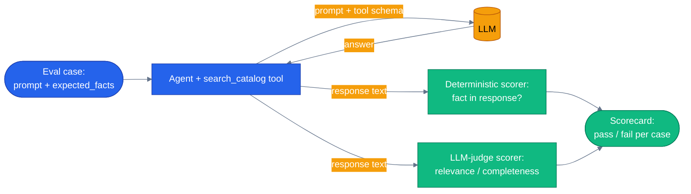

# Chapter 26 — Evals

This chapter builds a small eval suite: a list of test prompts, each paired with a fact a script can check, run against an agent and scored the same way every time.

**You will learn to:**

- Write an eval case as a prompt plus a fact a script can check
- Score a response deterministically, with a substring check that is free to run on every commit
- Shape an LLM-judge verdict so a stub and a real judge are interchangeable
- Spot a scorer that reports good numbers while measuring nothing

## Why this chapter

Every prior chapter ends the same way: run the script, read the answer, decide by eye whether it
looks right. That works for learning a mechanic, but it does not scale. "I tried a prompt and it
looked correct" tells you nothing about the cases you did not try. It also does not survive a
prompt change, a model upgrade, or someone else re-running your code six months later.

This chapter turns "looks right" into a number. For the argument on why a demo is not evidence,
and a worked example of a scorer that looked rigorous but measured the wrong thing, see
[`docs/concepts/12-evaluation.md`](../../docs/concepts/12-evaluation.md). This chapter covers the
mechanics of the eval loop itself.

## Prerequisites

- Completed [Chapter 02 — Add Tools](../02-add-tools/)
- No API key needed: with none set, `main.py` replays recorded responses and prints one line saying so. To use a live model instead, put `OPENAI_API_KEY` (or the `AZURE_OPENAI_*` variables) in the repo-root `.env`

## The concept

A good eval case is a **prompt plus a checkable fact**, not a prompt plus a vibe. "Ask about the
Wireless Mouse and see if the answer sounds reasonable" is not an eval case, because there is
nothing a script can assert. "Ask about the Wireless Mouse and check that `24.99` appears in the
response" is one. It pairs a prompt (`EvalCase.prompt`) with an `expected_facts` list a scorer can
search for. This chapter's `EVAL_CASES` list uses that shape. A case that cannot fail tests
nothing.

Scoring then splits into two tiers.

**Deterministic scoring** is `score_deterministic()` in this chapter's `main.py`: a mechanical
substring check. Did the expected fact appear, yes or no. It is free, exact, and safe to run in CI
on every commit. It can only check what is mechanically checkable, and says nothing about whether
the surrounding prose makes sense.

**LLM-judge scoring** asks a second model call to grade something with no mechanical answer, such
as whether the response addressed what was asked. It costs money and is not perfectly reproducible
between two runs of the same input. Reserve it for what deterministic checks cannot reach.

One rule sits above both tiers: an eval must run the same code path a live request runs. Suppose
a harness calls the agent's tool functions through its own loop instead of going through
`agent.run()`. It skips the guardrail middleware, the grounding verification (the check that an
answer's facts match the data), and everything else the application runs on each request. That
suite can report a clean pass while testing a system that is not the one users talk to. The
`ProductionRunner` in the capstone (the full application in this repo) exists to prevent this, and
the last section shows where it lives.



The two scorers run over the same response. One is cheap and exact; the other catches what the
first cannot.

## Python

Run from the repo root. The shared `tutorials/` uv project covers every chapter, so one `uv sync`
is enough:

```bash
uv sync --project tutorials
uv run --project tutorials python tutorials/26-evals/python/main.py
```

You should see:

```
No LLM key found - replaying the recorded fixture (set OPENAI_API_KEY or the AZURE_OPENAI_* variables for a live run).
Case                      Deterministic  Judge   Notes
--------------------------------------------------------------------------------
mouse-price               1.00           1.00    Response covers every expected fact.
keyboard-stock            1.00           1.00    Response covers every expected fact.
hub-out-of-stock          1.00           1.00    Response covers every expected fact.
headphones-price          1.00           1.00    Response covers every expected fact.
charger-price-and-stock   1.00           1.00    Response covers every expected fact.
--------------------------------------------------------------------------------
5/5 cases fully grounded (deterministic score == 1.0)
```

Source: [`python/main.py`](./python/main.py). The demo agent is a small e-commerce Q&A assistant
over a five-item in-memory catalog, with one tool:

```python
@tool(name="search_catalog", description="Look up the price and stock count for a product in the catalog by name.")
def search_catalog(
    product_name: Annotated[str, Field(description="The product name to look up, e.g. 'Wireless Mouse'.")],
) -> str:
    item = CATALOG.get(product_name.strip().lower())
    if item is None:
        return f"No catalog entry for '{product_name}'."
    availability = "in stock" if item["stock"] > 0 else "out of stock"
    return f"{product_name.title()}: ${item['price']:.2f}, {item['stock']} units ({availability})."
```

Each `EvalCase` pairs a prompt with the exact facts the answer must contain: a price, a stock
count, or an "out of stock" phrase. `run_eval_suite()` asks the agent each question, then scores
the response two ways:

- `score_deterministic()` checks that every expected fact appears as a literal substring,
  ignoring case.
- `judge_response_stub()` returns a structured `JudgeVerdict` (`score`, `reasoning`,
  `failure_mode`). It has the same shape as `evals/scorers/llm_judge.py::JudgeVerdict` in the
  application, computed here with a cheap heuristic instead of a second model call.

Swap the stub's body for a real `judge.run(...)` call and nothing else in the loop changes.
`main()` runs the suite once and prints the scorecard above.

## .NET

Source: [`dotnet/Program.cs`](./dotnet/Program.cs).

```bash
# From the repo root. Needs no API key.
dotnet test tutorials/26-evals/dotnet/tests/Evals.Tests.csproj

# Needs an API key in the repo-root .env. Note the cd.
cd tutorials/26-evals/dotnet
dotnet run
```

`dotnet run` calls a live model, so it needs `OPENAI_API_KEY` or the `AZURE_OPENAI_*` variables.
Run the tests first if you have no key.

The same two tiers and the same structured `JudgeVerdict` shape, so the stub judge and a real one are drop-in replacements:

```csharp
public sealed record JudgeVerdict(double Score, string Reasoning, string? FailureMode = null);
```

`Main` returns non-zero when any case fails, so you can use it as a CI gate.

Testing an eval harness means scoring the scorer. A broken scorer does not look broken: it reports numbers, the numbers look reasonable, and the suite goes green while measuring nothing. So the tests target the ways a scorer lies:

- a case with no expected facts scores `1.0` (defensible, and a trap — a suite of empty cases reports a perfect pass rate)
- the deterministic tier passes an answer that is rude and off-topic as long as the number appears in it
- `"15"` matches inside `"150"`
- the stub judge agrees with the deterministic tier *by construction*, which is exactly what a real judge must not do — two scorers that always agree are one scorer costing twice as much

Two more tests guard the suite against itself: every case must have at least one checkable fact, and case ids must be unique.

## Gotchas

- **A fabricated answer scores the same as a real one.** That is what you get from a scorer that
  does not check the thing it claims to check, such as a groundedness score of `1.0` whenever any
  tool was called. In the application, `evals/scorers/db_groundedness.py::score_from_report()`
  scores `verified_claims / total_claims` from the grounding report instead. This chapter's
  `score_deterministic()` is the same idea in miniature: it checks for the literal fact string,
  not "a tool was called".
- **A safety case passes without exercising the guardrail.** Eval evidence is only as good as the
  code path it runs. An eval routed around production middleware can report green for a red-team
  case that never met the guardrails. Ask what code path an eval runs through, not only whether it
  passes.
- **A wrong price still passes.** That happens when the expected fact is vague. `EVAL_CASES` uses
  exact numbers (`"24.99"`, `"15"`) or an unambiguous phrase (`"out of stock"`). A target like
  "mentions the mouse" would pass for any price.
- **The judge column always agrees with the deterministic column.** `judge_response_stub()` is a
  heuristic stand-in that keeps this chapter's recorded fixtures small. It is not a judge. Real
  code should call `evals/scorers/llm_judge.py::judge_response()`, which asks a model.
- **There are more fixture files than eval cases.** Replay fixtures are keyed per request, not per
  case. With a tool in play, each case makes more than one model call: one where the model decides
  to call `search_catalog`, one where it writes the answer from the tool result.

## Tests

```bash
uv run --project tutorials pytest tutorials/26-evals/python/tests -v
dotnet test tutorials/26-evals/dotnet/tests/Evals.Tests.csproj
```

Run both from the repo root. Neither needs an API key.

The tests score the scorers: full, partial and zero matches for the deterministic tier, and the
stub judge's coverage bands. They also check that every eval case has a checkable fact, and replay
the whole suite against recorded model responses. Tests against a live model are skipped unless
credentials are present.

## How this shows up in the capstone

The application has its own eval suite at `agents/python/evals/`, which CI runs against recorded
responses, without an API key, to catch regressions before they ship.

`agents/python/evals/harness.py:136` is the `ProductionRunner` class, and
`agents/python/evals/harness.py:159` is its `run()` method. It sends every eval case through the
dispatch a live request uses: `orchestrator.modes.get_mode("tool").run(...)` for the orchestrator
and `shared.agent_host._run_agent_native()` for each specialist. These are the entry points
[Chapter 21](../21-capstone-tour/) tours, so a passing eval means the deployed system passed.

The two scorer tiers this chapter mirrors are modules there:

- `agents/python/evals/scorers/db_groundedness.py:26` is `score_from_report()`, the deterministic
  tier. It computes `verified_claims / total_claims` from the `GroundingReport` the grounding
  middleware already produced during the run, so it costs no extra database round trip.
- `agents/python/evals/scorers/llm_judge.py:49` is `judge_response()`, the LLM-judge tier. It
  sends the question, the expected fields and the response to a second model, and parses the
  result into the `JudgeVerdict` Pydantic model at `agents/python/evals/scorers/llm_judge.py:33`.
  This chapter's stub `JudgeVerdict` copies that shape.

## What's next

- Related: [Chapter 21 — Capstone Tour](../21-capstone-tour/) for a guided walk through where
  every chapter's pattern lives in the application.
- Concept deep-dive: [`docs/concepts/12-evaluation.md`](../../docs/concepts/12-evaluation.md)
- Full source: [`python/`](./python/)
- Shared: [Mermaid style guide](../_shared/mermaid-style-guide.md) · [Jargon glossary](../_shared/jargon-glossary.md)

<!-- BEGIN GENERATED CHAPTER NAV -->
---

**Previous:** [Chapter 25 — Guardrails](../25-guardrails/) · [Series index](../README.md) · **Next:** [Chapter 27 — Agent-as-tool](../27-agent-as-tool/)
<!-- END GENERATED CHAPTER NAV -->
