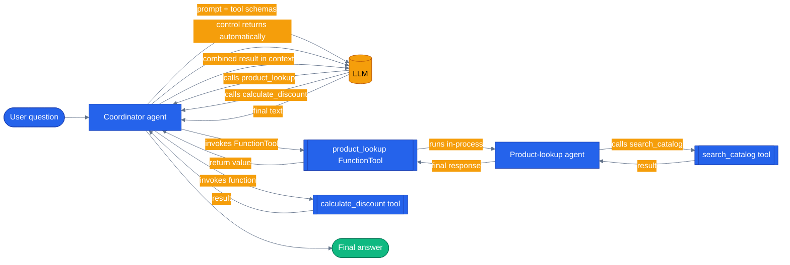

# Chapter 27 — Agent-as-tool

This chapter wraps one agent as a tool that a second agent can call. The second agent gets the answer back as an ordinary tool result and carries on with its own work.

**You will learn to:**

- Turn an `Agent` into a tool with `Agent.as_tool()` and give it to another agent
- Show that control returns to the calling agent, which can then call other tools
- Choose between an in-process agent tool, an agent called over HTTP, and a handoff

## Why this chapter

The multi-agent patterns earlier in this series do one of two things. Some cross a process
boundary: one agent calls another over HTTP, which is called A2A (agent-to-agent) and is the
subject of Chapter 23. Others hand control away: in Chapter 14's `HandoffBuilder` mesh, the
receiving agent takes over the conversation and decides for itself when to hand back.

Neither fits a common case: "this agent needs another agent's capability as one well-defined step,
in the same process, and then wants to keep going."

MAF has a third option for that case: `Agent.as_tool(...)`. It wraps any `Agent` as an ordinary
`FunctionTool`, the same shape as a `@tool`-decorated function, that another agent can add to its
own `tools=[...]`. There is no network hop and no handoff bookkeeping. Control returns to the
caller the moment the wrapped agent finishes, like any other tool call.

This chapter builds a small coordinator agent that calls a product-lookup agent this way. The
coordinator gets the product back, then calls a second, ordinary tool to compute a discount. An
agent that had taken over the conversation through a handoff could not be made to do that for it.

## Prerequisites

- Completed [Chapter 02 — Adding Tools](../02-add-tools/)
- No API key needed: with none set, `main.py` replays recorded responses and prints one line
  saying so. To use a live model instead, put `OPENAI_API_KEY` (or the `AZURE_OPENAI_*` variables)
  in the repo-root `.env`

## The concept

Three patterns in this repo all look like "one agent uses another", and they are easy to confuse.
[`docs/concepts/06-orchestration-patterns.md`](../../docs/concepts/06-orchestration-patterns.md)
covers the first and the third. Side by side:

- **A2A-as-tool** is cross-process. It is the default `tool` orchestration mode of the capstone
  (the full application in this repo). The orchestrator's model calls `call_specialist_agent`
  (`agents/python/orchestrator/agent.py:93`), which sends an HTTP request to a specialist. The
  callee is a separate running service with its own port, its own process and its own failure
  modes, such as timeouts and refused connections. It only *looks* like a tool call from the
  model's point of view.
- **`Agent.as_tool()`** (this chapter) is in-process. `agent.as_tool(...)` wraps an already-built
  `Agent` into a `FunctionTool`. No socket is opened and nothing is serialized across a process
  boundary. The wrapped agent runs in the same Python process, in the same `await`, as the caller.
  Control returns to the caller once the wrapped agent produces its final response.
- **Handoff** (`HandoffBuilder`, Chapter 14) *transfers* control. The target agent does not answer
  and return a value. It takes over the conversation and can hand back, hand off again, or keep
  talking. The caller does not get control back automatically.

`Agent.as_tool()` gives you composition without the overhead of the other two. You get a small,
well-scoped agent, with its own instructions, tools and reasoning, usable as one callable
capability inside a bigger agent's toolset. There is no HTTP client, no mesh of `add_handoff(...)`
edges to maintain, and no risk of an unbounded back-and-forth.

Use it when the two agents share a process and a deployment, and the relationship is "call it, get
an answer, move on". Use A2A when the callee is a separate service: a different deployment,
different scaling, a different team. Use handoff when the interaction needs more than one round
trip between the two agents, or when the receiving agent should keep driving the conversation.



The wrapped agent never keeps the conversation. Once `product_lookup` returns its string, the
coordinator is back in charge and free to call a second, unrelated tool before answering.

## Python

Run from the repo root. The shared `tutorials/` uv project covers every chapter, so one `uv sync`
is enough:

```bash
uv sync --project tutorials
uv run --project tutorials python tutorials/27-agent-as-tool/python/main.py
```

You should see:

```text
No LLM key found - replaying the recorded fixture (set OPENAI_API_KEY or the AZURE_OPENAI_* variables for a live run).
Q: Look up the Wireless Headphones, then tell me the price after a 20% discount.
A: The Wireless Headphones are priced at $149.99. After applying a 20% discount, the price comes to $119.99.
```

To produce that answer, the coordinator calls `product_lookup` and gets back
`"Wireless Headphones: $149.99, category Electronics, 42 in stock."`. Still in control, it then
calls `calculate_discount(149.99, 20)` and folds both results into one reply. The product-lookup
agent never had to hand anything back, because it never had control.

Source: [`python/main.py`](./python/main.py). The product-lookup agent is an ordinary `Agent`
with one ordinary tool:

```python
@tool(name="search_catalog", description="Look up a product in the catalog by name.")
def search_catalog(
    name: Annotated[str, Field(description="The product name to look up, e.g. 'Wireless Headphones'.")],
) -> str:
    item = CATALOG.get(name.lower().strip())
    if item is None:
        return f"No catalog entry for '{name}'."
    return (
        f"{name.title()}: ${item['price']:.2f}, category {item['category']}, "
        f"{item['stock']} in stock."
    )


def build_product_lookup_agent(client: object | None = None) -> Agent:
    return Agent(
        client or _default_client(),
        instructions=PRODUCT_LOOKUP_INSTRUCTIONS,
        name="product-lookup-agent",
        description="Looks up product price, category, and stock in the catalog.",
        tools=[search_catalog],
    )
```

`build_agent()` is the point of the chapter. It wraps that agent with `.as_tool()` and puts the
resulting `FunctionTool` in the coordinator's `tools=[...]`, next to an ordinary local tool:

```python
def build_agent(client: object | None = None) -> Agent:
    resolved_client = client or _default_client()
    product_lookup_agent = build_product_lookup_agent(resolved_client)
    product_lookup_tool = product_lookup_agent.as_tool(
        name="product_lookup",
        description="Delegate a product question to the product-lookup specialist agent.",
        arg_name="task",
    )
    return Agent(
        resolved_client,
        instructions=COORDINATOR_INSTRUCTIONS,
        name="coordinator-agent",
        tools=[product_lookup_tool, calculate_discount],
    )
```

## .NET

Source: [`dotnet/Program.cs`](./dotnet/Program.cs).

```bash
# From the repo root. Needs no API key.
dotnet test tutorials/27-agent-as-tool/dotnet/tests/AgentAsTool.Tests.csproj

# Needs an API key in the repo-root .env. Note the cd.
cd tutorials/27-agent-as-tool/dotnet
dotnet run
```

`dotnet run` calls a live model, so it needs `OPENAI_API_KEY` or the `AZURE_OPENAI_*` variables.
Run the tests first if you have no key.

`AIAgentExtensions.AsAIFunction(...)` is the .NET counterpart to Python's `Agent.as_tool(...)`:

```csharp
AIFunction productLookupTool = productLookup.AsAIFunction(new AIFunctionFactoryOptions
{
    Name = "product_lookup",
    Description = "Delegate a product question to the product-lookup specialist agent.",
});
```

The coordinator sees an `AIFunction` like any other. It has no idea there is an agent, and a second model call, behind it.

Compare this with [Chapter 14](../14-handoff-orchestration/). A handoff **transfers control**, so the specialist answers the user directly. A wrapped agent leaves control with the coordinator, which gets a string back and carries on, free to call other tools and compose the results. The user never learns a second agent existed.

`The_Wrapped_Agents_Own_Tools_Are_Not_Exposed_To_The_Coordinator` is the assertion that matters. If `search_catalog` leaked upward, the coordinator could bypass the specialist, and eventually would, on some prompt nobody tested.

Both agents share one chat client, so the demo needs one provider and one credential. The specialist's turns are billed to the same account: agent-as-tool hides the second agent from the user, not from the invoice.

## Gotchas

- **You cannot keep talking to the wrapped agent.** `.as_tool()` returns a `FunctionTool`, not a
  live handle. Every invocation runs the wrapped agent fresh and returns one string. With
  `propagate_session=True` it forwards the caller's session instead. If the two agents need to go
  back and forth more than once per turn, use `HandoffBuilder` (Chapter 14).
- **The coordinator passes a vague or malformed task.** The calling model sees a single string
  argument named by `arg_name`, which defaults to `"task"`, not `"input"` or `"query"`. Its
  description is auto-generated (`f"Task for {tool_name}"`) unless you set `arg_description`.
  A vague description produces vague task strings.
- **The wrapped agent does not remember the previous call.** `propagate_session=False` is the
  default, so the wrapped agent gets an independent session per call. For a narrow lookup like
  `product_lookup` that is what you want: it should not collect unrelated conversation history.
- **The coordinator calls the wrapped agent too often, or not at all.** The model deciding whether
  to call `product_lookup` sees only `name`, `description` and the `task` argument's schema. It
  never sees the wrapped agent's `instructions`. A vague tool `description` gets the same result
  as on any under-described tool (see Chapter 02's Gotchas).
- **You will not find `as_tool()` in the application.** Its agents are separate services, so it
  composes them over HTTP instead. The last section shows the code.

## Tests

```bash
uv run --project tutorials pytest tutorials/27-agent-as-tool/python/tests -v
dotnet test tutorials/27-agent-as-tool/dotnet/tests/AgentAsTool.Tests.csproj
```

Run both from the repo root. Neither needs an API key.

The tests prove that `.as_tool()` returns a `FunctionTool`, that the coordinator holds both
`product_lookup` and `calculate_discount`, and that the wrapped agent's own tool stays private to
it. A replay test runs the lookup-then-discount conversation against recorded model responses.
Tests against a live model are skipped unless credentials are present.

## How this shows up in the capstone

This chapter is the closest one to the application's default orchestration mode, `tool`, shown in
the chat UI's Mode dropdown as "Tool Router". When you send a chat message in that mode, the
orchestrator's model picks a specialist agent and calls it as a tool. The specialist's answer
comes back as the tool result, and the orchestrator uses it in its reply.

The idea is the one you just built: an agent, offered to another agent's model as a tool. The
implementation differs in one respect. The application's specialists are separate services, so the
tool is an A2A call over HTTP, not an in-process `Agent.as_tool()` wrapper. The application does
not call `as_tool()` anywhere.

`agents/python/orchestrator/agent.py:93` is `call_specialist_agent`, the tool the orchestrator's
model calls:

```python
async def call_specialist_agent(
    agent_name: Annotated[str, Field(description="Name of the specialist agent to call")],
    message: Annotated[str, Field(description="The message/request to send to the specialist agent")],
) -> str:
    """Call a specialist agent and return its response."""
    url = AGENT_REGISTRY.get(agent_name)
```

From the model's point of view it has the same shape as this chapter's `product_lookup` tool:
text in, text out, and control returns to the caller. Everything after
`url = AGENT_REGISTRY.get(...)` is a network request to another process
(`agents/python/orchestrator/agent.py:117-119` and the streaming and blocking paths below it), not
an in-process `agent.run()`.

So the two versions share a tool-shaped interface and differ underneath. Use `as_tool()` when both
agents live in one process, as in this chapter. Use the application's approach when they are
deployed apart. [Chapter 23](../23-a2a-protocol/) covers the HTTP side.

## What's next

- Related: [Chapter 14 — Handoff Orchestration](../14-handoff-orchestration/) for when control
  should transfer instead of returning automatically.
- Concepts: [Orchestration patterns](../../docs/concepts/06-orchestration-patterns.md)
- Full source: [`python/`](./python/)
- Shared: [Mermaid style guide](../_shared/mermaid-style-guide.md) · [Jargon glossary](../_shared/jargon-glossary.md)

<!-- BEGIN GENERATED CHAPTER NAV -->
---

**Previous:** [Chapter 26 — Evals](../26-evals/) · [Series index](../README.md) · **Next:** [Chapter 28 — Reflection and Critique](../28-reflection-and-critique/)
<!-- END GENERATED CHAPTER NAV -->
