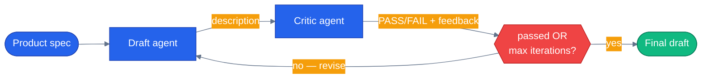

# Chapter 28 — Reflection and Critique

This chapter builds a loop in which one agent writes a draft, a second agent grades it against named criteria, and the first agent revises until the draft passes or a hard limit is reached.

**You will learn to:**

- Wire a draft agent and a critic agent into a revise-until-pass loop
- Parse a critic's verdict so that anything unclear counts as a fail
- Bound the loop with a maximum iteration count so it always stops
- Judge when a second model call per answer is worth paying for

## Why this chapter

Every earlier chapter treats the model's first answer as the answer. Chapter 24 added a
verification step, but it only *checks* the answer afterwards. It never gives the model a second
try.

Some outputs benefit from a second try. A product description that must mention the price, name a
feature and stay under a word limit is the kind of thing a model gets partly right the first time.
It gets it fully right the second time, once it is told what it missed.

This chapter builds that second try as a loop: draft, have a critic score the draft against named
criteria, revise using the critic's feedback, score again. The loop has a hard maximum, so "try
again" can never become "try forever".

It is also the first chapter where your code, not the framework, drives a multi-turn loop. MAF
bounds its own tool-calling loop for you (Chapter 02). Nothing bounds this one except the constant
you write by hand.

## Prerequisites

- Completed [Chapter 02 — Adding Tools](../02-add-tools/) (the request/response shape of a single
  agent call)
- Completed [Chapter 24 — RAG and Grounding](../24-rag-and-grounding/). It checks an answer after
  generation without feeding the result back. This chapter closes that loop.
- No API key needed: with none set, `main.py` replays recorded responses and prints one line saying so. To use a live model instead, put `OPENAI_API_KEY` (or the `AZURE_OPENAI_*` variables) in the repo-root `.env`

## The concept

Reflection (also called a critic loop, or self-refine) is three roles wired into a cycle:

1. **Draft** — an agent produces a first attempt at the output.
2. **Critique** — a second pass scores the draft against explicit, named criteria and returns
   specific feedback, not just a pass or fail. The second pass can be the same agent with
   different instructions or, as here, a separate critic agent.
3. **Revise** — if the critique fails, the draft agent gets another turn with the critic's
   feedback in the prompt, and the cycle repeats.

The loop ends one of two ways: the critique passes, or a hard `MAX_ITERATIONS` cap is reached.
That cap is what makes the pattern safe to ship.

Other loops in this series have a bound the framework enforces. Chapter 02's tool-calling loop
stops when the model stops requesting tools. The two workflow modes in the capstone (the full
application in this repo), `workflows/pre_purchase.py` and `workflows/return_replace.py`, pass a
message from one step to the next and finish without revisiting a step.

A critic loop has no such bound, because revisiting a step is its purpose. A critic that never
says "pass" keeps the loop running for as long as you let it. The cause might be a rubric that
cannot be satisfied, a model that repeats the same mistake, or an impossible constraint. Each turn
costs one draft call and one critic call. `MAX_ITERATIONS` in this chapter's `main.py` is the
whole mitigation.

Reflection earns its cost when the output has specific, checkable quality criteria and getting
them right matters more than answering fast. Examples: a product description with a price and a
word limit, a support reply that must not promise a refund, a summary that must cite a source. It
is wasted on a quick conversational reply. There is nothing for a critic to grade, and you pay for
extra model calls to approve something one call already got right.



The cycle back into `draft` is the whole chapter. `pass_check` is the only way out, and it has
*two* exit conditions: the critic passes the draft, or `MAX_ITERATIONS` is reached whatever the
verdict.

## Python

Run from the repo root. The shared `tutorials/` uv project covers every chapter, so one `uv sync`
is enough:

```bash
uv sync --project tutorials
uv run --project tutorials python tutorials/28-reflection-and-critique/python/main.py
```

You should see:

```
No LLM key found - replaying the recorded fixture (set OPENAI_API_KEY or the AZURE_OPENAI_* variables for a live run).
Product: Aurora Desk Lamp ($39.99)
Criteria: mentions price, mentions a feature, <= 40 words

--- Iteration 1/3 ---
Draft: Illuminate your workspace with the Aurora Desk Lamp, featuring adjustable color temperature and a convenient touch dimmer. USB-C charging port keeps your devices powered. Modern, versatile, and perfect for any desktop—all for just $39.99.
Critic: PRICE=PASS FEATURE=PASS LENGTH=PASS
Result: PASS

Passed after 1 iteration(s). Final description:
Illuminate your workspace with the Aurora Desk Lamp, featuring adjustable color temperature ...
```

`main()` prints each iteration's draft, the critic's verdict per criterion, and the feedback that
feeds the next revision. The recorded run passes on the first iteration. With a live model, a
stricter word limit or a product with no listed features produces a `FAIL` first and a visible
revision second.

Source: [`python/main.py`](./python/main.py). There are two agents with one instructions string
each. The draft agent writes. The critic agent grades against three named criteria in a fixed,
parseable format:

```python
CRITIC_INSTRUCTIONS = (
    "You are a strict copy editor grading a product description against three named criteria: "
    "PRICE (does it mention the exact price given), FEATURE (does it mention at least one of "
    "the listed features), LENGTH (is it at or under the given word limit). "
    "Respond in EXACTLY this format, one line per criterion, nothing before or after it:\n"
    "PRICE: PASS or FAIL\n"
    "FEATURE: PASS or FAIL\n"
    "LENGTH: PASS or FAIL\n"
    "FEEDBACK: one sentence covering every FAIL, or 'none' if all three pass\n"
    "Grade exactly what the text says — do not soften a FAIL into a PASS to be polite."
)
```

`parse_critique()` turns that text into a `CritiqueResult` the loop can branch on. Any criterion
the critic does not clearly mark `PASS` counts as a `FAIL`:

```python
def parse_critique(text: str) -> CritiqueResult:
    verdicts = {m.group(1).upper(): m.group(2).upper() == "PASS" for m in _CRITERION_RE.finditer(text)}
    feedback_match = _FEEDBACK_RE.search(text)
    feedback = feedback_match.group(1).strip() if feedback_match else ""
    return CritiqueResult(
        price_ok=verdicts.get("PRICE", False),
        feature_ok=verdicts.get("FEATURE", False),
        length_ok=verdicts.get("LENGTH", False),
        feedback=feedback,
    )
```

The loop drafts once, then critiques and revises up to `max_iterations` times. It stops as soon as
a critique passes:

```python
async def run_reflection_loop(
    draft_agent: Agent, critic_agent: Agent, product: Product, *, max_iterations: int = MAX_ITERATIONS
) -> list[Iteration]:
    iterations: list[Iteration] = []
    draft = await ask(draft_agent, draft_prompt(product))
    for number in range(1, max_iterations + 1):
        critique_text = await ask(critic_agent, critic_prompt(product, draft))
        critique = parse_critique(critique_text)
        iterations.append(Iteration(number=number, draft=draft, critique=critique))
        if critique.passed or number == max_iterations:
            break
        draft = await ask(draft_agent, revise_prompt(product, draft, critique))
    return iterations
```

## .NET

Source: [`dotnet/Program.cs`](./dotnet/Program.cs).

```bash
# From the repo root. Needs no API key.
dotnet test tutorials/28-reflection-and-critique/dotnet/tests/Reflection.Tests.csproj

# Needs an API key in the repo-root .env. Note the cd.
cd tutorials/28-reflection-and-critique/dotnet
dotnet run
```

`dotnet run` calls a live model, so it needs `OPENAI_API_KEY` or the `AZURE_OPENAI_*` variables.
Run the tests first if you have no key.

The same loop, the same hard cap, and the same parsing rule: any criterion the critic does not clearly mark `PASS` is treated as `FAIL`:

```csharp
return new CritiqueResult(
    PriceOk: verdicts.GetValueOrDefault("PRICE"),
    FeatureOk: verdicts.GetValueOrDefault("FEATURE"),
    LengthOk: verdicts.GetValueOrDefault("LENGTH"),
    Feedback: feedback.Success ? feedback.Groups[1].Value.Trim() : string.Empty);
```

That default has a cost: a critic whose output drifts causes extra revisions. The alternative is much worse. A parser that defaults to `PASS` turns an unreadable critique into a silent approval, and the loop stops enforcing anything while still looking like it works.

The tests are shaped around the two ways an unbounded loop goes wrong: it never stops, or it stops for the wrong reason. One of them is an off-by-one. `Hitting_The_Cap_Does_Not_Spend_A_Revision_Nobody_Grades` asserts exactly six calls for a three-iteration run (1 draft + 3 critiques + 2 revisions). A third revision after the final critique would be invisible in the output and show up only on the invoice.

## Gotchas

- **The loop never stops, and the token bill grows with it.** That is what happens without the
  `MAX_ITERATIONS` cap, or with one set too high, when the critic never says `PASS`. A critic loop
  has no stopping condition from the framework. `test_run_reflection_loop_respects_max_iterations_cap`
  proves the loop stops even when the critic never passes.
- **A garbled critique approves a bad draft.** That is the risk if a missing criterion counts as a
  pass. `parse_critique()` defaults every criterion to `False` unless the critic's text marks it
  `PASS`. When the critic ignores the format entirely, the loop revises or hits the cap; it does
  not crash. Critic instructions are always one bad model turn away from an unparseable response.
- **You look for a "critic agent" class in MAF and find none.** `build_draft_agent()` and
  `build_critic_agent()` are two ordinary `Agent` objects. Nothing links them except the `for`
  loop in `run_reflection_loop()`, which feeds one's output into the other's next prompt. One
  agent with two instruction strings works the same way.
- **Each revision looks like the last one.** Revision quality depends on specific feedback.
  `revise_prompt()` puts `critique.feedback`, the critic's one-sentence explanation, into the next
  draft prompt. A critic that returns a bare `FAIL` gives the draft agent nothing to act on, and
  the loop regenerates similar drafts until the cap. Keep the feedback line in
  `CRITIC_INSTRUCTIONS`.
- **You will not find a "reflection" mode in the application's Mode dropdown.** This chapter is
  standalone code. See the last section for the nearest thing in the application.

## Tests

```bash
uv run --project tutorials pytest tutorials/28-reflection-and-critique/python/tests -v
dotnet test tutorials/28-reflection-and-critique/dotnet/tests/Reflection.Tests.csproj
```

Run both from the repo root. Neither needs an API key.

The tests prove the two properties that keep the loop safe. Fake agents show that it stops at the
cap when nothing passes and stops early on the first pass. Parser tests show that a missing or
unparseable verdict counts as a fail. A replay test runs the full loop against recorded model
responses, and tests against a live model are skipped unless credentials are present.

## How this shows up in the capstone

The application does not run a reflection loop as an orchestration mode. The nearest thing in it
is a tool that drafts text once, with no critic: `draft_seller_response`, which gives a seller a
starting reply to a customer review. It is at `agents/python/review_sentiment/tools.py:563`:

```python
@tool(
    name="draft_seller_response",
    description=(
        "Generate a professional response template for a negative review. Returns a template the seller can customize."
    ),
)
@requires_role("seller", "admin")
async def draft_seller_response(
    review_id: Annotated[str, Field(description="UUID of the review to respond to")],
) -> dict:
```

It picks one of a few fixed templates by the review's star rating and returns it for the seller to
edit. That is a single pass: no scoring, no revision, no loop.

A reflection loop is how you would extend it. A critic would grade the drafted reply against
criteria such as "does it address the specific complaint", "is the tone appropriate" and "does it
avoid promising something the seller cannot authorize". The draft would be revised until it
passed.

## What's next

- Related: [Chapter 24 — RAG and Grounding](../24-rag-and-grounding/) for a verification step that
  checks an answer without feeding back into another generation
- Related: [Chapter 26 — Evals](../26-evals/) for scoring criteria applied *outside* the request
  path, across a whole test set, instead of inside one response's revision loop
- Full source: [`python/`](./python/)
- Shared: [Mermaid style guide](../_shared/mermaid-style-guide.md) · [Jargon glossary](../_shared/jargon-glossary.md)

<!-- BEGIN GENERATED CHAPTER NAV -->
---

**Previous:** [Chapter 27 — Agent-as-tool](../27-agent-as-tool/) · [Series index](../README.md) · **Next:** [Chapter 29 — Planner-Executor](../29-planner-executor/)
<!-- END GENERATED CHAPTER NAV -->
